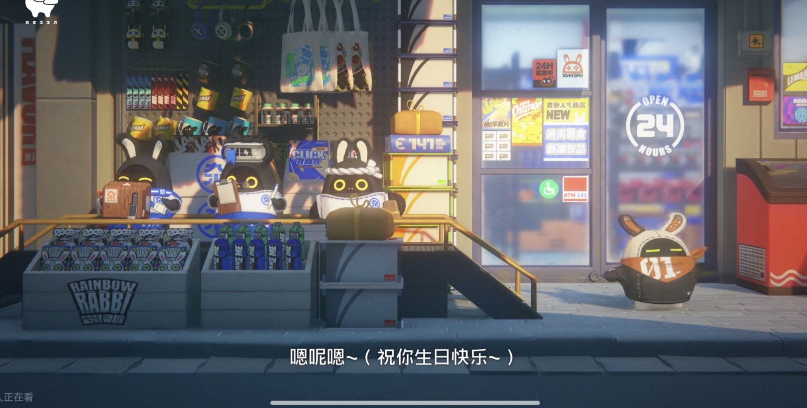
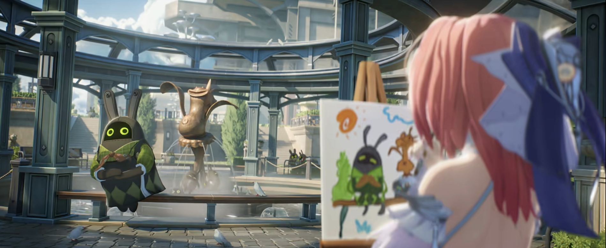
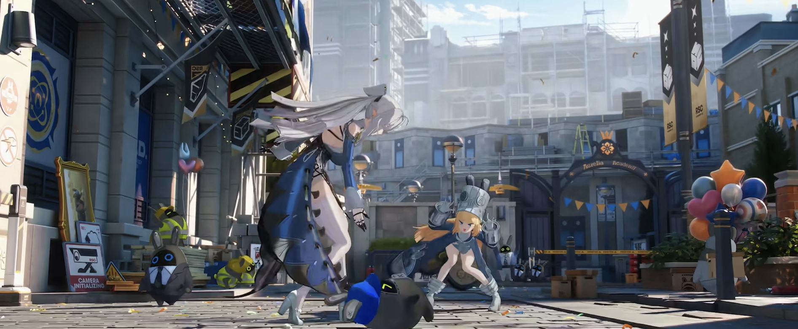
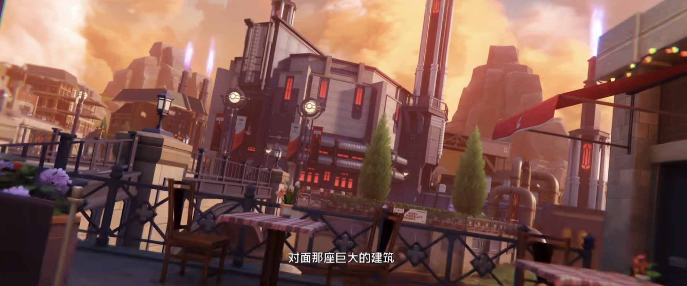
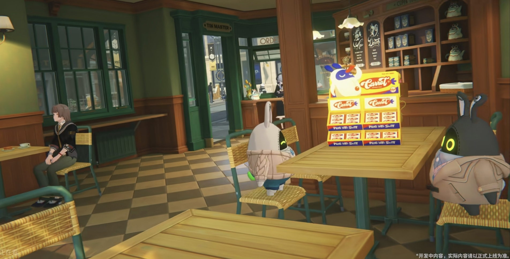
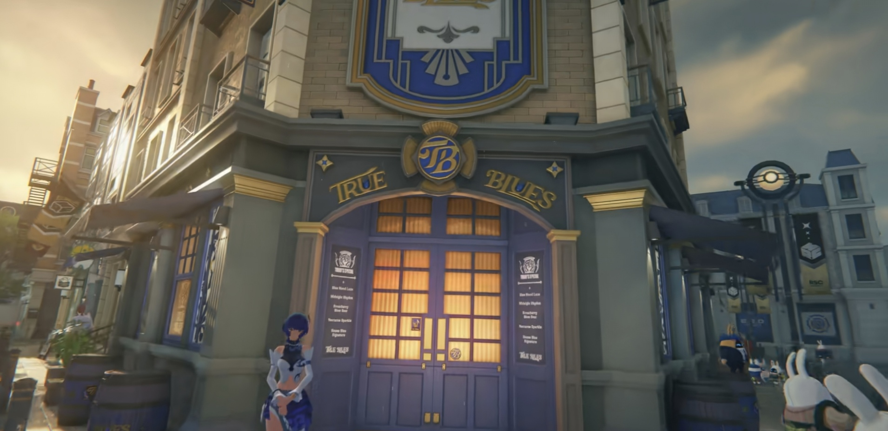
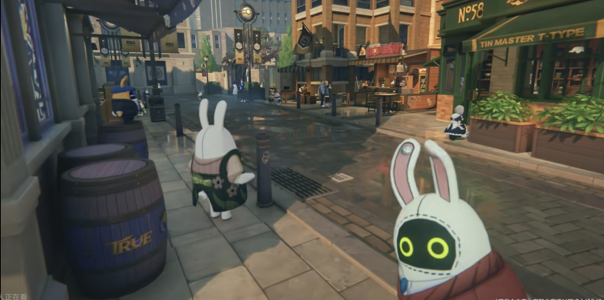
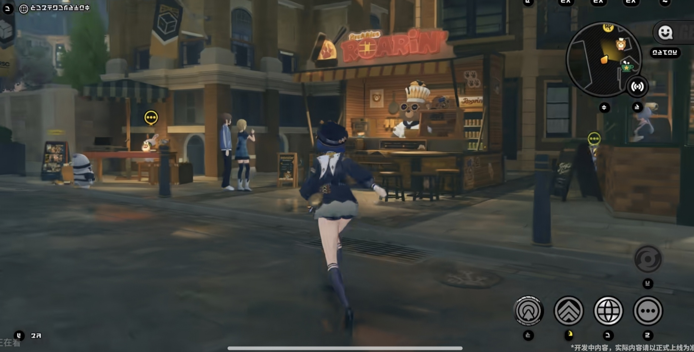

# 江浩提供的世界风格参考

2026-11-17，按江浩要求保存原目录「绝区零素材」内的全部 11 张 JPG，供 #252 中 C酱做风格拆解，以及林离后续建模、整合和验证时参考。

原始文件按 1.jpg 至 11.jpg 编号保存，没有裁切、缩放或重新编码；SHA256SUMS.txt 可校验原图。此独立参考分支用于保存和引用图片，不接入运行场景。

拆解重点：明暗与阴影、主辅配色、材质与边缘表现、建筑和道具细节密度、植被、水面以及前中远景层次。请结合当前世界区分可用着色调整的部分和需要几何/资产支撑的部分。

## 1.jpg

## 2.jpg

## 3.jpg

## 4.jpg

## 5.jpg

## 6.jpg

## 7.jpg

## 8.jpg

## 9.jpg

## 10.jpg

## 11.jpg

