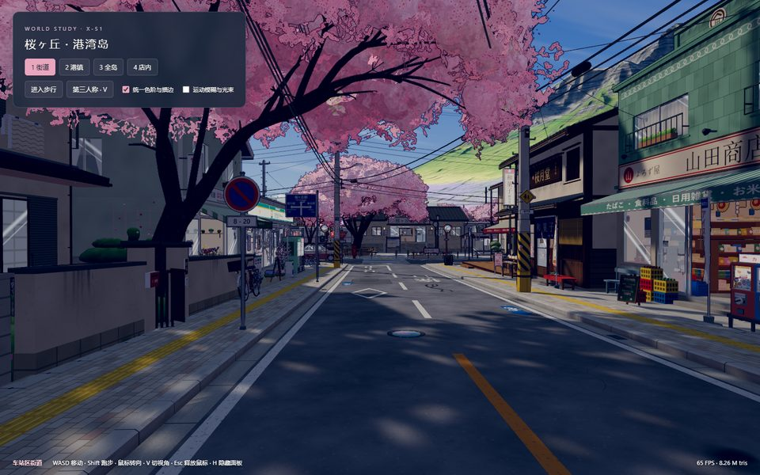
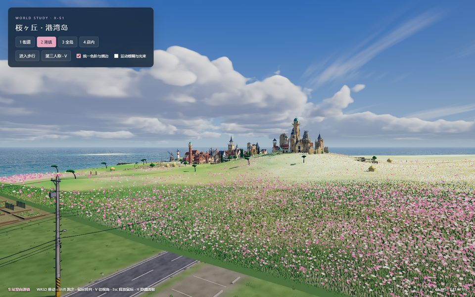
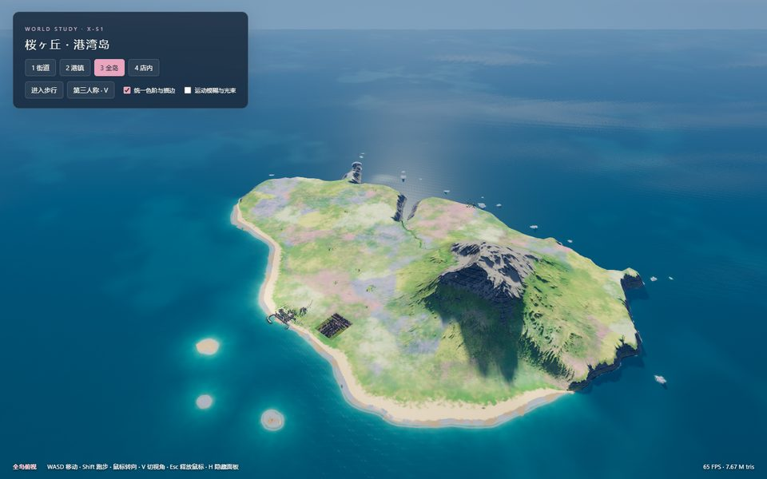
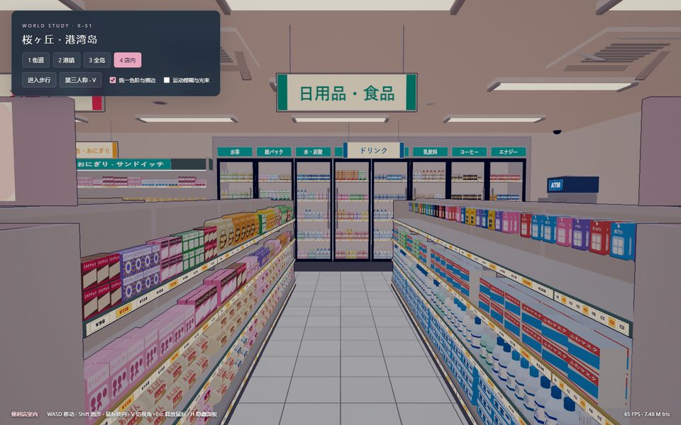

# X-51 第一段实测与精修入口

本机于 2026-11-16 完成组合场景验证。详细数字、检查结果及文件哈希见 [measurements.json](./evidence/measurements.json)，交付场景源码哈希见 [source-state.json](./evidence/source-state.json)，相对固定上游的改动集中在 [upstream-changes.patch](./evidence/upstream-changes.patch)。性能采集后未再编辑场景源码；完整源码哈希在采集后整理，不能作为当时已自动记录完整源码的证明。重录视频另外保存了启动时的 [源码清单](./evidence/video-source-manifest.json)，归档时逐项核对仍一致。原始全部日志、PNG、运行 profile 留在本机忽略的 `artifacts/`。

## 运行条件与基线

RTX 3060 Laptop GPU，Electron 44.9.0 / Chromium 152，WebGL2 / ANGLE D3D11；视口与画布均为 1440×900，pixelRatio=1。每次启动隔离浏览器 profile；资产下载时间不计入网页首载。原始项目保留各自默认质量：Petalwake 原版自动缩放开启，本轮 scale=1；Sakuragaoka 原版 High / MSAA4 / shadow4096，仍为 r170。组合统一 r187 / MSAA4 / shadow2048，meadow medium，未开启岛屿陆地水面反射。

首次可用绘制帧从文档导航开始计时，包含资源请求、几何构建、云烘焙与着色器编译。原站区的 CDN/Google Fonts 冷启动约占导航 60.23 秒，不能把 94.06 秒全部归因于几何构建。

| 场景 | 首次可用绘制帧 | FPS | draw calls/帧 | 三角形/帧 |
|---|---:|---:|---:|---:|
| Petalwake 原版 | 8.95 s | 64.60 | 195.16 | 7.577 M |
| Sakuragaoka 原版 | 94.06 s | 64.73 | 2267.03 | 9.368 M |
| 组合场景街道，15 秒采样 | 30.84 s | 64.93 | 1453.04 | 8.257 M |

计数来自全部 WebGL2 提交，包含阴影、反射和后处理，不等同屏幕上看得见的面数。FPS 含测量开销，接近相同的 RAF 调度水平，不能据此估算不受同步限制的 GPU 余量。这是本机短时测量，不是长时间稳定性或其他设备的承诺。

原版 Petalwake v4 留有一次 `menhir.glb net::ERR_ABORTED`，因此其原始报告 `ok=false`；Sakuragaoka 原版 `ok=true`。组合调试过程中也见过一次完整收取并成功解析的 `boulders.glb` 取消信号，没有据此编造底层原因。最终 `combined-camera-fixed` 采集 **ok=true / renderOk=true / transportClean=true，页面异常与网络失败均为 0**。

## 四个固定机位

机位坐标由 `src/main.js` 的 `worldBase.views` 唯一定义，preview 脚本调用同一组配置；每个机位独立采样超过 3 秒。

| 机位 | FPS | draw calls/帧 | 三角形/帧 |
|---|---:|---:|---:|
| 车站街道 | 65.00 | 1453.10 | 8.257 M |
| 站区望向港镇 | 65.00 | 794.00 | 7.810 M |
| 全岛俯视 | 65.00 | 1685.61 | 7.669 M |
| 便利店室内 | 65.00 | 881.98 | 7.537 M |






[四机位轮巡录像：1440×900、VP8 WebM，12.029 秒](./evidence/world.webm)。本 fixture 的 CDP 实际采集 392 张画面，用本机已有 FFmpeg 7.1 按原时间戳编码为 VFR；没有录桌面、补帧或加速。编码后仍为 392 帧，最大帧间隔 35ms，与源时间戳的最大误差 0.663ms。完整时间线见 [采集帧](./evidence/video-source-timeline.json) 与 [编码帧](./evidence/video-container-timeline.json)。录像独立采集，不把采帧及编码开销混入前面的 FPS。

另经 HTMLVideoElement 顺序回读并目视核对五张抽样画面，四个镜头正确且非黑。回读仪表在同时截图及分析像素时记录了 14 个播放呈现丢帧，因此不声称每个编码帧都被实际呈现；文件帧完整性由容器时间戳与采集时间戳逐项对齐核对。早期 MediaRecorder 路径出现过秒级编码缺帧，已拒收并移除该路径，失败产物仅保留在本机。

## 步行与镜头

初版第三人称每帧扫描完整渲染网格避障，真实 W 按键采样只有 **10.42 FPS，p95 107.7ms**。已将镜头避障移到现有 Physics 空间格及碰撞体，删除渲染网格扫描。相机球体扫掠覆盖旋转墙、圆柱、动态门、平台、坡道与地形，按近裁面尺寸留出安全距离。

| 真实按键段 | FPS | p95 帧时间 | W 按住后的水平位移 |
|---|---:|---:|---:|
| 第三人称，修复后 | 65.00 | 15.5 ms | 9.37 m / 约 3.11 s |
| 第一人称 | 65.00 | 15.5 ms | 9.37 m / 约 3.11 s |

两段记录到 `isTrusted=true` 的 KeyW 按下/抬起，未逐帧覆盖角色位置。切换视角的脚底位置差为 0。

11 项浏览器行为检查通过：真实便利店关门阻挡、靠近开门、旁侧墙体、连续入口通道、室内地板、第一人称眼高、第三人称跟随范围、切视角不移位、local/world 往返、真实店墙缩臂及近裁面安全距离、镜头不调用渲染 mesh.raycast。另有 8 项相机物理检查通过。

## 可精修范围与当前限制

- 着色入口：`src/look.js`；车站原调色库：`upstream/sakuragaoka/src/core/materials.js`；灯光和机位：`src/main.js`。基础色阶、深度描边与偏紫阴影可开关；运动模糊/god rays 默认关闭，可独立启停。两种风格共用 ACES 映射。
- 精修重点：街道阴影目前偏深；站区绿色边带及植被切线仍较整齐；港镇与站区的配色尚未做完整美术统一。描边使用真实深度，不包含原站区的法线边缘分量。这是着色对比底子，不宣称已达到最终画风。
- 步行只在站区核心范围内。铁路朝港镇方向，边缘裁切；没有把全岛步行导航、铁路线路或港镇室内做完。
- 原岛游戏任务、主角、人物、隐藏景点、海岸小景和完整陆地水面反射不在本轮组合范围。环境中的地藏、达摩、玩具及海报仍保留。
- 不接生产页面、世界规则、存档或契约。没有运行全仓生产测试；本轮验收针对独立 fixture、HTTP、渲染、物理、输入和媒体输出。

## 已执行的检查

```text
node scripts/prepare.cjs
  Petalwake 599 + Sakuragaoka 161 原始文件及两份归档哈希验证通过
node scripts/check-camera-physics.cjs
  8 camera physics checks passed
node scripts/baseline.cjs --scene=combined --electron=<已有Electron> --output=artifacts/combined-camera-fixed --timeout-ms=240000
  历史采集命令：Electron exited 0；11 项行为检查、真实按键、四机位和着色开关通过
  此次旧录像后来被拒收，性能/行为结果保留；当前脚本复现纯性能/截图时加 --stills
node scripts/baseline.cjs --scene=combined --video-only --video-ms=12000 --electron=<已有Electron> --ffmpeg=<已有FFmpeg> --output=artifacts/combined-video-ffmpeg --timeout-ms=240000
  Electron exited 0；仅重录视频，ok/renderOk/transportClean 均为 true
node scripts/verify-video.cjs --electron=<已有Electron> --video=artifacts/combined-video-ffmpeg/world.webm
  Video verifier exited 0
node --check <本轮自有脚本和修改模块>
  exit 0
git diff --check
  exit 0
```

本机本轮使用的 FFmpeg：`E:\AI\ComfyUI-aki-v3.2-core037\python\Lib\site-packages\imageio_ffmpeg\binaries\ffmpeg-win-x86_64-v7.1.exe`；完整编码参数及版本保存在 measurements.json。
