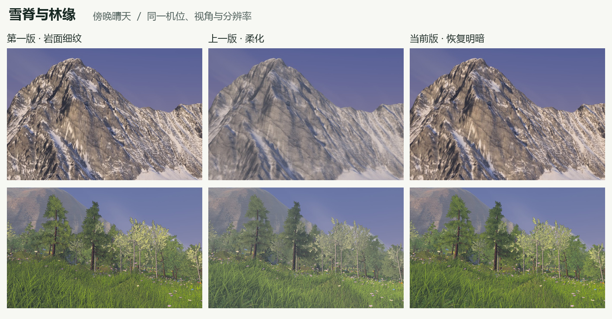

# X-51 海岛雪脊、林缘与原有聚落



图中从左到右对应 [第一版](https://github.com/aa15119557034/agent-review-room/commit/b3ab0988ed874124b1389c640835b7ac92e569e1)、[柔化版](https://github.com/aa15119557034/agent-review-room/commit/4c290b18b448817d1665ee2588bffbe42f6eb6f3)和[当前渲染源码](https://github.com/aa15119557034/agent-review-room/commit/5f8a426871e804509424135c3f1f6c17d730e3e5)。每列均为 1440 × 900 的 Electron 实机画面，固定傍晚晴天、风相位、机位、焦距与曝光。两排分别按相同矩形裁切缩放。完整雪脊原图依次为[第一版](./detailed-alpine.jpg)、[柔化版](./soft-alpine.jpg)、[当前版](./alpine.jpg)。[当前草甸](./meadow.jpg) · [林中近景](./woodland.jpg) · [雪沟](./couloir.jpg) · [林线](./treeline.jpg) · [海蚀拱门](./sea-arch.jpg)

雪脊取自 Schreckhorn 至 Lauteraarhorn 的 4 × 3 公里实测地形，缩至岛上约 1 × 0.75 公里，并逐渐过渡到原有山脚与火山口。当前岩雪材质保留岩壁折面和雪沟的明暗分界，减少细碎纹理，并沿用站区的色彩调校。草甸向落叶林、高处松林和裸岩渐变。15 片林地共有 5,007 株树，使用四个树种、八种树形，坡度、土壤湿度和原有聚落共同约束摆放。[地形及树木素材许可](../../THIRD-PARTY.md) · [改造前山地](./original-alpine.jpg) · [改造前草甸](./original-meadow.jpg) · [改造前同机位记录](./before.json)

## 原岛资产

| 聚落 | 已加载 / 原建筑与场景构件 | 已挂入场景 / 原几何分块 |
| --- | ---: | ---: |
| [Larkhaven](./larkhaven.jpg) | 433 / 433 | 57 / 57 |
| [Cairnwick](./cairnwick.jpg) | 101 / 101 | 14 / 14 |
| [The Meadows](./fields.jpg) | 188 / 188 | 32 / 32 |

港镇、农地、车站与站后五栋建筑均可在组合场景中查看。原岛独立摆件实装灯塔 1/1、立石 21/21、巨石组 87/88、风弯树 50/53。组合场景按站区边界、水域及岩面筛选放置点。另有 13 艘船、10 个旋转构件、228 盏灯。原版聚落、原始模型与放置文件共核对 56 个，哈希均与上游清单相符。[岛图与落点](./island-map.jpg) · [资产核验](./source-check.json)

## 实机采集

Windows、NVIDIA RTX 3060 Laptop、D3D11、1440 × 900、像素比 1。每个性能样本预热 1.5 秒，连续采集 6 秒帧间隔。傍晚雪脊、密林、草甸分别为 65.0、64.8、65.0 FPS，下午同机位为 65.0、58.7、55.0 FPS。沙丘分别为 37.1、42.2 FPS。原始报告含逐帧时长、天气、镜头与采集时间。[傍晚](./evening.json) · [下午](./day.json) · [水岸与涉水](./water.json)

十二个岛图落点可选。步行检查覆盖十一处地貌入口与海蚀拱门穿越，检查了车站与海岸返回路径、水下河床、两处支流汇口及约 22 米跌水。5,007 个新增树位与采样地表吻合，河床中树位为零。1677 万个高程样本的岸线正负号变化为零，四处湖盆水域共 158,917.5 平方米。

水岸检查中，浅水步行前进 16.27 米，触发 18 次接触扰动，地面高度误差为零。四处湖岸的测点均随波经历淹没与露出。湿地倒影开关在固定时间与视角下改变了 59,743 个像素。涉水采样为 42.7 FPS。

按主说明准备本地素材后，从场景目录执行。将环境变量 `WORLD_ELECTRON` 设为本机 Electron 的完整路径。

```bat
node scripts\capture-inland.cjs "%WORLD_ELECTRON%" artifacts\alpine\evening . --landforms
node scripts\capture-inland.cjs "%WORLD_ELECTRON%" artifacts\alpine\day . --landforms --afternoon
node scripts\capture-inland.cjs "%WORLD_ELECTRON%" artifacts\alpine\water
node scripts\check-island-relief.cjs
node scripts\check-ground-transition.cjs
node scripts\check-camera-physics.cjs
```
