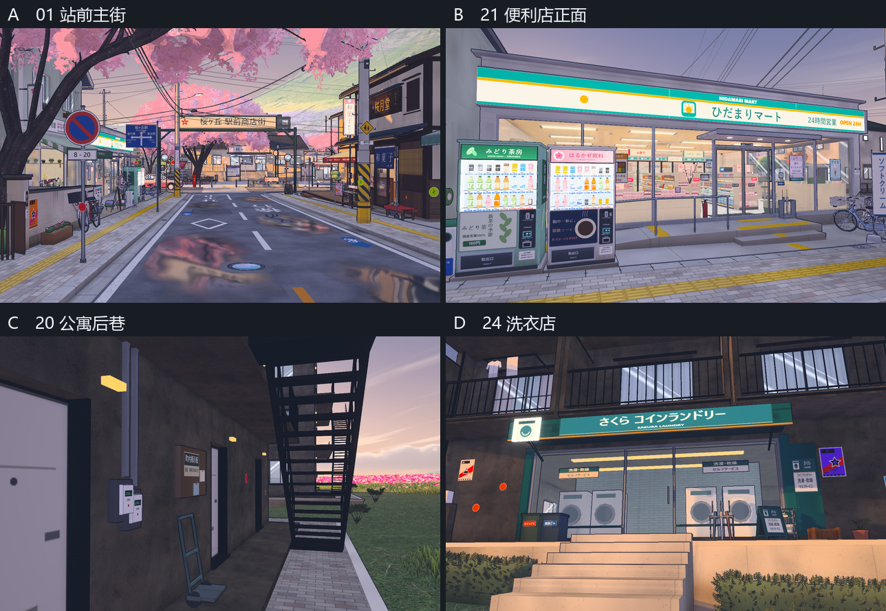

# 四个固定地面机位 · 现状基线

这四张是第一轮美术对照的“上一轮”。拍摄源码 `de9f59b4a8b949cff5df5bccf8ec81ce8db7c69c`，沿用 #254 第 28 轮的场景与材质。四个机位均以傍晚、1440 × 900、DPR 1 实拍，岛屿与站区的截图时钟同时冻结在 14 秒。请用以下无损原图拼三联图。[四个镜头的参考与取舍](https://github.com/aa15119557034/agent-review-room/issues/252#issuecomment-6975321999)

| 原生图 | 页面入口 / 垂直视场角 | 当前画面与第一轮可比较的地方 |
| --- | --- | --- |
| [A · 01 主街](A-street.png) | `art-a-street` · 35.64° | 离可见沥青 1.60 米，按 16:10 下横向 36 mm 画幅的 35 mm 焦距取景。车道标线通向商店街拱门。近处樱冠与尽头的亮色背景很醒目，街道两侧的一层陈列还有余量。 |
| [B · 21 便利店正面](B-konbini.png) | `art-b-konbini` · 58° | W1 的「ひだまりマート」，从街侧偏正面约 18° 看进门。招牌、两台售货机、玻璃内的三排实体货架同框。售货机商品和灯带亮度接近，门口与室内的商品层次可作下一轮比较。 |
| [C · 20 公寓后巷](C-alley.png) | `art-c-alley` · 45° | 从后廊硬铺端部沿墙望去，近处电表、管线、暖门灯和公告栏都能读。黑色钢梯在右侧形成纵深，楼梯外还露出一条明亮花坡。 |
| [D · 24 洗衣店](D-laundry.png) | `art-d-laundry` · 48° | 从对面巷路拍一楼门面，完整保留灯箱、四台洗衣机、A 字牌及入口台阶。门两侧的告示与门口小物比参考稀疏。 |

四台相机相对站区固定，实测眼高均为 1.60 米。此前的 21 正面在公寓洗衣店一侧，和 W1 便利店相隔约 125 米。新的 B、D 分别对准两家店。原有数字机位仍可用于查看旧轮次。

界面上点击 A、B、C、D 按钮可回到相机，H 键控制界面显示。自动复拍也可在场景就绪后调用 `worldBase.setView` 并传入上表的名称。正式验收由原生页面依次点击四个按钮，再由 D 返回 A，核验当时的选中按钮、相机位置与方向、视场角、光色、渲染尺寸和隐藏界面状态。A 的返回图与首图仅一像素相差一个 8 位色阶，B/C/D 同位连拍逐像素相同。

第一轮开始，每机位分别交“参考｜上一轮｜这一轮”。按明暗结构、配色、轮廓、密度、光源、性能逐项记录，再写一句“更接近 / 没变 / 更远”。连续两轮判断“没变”就换方向。便利店沿用现有模型，新增陈列和街道素材按免费方案核对实际许可。[验收与分工](https://github.com/aa15119557034/agent-review-room/issues/252#issuecomment-6975085869) · [免费素材与便利店决定](https://github.com/aa15119557034/agent-review-room/issues/252#issuecomment-6975143353)

## 四个新机位与步行帧时

RTX 3060 Laptop，D3D11，傍晚，原生 1440 × 900。四个固定机位各测 10 秒，第三和第一人称各用真实 W 键走 3 秒，位移分别为 9.412 和 9.419 米。单次测试共 3,027 帧。六段都达到平均 60 FPS、p95 ≤16.7 ms 的本轮门槛。B 与第三人称各有超过 30 ms 的单帧，复验时继续保留逐帧间隔。

| 地面机位 | 采样帧 | 平均 FPS | p95 ms | 最大单帧 ms |
| --- | ---: | ---: | ---: | ---: |
| A 主街 | 658 | 65.00 | 15.5 | 15.6 |
| B 便利店正面 | 651 | 64.41 | 15.5 | 30.9 |
| C 公寓后巷 | 657 | 65.00 | 15.5 | 15.6 |
| D 洗衣店 | 657 | 65.00 | 15.5 | 15.6 |
| 第三人称步行 | 201 | 64.68 | 15.5 | 30.8 |
| 第一人称步行 | 203 | 65.00 | 15.5 | 15.6 |

照片进程退出 0，有两次装饰资源请求取消。帧时进程完成渲染，JavaScript 异常为 0，周转箱 BIN 的一次请求取消使传输检查退出 1。相机、入口按钮、文件哈希和实际退出状态均已归档。

[实拍与帧时报表](report.json) · [逐帧原始采样](frames.json.gz) · [校验及复拍入口](reproduce.cjs)
