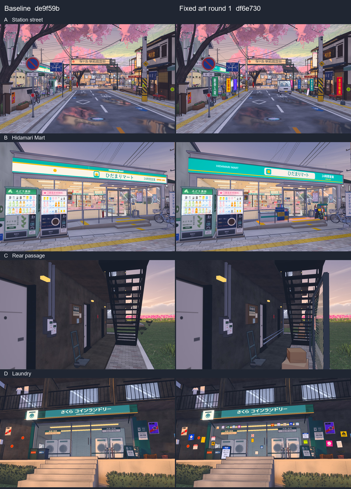

# 四机位第一轮 · 实机验收

C酱交回 `7bf4e7e`，本站实测与整合修复为 `df6e730`。A 的车与路旁陈列、B 的外摆与整块青色门头、C 的网片和包裹、D 的窗贴和价格牌，均在同一相机与场景时钟上对照。四张参考仍在 [#252 的定稿](https://github.com/aa15119557034/agent-review-room/issues/252#issuecomment-6975321999)；本目录只保存本项目的截图。 [源码 Windows 验证](https://github.com/aa15119557034/agent-review-room/actions/runs/44305298769)

| 地面镜头 | 上一轮无损图 | 第一轮最终无损图 | 对照参考的判断 |
| --- | --- | --- | --- |
| A · 主街 | [基线](../art-baseline-2026-11-18/A-street.png) | [第一轮](final/A-street.png) | 更接近。新增厢车给出街道尺度，积水中的粉色倒影减弱。沿街有了前后层次，多面高饱和竖旗仍争夺视线。 |
| B · 便利店 | [基线](../art-baseline-2026-11-18/B-konbini.png) | [第一轮](final/B-konbini.png) | 更接近。冰柜、货架和周转箱占据门口，玻璃后的商品仍能读。本轮主要加了外摆；店内货架采样区 16,072 个像素没有超过 8 色阶的变化。 |
| C · 公寓后巷 | [基线](../art-baseline-2026-11-18/C-alley.png) | [第一轮](final/C-alley.png) | 略接近。电表、纸箱、暖灯和网片收窄了通廊。两根横管在门前经过，一扇门被横跨全宽、另一扇被跨过 0.815 米；右侧亮粉花坡仍抢眼。 |
| D · 洗衣店 | [基线](../art-baseline-2026-11-18/D-laundry.png) | [第一轮](final/D-laundry.png) | 陈列密度更接近。新增窗贴、价目牌可辨，主招牌还是细长的一条，难以承担参考照片里整面灯箱的视觉重量。 |

## 按 #252 的七项验收

| 项目 | 本轮结论 |
| --- | --- |
| 明暗结构 | B 有更完整的暖亮店面，C 廊墙加深。C 右端的亮色在参考所对应位置仍然过重。 |
| 配色 | B 形成一块主色。A 入口多色竖旗与 C 的花坡应收敛。 |
| 轮廓 | 玻璃遮罩确实去除了原白车窗的多余暗线。C 的两条管线读成斜扶手，还横过门洞。 |
| 密度 | A、B、D 明显增加道具，B 的主体模型与门内货架仍沿用原版，D 的灯箱占比偏小。 |
| 光源 | C 暖门灯保住可读性。D 主灯箱在相同纸面区域的亮度中值保持原值。 |
| 性能 | 修复首轮六段过线，独立复测 A 与第三人称步行再次超预算。两次结果都在下表。 |
| 方向判断 | 整体更接近。四个机位继续作为这轮补修的比较基准，性能与 C 门洞问题仍然开放。 |

新增外摆、幟旗和贴纸由程序生成，厢车使用既有车型。第一轮没有引入新的免费素材包。[各镜头原尺寸前后图与取样](photos/README.md) · [修复前后三列像素](final/photos/README.md)

## 进场、贴花和玻璃

原交件加入网片、车辆和告示后，旧贴花清单的指纹失配，默认入口执行了 3,461 次射线检测。单次规划 204.507 秒，另一次原生专项复现 207.796 秒。原有 26 项中只有 9 项的位置、图格和尺寸仍一致。洗衣店右墙紫星从图格 5 变成红绿色图格 6，新停厢车的左侧还接到一张原属于对街店墙的贴纸。

按项目自己的墙面判定逐项检查，原先 24 项可以原位保留。新增两张告示挡住余下两项，分别将它们横移 0.38 米与 0.45 米后恢复了 26 项的原图格和位置。保留车辆原来的车型标识，让墙面规划复用做旧系统的车辆排除范围，位于车身上的首次交点会挡住该射线。正常入口读取新几何指纹的离线清单，规划射线为零，两次首个可见帧分别为 46.240 秒与 46.933 秒，原始交件为 251.436 秒。最终 D 的紫星图案内有 6,863 个被核验像素，和基线的单通道最大差为 1/255。[车侧与店墙](final/photos/A-van.png) · [洗衣店海报原位](final/photos/D-posters.png)

原白车侧窗取样中，8,540 个像素确有玻璃着色。保留在 HDR 颜色缓冲的 RGB 全相同，仍能描边的像素从 8,468 降到 0，原先多余的 1,060 个明显压暗像素也消失。新停厢车在 A 的独立取样有 4,566 个玻璃着色像素，4,529 个从可描边变为全部拒绝。[原始交件玻璃实测](glass/README.md)

[修复版车窗、车辆排除范围及贴花强制重规划实测](glass/fixed-df6e730/) · [修复前贴花诊断](decal-repair/)

## RTX 3060 帧时

每格为平均 FPS / P95 毫秒。四个傍晚机位各 10 秒，两段步行各按住 W 3 秒。均为原生 1440×900。验收线为平均至少 60 FPS，P95 至多 16.7 毫秒。

| 镜头 | 上一轮基线 | C酱交件 | 整合修复首测 | 同版本独立复测 |
| --- | --- | --- | --- | --- |
| A 主街 | 65.00 / 15.5 | 59.28 / 30.8 | 64.90 / 15.5 | 55.53 / 30.8 |
| B 便利店 | 64.41 / 15.5 | 64.80 / 15.5 | 65.00 / 15.5 | 65.00 / 15.5 |
| C 后巷 | 65.00 / 15.5 | 65.00 / 15.5 | 65.00 / 15.5 | 65.00 / 15.5 |
| D 洗衣店 | 65.00 / 15.5 | 63.12 / 15.5 | 63.71 / 15.5 | 65.00 / 15.5 |
| 第三人称步行 | 64.68 / 15.5 | 57.67 / 30.8 | 62.76 / 15.6 | 54.80 / 30.8 |
| 第一人称步行 | 65.00 / 15.5 | 64.04 / 15.5 | 65.00 / 15.5 | 62.12 / 15.5 |

四列分别覆盖 3,027、2,933、3,014、2,902 个 RAF 间隔。修复版两次分别为 6/6 与 4/6 段过线。第三人称与 A 的慢帧还会出现，暂缓通过本轮。三次 R1 计时均无 JS 异常，原生宿主记录了 3、2、3 个取消的资源请求，计时进程因此返回 1。相机截图进程返回 0。详细请求、渲染与相机状态均保存在报告中。

[原始采样与运行环境](report.json) · [两次修复版采样与运行环境](final/report.json) · [上一轮基线](../art-baseline-2026-11-18/README.md)

在本目录和 final 子目录分别运行 `node reproduce.cjs verify` 可从压缩帧间隔重算帧时并校验截图。
