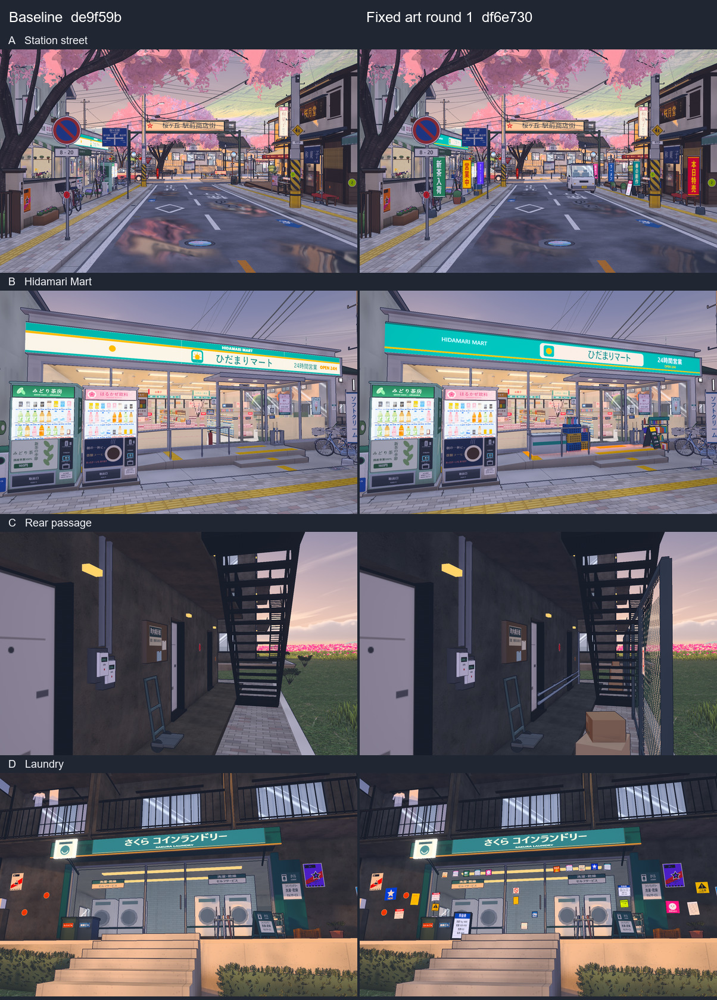
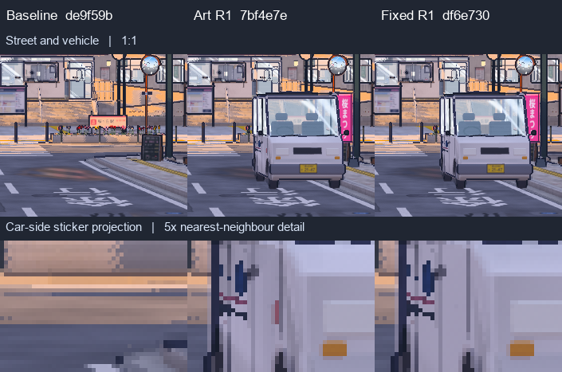
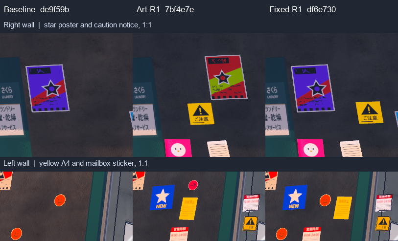

# 固定地面机位的第一轮修复对照

右列为修复后的第一轮 `df6e730`，左列为四镜基线 `de9f59b`。两次正式采集的相机位置、旋转、垂直视场角、光照和后期相同；固定傍晚，车站与岛屿时钟均为 14，RTX 3060 Laptop 原生输出 1440 × 900、DPR 1。这张总览为每张照片等比缩小后的 JPEG。

| 1440 × 900 原图 | 基线 | 修复后的第一轮 |
|---|---|---|
| A 站前主街 | [左](../../../art-baseline-2026-11-18/A-street.png) | [右](../A-street.png) |
| B 便利店 | [左](../../../art-baseline-2026-11-18/B-konbini.png) | [右](../B-konbini.png) |
| C 后巷 | [左](../../../art-baseline-2026-11-18/C-alley.png) | [右](../C-alley.png) |
| D 洗衣店 | [左](../../../art-baseline-2026-11-18/D-laundry.png) | [右](../D-laundry.png) |

## A 的新车与旧墙贴

局部三列从左到右依次是基线 `de9f59b`、原始第一轮 `7bf4e7e`、修复 `df6e730`。上排按原尺寸展示，下排的同一区域按最近邻放大 5 倍。修复保留停靠的小货车。

原始第一轮现场生成的图格 10 在车身左侧 `[1.3625,1.0346,13.6663]`。它在 A 的中心是 (852.30, 531.71)，斜视投影宽仅 1.13 像素。其四角栅格化覆盖 19 像素，其中 6 个在修复前后出现大于 32 级通道差，最大为 82。车辆上图格的身份由原始计划与真实车壳射线确认。修复的实际预烘焙清单把图格 10 恢复到对街原墙面 `[8.6,1.0346,13.6663]`；这张全街照无法分辨该贴纸的图案。[车壳命中记录](../../photos/A-van-sticker.json) · [图格与实拍注册坐标](registration.json)

## D 的右墙星形海报与两张新告示

- **右墙紫星。** 基线图格 5 的站区位置 `[6.1352,6.5412,-123.25]` 与屏幕中心 (1264.48, 411.32) 均恢复。原始第一轮显示图格 6 的红绿星，中心在 (1358.12, 388.66)。从原图的图格 5 内区剔除 2 像素边缘，余下 6,863 像素；基线和修复照片的最大 RGB 通道差只有 1，原始第一轮与修复有 6,839 像素差大于 8。
- **左翼黄色 A4。** 新告示以相同尺寸和转角沿墙移 0.38 m。中心 (178.82, 509.68) → (223.09, 508.16)，原图右移 44.27 像素。新位置内区 1,127 像素在修复前后全部出现大于 8 级通道差，原橙色信箱贴纸也重新可见。
- **右翼三角警告。** 新告示沿墙移 0.45 m。中心 (1307.15, 463.78) → (1380.65, 461.20)，右移 73.50 像素。新位置内区 1,895 像素中有 1,618 个差大于 8，警告图的位置与旧紫星有明显间隔。

运行时读取的 26 项贴花和基线逐项完全相同，包括图格、位置、朝向与尺寸。最终场景指纹 `1045:2749411:293818.6:935240.7` 命中 `baked`，本次读取与核验耗时 2.3 ms，现场规划射线为零。比较只使用本机正式原图和原生投影。[实际贴花与告示注册](registration.json)

## B 和 C 的修复前后差异

B 全幅 1,296,000 像素的 RGB 逐项相同。C 全幅 1,950 像素的最大通道差大于 8，全都位于原始与最终后墙贴花投影的并集内，投影边缘容差 2 像素。此并集以外共 1,292,051 像素，最大通道差为 4。原始第一轮增加的网片、纸箱、管线与远处的亮粉坡仍可见。[逐镜统计、源图散列与裁区结果](measurements.json)
