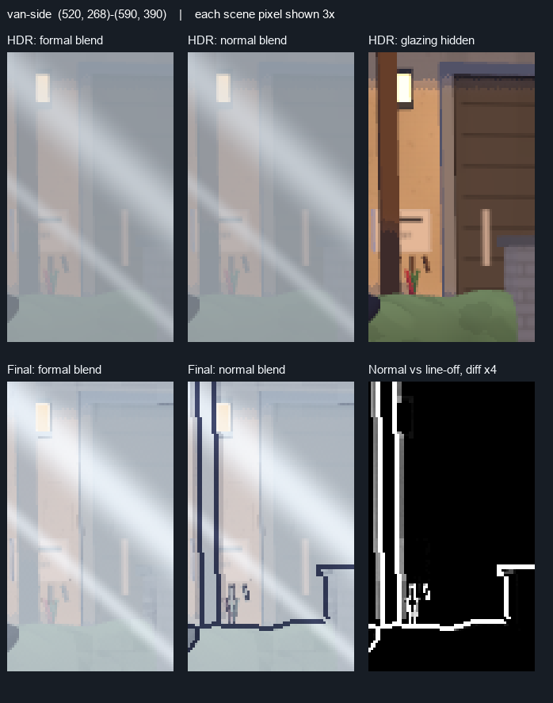

# 白色厢车车窗的描边与透色

场景提交 `7bf4e7ee6357d90c350351be3b90ea2b6f9c8d3e`。傍晚 `van-side` 使用与 C28 相同的地面相机和 (520,268)–(590,390) 测框，右下界不含。车窗在全部 8,540 个像素都有可见的 HDR 颜色贡献。R1 的独立 alpha 混合保留了这些像素的颜色，也消除了测框内由新增深度描边造成的暗线。

| 原位、同时钟，仅切换玻璃混合 | 普通混合对照 | 正式 R1 |
| --- | ---: | ---: |
| 有可见车窗颜色贡献的像素 | 8,540 | 8,540 |
| 场景 alpha ≥ 0.95，允许新线 | 8,468 | 0 |
| 打开新线后，最终 RGB 发生变化的像素 | 1,175 | 0 |
| 新线令最终亮度降低超过 8/255 的像素 | 1,060 | 0 |

普通和正式混合的 RGBA16F 原始 RGB **逐位相同**。隐去车窗材质，8,540 个像素的 HDR RGB 全部变化。单独关闭新增深度描边后，两种混合的最终 RGB 也完全相同。因而可将该测框里两种混合的画面差异归到新增深度线。车厢几何、既有阴影和玻璃着色仍参与正式画面的合成。本次测量不能为每条可见车内轮廓命名。此前 C28 记录了车窗 RGB 贡献及 8,468 个允许描边的像素，本轮第一次测得上述实际暗线像素数。[C28 历史对照](../../c28-toon-ground-3060-2026-11-18/motion/README.md)

新停的厢车和原有四辆车实测使用同一份 `vehicle-glass` Material。其材质保持 SrcAlpha/OneMinusSrcAlpha 的颜色混合，alpha 两个混合因子均为零。实际场景中五个玻璃网格各有 8 个三角面，新增网格位于 `Sakuragaoka/static/art-r1-kei-van`。仅隐藏新车玻璃时，旧车测框的 HDR RGB 没有像素变化。仅保留新车玻璃时，旧车测框的 8,540 个像素均变化。[车辆工厂、材质与运行时归属](measurements.json)

## 采样与复查

原生 RTX 3060 Laptop / ANGLE D3D11，1440 × 900，4× MSAA。相机位置 (276.3147278, 11.2100135, 971.1462176)，FOV 47°，四元数存于原始记录。冻结站区及岛屿时钟为 14 秒，关闭运动模糊，帧步长 1/60 秒。在相同曝光下采集正式混合、普通混合、隐藏车窗及复拍，两种混合分别与将新增深度线强度设为零的画面对照。普通与正式复拍均逐像素相同。所有修改仅作用于这次诊断的内存场景，退出前已恢复。原生进程退出 0，WebGL、场景、JS 和 HTTP 错误均为 0。CDP 报告两次已取消的 plastic_crate_02 资源请求。采样前后核对 18 份源码和配置的 SHA。[相机、源码哈希与退出记录](result.json)

`samples.bin.gz` 保存每次采样的原始数据，顺序见 `result.json` 的 `packetFormat`。每组先存自下而上的 RGBA16F 场景纹理，再存 RGBA8 最终输出。在已具备 Python、NumPy 和 Pillow 的环境下，从本目录运行 `python recompute.py .` 可重建统计和比较图。[原始像素](samples.bin.gz) · [离线复算脚本](recompute.py)
