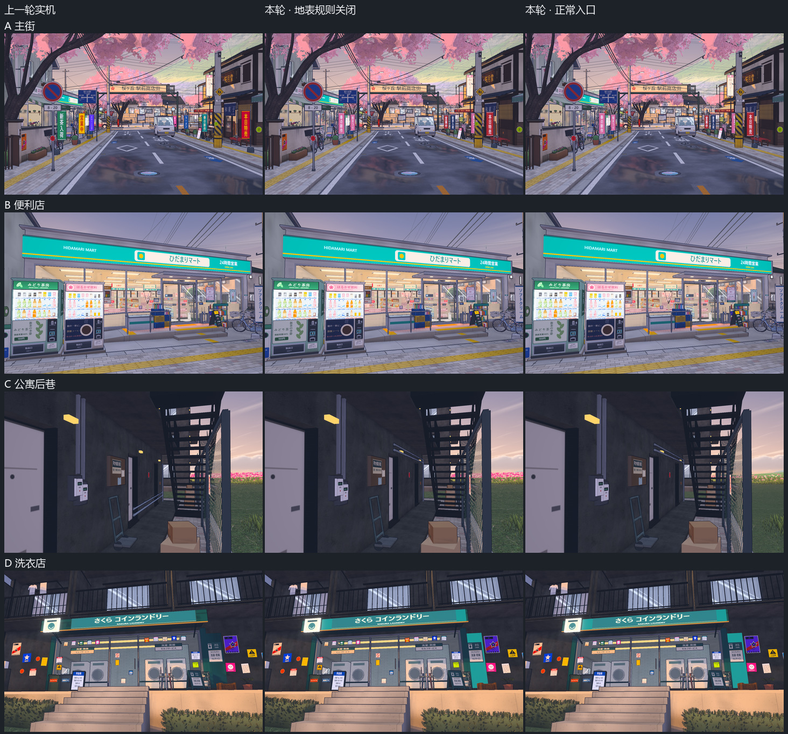
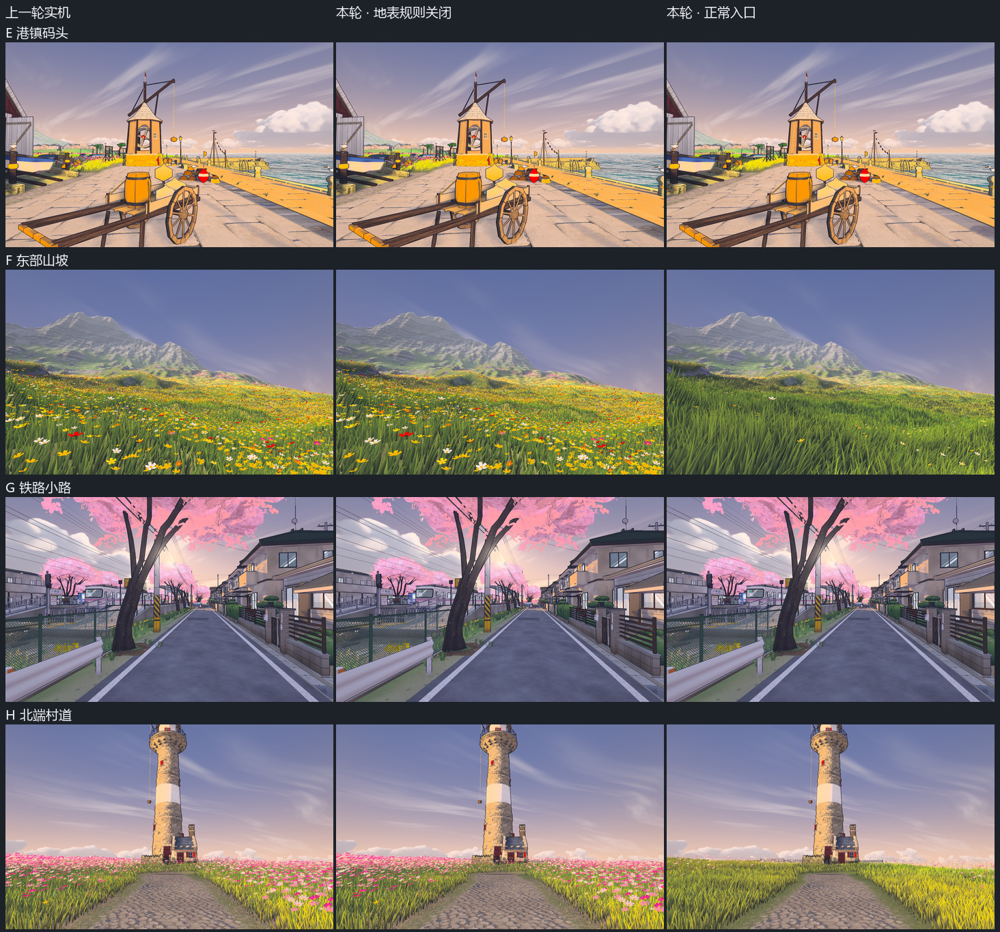

# 第二轮傍晚地面复拍 · RTX 3060 Laptop

C酱交件为 `363034ed1b6fa6c4ee7fbb05254156c937baf722`。四个正式镜头和两段实走两次都达到项目帧时目标。画面上，A 的店旗和 D 的灯箱更易读，C 的两盏门灯被新管线遮住，B 门内货架仍待改。参考图、上一轮和本轮的四组原尺寸并排见 [#254](https://github.com/aa15119557034/agent-review-room/pull/254)。[固定参考和四镜口径](https://github.com/aa15119557034/agent-review-room/issues/252#issuecomment-6975321999)

## 四个固定机位

每行从左到右为上一轮实机、同一份 R2 关闭地表规则、R2 正常入口。八个机位用 1440 × 900、无界面、固定姿态和傍晚场景时钟 14 秒复拍。两个 R2 条件分别启动。完整 PNG 在本目录和 [ground-off](ground-off) 下。[机位、时钟和源文件摘要](photos.json)

|机位|明暗与配色|轮廓、层次和光源|相对参考|
|---|---|---|---|
|A 站前主街|湿路和标线的灰色面块稳定。门面色点更集中，但树冠和天空仍占大面积粉色。|7 个店面共 14 面店旗，前中景更好分辨。主街远端楼体的层次仍弱。|店面的层次更接近。|
|B W1 便利店|青色门楣、暖室内、冷街面均与上轮相同。|入口外摆和玻璃后货架均与上轮同像素。已有货架，但从街面看仍读不出商品分区。|没变。门内连续两轮缺少进展，须改变陈列方式。|
|C 公寓后巷|右侧草坡固定选区内的粉色像素从 3,240 降到 690。门前保留冷色暗面。|管夹最低点离门顶 6.52 cm，但横管遮住中、远暖灯各 47.2%、50.0%。最近的灯保留完整。|花坡和门洞更接近，中、远灯变差。|
|D 洗衣店|横牌和侧牌的青色面更亮。玻璃、窗贴和价目牌沿用上一轮。|横牌宽 4.60 → 5.30 m。两牌轮廓内 Y′≥128 的实拍像素从 10,840 增至 35,036。|店面主招牌更接近。|

[门灯遮挡、灯箱投影、1:1 原图裁切和可复算的管线试装高度](doors-and-sign/README.md)

## 街区外的四个地面样本

港口、东部山麓、铁路北侧小路、北村塔道使用上一轮已经公布的种子 252 机位。地表开启后，花丛分布图的累计权重为原值的 39.43%。这是权重和；实例数量取决于后续采样。东坡和北村从满幅碎花中显出了地形和道路，铁路小路变化很小。

|机位|上一轮 → R2 正常入口|R2 关闭地表 → 开启|
|---|---:|---:|
|A 主街|72,311|19,699|
|B 便利店|0|0|
|C 后巷|22,761|14,508|
|D 洗衣店|27,814|513|
|E 港口|35,003|31,438|
|F 山麓|563,122|563,122|
|G 铁路|754|754|
|H 北村|268,492|268,492|

单位为原生画面中任一 RGB 通道差值 >8 的像素个数，每图 1,296,000 像素。B 两轮和地表开关图连 PNG 字节也一致。花坡、灯面等局部另有独立选区。[逐图与选区数据](image-comparison.json)

## 性能和复算

原交件两次独立会话共 6,052 个 RAF 间隔。两次均覆盖 A–D 及实际按 W 的第三、第一人称步行，各段 P95 都是 15.5 ms，最低段均值 63.09 FPS。独立的阴影合批候选四镜各少 300 次提交，两轮结果未显示稳定的帧时收益，未纳入正式交件。四轮宿主都记录了启动资源请求取消，退出码为 1。渲染/输入断言通过，JS 异常 0。[逐帧数据、采样顺序、前台差异和复算命令](performance/README.md)

正常入口与诊断入口各得到 8 张原生 PNG。26 枚烘焙贴花的位置和顺序全部保留；22 枚平面贴花各 9 点承托通过，4 枚曲面贴花另按曲率检查，未发现新增遮挡。[贴花复核](retained-decals.json)

在此目录运行 `node verify.cjs` 和 `node performance/verify.cjs`。重拍可在准备好场景资源的源检出中执行 `node capture.cjs on "<Electron 路径>" "<全新输出目录绝对路径>"`，将 `on` 改为 `off` 单独启动地表关闭的对照。
