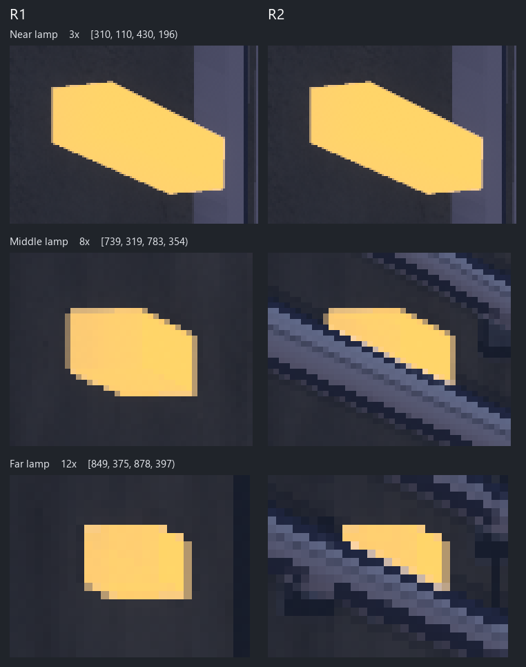
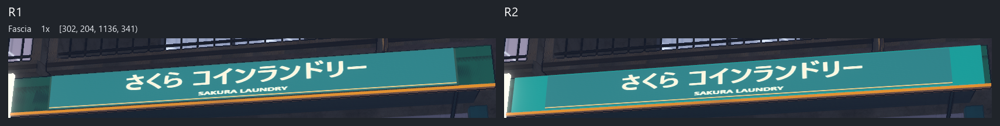
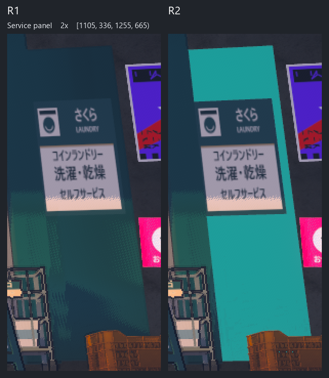

# R2 地面门灯和洗衣店灯箱

C 后巷的管道已经越过门顶，从 C 机位看，较低横管仍挡住中、远两盏门灯的下半部。D 洗衣店横牌扩宽，侧牌尺寸保持，二者的青色衬底都更亮。B 便利店与上一轮同机位 PNG 的全部字节相同。

## C 后巷

后门金属门扇、门框和墙洞共用顶部标高。四层公寓地基世界 Y 为 12.764808464 m，门底高出地基 0.16 m，门高 2.08 m，因此门顶为 15.004808464 m。R2 管道用站区原点 Y=8 m 加自身楼面基准 4.78 m。低横管轴高 2.34 m、半径 0.034 m，最低点世界 Y=15.086 m，距真实门顶 **8.119 cm**。实际横跨门宽的固定夹高 0.10 m，最低点 Y=15.070 m，整个组件最小净空为 **6.519 cm**。竖管独立落地，在门洞左侧。源码见 [管道及固定夹](../../../src/art-r1-city.js#L217)、[门洞和门灯](../../../src/city-apartments.js#L100)、[公寓地基](../../../src/city.js#L140)。

|C 机位从近到远|灯体投影像素|低横管在灯前的像素|实拍亮像素 R1 → R2|
|---|---:|---:|---:|
|近灯|2,937|0|2,937 → 2,937|
|中灯|299|141（47.2%）|299 → 166|
|远灯|100|50（50.0%）|100 → 56|

截图取自两轮已有的 1440×900 傍晚原图。左列 R1，右列 R2，三行分别用 3×、8×、12× 整数最近邻放大，框坐标为左闭右开。实体投影用像素中心计算八边形管道、固定夹和灯体的最近三角形深度。实拍计数使用显示 RGB 上的 Y′>180。抗锯齿和后处理会改变边缘像素，故两种计数各自列出。

**一个可试的安装高度。** 保留管段和夹具的 X/Z、半径及间距范围，把上下轴线分别升至楼面基准以上 2.58 m 和 2.72 m，竖管延至 2.72 m。此时较低固定夹底高于灯顶 **9.269 cm**，较高固定夹顶距上一层廊板底 **6.481 cm**。用同一 C 相机重新投影，此方案在三盏灯前的覆盖均为零像素。该高度仅作空间与该机位的计算建议。落地后还应从走廊另一端检查灯面，并核实邻近梁件、支架及接头。

## D 洗衣店

横牌衬底宽 4.60 → 5.30 m，高 0.44 m，正面实体面积 2.024 → 2.332 m²。侧面服务牌宽 0.60 m、高 2.07 m，正面面积仍为 1.242 m²。R2 给两块衬底传入同一个由 M.lamp 克隆的 H.signTeal，将颜色设为 #3c9c97 并乘 0.78。前方横牌文字仍是 4.56 × 0.42 m 的印刷图片，侧牌文字仍是 0.50 × 0.78 m。源码见 [衬底与文字装配](../../../src/city-apartments.js#L285)、[灯箱材质](../../../src/city.js#L73)。

|D 机位|R1 → R2 实体投影像素|在固定 R2 外轮廓内，实拍 Y′≥128 像素 R1 → R2|显示亮度增加超过 20 的像素|
|---|---:|---:|---:|
|横牌|44,669 → 51,376（+6,707）|6,851 → 16,059|10,182|
|侧牌|30,130 → 30,130|3,989 → 18,977|16,208|
|两者合计|74,799 → 81,506|10,840 → 35,036（+24,196）|26,390|

扣除前方文字图片的投影后，横牌衬底的显示亮度中位数从 74.02 升至 132.21，侧牌从 56.38 升至 129.15。实拍阈值采用 8 位显示 RGB，Y′=0.2126R+0.7152G+0.0722B。投影包含侧边，图像还包含可能遮住牌体的实景物件。像素计数仅描述这张画面，无法据此换算灯具的物理亮度。下图横牌为原大 1×；服务牌为整数最近邻 2×。

## B 和复算

R1 归档、R1 最终复拍、R2 地表开启和 R2 地表关闭四个 B 文件的 SHA-256 均为 `6998455998a886a729c677a9a50a8c35d4cdfe480ad5f20d59c753957d77fdee`，全部 1,296,000 个像素一致。

R2 源码为 `363034ed1b6fa6c4ee7fbb05254156c937baf722`。在本目录用现有 Node 24 与装有 NumPy、Pillow 的 Python 运行 `python measure.py`，可重算 [原始计数](measurement.json) 和三张裁图。亦可运行 `python measure.py <fixture目录> <新输出目录>`。脚本读取 R1 最终原图、R2 归档的相机位置与四元数，并按标注的装配参数调用同源 GB 和 Frame。地基标高来自[已归档的四层公寓装配](../../look-c14-2026-11-17/cpu/x51-c14-city-result.json)，与 R1 正常运行记录相符；R2 沿用相同地形高度和地基算法。全程在 CPU 计算。
