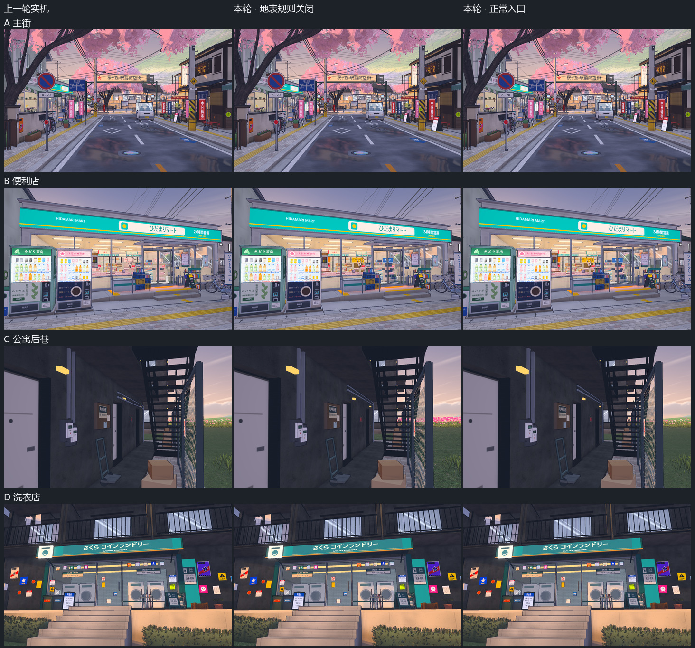
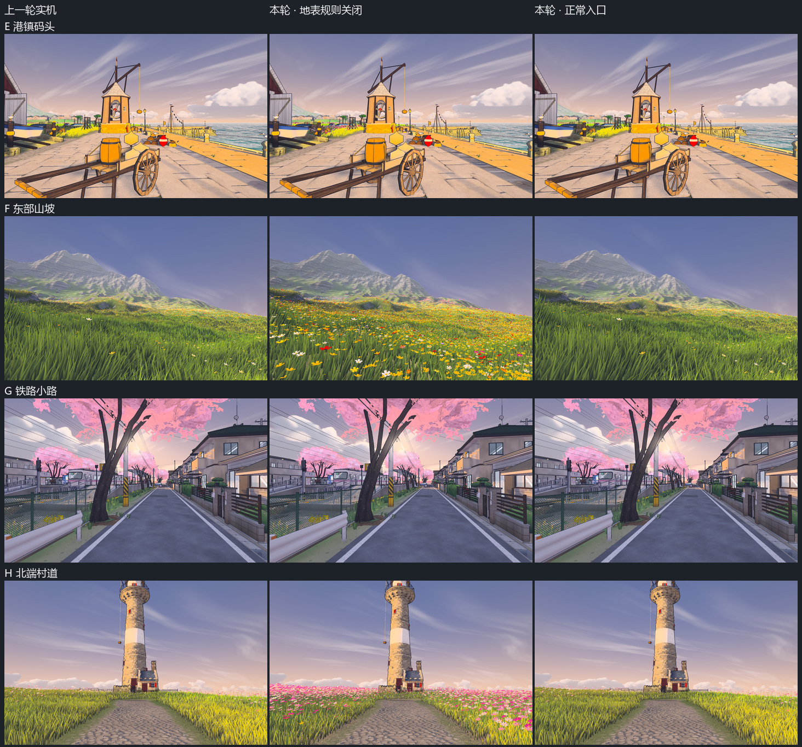

# 第三轮傍晚地面复拍 · RTX 3060 Laptop

正式交件为 `47a5c12eba910682ccbf8bc9138510bc01737bf3`。正常入口和关闭地表规则各启动一次。固定场景与站区时钟为 14 秒，1440 × 900、DPR 1、无 HUD，复用第二轮同一眼点、朝向、视角。每幅图连续抓三帧，归档第三帧。正常入口切回 A 时第一帧哈希不同，第二、三帧和最初的 A 相同。两进程退出 0，JS/GL 错误为零；启动阶段分别有 2 条和 1 条资源请求被浏览器取消。[正常入口回执](photos.json) · [地表关闭回执](ground-off/photos.json)

|#252 固定镜头|明暗、色彩与轮廓|陈列、光源与方向判断|
|---|---|---|
|A 站前主街|傍晚路面的灰色和标线保持。新增店前立牌沿街缘布置。|W2、W4、W6、E3、E5 实装 5 块折叠招牌。14 面店旗实测共 1,512 三角，含双面布 336 三角。沿街的一层陈列更接近参考。|
|B W1 便利店|橙、黄、蓝三块类别牌现在能从玻璃外辨别，暖室内与青色门楣保持。|饮料堆在街上可见，左、中两个低货堆被前景遮住。货架分区更接近参考。60 件货物的底面中心都缺承托，其中 48 件整个底面悬空。|
|C 公寓后巷|管线让开了原先被切掉的中、远门灯，仍能读出蓝灰色墙面和台阶。|固定机位三盏灯均完整。中灯的亮像素 166 → 299，远灯 56 → 100，近灯稳定在 2,937。光源布局更接近。|
|D 洗衣店|门面、青色横牌、暖窗和灯箱与上轮一致。|原图逐字节相同，保持第二轮的陈列。|

[三类商品的实拍位置、承托射线、可重放的两级台座试装](w1/README.md) · [三盏门灯原像素、额外后廊的楼板穿模和五块立牌](corridors-and-boards/README.md)

## 额外地面样本

每图共 1,296,000 像素。下表列任一 RGB 通道变化大于 8 的像素数。

|机位|第二轮 → 第三轮正式入口|第三轮地表关 → 开|
|---|---:|---:|
|A 主街|7,460|16,975|
|B 便利店|11,395|0|
|C 后巷|8,624|14,345|
|D 洗衣店|0|513|
|E 码头|19,330|29,939|
|F 山麓|9,718|509,506|
|G 铁路小路|0|754|
|H 北村塔道|0|268,492|

D、G、H 正式入口 PNG 与 R2 完全相同。码头船的摇摆有独立初始相位，E 整幅差异无法全部归因于岩石。F 在联合地形的实际落脚点，近景岩石能重新读出明暗变化。同一原大裁框中，三版共同的 73,680 个蓝灰像素里，最常见五种色值占比为 2.98%（原岩纹）、36.78%（第二轮）、10.28%（第三轮）。[八镜像素与选区](image-comparison.json) · [联合落脚点原图、岩纹裁图与天气参数](https://github.com/aa15119557034/agent-review-room/blob/6485bf56fba0955c87c0728787fa4fc661f9378f/apps/desktop/e2e/fixtures/world-base/evidence/joint-r3-ground-3060-2026-11-18/README.md)

## 场景与复算

正式站区运行时读到 `1057:2751069:297148.3:946248.3`，使用烘焙贴花，规划射线为 0，正常入口规划统计为 1.9 ms。26 枚沿用贴花同序、同位置，22 枚平面逐枚九点、4 枚曲面按原指令复核，未发现新增遮挡。三层和五层公寓确实都布置了管线、箱子和告示；两栋的上管嵌入上层廊板 3.7 cm，上卡箍嵌入 6.0 cm。[贴花逐项检查](retained-decals.json)

在本目录运行 `node verify.cjs`。原生照片复用 [R2 的 capture.cjs](../art-r2-ground-3060-2026-11-18/capture.cjs)，在含本轮源码与资源的检出执行 `node capture.cjs on <Electron可执行文件> <新的绝对输出目录>`，另用 `off` 起一个进程。在有 NumPy 和 Pillow 的环境中运行 `python compare.py <fixture> <on输出> <off输出> <新证据目录>` 可复算像素与拼图。[正式帧时与逐帧复算](performance/README.md)

## RTX 3060 帧时

原交件和按空间剔除岛上道具的候选各测两次。原交件 A 主街分别 53.85 / 55.93 FPS，P95 两次均 30.8 ms。第三人称实走由 64.68 FPS / 15.5 ms 变为 57.67 FPS / 30.8 ms。B 第一次的 P95 为 30.7 ms，第二次 15.5 ms。C、D 和第一人称在两轮原交件均达标。候选首次 A 为 45.17 FPS / 30.9 ms，第二次为 64.90 FPS / 15.5 ms，暂留独立分支。[四轮六段、设备和逐帧记录](performance/README.md)
