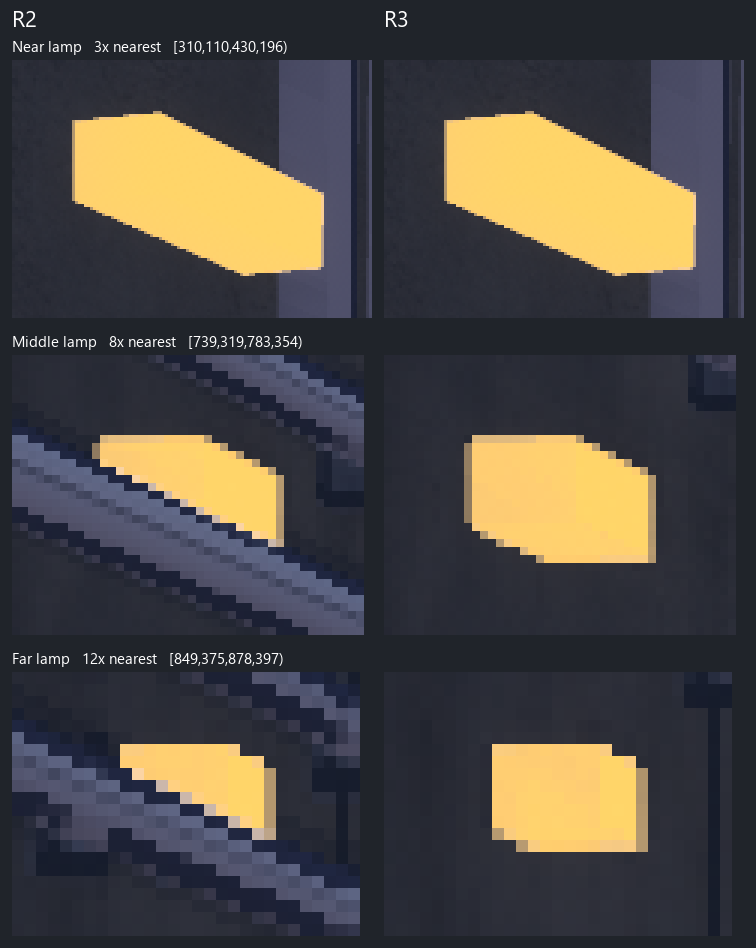

# R3 公寓后廊、店旗和立牌

四层公寓 C 的中、远门灯已恢复。三层、五层公寓复用后廊规则时，上管和上排卡箍进入二层走廊板，需单独修正。D 洗衣店原生图与 R2 逐字节相同。

## C 与 D 的原生同机位

R2、R3 均为本机 RTX 3060 正常入口的 1440 × 900 PNG。逐镜核对相机位置、四元数、目标、FOV。下表的灯体来自真实 GB 灯盒。按像素中心做透视校正深度测试，与本机 PNG 的显示亮度逐点交叉核对。坐标原点在左上，右下边界不计入。

| C 后廊门灯 | 灯体投影 [x0,y0,x1,y1) | 投影像素 | R2 → R3 亮像素 Y′>180 | R3 前方的管/夹像素 |
|---|---|---:|---:|---:|
| 近 | [331,128,413,181) | 2937 | 2937 → 2937 | 0 |
| 中 | [750,329,772,345) | 299 | 166 → 299 | 0 |
| 远 | [858,381,870,390) | 100 | 56 → 100 | 0 |



以灯体上沿测算，四层后巷的下管净空 10.87 cm，下卡箍净空 9.27 cm。上排卡箍离二层板底 6.48 cm。D 洗衣店整张 PNG 的 SHA-256 为 `239d42400a94bbda14db29e49845f0211a66c27d3bcef732c6e55f346d14bd46`，两轮 1,296,000 像素完全相同，灯箱和侧牌两个局部也相同。[原图统计](photos-check.json)

## 三层与五层公寓

两栋首层各装配两根水平管、四个纸箱和一张告示。箱体到最近门洞左右边缘保守间距分别为 45.84、62.50 cm，告示分别为 21.05、21.31 cm。下卡箍到灯顶均为 21.75 cm。两栋扩展位置使用实际楼体、相同随机种子和 GB 网格复算，辅助画面在作者拼图的最下排。[几何记录](geometry.json) · [作者的额外后廊视图](../../art-r3/r3-samples-and-rear.jpg)

| 首层后廊 | 上管长度 | 上管顶进入板内 | 上卡箍顶进入板内 | 涉及卡箍 |
|---|---:|---:|---:|---:|
| 三层公寓 | 9.80 m | 3.70 cm | 6.00 cm | 7 |
| 五层公寓 | 10.80 m | 3.70 cm | 6.00 cm | 8 |

两栋楼的二层走廊板底都在建筑局部 y=2.85 m。装配给管线多加了 0.14 m 完成面抬高量，使上管中心变成 2.86 m。管及全部上夹的水平范围也与板相交。建议管线单独用楼层结构标高，纸箱沿用完成面。[楼板、门灯与装配入口](../../../src/city-apartments.js#L100) · [管线生成](../../../src/art-r1-city.js#L233)

CPU 试装仅将两栋楼的横管与卡箍下移 14 cm。逐件核对真实网格后，两栋的管件离门扇及门框至少 29.00 cm，高出灯顶至少 7.75 cm、高出箱顶至少 141.00 cm，距板底至少 8.00 cm。三层、五层告示上方分别留有 77.67、77.86 cm。每栋两根横管均与三盏灯的水平投影重叠，靠垂直净空避开，管身本身高出灯顶至少 9.35 cm。[安装高度试算](trial-result.json)

## 贴花、碰撞与街面构件

- 26 个烘焙贴位与 R2 每项字段相同。对每项按实际贴花朝向、面积取九点，从墙前 0.70 m 射向墙面，新增后廊装饰均未提前命中。另读本机关闭地表着色的场景记录，运行时加载烘焙、0 次规划射线，26 项中心均命中原墙。22 个平面项九点全过，4 个许可曲面项按中心吸附通过。两种测法分别检查新增物遮挡与整场选墙。[贴花核验](retained-summary.json) · [整场射线原始记录](../retained-decals.json)
- 城市背景沿用隔离的物理接口，后廊新增件没有登记玩家碰撞，既有门、门灯、楼梯与平台生成保持原样。三栋模型原有设定为背景，未追加步行进入楼梯的实测。另有三组 W1 货架陈列各登记了 0.80 × 0.44 m 的碰撞盒。[城市物理接口](../../../src/city.js#L51) · [便利店货架](../../../src/art-r1.js#L219)
- 实际按街区规则装配出 W2 花店、W4 书店、W6 车行、E3 杂货和 E5 面店五块新立牌。每块有两个支撑板和一个独立印刷面，3 个网格、26 个非退化三角，位置均为店面向外 0.70 m。立牌沿用装饰用 `board()`，本身没有登记独立碰撞。店旗位于七家店外，共 14 面。以真实 kit 网格索引及顶点面积复核为 43 个网格、1,512 个非退化三角，其中布面 336 个、旗杆底座等 1,176 个。[店面、旗杆和网格计数](../../../src/art-r1.js#L266)

## 复算

场景源码为 `47a5c12eba910682ccbf8bc9138510bc01737bf3`。以下命令在本目录执行，用已准备依赖的 fixture 和归档照片，需 Node 24 及含 NumPy、Pillow 的 Python。可将最后一个参数换成已有的独立空目录。几何、截图和贴花三项分别以退出码 0 通过。

```text
node geometry.mjs ../../.. .
node trial-14cm.cjs ../../..
python photos.py ../../.. .. .
node retained-summary.cjs ../retained-decals.json .
```

几何脚本核对实际参与本次装配的源码与该提交是否相同。管卡与纸箱使用真实生成器，灯盒与上层平台按真实调用装配。旗和立牌用原始规则及几何 kit 单独计数，CPU 测试中的画布不记录文字像素。非固定视角的后廊实照来自作者，本机新增的定点原生复核限于 C、D。
