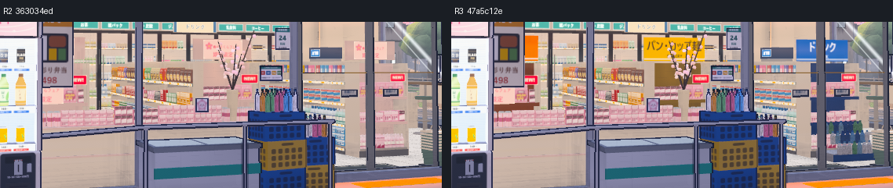

# W1 便利店三个类别货堆

R3 的 60 件新增商品中，48 件底面全悬。其余 12 个前排纸盒只有后缘搭在台座上，重心下方也缺少支撑。B 的同机位实拍能辨认三块新货类牌和右侧低处的饮料，左侧和中间低处由前景陈列遮挡。画面左边沿用 R2，右边为 R3，均保留原生像素。

| R3 实例 | 第一层 | 第二层 | 第三层 |
| --- | --- | --- | --- |
| 零食盒，每层 6 件 | 后缘有 5.3%–6.5% 的底面采样获得支撑 | 6 件全悬 | 6 件全悬 |
| 面包盒，每层 6 件 | 后缘有 5.2%–5.8% 的底面采样获得支撑 | 6 件全悬 | 6 件全悬 |
| 饮料瓶，每层 8 件 | 8 件全悬 | 8 件全悬 | 8 件全悬 |
| 底面中心至最近上表面的垂直净距 | 11.5 cm，到 W1 旧店内地砖 | 13 cm，到现有台座 | 26 cm，到现有台座 |

## 几何和步行

用 R3 `47a5c12eba910682ccbf8bc9138510bc01737bf3` 实际构建站区。在站区静态合批前，从 `w1-zones-boxes`、`w1-zones-bottles` 读取 60 个实例矩阵。将 W1 近处原货架、店内地砖、新台座和周边可见网格还原为实际三角面，按水平投影筛得 2,256 个朝上三角。对每件商品从底面中心及 31×31 个格心向下求最近交点，瓶底按原八边形裁切，总共 51,036 个底面格心。每条射线排除所测实例自身，接触容差 2 mm。表中底面比例为格心采样值。

每个台座宽 0.78 m、深 0.42 m、高 0.12 m，中心为 W1 本地 `iz = -3.98 m`。三块既有碰撞体均为 0.80 × 0.44 m，高度为站区本地 0.0634–1.0134 m，分别位于站区 `(-8.78, 11.65)`、`(-8.78, 9.20)`、`(-8.78, 6.70)`，平面坐标按 X、Z 排列。原货物最前缘超出台座约 8.8 cm，也超出碰撞体约 7.8 cm。

在同一版的内存试装中，把三个货堆的商品都向背板退 0.10 m，每个台座上补两级 0.78 m 宽、0.13 m 高的实心承托。两个承托的深度分别为 0.28 和 0.14 m，中心相对 `iz` 分别偏 -0.07 和 -0.14 m，顶面落在柜底以上 0.25 和 0.38 m。原有碰撞体三个数值记录逐项一致，60 件的全部 51,036 个格心均恢复支撑。这个试装只量了几何承托和碰撞范围，灯光、帧时、正式贴花指纹应在接受改动后的正常入口复测。[R3 实例和射线](r3-stock.json) · [内存试装复核](trial-stairs.json)

## B 同机位

R2 `363034ed` 与 R3 `47a5c12e` 的原生 1440×900 PNG 来自 RTX 3060 Laptop 的正常入口，两次照片均使用 B，傍晚时钟固定 14 s，位置、四元数与 58° 垂直视角逐项相同。对照图截自两个原图的同一区域 `[502,423,1065,636)`。下表的裁区由 R3 的实际货物或类别牌包围盒投影得到。差异按同位置 RGB 最大通道绝对差大于 8 的像素数统计，矩形内包括透玻璃观察时重叠的物件。

| R3 类别 | 类别牌差异像素 | 低处商品范围差异像素 |
| --- | ---: | ---: |
| 零食 | 568 / 3,384 | 0 / 4,488 |
| 面包、杯面 | 2,171 / 2,607 | 0 / 3,995 |
| 饮料 | 1,577 / 2,040 | 2,299 / 3,312 |

画面可见橙黄蓝三块牌的变化，右侧饮料货堆有显著新增色块。近处的折叠箱、层架和玻璃竖框在 R2 已可见。单张照片无法判断 60 件底部的支撑。[原图校验、机位和六个裁区](doorway-diff.json)

## 重放

使用已备妥本机资产的 R3 fixture，在其工作目录以 Node 调用本目录的 `capture.cjs --fixture=<R3 fixture> --electron=<Electron 可执行程序>`。加 `--stairs` 可重复内存试装。采集器禁用硬件加速并拒绝 WebGL 上下文，在独立临时用户配置中运行，默认结果写入 fixture 的 `artifacts/w1-audit-replay`。[驱动](capture.cjs) · [实体测量](rays.cjs) · [照片裁区计算](screen.py)
