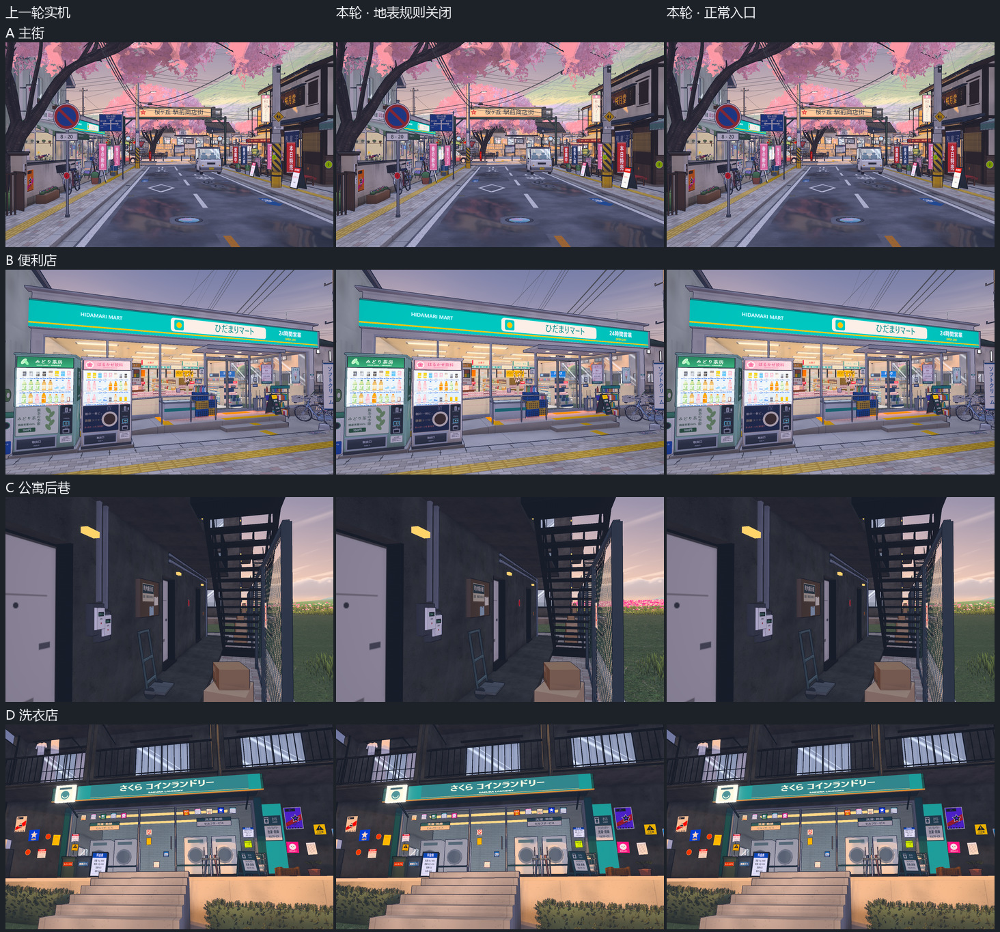
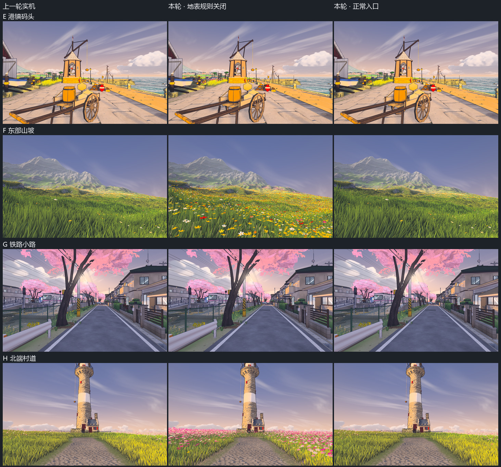

# 第三轮补修 · W1 货堆、后廊与街区印刷牌

本轮在北京时间 11 月 18 日深夜开始，交错计时跨至 11 月 19 日凌晨；原始时间戳使用 UTC。复拍的运行源码为 `ffbcfa3e091bdb2d4a7cf94367d40868101c2ddc`，上一轮为 `47a5c12`（证据提交 `6e35a4c`）。W1 三组货堆已有实体承托，三层、五层公寓的上卡箍已离开楼板。八张印刷面进入同一图集，按空间实际分成四个批次。

|机位|同位画面的变化|与 #252 参考的关系|
|---|---|---|
|A 主街|五家店的折叠立牌改为印刷面，街面仍有灰色路缘、路标和傍晚店旗。|店前层次保持，仅局部牌面的亮色发生变化。|
|B 便利店|三排商品后移并落在两级台座上。橙、黄、蓝三个端头色块保留。原机位只能看到橙牌一侧，花枝遮住部分黄牌，门框遮住蓝牌中央。|室内陈列的实体关系更接近参考。完整分区文字仍受前景遮挡。|
|C 后巷|固定四层后巷的三盏灯和管件保留。3F、5F 的管件下降。C 整幅 248 像素变化，三处灯罩矩形各自零变化。|正确的门、灯和管线关系保留。|
|D 洗衣店|整张 1440 × 900 PNG 与 R3 逐字节相同。|沿用上轮灯箱与告示的层次。|

## 两项施工复验

- 真实 W1 三个显示台上合计 60 件商品；其底面 51,036 个采样均获得承托，三块原有碰撞记录逐字段相同。三张 256 × 92 头牌的 70,656 个 RGBA 像素在图集中原样保留。[W1 底面、三块牌的原生裁图和试算](w1/README.md)
- 3F、5F 的管与卡箍离门至少 29 cm、离灯顶 7.75 cm、离箱顶 141 cm、离上层廊板 8 cm。4F 固定后廊的 16 组实体顶点和索引都未变。五块店前立牌共 130 个三角。五个印刷面合成三个空间批次，三张 W1 类别牌合成另一个批次；八张归入同一张 4096² 图集的不同区域。[实体净空与实际合批](corridors-and-boards/README.md)

## 同机位与全岛地面样本

正常入口和 `?ground=off` 分别使用独立 Electron 进程。两组都为 RTX 3060 Laptop、原生 1440 × 900、无 HUD、傍晚时钟 14 秒。两个进程均退出 0，无 JS 异常、WebGL 错误或网络取消；固定八镜全部落盘，返回 A 最终帧与初次 A 同哈希。贴花指纹为 `1053:2751141:296058.6:942440.7`，正常入口读取烘焙、规划射线 0、统计 1.7 ms。沿用 26 枚原贴花，22 枚平面九点、4 枚曲面原指令全过，未发现新增遮挡。[正常入口回执](photos.json) · [地表关闭回执](ground-off/photos.json) · [贴花几何检查](retained-decals.json)

|机位|R3 → 补修正常入口|补修地表关 → 开|
|---|---:|---:|
|A 主街|3,170|16,975|
|B 便利店|4,623|0|
|C 后巷|112|14,345|
|D 洗衣店|0|513|
|E 码头|3,679|31,580|
|F 山麓|0|509,506|
|G 铁路小路|26|754|
|H 北村|0|268,492|

单位为任一 8 位 RGB 通道差值 >8 的像素个数，每幅共 1,296,000 像素。R3 与补修正常入口的 D、F、H 三幅 PNG 逐字节相同。E 含每次启动独立取相位的系泊船。[各机位与固定局部选区的数值](image-comparison.json)

在此目录运行 `node verify.cjs`。复拍复用 [八镜原生脚本](../art-r2-ground-3060-2026-11-18/capture.cjs)，在对应源码检出中分别执行 `node capture.cjs on <Electron路径> <新的绝对目录>` 和 `off`。有 NumPy 与 Pillow 时可运行 `python compare.py <fixture> <on目录> <off目录> <新证据目录>` 复算差异与拼图。正式帧时使用独立进程的旧→补→补→旧四轮交错测量。[原始帧间隔与复算](performance/README.md)

## 3060 实走结果

补修两轮的 A–D 和第三人称均满足 60 FPS、P95 ≤16.7 ms；第一人称两次 P95 为 30.8 和 30.7 ms。旧版主街一次 65.00 FPS / 15.5 ms，另一次 59.75 FPS / 30.8 ms。补修后主街每帧 draw 中位低 4 次，但当时四轮 368 个系统前台采样均在测试进程树外，其他几何也有变化；现有交错结果不能将先前主街慢帧单独归因给标牌。全部 11,900 个 RAF 间隔参与复算。

第一人称补充定位共记录 2,183 帧。按脚位匹配的 190 次稀疏采样中，随后出现长帧间隔的 15 次，渲染调用主机耗时中位为 18.6 ms，其余 175 次为 14.5 ms；对应的整帧 GPU 中位耗时为 16.02 / 14.45 ms。两种时间有重叠。 [诊断、原始记录与可独立复算入口](walk-diagnostic/README.md)
