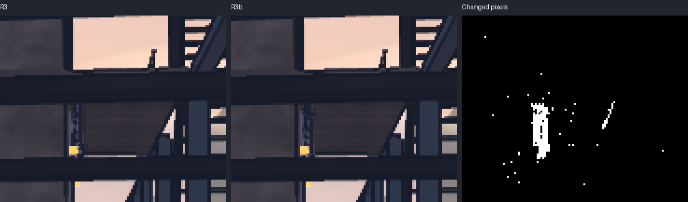

# R3b 后廊管件与街面印刷牌

补修提交 `ffbcfa3e091bdb2d4a7cf94367d40868101c2ddc` 的两栋新后廊已经清开上方楼板。正常入口的 C 近、中、远三盏门灯与 R3 同像素，D 洗衣店全图同像素。五块街面立牌的印刷面进入一张共享图集，实际输出三个空间批次。

## 后廊

从补修源码执行 `addRearCorridor()`，使用两栋实际建筑原点、首层完成面和同种子生成的纸箱/告示。对每件管、夹和门扇、门框、门槛、灯体、纸箱、告示及二层平台的实际几何逐对取世界坐标界限。下表为最小垂直净空，单位 cm。管与卡箍均按补修提交的最终顶点直接计量。

| 后廊 | 两根管长，各 | 管 / 夹数量 | 低件到门 | 到灯顶 | 到箱顶 | 到告示顶 | 高件到板底 |
|---|---:|---:|---:|---:|---:|---:|---:|
| 3F | 9.80 m | 2 / 14 | 29.00 | 7.75 | 141.00 | 77.67 | 8.00 |
| 5F | 10.80 m | 2 / 16 | 29.00 | 7.75 | 141.00 | 77.86 | 8.00 |

每栋两根管与三盏灯的六对水平投影均重叠，管身靠垂直方向留出至少 9.35 cm。上管本体与板底之间留有 10.30 cm，上卡箍占去其中的 2.30 cm。[实际网格测量](corridors.json)

## C、D 正常入口原生图

本机 RTX 3060 两次正常入口均为 1440 × 900。对照 14 秒时的相机位置、四元数、目标与视角后，C 四层的三个灯罩外接矩形 [331,128,413,181)、[750,329,772,345)、[858,381,870,390) 内逐像素相同。四层灯、横管、卡箍、立管共 16 组几何，顶点和索引也与 R3 完全相同。D 洗衣店整张 PNG 的 SHA-256 在两轮均为 `239d42400a94bbda14db29e49845f0211a66c27d3bcef732c6e55f346d14bd46`。[图片测量](photos-same-camera.json)

C 整幅有 248 个像素变化，全部在 [1007,337,1103,417)。最大通道差超过 8 的有 112 个。用两个实际版本重建远处 3F 管件并投影，119 个变化像素位于两轮管件轮廓并集内，扩大 2 像素后涵盖 199 个。5F 管件在相机后方。其余差异无法由这次轮廓投影直接归因。下图裁自原生帧的 [995,326,1116,426)，按 3 倍最近邻放大。



## 印刷面图集与合批结果

以正常 `createStation()` 入口构建完整车站并执行项目自身的 `batchStatic()`。观测点在每个成功合并的输出网格后。每块立牌有两个支撑板和一个印刷面，实测 3 个网格、26 个三角，其中印刷面 2 个。五牌共 130 个三角。印刷面均用 `MeshBasicMaterial`，线性 RGB 0.86，全站合批后烘入顶点颜色。

| 源构件 | 图集槽尺寸 | 输出网格序号（从 0 计） | 该网格的来源数 / 三角数 |
|---|---|---:|---:|
| W2 花店、W4 书店 | 各 256 × 440 | 719 | 2 / 4 |
| W6 车行 | 256 × 440 | 721 | 1 / 2 |
| E3 杂货、E5 面店 | 各 256 × 440 | 722 | 2 / 4 |
| W1 三个分类抬头 | 各 256 × 92 | 717 | 3 / 36 |

八张印刷画布都进入第 5 张 4096 × 4096 图集（源码页号 4）。按每一块真实 UV 回读图集对应的 RGBA，8/8 与原画布逐像素相同，最终顶点 UV 最大误差为 0。五块立牌的印刷面占用三个批次，W6 独占其中一个。原有 E1/E2 手工立牌保留原材质处理。全站 16,362 个输入合成 725 个网格，共 254 张纹理进入 5 页图集。这里计量合批结果，实际每帧绘制仍受剔除等条件影响。[合批及逐槽实测](boards-batch.json)

## 复算

在本目录执行，前两项从归档照片及同源几何复算，后一项需要该项目可启动的 Electron。最后一个命令的输出目录应为独立临时目录，测试使用关闭硬件加速、OpenGL、WebGL 的隐藏窗口和独立用户数据。它通过服务器内存插入观测点，保持项目磁盘源码原样。

```text
node corridors.cjs ../../.. .
python photos.py ../../.. .. .
node batch-cpu.cjs ../../.. <独立临时目录> <electron.exe绝对路径>
```

三项命令均实际运行，退出码均为 0。相机以正常渲染路径的本机原始 PNG 验收；各构件间距和图集槽位使用 CPU 复核。
