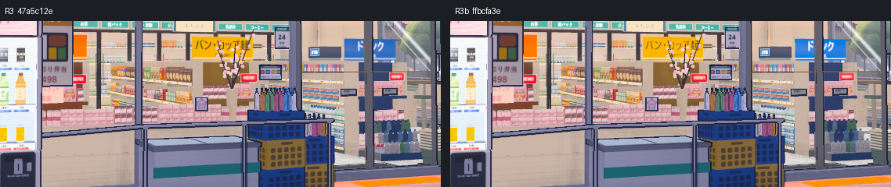

# W1 三座货台与货类牌

补修版 `ffbcfa3e` 的 60 件商品全部获得承托。与原 R3 `47a5c12e` 相比，橙、黄、蓝三块类别牌改用一张图集中的三块独立区域。固定 B 机位仍能看到黄色面包区和蓝色饮料区，橙色零食牌的字被前景挡住。

## 商品底面和步行碰撞

用禁硬件的 Electron 建立完整站区，在静态合批前读取实际商品实例、台阶和原有货架。沿用原 R3 的同一份射线代码，排除受测商品自身，查底面中心和 31×31 网格。瓶底按自身八边形裁切，接触容差为 2 mm。补修版的 2,268 个相关朝上三角进入相交测试。

| 类别 | 分层件数 | 上轮完全悬空 | 本轮获承托 | 本轮底面采样有支撑 |
| --- | ---: | ---: | ---: | ---: |
| 零食纸盒 | 每层 6，共 18 | 12 | 18/18 | 17,298/17,298 |
| 面包纸盒 | 每层 6，共 18 | 12 | 18/18 | 17,298/17,298 |
| 饮料瓶 | 每层 8，共 24 | 24 | 24/24 | 16,440/16,440 |

另 60 条中心射线全部接触承托面。第一、二、三层的接触面分别在柜底以上 0.12、0.25、0.38 m。51,036 个格心里的最大正净距约为 1.2×10⁻⁸ m。三块原碰撞体逐字段相同，站区 X 为 −8.78 m，Z 为 11.65、9.20、6.70 m，宽深为 0.80 × 0.44 m，竖直范围为 0.0634–1.0134 m。[逐件射线、碰撞及图集记录](r3b-stock.json) · [上轮原始记录与重放用射线](../../art-r3-ground-3060-2026-11-18/w1/README.md)

## 类别牌与原生 B 镜头

三块牌的源画布各为 256×92。合批前后的材质均为 `MeshBasicMaterial`，三者合入同一个输出网格。实际检查 4096² 图集第 5 页，三个区域左上角分别为 (6,2782)、(274,2782)、(542,2782)。图集与源画布共 70,656 个 RGBA 像素逐一相同。[合批观测代码](observe-atlas.cjs)

| 相同原像素裁区 | 类别牌差异 >8 | 低处商品差异 >8 | 固定 B 上可辨范围 |
| --- | ---: | ---: | --- |
| 零食 | 110/3,384 | 0/4,488 | 两版都只露橙牌右端色块，前景招牌挡住文字。 |
| 面包、杯面 | 875/2,607 | 0/3,995 | 黄色牌开头的「パン」可辨，后半行被花枝部分遮住。 |
| 饮料 | 1,561/2,040 | 1,972/3,312 | 蓝牌和白字两端可见，窗框挡住中部。右下瓶堆的移位可见。 |

原图均为 RTX 3060 Laptop、1440×900、58° 垂直视角，傍晚时钟锁 14 s，隐藏 HUD。机位、四元数与上轮逐项一致，两张原图各自三次捕获的哈希相同。表内数值为同位置 RGB 最大通道差大于 8 的像素数。三块牌的英文小字在固定 B 上均无法完整辨读。下图将每个类别牌裁区作最近邻 3 倍放大以查看遮挡。[三块牌的原像素放大](w1-headers-3x.png) · [六个裁区和原图校验](doorway-diff.json)

从本轮已准备的 fixture 运行 `node evidence/art-r3b-ground-3060-2026-11-18/w1/capture.cjs --electron=<本机 Electron> --output=<输出目录>` 可重放几何及图集检查。照片裁区可用 `python screen.py <含本轮 B 原图和拍摄记录的目录>` 重算。[CPU 采集驱动](capture.cjs) · [裁区脚本](screen.py)
