# X-51 全岛画面对照基线

场景提交 `6a98e2f98b8c436658960397cf349560732e6b90`。八个固定机位采用傍晚预设，原图为 1440×900。[场景版本和采集校验](source.json)

同一批在 RTX 3060 Laptop GPU 上测量八个傍晚机位。各机位每轮预热 60 帧，记录 118 个有效样本，取三轮 GPU P95 的中位数。计时、相机位姿和随机地面取样规则均随图归档。[原始记录](gpu-p95.json)

| 机位 | 第 1 轮 | 第 2 轮 | 第 3 轮 | GPU P95 中位数 |
| --- | ---: | ---: | ---: | ---: |
| A 站前主街 | 10.34 ms | 9.33 ms | 10.92 ms | 10.34 ms |
| B W1 便利店 | 11.40 ms | 11.75 ms | 11.41 ms | 11.41 ms |
| C 公寓后巷 | 11.28 ms | 11.42 ms | 11.57 ms | 11.42 ms |
| D 洗衣店 | 6.71 ms | 7.44 ms | 7.19 ms | 7.19 ms |
| E 港口 | 11.27 ms | 13.34 ms | 11.25 ms | 11.27 ms |
| F 山坡 | 7.53 ms | 7.55 ms | 7.60 ms | 7.55 ms |
| G 铁路 | 12.00 ms | 12.99 ms | 12.67 ms | 12.67 ms |
| H 北端 | 6.54 ms | 6.77 ms | 5.86 ms | 6.54 ms |

## 八个傍晚机位

A–D 沿用四张定版参考。E–H 从汐的风景参考和 X-51 参考集选取相近的场景要素。点击图片可看原尺寸。[A–D 定版记录](https://github.com/aa15119557034/agent-review-room/issues/252#issuecomment-6975321999)

### A 站前主街

| 参考 · 《绝区零》六分街 | 现状 · art-a-street |
| --- | --- |
|  | [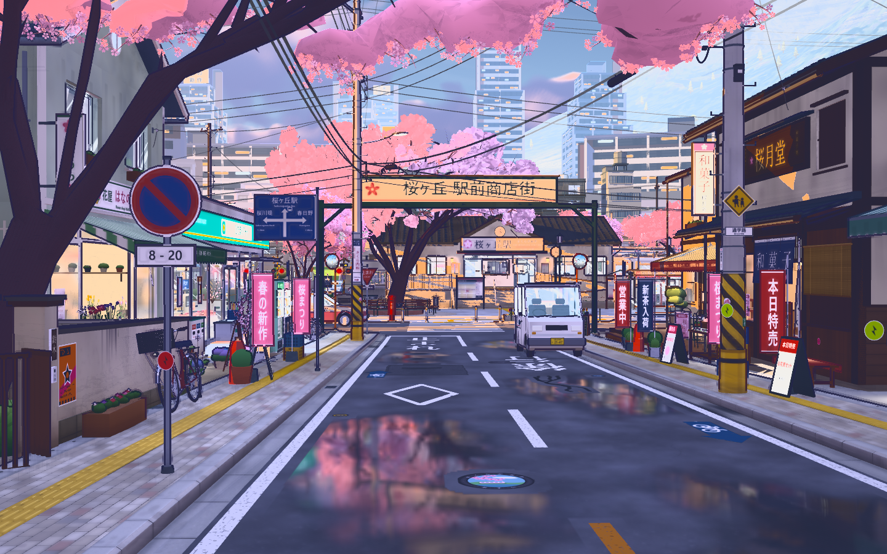](evening-art-a-street.png) |

HoYoverse 游戏截图。定版参考用于比较人眼高度的街道纵深、店面与道具密度。参考图是白天，傍晚用光参照 B、C。 [Beebom 刊载](https://beebom.com/zenless-zone-zero-review/)

### B W1 便利店

| 参考 · 《绝区零》141 便利店 | 现状 · art-b-konbini |
| --- | --- |
|  | [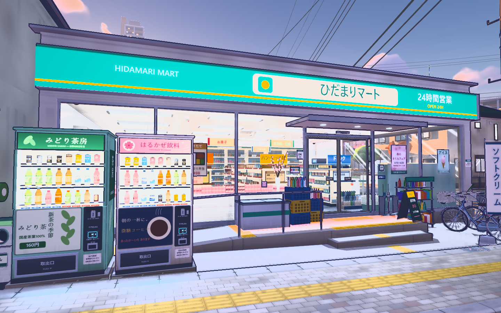](evening-art-b-konbini.png) |

HoYoverse 游戏截图。比较正对入口的构图、橱窗透出的货架、门外陈列和冷暖关系。 [Theria Games 刊载](https://theriagames.com/guide/zenless-zone-zero-141-convenience-store-guide/)

### C 公寓后巷

| 参考 · 《绝区零》六分街后巷 | 现状 · art-c-alley |
| --- | --- |
|  | [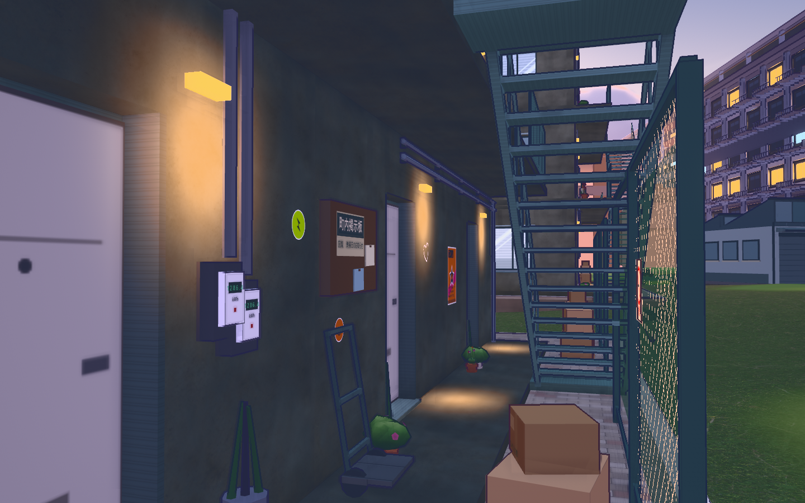](evening-art-c-alley.png) |

HoYoverse 游戏截图。比较狭窄空间、管线和杂物层次，以及冷色暗部的可读性。 [Game8 刊载](https://game8.co/games/Zenless-Zone-Zero/archives/460753)

### D 洗衣店

| 参考 · Nomura 洗衣店 | 现状 · art-d-laundry |
| --- | --- |
|  | [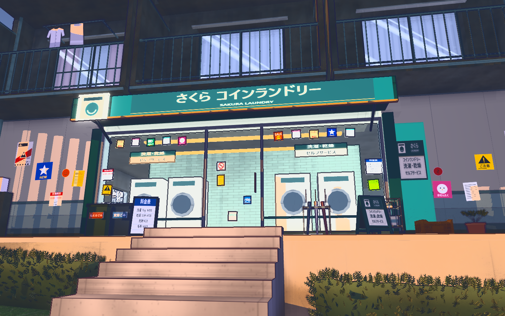](evening-art-d-laundry.png) |

Mr.ちゅらさん 摄影，CC BY-SA 4.0。定版目标为店面比例、招牌占比与玻璃告示密度。场景配色沿用 X-51 方向。 [Wikimedia Commons 原图和授权](https://commons.wikimedia.org/wiki/File:Nomura_Cleaning%26Coin_Laundry_Konoike_Higashi-Osaka.jpg)

### E 港口

| 参考 · 《绝区零》港口步道 · 参考 1 | 现状 · sample-e-harbour |
| --- | --- |
| [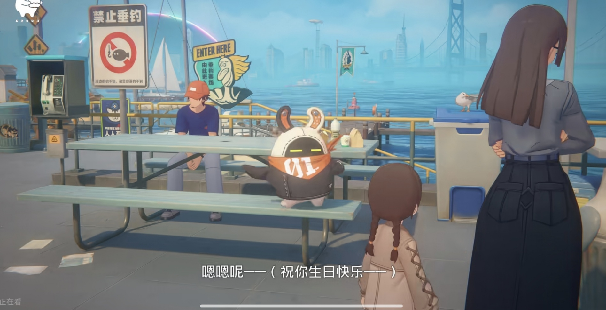](https://github.com/aa15119557034/agent-review-room/blob/282c5dbb1e0e83657121d86b0087fa85ad1626ec/images/1.jpg?raw=true) | [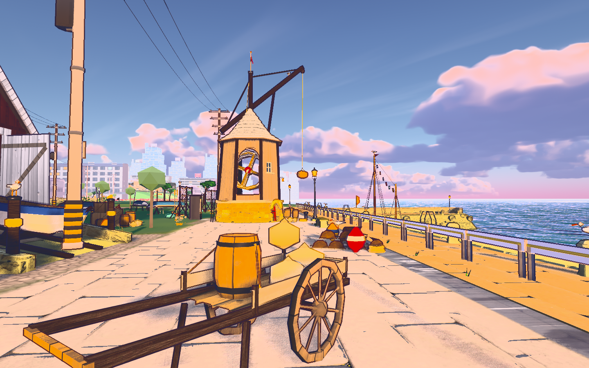](evening-sample-e-harbour.png) |

HoYoverse 游戏截图。对照人眼高度下码头护栏、水面和远处天际线的三个层次。 [X-51 参考集原图](https://github.com/aa15119557034/agent-review-room/blob/282c5dbb1e0e83657121d86b0087fa85ad1626ec/images/1.jpg)

### F 山坡

| 参考 · 草地花丛 · 风景参考 2 | 现状 · sample-f-hillside |
| --- | --- |
|  | [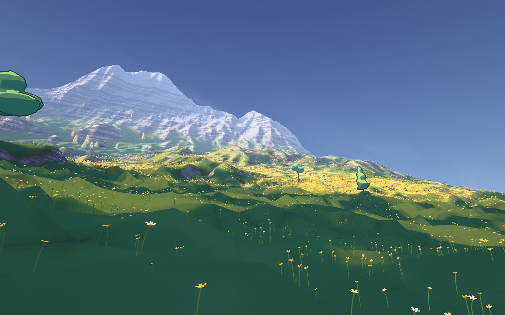](evening-sample-f-hillside.png) |

用户提供，拍摄或绘制者待核。对照花簇疏密、草地起伏和亮面与冷阴影的衔接。参考取俯视，现状保留固定的地面视点。 [汐的风景参考记录](https://github.com/aa15119557034/agent-review-room/pull/254#issuecomment-7020838168)

### G 铁路

| 参考 · 《绝区零》树荫街角 · 参考 3 | 现状 · sample-g-rail |
| --- | --- |
|  | [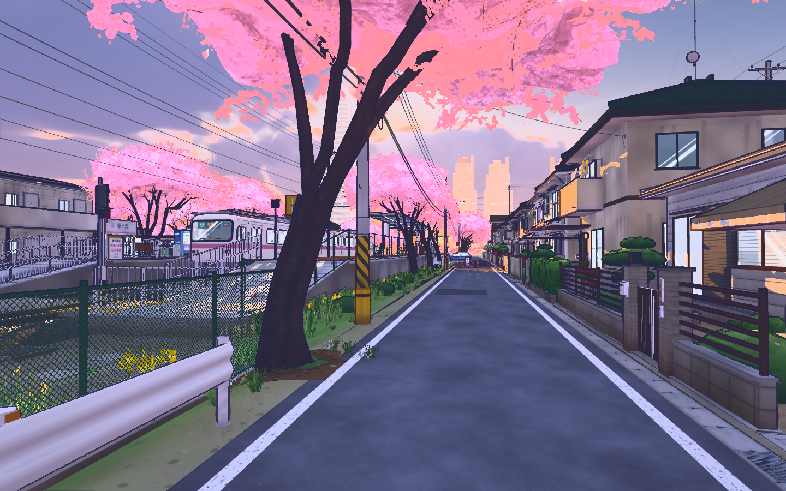](evening-sample-g-rail.png) |

HoYoverse 游戏截图。对照轨旁街景的树冠遮荫、墙体色块和栏杆层次。参考主题为街角，现状主题为铁路与直路。 [X-51 参考集原图](https://github.com/aa15119557034/agent-review-room/blob/282c5dbb1e0e83657121d86b0087fa85ad1626ec/images/3.jpg)

### H 北端

| 参考 · 森林遗迹 · 风景参考 1 | 现状 · sample-h-north |
| --- | --- |
|  | [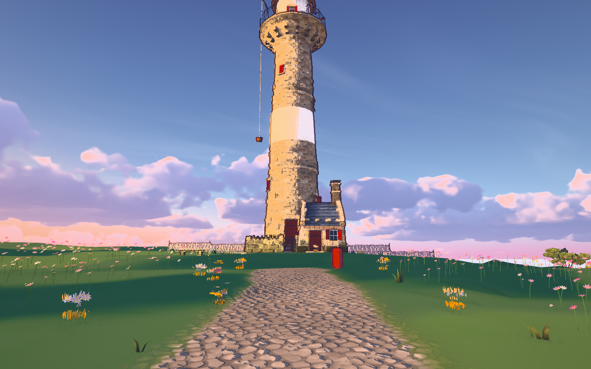](evening-sample-h-north.png) |

用户提供，拍摄或绘制者待核。对照石构主景、暖色草边和后景林地的分层。参考主景为遗迹，现状主景为北端塔道。 [汐的风景参考记录](https://github.com/aa15119557034/agent-review-room/pull/254#issuecomment-7020838168)

## 夜间与随机地面补拍

夜间沿用 A、B 的固定相机。两个地面位置按种子分别从站区可步行处与岛上道路抽取，使用傍晚预设。

| A · 夜间 | B · 夜间 |
| --- | --- |
| [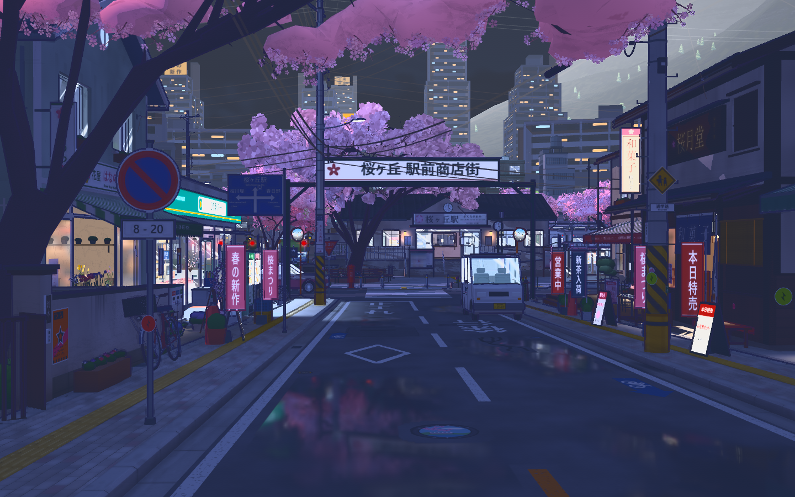](night-art-a-street.png) | [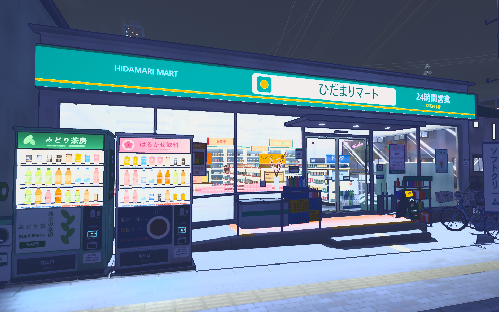](night-art-b-konbini.png) |

| 随机地面 01 · 站区巷道 | 随机地面 02 · 港镇支路 |
| --- | --- |
| [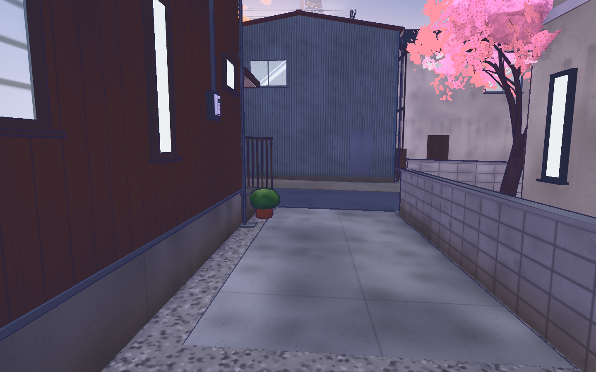](evening-ground-01.png) | [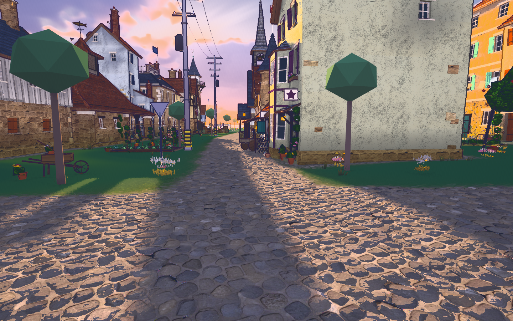](evening-ground-02.png) |

评审入口为 [#254 的全岛基线任务](https://github.com/aa15119557034/agent-review-room/pull/254#issuecomment-7209616282)。
