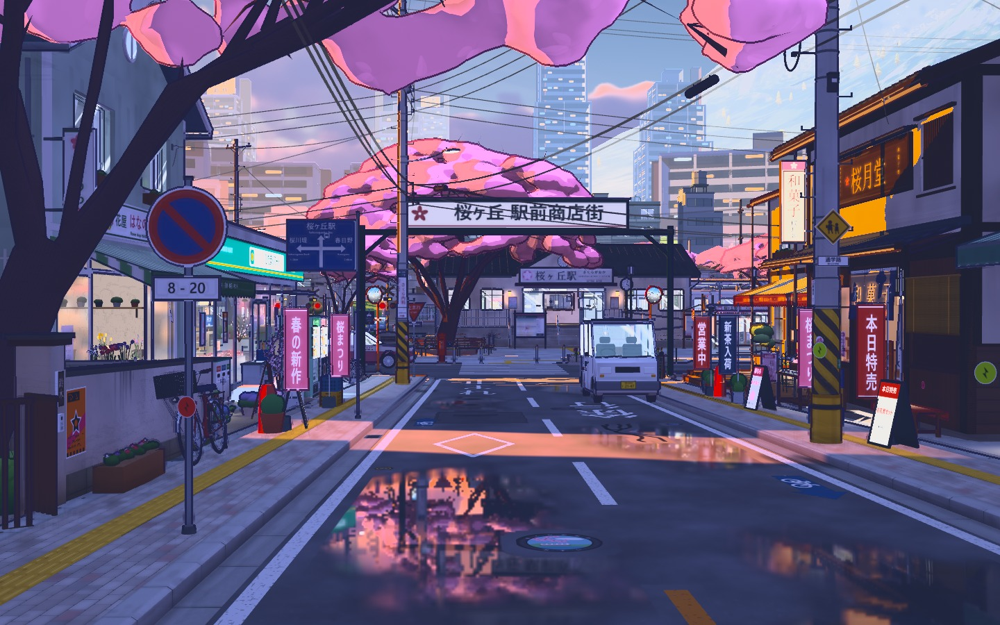
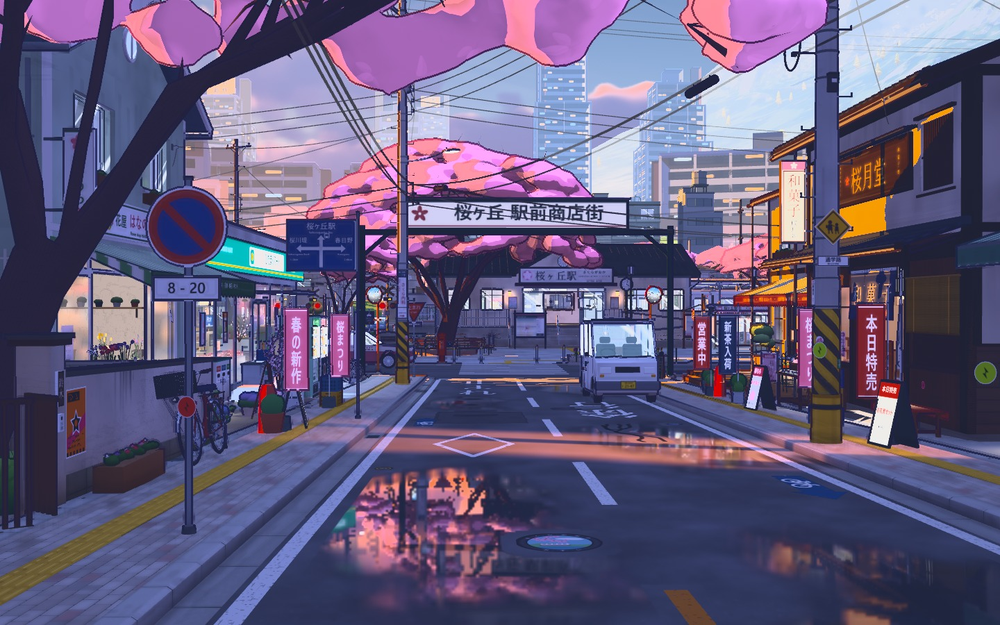
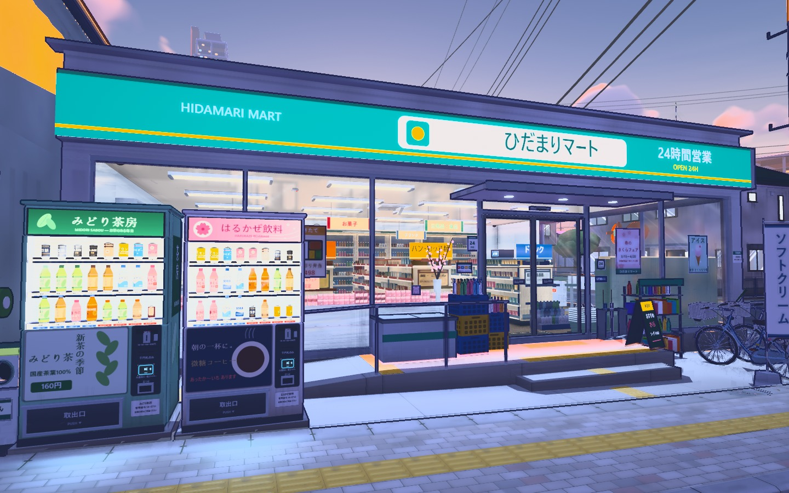

# X-51 批 4 · A 夕照复拍

基线 3846b06a。相同相机、RTX 3060 Laptop 实拍、1440 × 900、场景冻结 5 秒。

| 机位 | 参考 | 第二轮 | 第三轮 |
| --- | --- | --- | --- |
| A 站前夕照 |  |  |  |
| B 店外邻接镜头 | |  |  |

路面、路沿、人行道共用同一束光。在楼缝一侧较亮，向对街渐弱。路杆与店前立式牌沿相同方向投出带半影的遮挡。

[相机和源文件记录](captures.json)
