# 第 19 轮傍晚精修 · RTX 3060 同机位回验

傍晚默认入口 `6e6d3eb1e05bbb3f37491eed2cc183ff9f385385` 已在 RTX 3060 Laptop、ANGLE D3D11、1440×900、DPR 1 上复测。四个常规机位、两段真实步行和四个镇边机位都达到 ≥60 FPS、p95 ≤16.7 ms。下午对照取自同机精修前的 `b0259599bd51178c2d4980243a9c87553eac1a66`。两版都使用本机经哈希校验的原始公寓 PBR 贴图。两次独立采样的 FPS 差值也包含运行波动。[十段逐帧统计](frame-times.json) · [原始帧](frames/)

| 机位／步行 | 下午 FPS | 傍晚 FPS | 傍晚 p95（ms） | 最慢帧（ms） | 超过 20 ms | 采样帧数 |
|---|---:|---:|---:|---:|---:|---:|
| 01 主街 | 64.68 | 64.68 | 15.5 | 30.7 | 1 | 201 |
| 02 港口 | 65.00 | 65.00 | 15.5 | 15.6 | 0 | 202 |
| 03 全岛鸟瞰 | 65.00 | 63.72 | 15.5 | 30.8 | 4 | 200 |
| 04 便利店内 | 65.00 | 65.00 | 15.5 | 15.6 | 0 | 202 |
| 第三人称步行 | 65.00 | 64.68 | 15.5 | 30.7 | 1 | 202 |
| 第一人称步行 | 64.36 | 65.00 | 15.5 | 15.7 | 0 | 203 |
| 20 公寓后廊 | 64.80 | 65.00 | 15.5 | 15.7 | 0 | 657 |
| 21 洗衣店前 | 64.80 | 65.00 | 15.5 | 15.7 | 0 | 657 |
| 23 维修角 | 64.50 | 65.00 | 15.5 | 15.7 | 0 | 657 |
| 24 洗衣店细节 | 65.00 | 65.00 | 15.5 | 15.6 | 0 | 658 |

常规机位及步行每段约 3.1 秒，镇边机位每段约 10.1 秒，站区和岛屿时钟均正常推进。帧时取 RAF 间隔，计入各渲染阶段及统计开销。FPS 由总帧数和总时长计算，p95 使用最近秩。14 项行为检查、画面开关检查和两种视角的实际移动均通过。[运行回执](runs.json)

## 同机位前后图

每组都核对相机世界坐标、四元数、视场角、动画时间参数 14、AO 0.55、HUD 与分辨率。最终图取第二次正式采集，JPEG 保留原始 1440×900 尺寸。灯光与 bloom 跟随各自提交的默认预设。03 沿用原全岛鸟瞰机位。[机位、PNG 摘要与现场光照参数](comparison.json)

| 机位 | 精修前 · 下午 | 第 19 轮 · 默认傍晚 |
|---|---|---|
| 01 站前主街 | [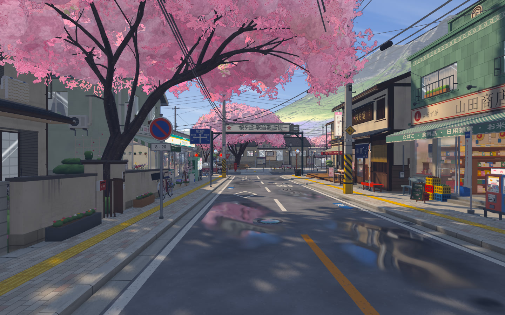](../street-upgrade-2026-11-18/images/01-after.jpg) | [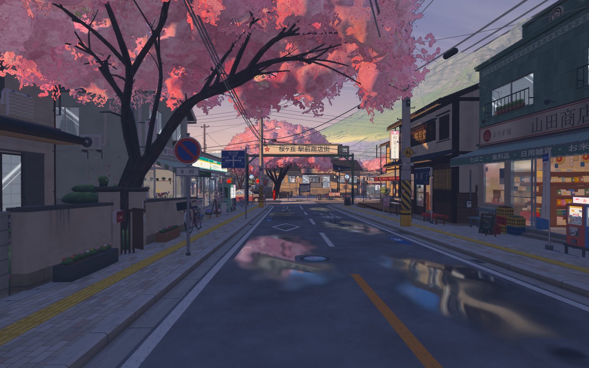](images/01-evening.jpg) |
| 20 公寓后廊 | [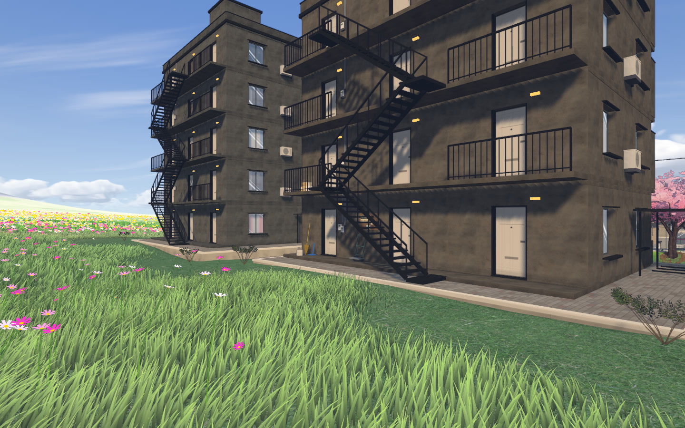](../street-upgrade-2026-11-18/images/20-after.jpg) | [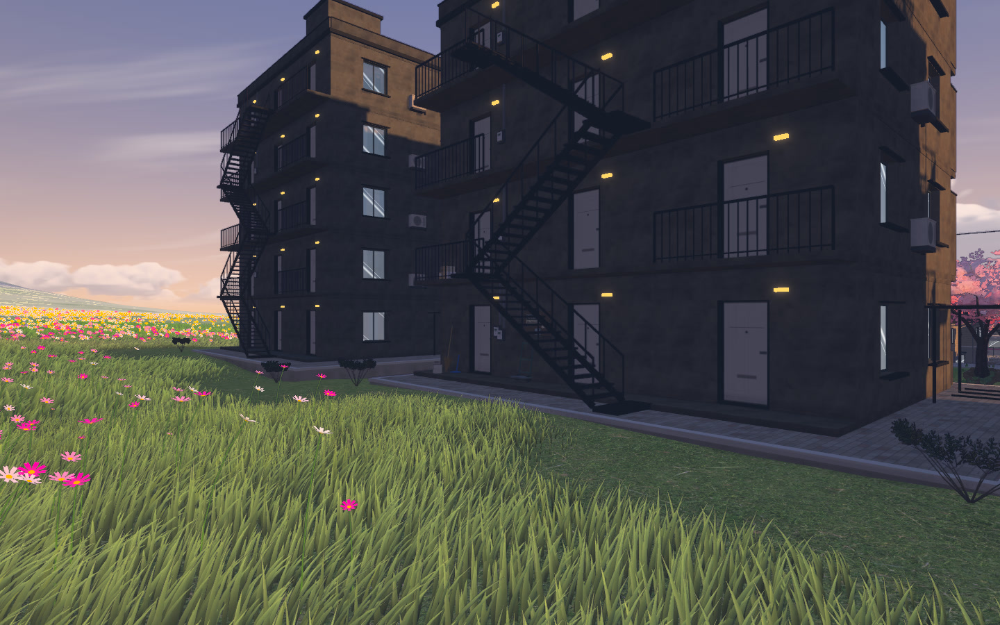](images/20-evening.jpg) |
| 21 洗衣店前 | [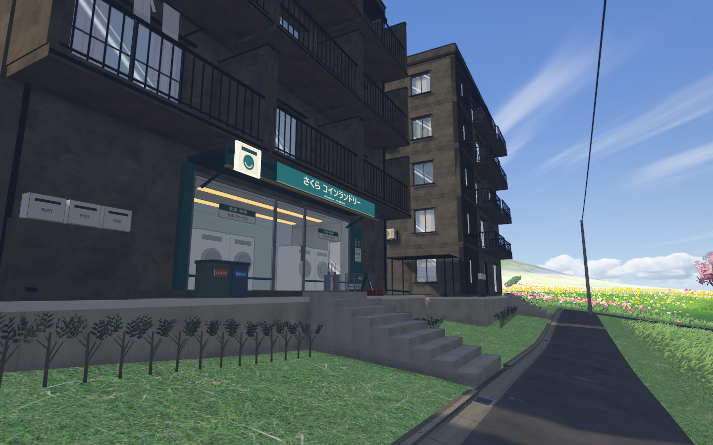](../street-upgrade-2026-11-18/images/21-after.jpg) | [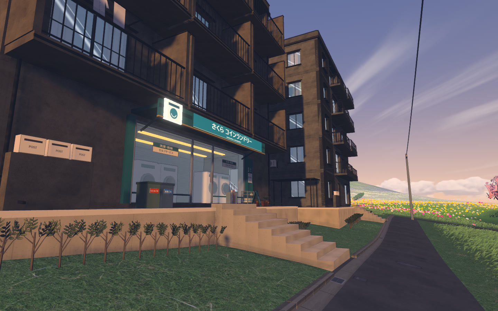](images/21-evening.jpg) |
| 23 维修角 | [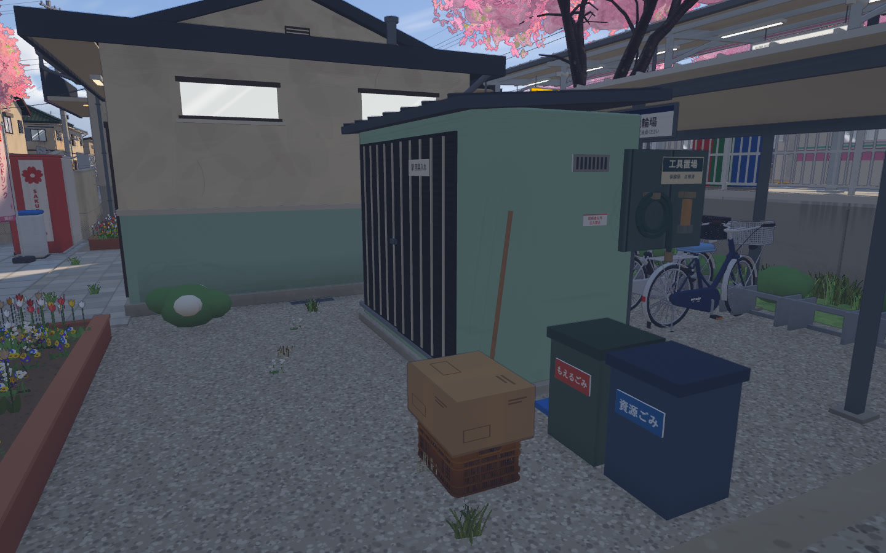](../street-upgrade-2026-11-18/images/23-after.jpg) | [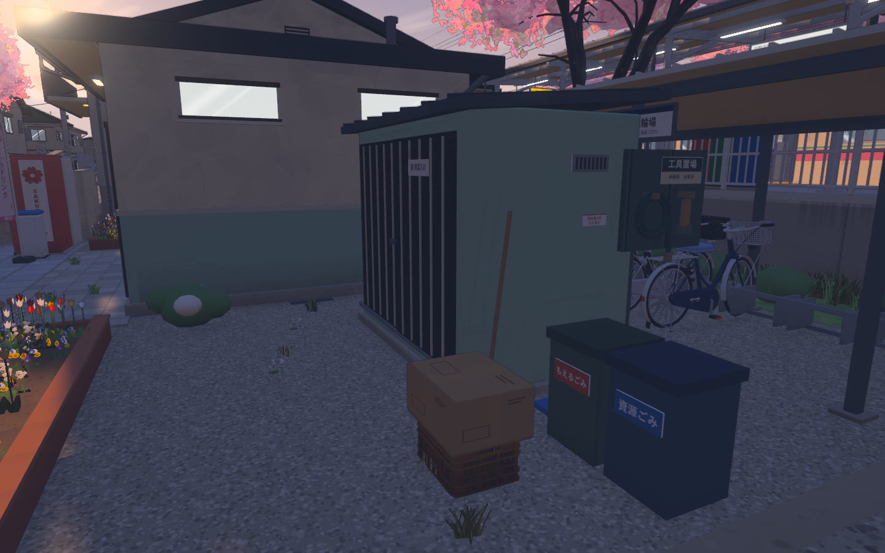](images/23-evening.jpg) |
| 24 洗衣店细节 | [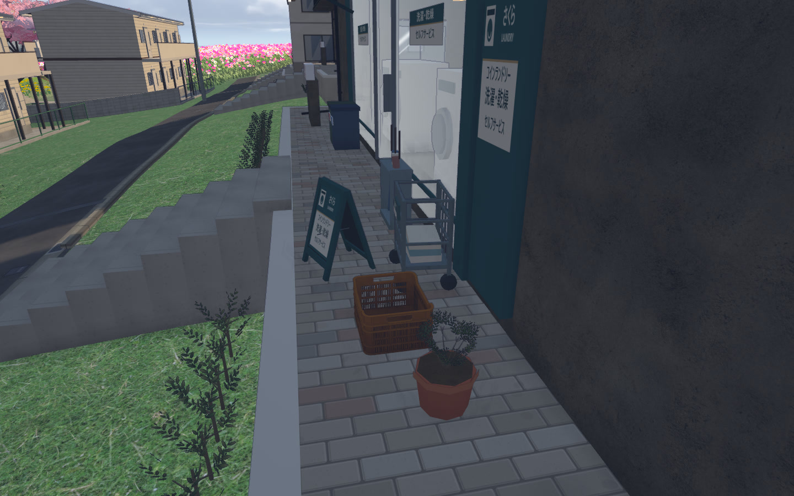](../street-upgrade-2026-11-18/images/24-after.jpg) | [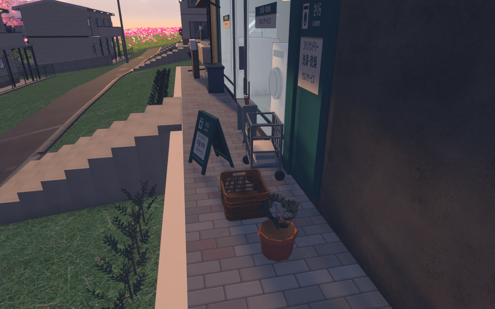](images/24-evening.jpg) |
| 04 便利店内 | [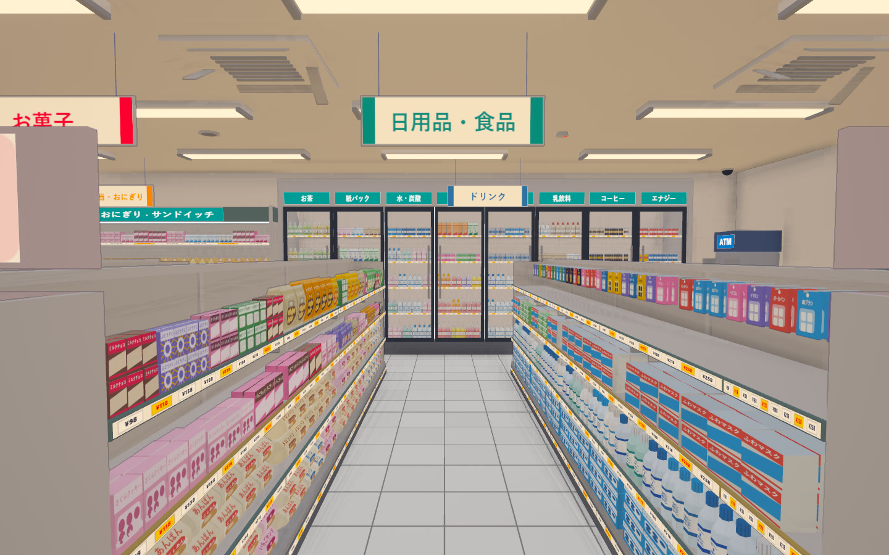](../street-upgrade-2026-11-18/images/04-after.jpg) | [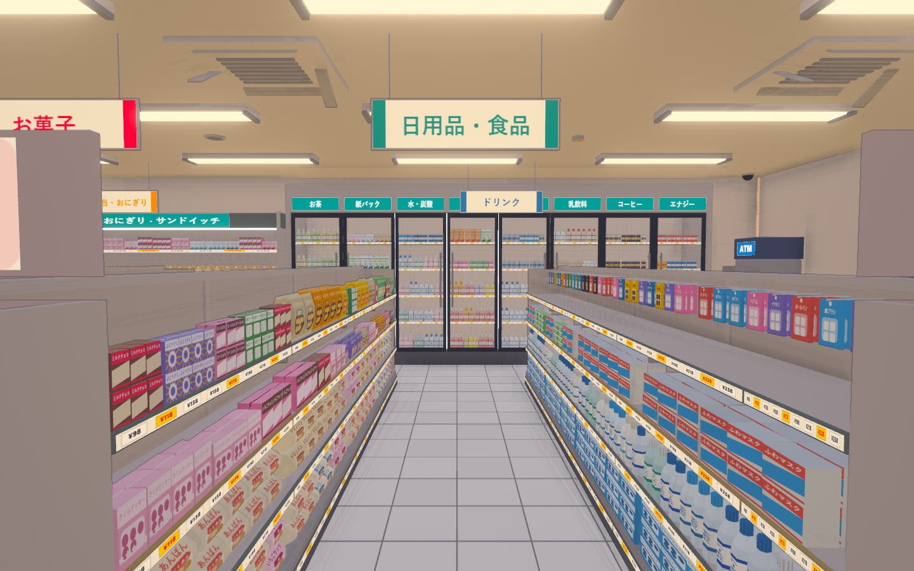](images/04-evening.jpg) |
| 03 全岛鸟瞰 | [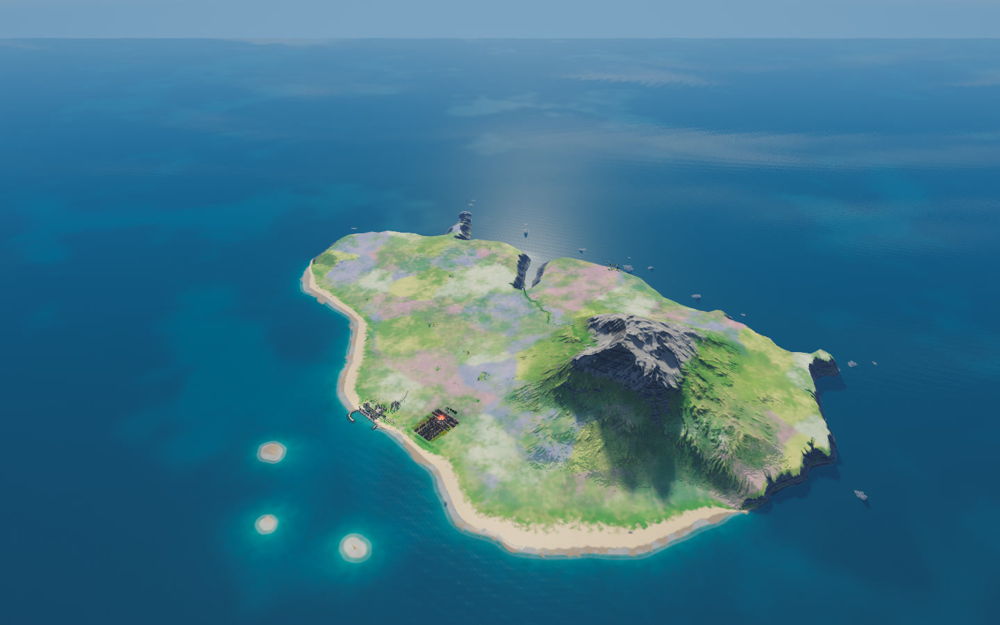](../street-upgrade-2026-11-18/images/03-after.jpg) | [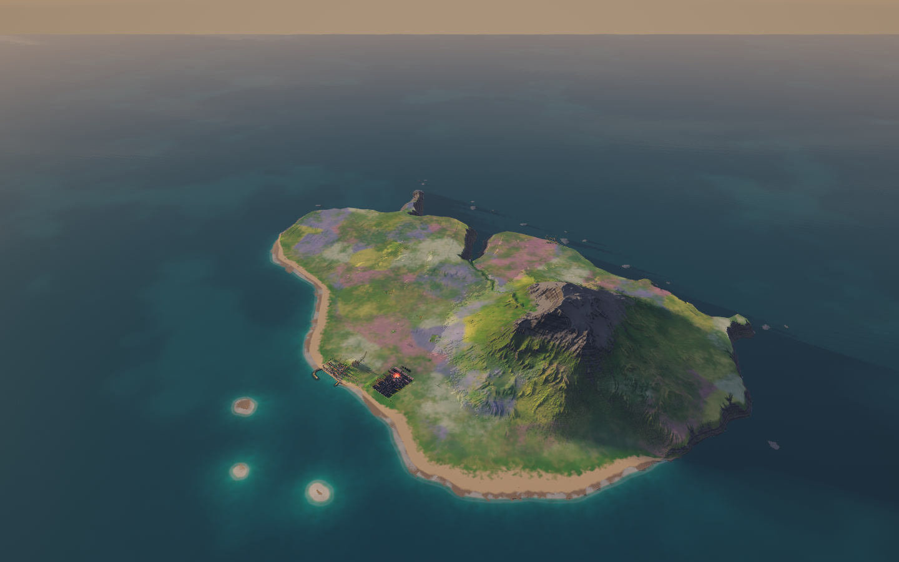](images/03-evening.jpg) |
| 补充 商店橱窗近景 | [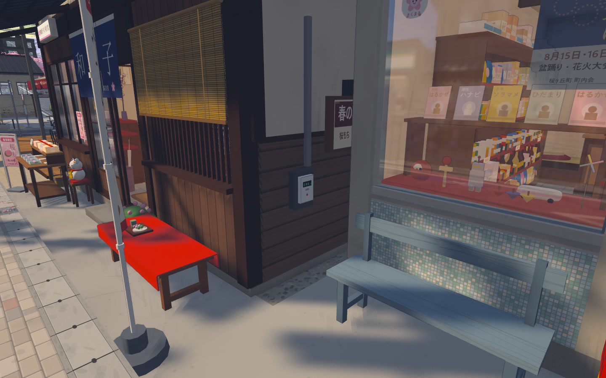](../street-upgrade-2026-11-18/images/detail-after.jpg) | [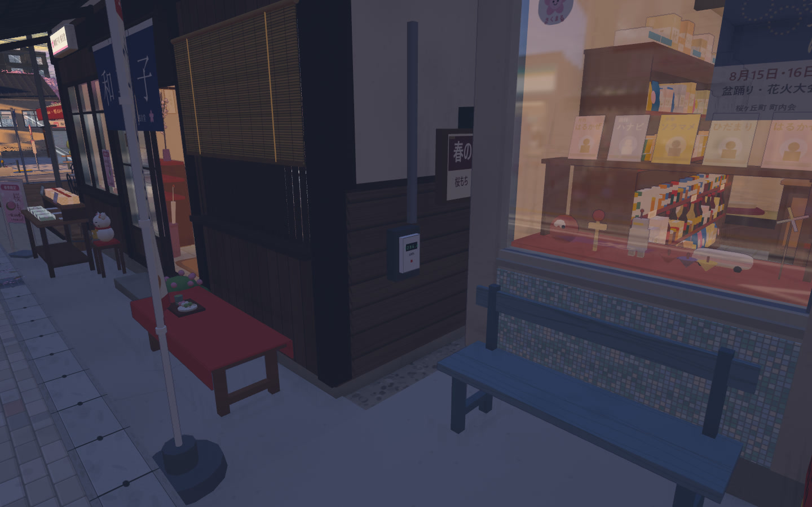](images/detail-evening.jpg) |

- **01 主街与橱窗近景**。斜阳照亮街口灯箱，右侧店面进入冷阴影。直射樱冠里仍可见成片橙红。主街水洼和近景橱窗沿用下午倒影，和傍晚天色有落差。
- **20 公寓后廊**。真实 PBR 墙面在背光面变得很暗，中间一跑楼梯与后墙接近同色。门灯清楚，楼梯扶手和栏杆的层次需继续调整。
- **21 洗衣店前与 24 门廊**。台阶、店招、玻璃门和推车可辨。21 前方能一株株数出等距树干，叶冠之间仍露出挡墙。连续绿篱的问题仍在。
- **23 维修角与 04 店内**。维修棚进入蓝紫阴影，后墙标牌仍可辨；便利店灯具比下午亮，货架标识仍可读。
- **03 全岛鸟瞰与港镇阴影**。山体明暗随低角度太阳变化。实机读取 Cairnwick 的 2048² 和 Larkhaven 的 4096² 阴影图，两台阴影相机朝太阳的单位向量与傍晚太阳的点积都为 1。当前代码在设置傍晚太阳后调用 `town.bakeShadows()`。这项核对覆盖 `uTownSh0/1` 方向，单栋屋顶的其他明暗来源需要更近的机位判断。[运行时读数](comparison.json)

## 光图、倒影与加载记录

先按交接在本机运行 `scripts/bake-evening-light.py`，退出 0。实际载入 4096² 的 `light-evening.png`，与下午图相比，R 通道改变 2,247,469 像素，G/B/A 逐像素一致。确认 bloom 为 0.2、13 个无贴图材质及 1 个印刷材质经过傍晚增亮。[逐通道校验](reports/terrain-light.json)

八组图与十段帧时均取自交回的源码及当时随附的街景倒影。实测结束后另外离线重烘了傍晚倒影六面，已存放在 [reflection-candidate](reflection-candidate/)。六面均生成，浮点原值中有 98 / 393,216 个像素至少一个通道超过当前编码上限 2，峰值 5.0391。候选图尚待处理高光和入场复验。烘焙时一次周转箱 BIN 加载取消，进程退出 1。[六面哈希、超范围位置和实际退出码](reflection-candidate/bake.json)

| 运行 | 实际退出码 | 加载期间的 `net::ERR_ABORTED` | JS 异常 |
|---|---:|---|---:|
| 常规六段 | 1 | `boulders.glb`、周转箱 glTF | 0 |
| 八机位截图 | 1 | 周转箱 BIN | 0 |
| 镇边四段 | 1 | `boulders.glb`、周转箱 BIN | 0 |

三轮均完成渲染，源码和准备资产的 237 项文件清单与实测完成后的哈希一致。保留了[实机报告、源清单与退出记录](reports/)。

## 实测命令

以 fixture 目录为当前目录，`<electron>` 为现有 Electron 可执行文件。八机位采集沿用建模工作树已有的 C17 相机报告。以下固定相机和镇边驱动均只读场景，采样输出写入不同目录并串行运行。

```text
python scripts/bake-evening-light.py .local/petalwake-25443cef0eba802052d9ef24c94ba3c4157b6f2e
node scripts/baseline.cjs --scene=combined --electron=<electron> --output=artifacts/gpu-c19-normal-6e6d3eb --stills
node <本目录>/tools/dusk-fixed.cjs gpu-modern-after-c19-6e6d3eb 6e6d3eb1e05bbb3f37491eed2cc183ff9f385385 <fixture>
node evidence/street-upgrade-2026-11-18/town/town-frame-times.cjs . <electron> artifacts/gpu-modern-after-c19-6e6d3eb/c17-reference.json artifacts/gpu-c19-normal-6e6d3eb/source-manifest.json artifacts/gpu-c19-town-6e6d3eb
node scripts/bake-street-reflections.cjs --electron=<electron> --output=artifacts/gpu-c19-evening-reflection-candidate-6e6d3eb
```
