# 第 21 轮 · 傍晚道口远景光晕回验

实测源码 `b949ffeb135f5b0798155aa5579740a841d94d0d`，修前源码 `e78c52ce50205f85a4af02bfa78fb8f230b3644b`。道口远景光斑可以收下。性能的首测与同机复测分列在下表。[C酱源码交回](https://github.com/aa15119557034/agent-review-room/pull/254#issuecomment-6964239516) · [第 20 轮原始诊断](https://github.com/aa15119557034/agent-review-room/pull/254#issuecomment-6963750528) · [源码 Windows CI](https://github.com/aa15119557034/agent-review-room/actions/runs/44201010190/job/134454763135)

## 道口从远到近

03 的橙红亮团已经退成一个小光点。相同测区暖亮像素从 57 降到 1。01 街尽头的两盏红灯仍然清楚，暖亮像素从 243 降到 215。另在南侧距信号杆 8.54 米处实拍，红灯测区的 **10,494 个像素修前修后完全相同**，灯芯与外围光晕都保住了。

在同一时刻只隐藏五个 `crossing-halo` 再恢复，保留物理灯体、灯具材质和 bloom。三处测区恢复后逐像素等于各自开启时。两版隐藏光晕后，三处测区也逐像素相同。表中统计显示 RGB 满足 R ≥170、R−G ≥45、R−B ≥50 的像素。

| 测区 | C20 开启 / 隐藏 / 恢复 | C21 开启 / 隐藏 / 恢复 |
|---|---:|---:|
| 03 航拍站区 | 57 / 0 / 57 | 1 / 0 / 1 |
| 01 街尽头的信号灯 | 243 / 135 / 243 | 215 / 135 / 215 |
| 8.5 米近景红灯 | 2,826 / 677 / 2,826 | 2,826 / 677 / 2,826 |

[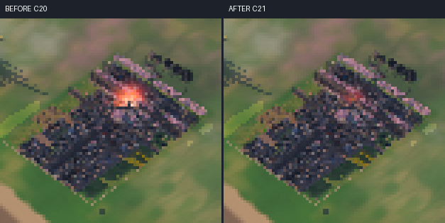](crops/03-before-after.png)

[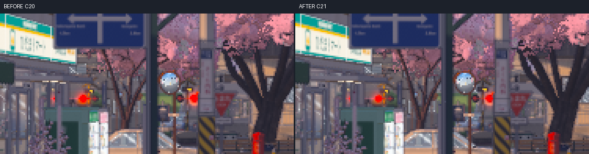](crops/01-before-after.png)

[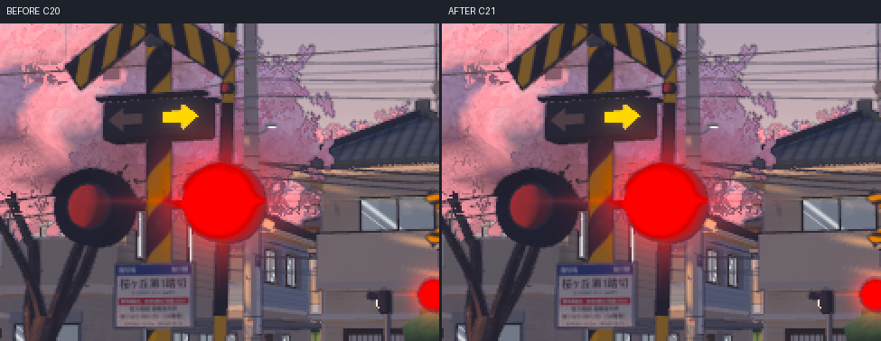](crops/near-before-after.png)

### 五灯开关

每组上行为 C20、下行为 C21。三列依次为正常显示、暂时隐藏五个光晕、恢复。03 放大 4 倍、01 放大 3 倍、近景放大 2 倍，均用最近邻保留显示像素。01 和近景修前补拍在证据提交 `8091a90`，其运行文件散列与 `e78c52c` 的冻结诊断清单完全一致。[相机姿态、取样矩形、像素条件和开关回执](crossing-measurements.json)

[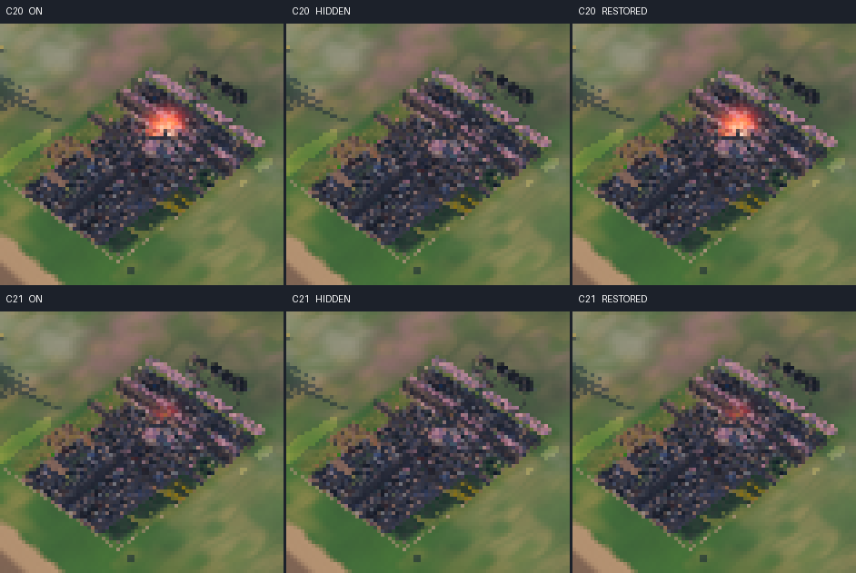](crops/03-isolation.png)

[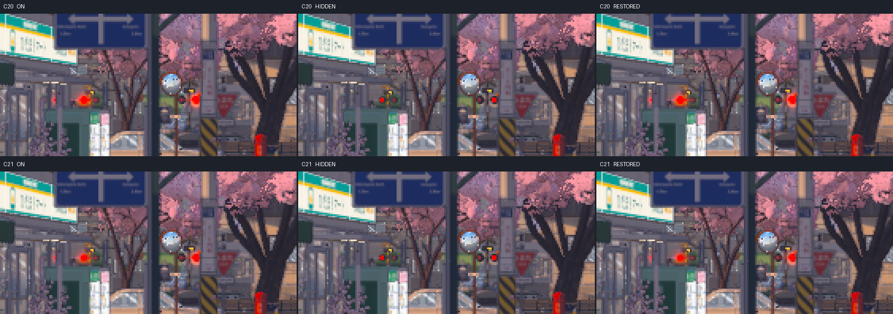](crops/01-isolation.png)

[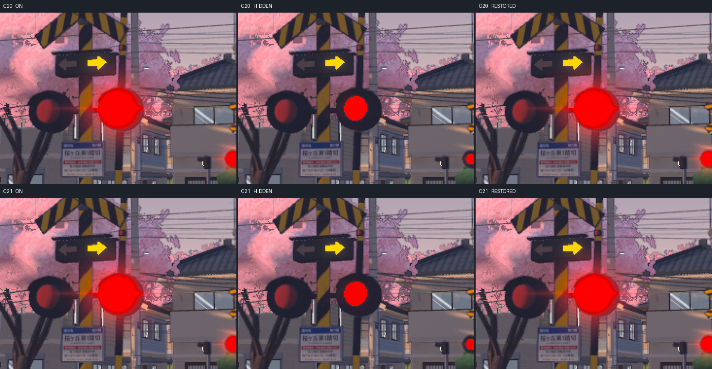](crops/near-isolation.png)

## 八个固定机位

RTX 3060 Laptop / D3D11，1440×900，DPR 1。对照沿用上一轮八个固定机位。世界与车站时钟冻结在 14，相机位置、四元数、FOV、AO 0.55、太阳、半球光和后期参数逐一核对相同。每组取第三次渲染的原尺寸照片。 20 后廊、21 绿墙、23 维修角、24 洗衣店细节、04 店内和橱窗近景的全幅像素与前版完全相同。01 旧樱冠测区中 35 个像素相差 1 级色值。下午入口的 01 PNG 与前版逐字节相同。

| 机位 | 第 20 轮 · e78c52c | 第 21 轮 · b949ffe |
|---|---|---|
| 01 站前主街 |  | [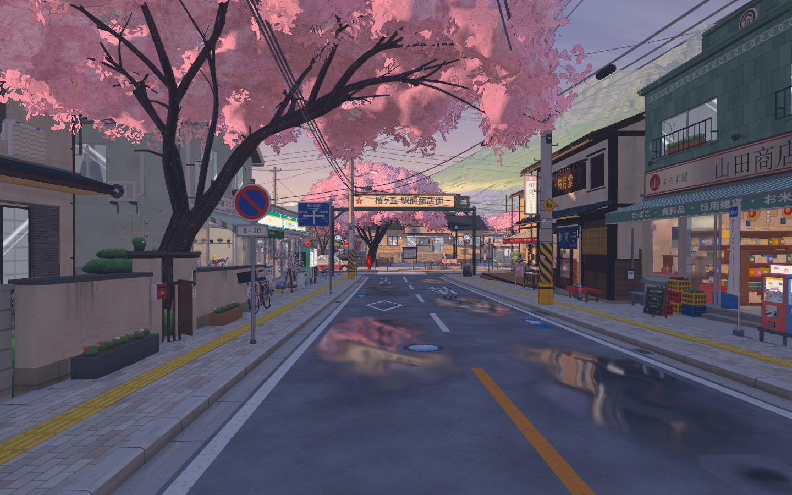](images/01-evening.jpg) |
| 20 公寓后廊 | [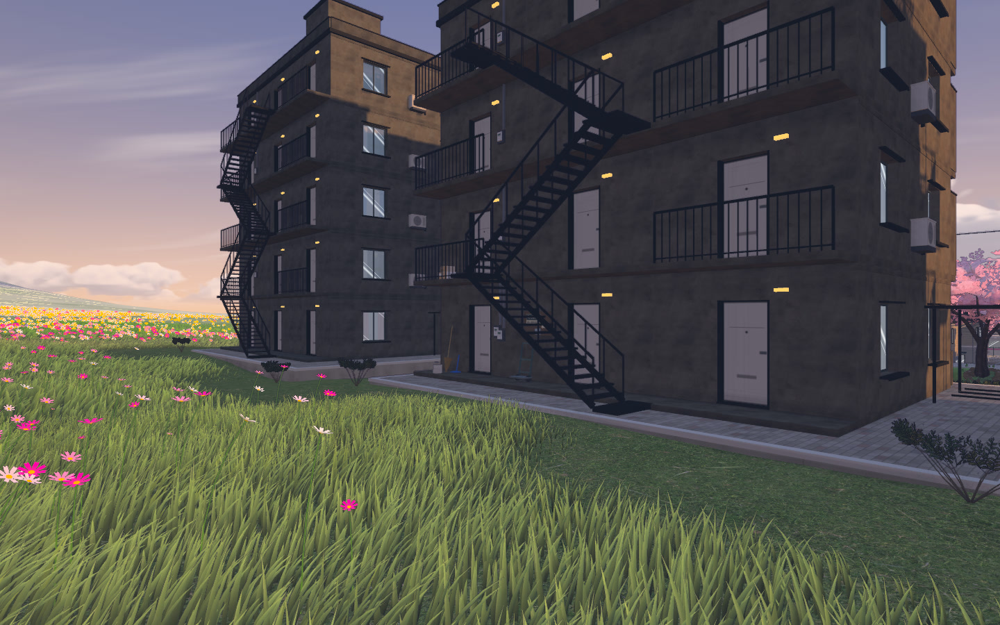](../c20-evening-corridor-sakura-3060-2026-11-18/images/20-evening.jpg) |  |
| 21 洗衣店前 | [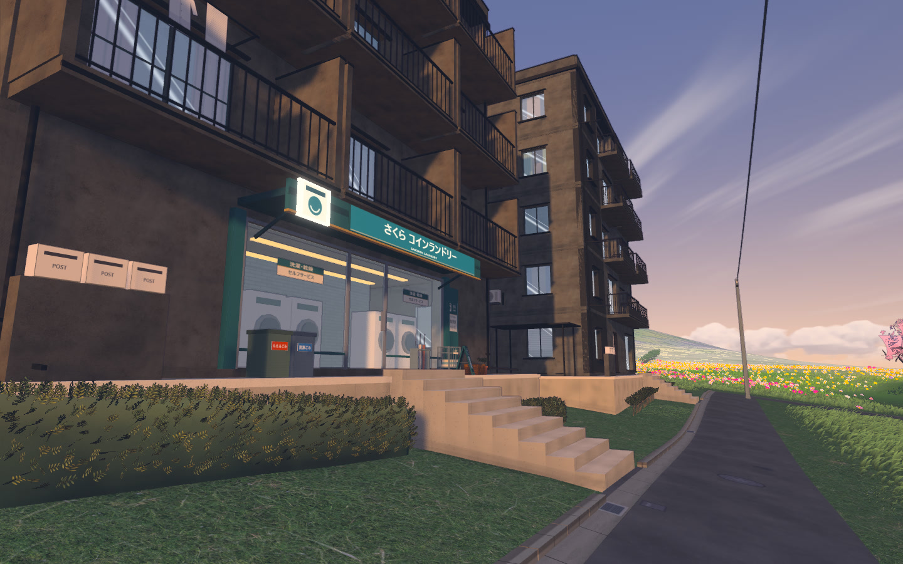](../c20-evening-corridor-sakura-3060-2026-11-18/images/21-evening.jpg) |  |
| 23 维修角 |  | [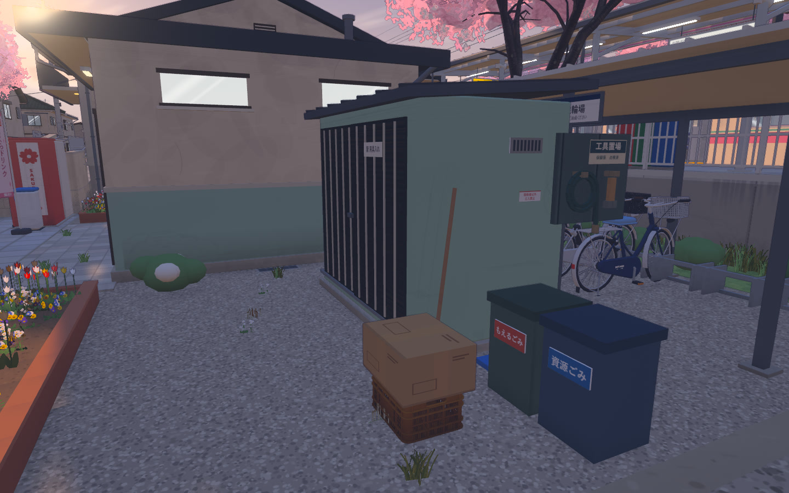](images/23-evening.jpg) |
| 24 洗衣店细节 | [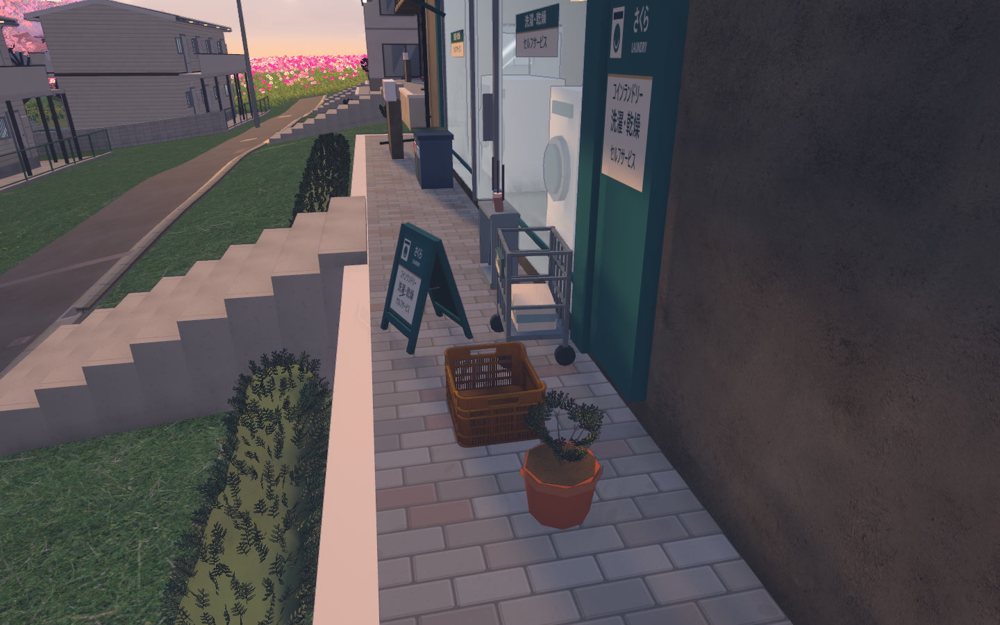](../c20-evening-corridor-sakura-3060-2026-11-18/images/24-evening.jpg) |  |
| 04 便利店内 | [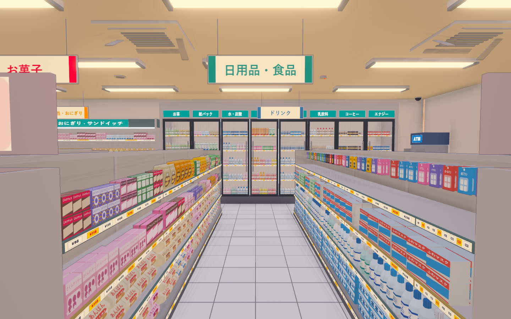](../c20-evening-corridor-sakura-3060-2026-11-18/images/04-evening.jpg) |  |
| 03 全岛鸟瞰 | [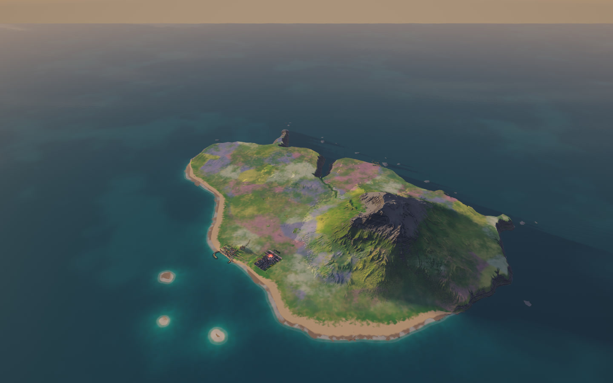](../c20-evening-corridor-sakura-3060-2026-11-18/images/03-evening.jpg) |  |
| detail 商店橱窗近景 | [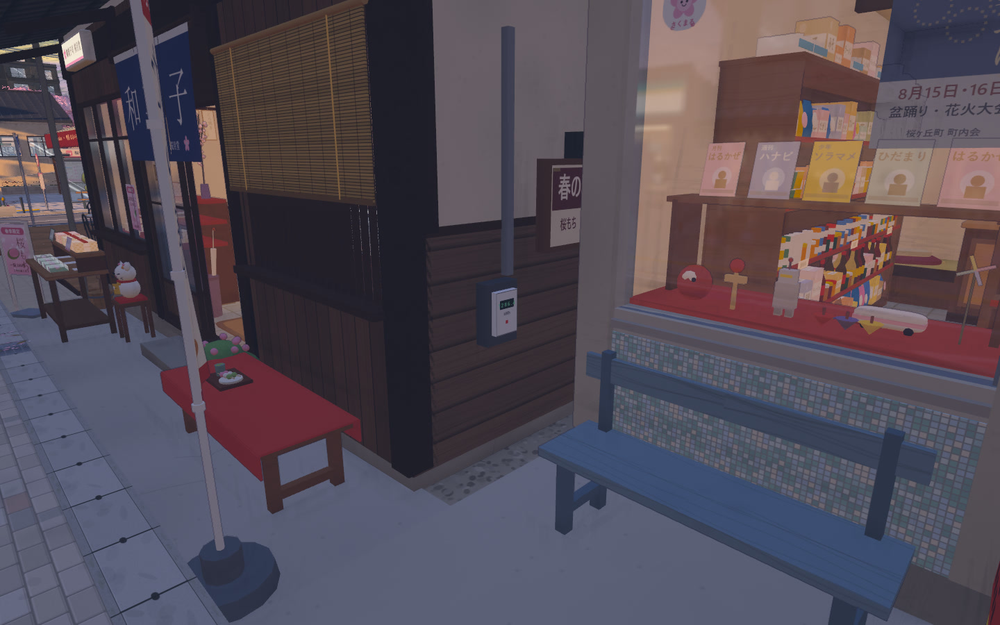](../c20-evening-corridor-sakura-3060-2026-11-18/images/detail-evening.jpg) |  |

## 帧时

逐段预算为平均 ≥60 FPS 且 p95 ≤16.7 ms。正式首测有 7/10 段达标，随后在同机回切真实 C20 源码测得 7/10，再切回 C21 测得 9/10。每格为 FPS / p95（ms）。常规四机位和两段步行各约 3 秒，镇边四机位各约 10 秒。三轮采用相同相机、画质、采样程序和计时窗口。

| 机位或路线 | C21 首测 | C20 回切对照 | C21 复测 | 三轮 >20 ms 帧数 |
|---|---:|---:|---:|---:|
| 03 全岛鸟瞰 | 58.28 / 30.8 | 56.08 / 30.8 | 61.48 / 30.7 | 21 / 28 / 11 |
| 01 站前主街 | 63.40 / 15.5 | 61.18 / 30.7 | 64.68 / 15.5 | 5 / 12 / 1 |
| 第一人称步行 | 55.12 / 30.8 | 65.00 / 15.5 | 65.00 / 15.5 | 31 / 0 / 0 |
| 第三人称步行 | 63.09 / 15.5 | 61.49 / 30.8 | 64.36 / 15.5 | 6 / 11 / 2 |
| 20 公寓后廊 | 61.14 / 30.7 | 64.50 / 15.5 | 63.32 / 15.5 | 39 / 5 / 17 |
| 21 洗衣店前 | 65.00 / 15.5 | 65.00 / 15.5 | 65.00 / 15.5 | 0 / 0 / 0 |
| 23 维修角 | 65.00 / 15.5 | 65.00 / 15.5 | 64.90 / 15.5 | 0 / 0 / 1 |
| 24 洗衣店细节 | 65.00 / 15.5 | 65.00 / 15.5 | 65.00 / 15.5 | 0 / 0 / 0 |
| 站区港口 | 65.00 / 15.5 | 65.00 / 15.5 | 65.00 / 15.5 | 0 / 0 / 0 |
| 04 便利店内 | 63.40 / 15.5 | 65.00 / 15.5 | 65.00 / 15.5 | 5 / 0 / 0 |

03 航拍三轮的 p95 依次为 30.8 / 30.8 / 30.7 ms，超过 20 ms 的帧分别为 21/182、28/176、11/192。对应全流程平均约 1773 / 1773 / 1776 个绘制调用，三轮每帧都约 740 万个三角形。该机位的帧时预算仍未达到。

首测未达标的机位或路线有 20 公寓后廊、03 全岛鸟瞰、第一人称步行。C20 同机对照未达标的机位或路线有 01 站前主街、03 全岛鸟瞰、第三人称步行。C21 复测未达标的机位或路线有 03 全岛鸟瞰。修前源码在这次交叉测试中也出现过长帧，三轮记录不足以把波动归因于这次光晕改动。

C21 首测 107/3741 帧超过 20 ms，C20 同机 56/3792 帧超过 20 ms，C21 复测 32/3812 帧超过 20 ms。

## 复核

当前五次 GPU 运行及补充的四次同机计时均完成渲染，共记录 0 个 JS 异常。2 次退出 0，7 次记录资源请求取消并以 1 退出。正常入口的 14 项行为、外观、第一及第三人称步行检查通过。 取消请求涉及 `boulders.glb`、`menhir.glb`、`plastic_crate_02.bin`、`plastic_crate_02_1k.gltf`。

实际准备命令 `node scripts/prepare-apartments.cjs` 和 `node scripts/prepare-props.cjs` 分别验证九张真实 PBR 图片与九份道具文件，均以 0 退出。源码清单涵盖 243 个文件，对此次修前清单仅两份运行源码改变。常规命令使用 `node scripts/baseline.cjs --scene=combined --stills --timeout-ms=420000` 并指定同一现有 Electron。原始样本含 RAF 间隔、全渲染流程的绘制调用与三角形计数。

- [原尺寸图片与 PNG/JPEG SHA-256](comparison.json)
- [C21 首轮和上轮基准](frame-times.json)、[真实版本回切后的两轮](paired-frame-times.json)、[三轮逐帧数组](frames/)
- [运行命令、GPU、资产、网络请求与退出码](runs.json)、[原始报告](reports/)
