# 常规游玩视角专项复测

2026-11-18，傍晚场景源码 `b949ffe`。本机 RTX 3060 Laptop、D3D11、1440 × 900、DPR 1。每轮先在一个全新 Electron 进程测 01 主街、04 店内和两种步行，再开一个进程测 20、21、23、24。两轮都走同样的顺序。

01 主街、第一人称和第三人称步行的 p95 在两轮都超出 16.7 ms，23 维修角在第二轮超出。20 后廊、21 洗衣店前、24 洗衣店细节和 04 店内两轮均达标。之前的完整流程和这次地面专项采用不同的机位顺序，长帧原因仍需定位。

主街、店内和步行沿用原来每段 3 秒的窗口，四个镇边段各 10 秒，模拟时钟正常推进。步行通过 Electron 发送 W 键，记录到可信的按下和抬起事件。逐段以平均 FPS ≥ 60 且 p95 ≤ 16.7 ms 判定。

| 机位或路线 | 上轮最近一次 FPS / p95 ms | 本次首测 FPS / p95 ms | 本次复测 FPS / p95 ms | 本次两轮 >20 ms 帧数 |
|---|---:|---:|---:|---:|
| 01 站前主街 | 64.68 / 15.5 | 49.70 / 30.8 | 53.53 / 30.8 | 48 / 36 |
| 04 便利店内 | 65.00 / 15.5 | 65.00 / 15.5 | 64.04 / 15.5 | 0 / 3 |
| 20 公寓后廊 | 63.32 / 15.5 | 62.23 / 15.6 | 62.63 / 15.6 | 28 / 24 |
| 21 洗衣店前 | 65.00 / 15.5 | 65.00 / 15.5 | 65.00 / 15.5 | 0 / 0 |
| 23 维修角 | 64.90 / 15.5 | 62.33 / 15.6 | 59.86 / 30.7 | 27 / 52 |
| 24 洗衣店细节 | 65.00 / 15.5 | 65.00 / 15.5 | 64.21 / 15.5 | 0 / 8 |
| 第三人称步行 | 64.36 / 15.5 | 56.44 / 30.8 | 53.27 / 30.8 | 27 / 37 |
| 第一人称步行 | 65.00 / 15.5 | 58.60 / 30.7 | 60.19 / 30.7 | 20 / 15 |

首测 5/8 段达标，3295 帧中有 150 帧超过 20 ms，最大帧时 31.6 ms。
复测 4/8 段达标，3270 帧中有 175 帧超过 20 ms，最大帧时 31.0 ms。

## 傍晚同机位图

单独拍照时固定两套场景时钟为 14，AO 为 0.55。七个机位的位置、四元数、FOV、灯光和后期参数都与前次 C21 相同。下表使用精修前和本次复拍的画面。与上次 C21 原尺寸照片逐像素相同的机位直接引用已归档图。

| 机位 | 20 后廊与 01 樱花精修前 | 本次复拍 | 与前次 C21 不同的像素 |
|---|---|---|---:|
| 站前主街 | [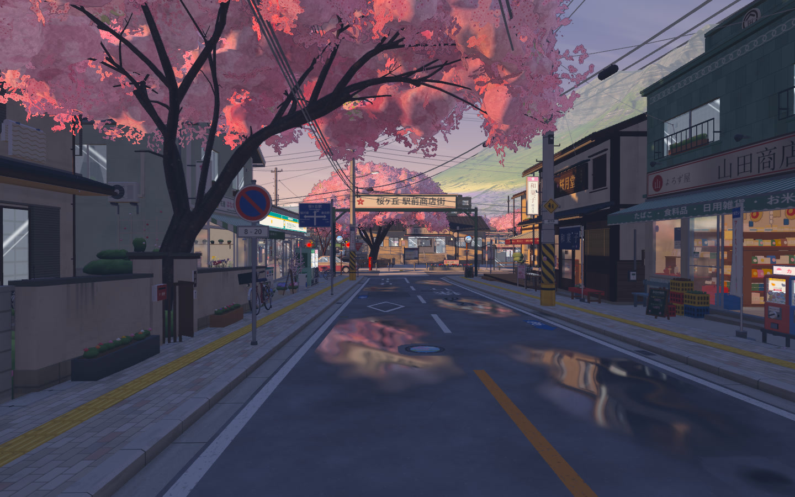](../../laundry-hedge-evening-reflections-2026-11-18/images/01-evening.jpg) | [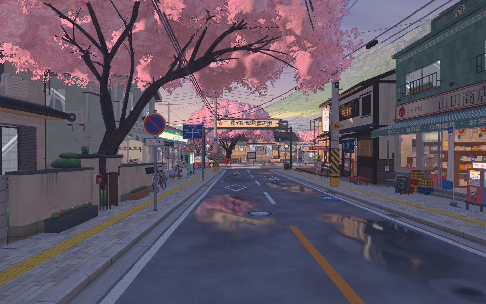](../images/01-evening.jpg) | 0 |
| 公寓后廊 | [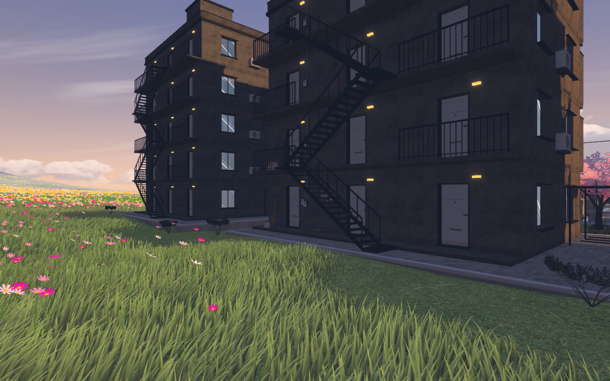](../../laundry-hedge-evening-reflections-2026-11-18/images/20-evening.jpg) | [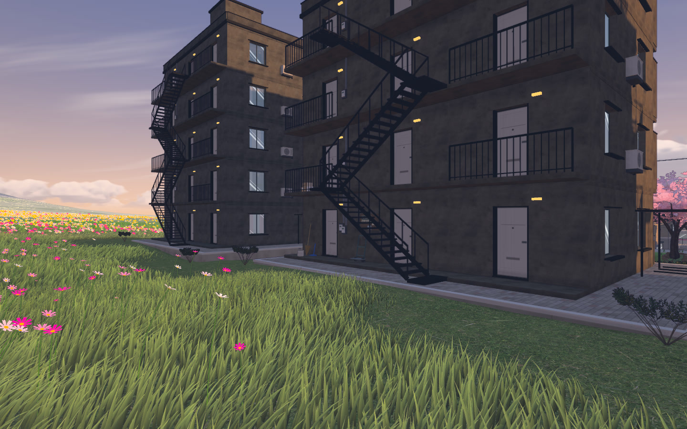](../images/20-evening.jpg) | 0 |
| 洗衣店前 | [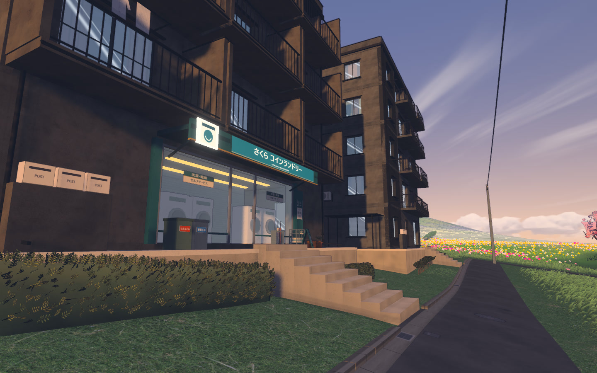](../../laundry-hedge-evening-reflections-2026-11-18/images/21-evening.jpg) | [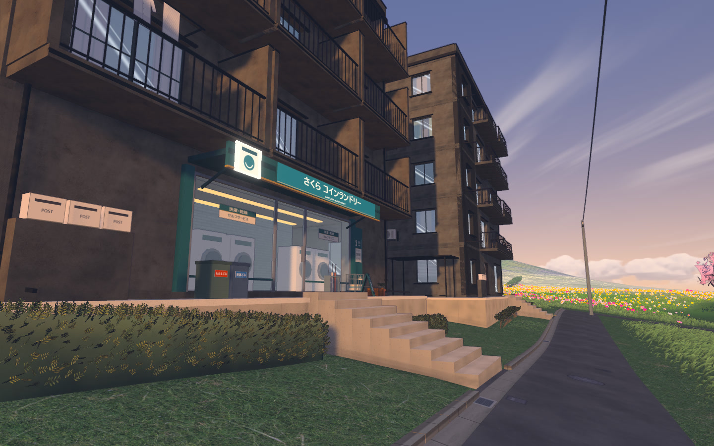](../images/21-evening.jpg) | 0 |
| 维修角 | [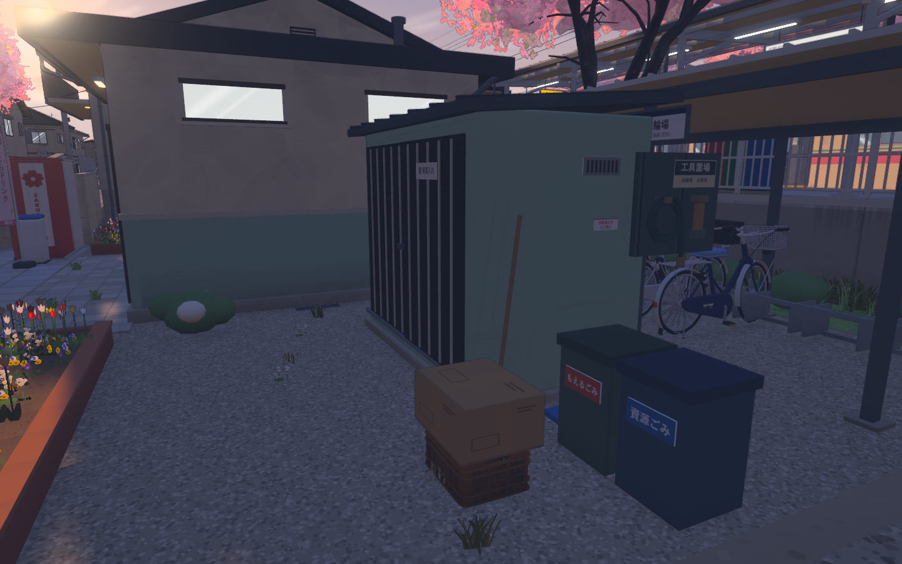](../../laundry-hedge-evening-reflections-2026-11-18/images/23-evening.jpg) | [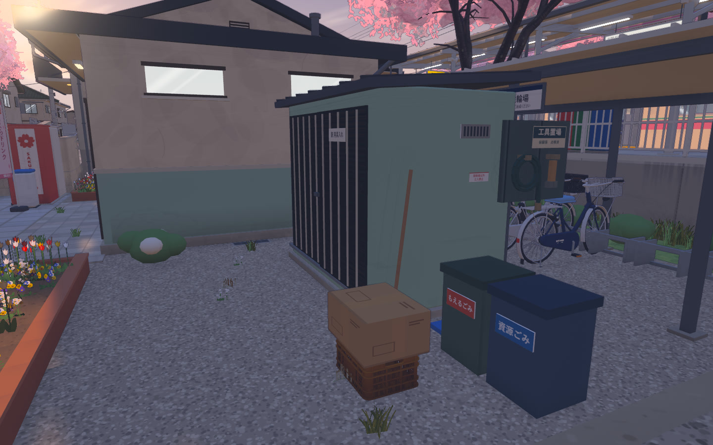](../images/23-evening.jpg) | 0 |
| 洗衣店细节 | [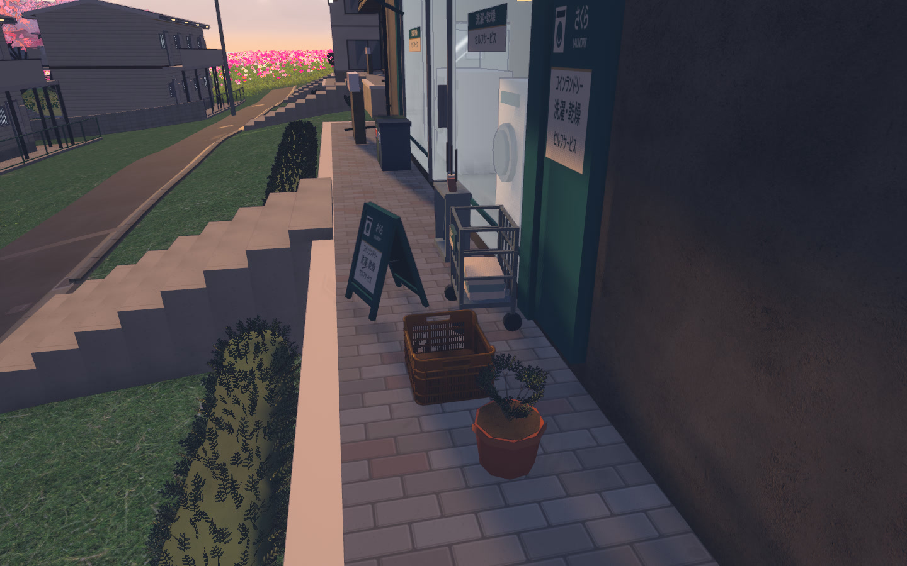](../../laundry-hedge-evening-reflections-2026-11-18/images/24-evening.jpg) | [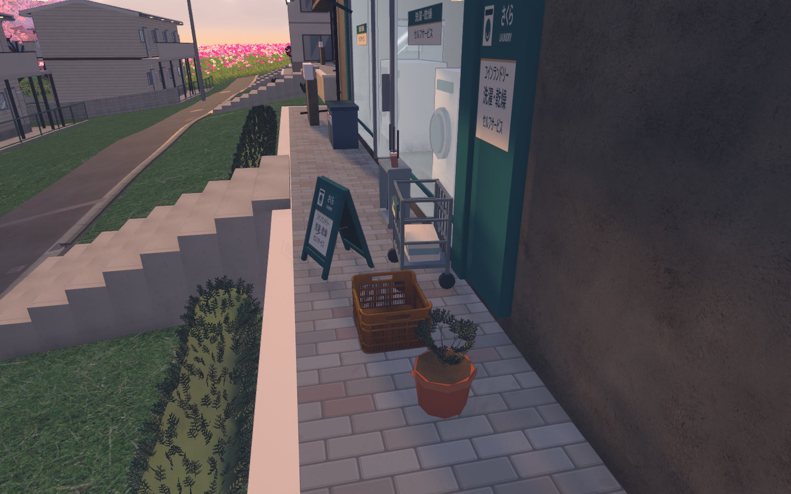](../images/24-evening.jpg) | 0 |
| 便利店内 | [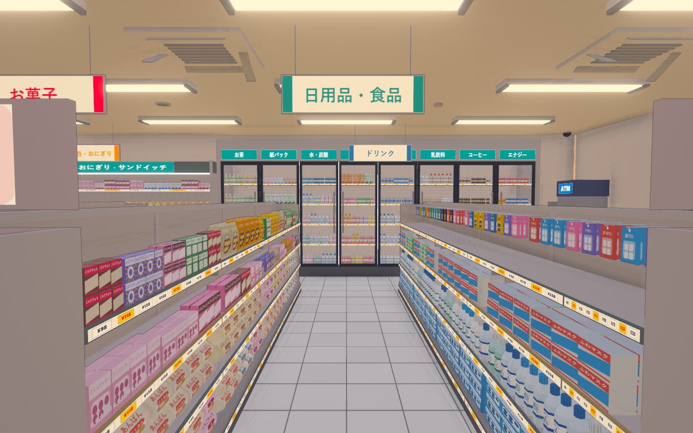](../../laundry-hedge-evening-reflections-2026-11-18/images/04-evening.jpg) | [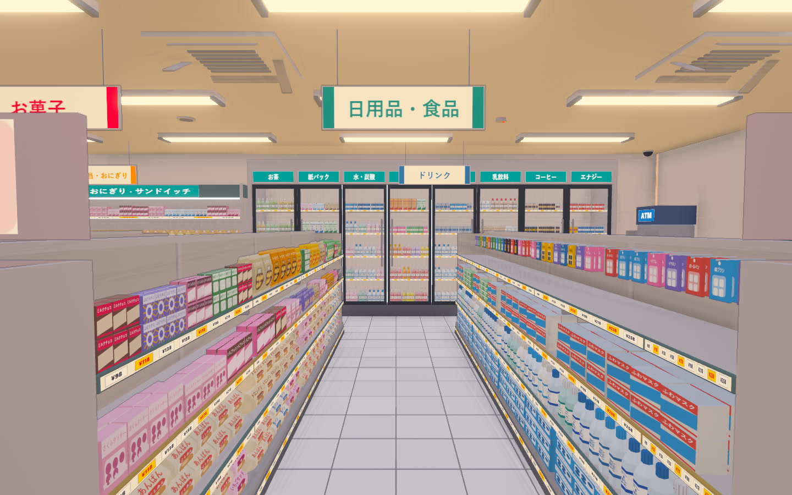](../images/04-evening.jpg) | 0 |
| 商店橱窗近景 | [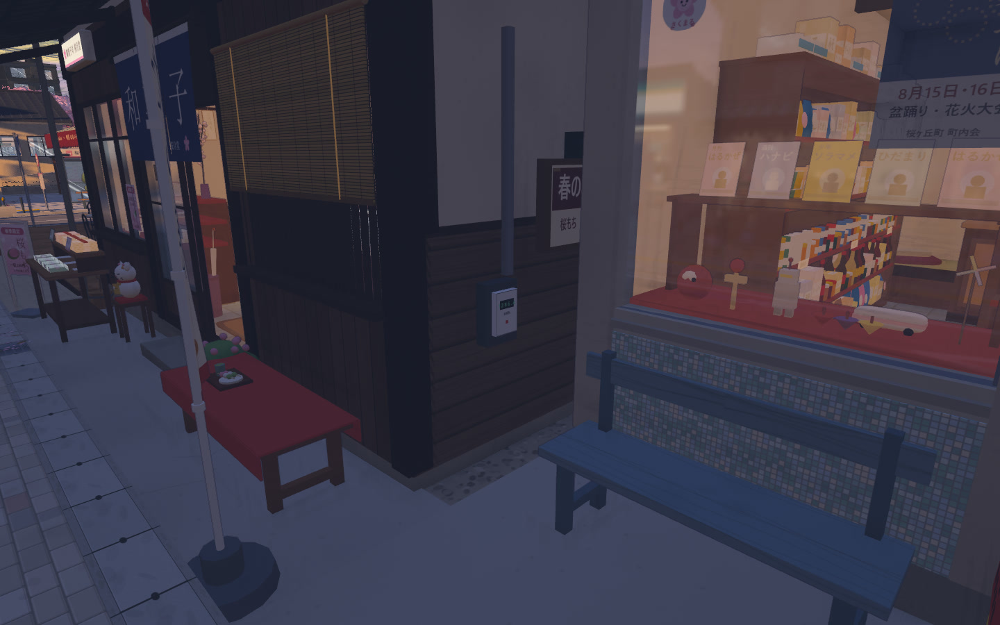](../../laundry-hedge-evening-reflections-2026-11-18/images/detail-evening.jpg) | [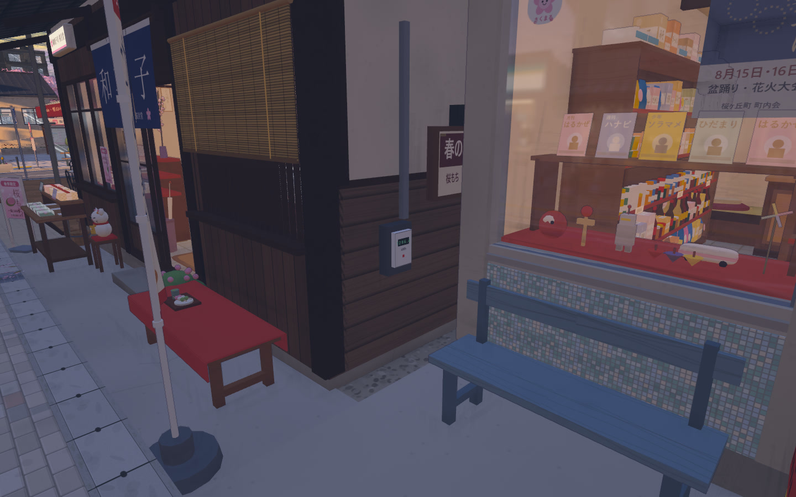](../images/detail-evening.jpg) | 0 |

## 原始记录

两轮四个计时进程均完成渲染、采样和步行或固定机位校验，各以退出码 1 结束并记录到取消的资源请求。四个进程合计 0 个 JS 异常。独立复拍进程退出 0，资源请求正常。

[逐段指标、步行位移、七机位照片校验及每次进程退出状态](results.json) · [两轮八段逐帧数据，包含帧间隔、绘制调用数和三角形数](frames.json.gz) · [本次地面计时脚本](run-ground.cjs)

已准备本机素材时，可用 `node run-ground.cjs <fixture> <electron.exe> <此目录的 results.json> <全新输出目录>` 复做地面计时。脚本按 C21 清单核对 243 个文件，镇边相机读取 `results.json` 中的 `cameras`。
