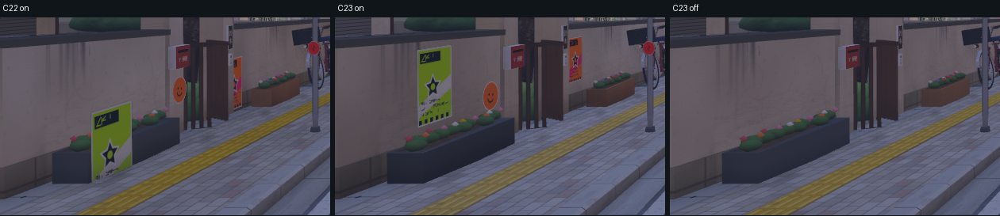
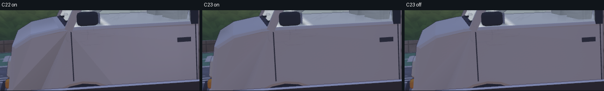

# 第 23 轮街景在 RTX 3060 Laptop 上的回验

第 23 轮源码 `343fbe1` 已在真实材质上复拍。01 左墙的绿色海报完整贴在花箱上方，白色面包车的车门和前翼子板已恢复连续的漆面。三次进场从第 22 轮的 103.02 / 105.84 / 102.43 秒降到 38.82 / 37.32 / 38.65 秒。

## 同机位前后图

三联图从左到右为第 22 轮开启、第 23 轮开启、第 23 轮关闭。原始帧为 1440 × 900，DPR 1。两版及各开关间的相机、FOV、光照、AO、后期和时钟逐项相同。四种公寓材质均绑定 1024² 本机贴图。

绿色海报的中心回到墙面局部 x = −4.84 米。中心抬到 1.55 米，宽度 0.484 米。中图可见底边和花箱之间的墙面。

取同一块 10,388 像素的车门漆面。傍晚开关的最大通道差从 10 降到 1，下午从 9 降到 1。[20 后廊局部](crops/20.png)

21 台阶左侧仍是一整排绿篱。相同近侧区域 38,025 像素中，跨版本最大通道差为 1。从原始半精度数据逐像素回算，实际加载的六面傍晚倒影全部匹配，线性峰值为 2。[21 固定机位](images/evening-21-on.jpg)

### 傍晚原尺寸对照

| 地面机位 | 第 22 轮开启 | 第 23 轮开启 | 第 23 轮关闭 |
|---|---|---|---|
| 01 主街 | [前](../c22-weathering-ground-3060-2026-11-18/images/evening-01-on.jpg) | [后](images/evening-01-on.jpg) | [关](images/evening-01-off.jpg) |
| 20 后廊 | [前](../c22-weathering-ground-3060-2026-11-18/images/evening-20-on.jpg) | [后](images/evening-20-on.jpg) | [关](images/evening-20-off.jpg) |
| 21 洗衣店前 | [前](../c22-weathering-ground-3060-2026-11-18/images/evening-21-on.jpg) | [后](images/evening-21-on.jpg) | [关](images/evening-21-off.jpg) |
| 23 维修角 | [前](../c22-weathering-ground-3060-2026-11-18/images/evening-23-on.jpg) | [后](images/evening-23-on.jpg) | [关](images/evening-23-off.jpg) |
| 24 洗衣细节 | [前](../c22-weathering-ground-3060-2026-11-18/images/evening-24-on.jpg) | [后](images/evening-24-on.jpg) | [关](images/evening-24-off.jpg) |
| 面包车左侧 | [前](../c22-weathering-ground-3060-2026-11-18/images/evening-van-on.jpg) | [后](images/evening-van-on.jpg) | [关](images/evening-van-off.jpg) |
| 04 店内 | [前](../c22-weathering-ground-3060-2026-11-18/images/evening-04-on.jpg) | [后](images/evening-04-on.jpg) | [关](images/evening-04-off.jpg) |
| 橱窗细节 | [前](../c22-weathering-ground-3060-2026-11-18/images/evening-detail-on.jpg) | [后](images/evening-detail-on.jpg) | [关](images/evening-detail-off.jpg) |

### 下午原尺寸对照

| 地面机位 | 第 22 轮开启 | 第 23 轮开启 | 第 23 轮关闭 |
|---|---|---|---|
| 01 主街 | [前](../c22-weathering-ground-3060-2026-11-18/images/afternoon-01-on.jpg) | [后](images/afternoon-01-on.jpg) | [关](images/afternoon-01-off.jpg) |
| 20 后廊 | [前](../c22-weathering-ground-3060-2026-11-18/images/afternoon-20-on.jpg) | [后](images/afternoon-20-on.jpg) | [关](images/afternoon-20-off.jpg) |
| 面包车左侧 | [前](../c22-weathering-ground-3060-2026-11-18/images/afternoon-van-on.jpg) | [后](images/afternoon-van-on.jpg) | [关](images/afternoon-van-off.jpg) |

## 进场与地面帧时

| 未开性能分析器 | 第 22 轮首帧，秒 | 第 23 轮首帧，秒 | 第 23 轮做旧初始化，ms | 贴花读取与指纹核对，ms |
|---|---:|---:|---:|---:|
| 开启 | 103.02 | 38.82 | 708.8 | 2.1 |
| 关闭 | 105.84 | 37.32 | 647.0 | 1.9 |
| 再次开启 | 102.43 | 38.65 | 731.0 | 2.5 |

三次正常进场都命中预烘焙数据，运行时贴花规划射线为零。第 22 轮相同位置的射线查询占用约 65.57 秒。[上一轮启动 CPU 采样](../c22-weathering-ground-3060-2026-11-18/startup.json)

| 地面机位 | 开启 FPS / p95 ms | 关闭 FPS / p95 ms | 再次开启 FPS / p95 ms |
|---|---:|---:|---:|
| 01 主街 | 59.88 / 30.8 | 65.00 / 15.5 | 65.00 / 15.5 |
| 04 店内 | 65.00 / 15.5 | 65.00 / 15.5 | 65.00 / 15.5 |
| 20 后廊 | 65.00 / 15.5 | 65.00 / 15.5 | 64.70 / 15.5 |
| 21 洗衣店前 | 65.00 / 15.5 | 65.00 / 15.5 | 65.00 / 15.5 |
| 23 维修角 | 65.00 / 15.5 | 65.00 / 15.5 | 65.00 / 15.5 |
| 24 洗衣细节 | 65.00 / 15.5 | 65.00 / 15.5 | 65.00 / 15.5 |
| 第三人称步行 | 61.49 / 30.7 | 65.00 / 15.5 | 65.00 / 15.5 |
| 第一人称步行 | 64.36 / 15.5 | 65.00 / 15.5 | 65.00 / 15.5 |

三轮共 10,289 帧。按平均 ≥60 FPS 且 p95 ≤16.7 ms，各轮有 6/8、8/8、8/8 段达标。第一轮的 01 与第三人称步行仍出现约 31 ms 的长帧。镇边四个机位均按 10 秒采样，01、店内和两种真实 W 步行每段采 3 秒。[逐段结果与启动明细](frame-times.json) · [原始逐帧记录](frames.json.gz)

### 同进程开关对照

把 01 相机、岛屿和车站时钟固定，同一次前台启动分四次开启、四次关闭，每段连续采 5.5 秒。开启合计 64.36 / 15.5，关闭 65.00 / 15.5（FPS / p95 ms）。用 WebGL 计时查询每四帧采一帧完整绘制，开启与关闭的 GPU 绘制中位数分别为 12.49 和 12.49 ms。[各段与 GPU 时间](additional-checks.json) · [八段原始数据](paired-01.json.gz)

| 次序 | 开关 | FPS | 呈现 p95 ms | GPU 中位数 ms | GPU p95 ms |
|---|---|---:|---:|---:|---:|
| 1 | 开启 | 65.00 | 15.5 | 12.13 | 12.88 |
| 2 | 关闭 | 65.00 | 15.5 | 12.05 | 12.65 |
| 3 | 关闭 | 65.00 | 15.5 | 12.13 | 12.96 |
| 4 | 开启 | 64.82 | 15.5 | 12.50 | 13.41 |
| 5 | 关闭 | 65.00 | 15.5 | 13.07 | 13.97 |
| 6 | 开启 | 64.27 | 15.5 | 12.80 | 14.31 |
| 7 | 开启 | 63.37 | 15.5 | 12.82 | 15.60 |
| 8 | 关闭 | 65.00 | 15.5 | 13.06 | 13.71 |

## 与整岛天气联验

#266 的地形、水体和云层与本轮精修在一份临时工作树里同时启用。26 张贴花使用 baked 路径，四种真实公寓贴图均已绑定。站区 14 项、自然环境 5 项通过。实际从街口往潮间带走 93.85 米，往返 1,716 次落脚采样最大偏差 1.95 mm，干沙测区 0 / 44,000 像素变化。

| 场景 | FPS / p95 ms |
|---|---:|
| 南岸海雾 | 65.00 / 15.5 |
| 主街低云 | 65.00 / 15.5 |
| 南岸 | 65.00 / 15.5 |
| 主街 | 64.34 / 15.5 |
| 第三人称步行 | 65.00 / 15.5 |
| 第一人称步行 | 61.33 / 30.7 |

本轮联合场景六段中五段达到平均 60 FPS 和 p95 16.7 ms 的目标。第一人称步行为 61.33 FPS，p95 为 30.7 ms。这段步行的长帧仍需定位。

[低云经过主街](joint-island/street-48.jpg) · [南岸海雾](joint-island/coast-48.jpg) · [走到潮间带](joint-island/trail-walk-32.jpg) · [联合版本原始记录](joint-island/report.json)

## 验证记录

4 次拍照与 6 个地面计时进程均完成渲染，JS 异常为 0。进程退出 0 的有 2 个，退出 1 的有 8 个。报告共记录 17 个取消请求。联合场景和同进程开关采样均退出 0，JS 与网络异常均为 0。 [固定机位退出记录](photos.json) · [地面计时退出记录](frame-times.json) · [源码 Windows CI](https://github.com/aa15119557034/agent-review-room/actions/runs/44223405699/job/134530599385)

地面计时驱动核验 247 个文件的内容及来源提交。执行环境为 Windows、Electron、ANGLE D3D11、RTX 3060 Laptop。相机与第 22 轮共享，测量前逐项校验开关、像素密度、实际步行距离和固定机位。[地面采集驱动](driver/ground.cjs) · [场景文件清单](driver/x51-c23-manifest.json)
