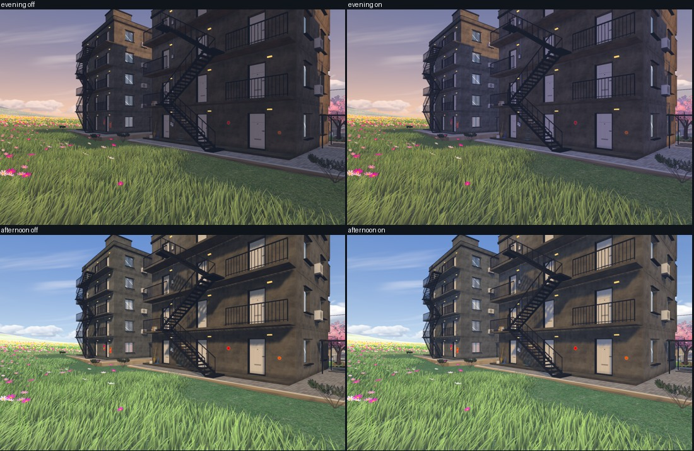
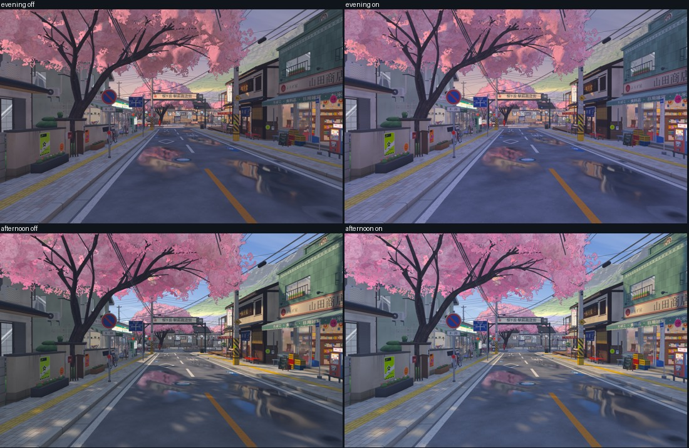
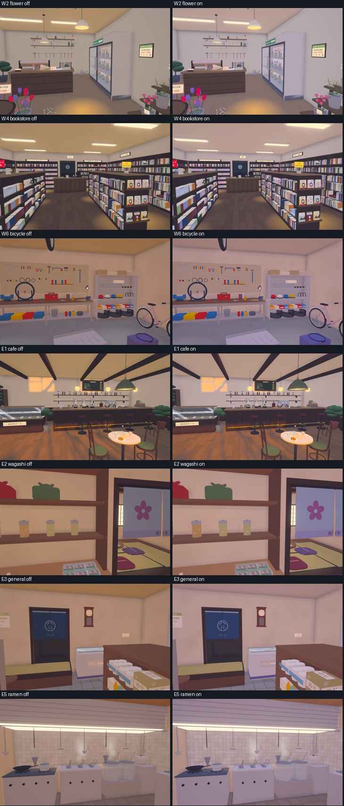

# 第 24 轮阴影调色与地面帧时

`4a89038` 的 20 后廊门、楼梯和栏杆已能读清。04 便利店朝货架拍摄时，傍晚和下午各 1,296,000 像素的开关差均为零。另七家有内景的店铺全部受到冷色补光，尤其是自行车工坊、杂货铺和拉面店。三轮十段地面帧时均达标。

## 后廊与主街

20 背光墙的固定区域，8 位图像亮度均值从 43.25 升至 51.69，门板从 96.14 升至 115.18。门和栏杆能与墙分开。墙面纹理可见，常规机位里仍难把细雨痕单独辨出。本机建议保留当前傍晚补光强度。

01 的路面和人行道明显变冷。傍晚固定路面区域的 RGB 平均变化为 +10.6、+10.5、+21.8 个色阶。远处拱门、店招和樱冠仍有分层，画面上没有看到遮住街景的一层白雾。四种公寓漫反射贴图均为本机真实 1024² 素材。

## 室内排除

04 朝货架的图逐像素相同。原点不动、向门外转身后，室内后期强度仍为 0，门外的街道会随阴影补光变色。[04 货架开关图](shop-interior.jpg) · [同一点向门口看](shop-door-eye.jpg)

另取七个店内机位，视线朝货架、墙面或工作台。机位通过半径 0.3 米的角色碰撞检查。花店 W2、书店 W4、自行车工坊 W6、咖啡店 E1、和菓子店 E2、杂货铺 E3、拉面店 E5 的室内后期强度都为 1。七处画面的平均蓝色增量为 16.6–28.4 个色阶。`shopInteriorBox()` 只取了 `konbini` 地块，材质补光和后期淡出都使用这一处包围盒。

### 傍晚九组

| 机位 | 阴影调色关 | 阴影调色开 | 任一通道差 >8 的像素 |
|---|---|---|---:|
| 23 | [原图](images/evening-service-corner-off.jpg) | [原图](images/evening-service-corner-on.jpg) | 1,201,644 |
| 24 | [原图](images/evening-laundry-details-off.jpg) | [原图](images/evening-laundry-details-on.jpg) | 953,099 |
| 04 | [原图](images/evening-shop-interior-off.jpg) | [原图](images/evening-shop-interior-on.jpg) | 0 |
| 20 | [原图](images/evening-20-rear-eye-off.jpg) | [原图](images/evening-20-rear-eye-on.jpg) | 521,682 |
| 21 | [原图](images/evening-21-front-eye-off.jpg) | [原图](images/evening-21-front-eye-on.jpg) | 512,205 |
| 01 | [原图](images/evening-station-street-off.jpg) | [原图](images/evening-station-street-on.jpg) | 1,085,937 |
| 橱窗 | [原图](images/evening-street-detail-off.jpg) | [原图](images/evening-street-detail-on.jpg) | 1,114,615 |
| 04 朝门 | [原图](images/evening-shop-door-eye-off.jpg) | [原图](images/evening-shop-door-eye-on.jpg) | 443,520 |
| 车侧 | [原图](images/evening-van-side-off.jpg) | [原图](images/evening-van-side-on.jpg) | 962,651 |

### 下午五组

| 机位 | 阴影调色关 | 阴影调色开 | 任一通道差 >8 的像素 |
|---|---|---|---:|
| 01 | [原图](images/afternoon-station-street-off.jpg) | [原图](images/afternoon-station-street-on.jpg) | 1,001,369 |
| 20 | [原图](images/afternoon-20-rear-eye-off.jpg) | [原图](images/afternoon-20-rear-eye-on.jpg) | 262,895 |
| 04 | [原图](images/afternoon-shop-interior-off.jpg) | [原图](images/afternoon-shop-interior-on.jpg) | 0 |
| 04 朝门 | [原图](images/afternoon-shop-door-eye-off.jpg) | [原图](images/afternoon-shop-door-eye-on.jpg) | 247,988 |
| 车侧 | [原图](images/afternoon-van-side-off.jpg) | [原图](images/afternoon-van-side-on.jpg) | 863,245 |

### 七家商店内景

| 机位 | 阴影调色关 | 阴影调色开 | 任一通道差 >8 的像素 |
|---|---|---|---:|
| W2 | [原图](images/shops-W2-off.jpg) | [原图](images/shops-W2-on.jpg) | 1,223,661 |
| W4 | [原图](images/shops-W4-off.jpg) | [原图](images/shops-W4-on.jpg) | 998,790 |
| W6 | [原图](images/shops-W6-off.jpg) | [原图](images/shops-W6-on.jpg) | 1,294,626 |
| E1 | [原图](images/shops-E1-off.jpg) | [原图](images/shops-E1-on.jpg) | 689,916 |
| E2 | [原图](images/shops-E2-off.jpg) | [原图](images/shops-E2-on.jpg) | 1,146,593 |
| E3 | [原图](images/shops-E3-off.jpg) | [原图](images/shops-E3-on.jpg) | 1,188,030 |
| E5 | [原图](images/shops-E5-off.jpg) | [原图](images/shops-E5-on.jpg) | 1,245,764 |

## RTX 3060 Laptop 帧时

1440 × 900、DPR 1、D3D11。开、关、再开各从新进程进入。主街、04 与两种真实 W 步行每段 3 秒，四个镇边机位、橱窗及店内看门口各 10 秒。照片将场景时钟固定在 14，性能采样用正常推进的时钟。

| 地面机位 | 开启 FPS / p95 ms | 关闭 FPS / p95 ms | 再次开启 FPS / p95 ms |
|---|---:|---:|---:|
| 01 主街 | 65.00 / 15.5 | 64.68 / 15.5 | 64.68 / 15.5 |
| 04 便利店 | 65.00 / 15.5 | 65.00 / 15.5 | 65.00 / 15.5 |
| 20 后廊 | 65.00 / 15.5 | 65.00 / 15.5 | 65.00 / 15.5 |
| 21 洗衣店前 | 65.00 / 15.5 | 65.00 / 15.5 | 65.00 / 15.5 |
| 23 维修角 | 65.00 / 15.5 | 65.00 / 15.5 | 64.41 / 15.5 |
| 24 洗衣细节 | 65.00 / 15.5 | 65.00 / 15.5 | 65.00 / 15.5 |
| 橱窗前 | 65.00 / 15.5 | 65.00 / 15.5 | 65.00 / 15.5 |
| 便利店回看门口 | 65.00 / 15.5 | 65.00 / 15.5 | 64.70 / 15.5 |
| 第三人称步行 | 65.00 / 15.5 | 65.00 / 15.5 | 65.00 / 15.5 |
| 第一人称步行 | 65.00 / 15.5 | 65.00 / 15.5 | 65.00 / 15.5 |

三轮共 14,254 帧，10/10、10/10、10/10 段达到平均 ≥60 FPS 且 p95 ≤16.7 ms。六次固定机位拍照、六个地面计时进程均完成渲染，JS 异常为 0。这十二个进程均退出 1，合计有 21 个资源请求由 Chromium 取消，报告为 `net::ERR_ABORTED`。[逐帧记录](frames.json.gz) · [分段数据和退出记录](frame-times.json) · [拍摄状态与图像校验值](photos.json)

## 与整岛环境一起运行

整岛天气与本轮阴影都改动了 `src/look.js`。环境分支合入本轮代码后，最终渲染通道同时更新雾的相机高度与阴影补光。湿地雾帧实测地面雾强度 0.880、阴影调色强度 1。湿地晴天 64.33 FPS，山湖阵雨 65.00，主街晴天与阵雨均为 65.00，湿地涉水 64.83，五段 p95 均为 15.5 ms。站区 14 项及沿岸 5 项行为通过，完整联合进程退出 0，JS 与网络异常均为 0。[整岛联合实拍、逐帧和水面物理](https://github.com/aa15119557034/agent-review-room/blob/1c106b378a0a57751aecb8c219945015b6ecda50/apps/desktop/e2e/fixtures/world-base/evidence/inland-water-weather/combined-c24/README.md) · [源码 Windows CI](https://github.com/aa15119557034/agent-review-room/actions/runs/44232008049/job/134559063344)
