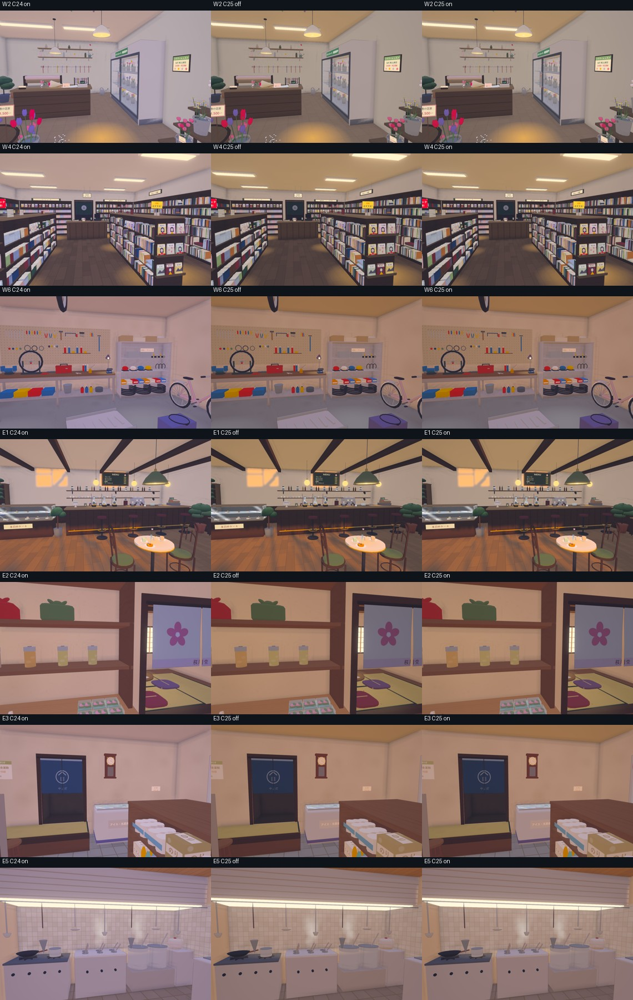
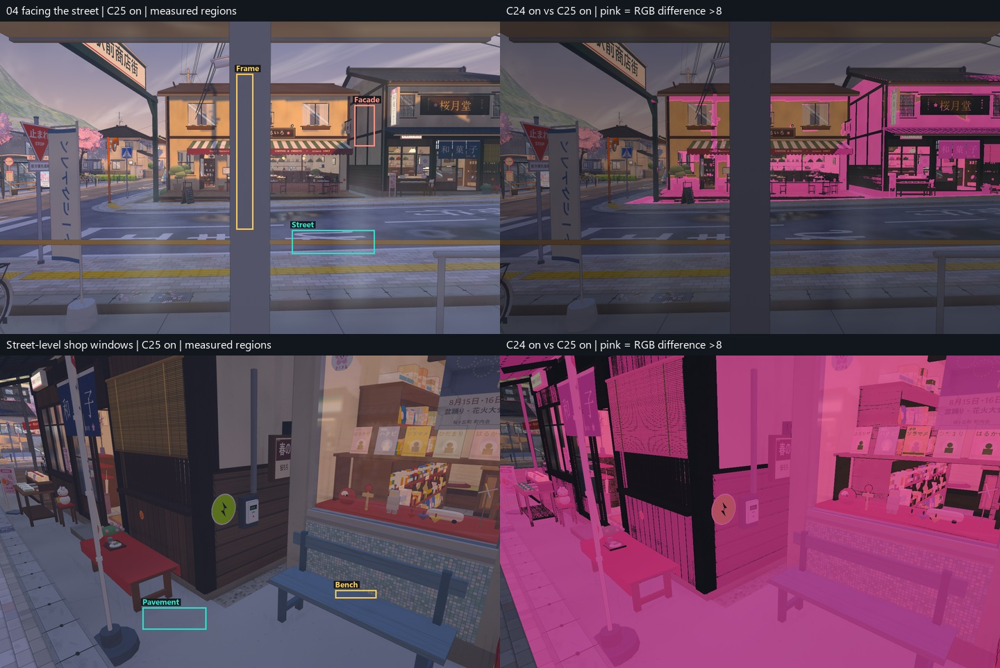

# 第 25 轮店内阴影排除与地面帧时

C酱的源码 a53236b 已在 RTX 3060 Laptop 上回验。七家店内原有的冷色补光已消退，20 后廊保留了上一轮的亮度。04 朝门和 01 主街两处画面都能看到，排除范围也覆盖了临街外立面。

## 七家店内与 20 后廊

七个室内机位各拍开、关、再开，画面均为 1440 × 900。六家店第一次开关逐像素相同，和菓子店只有一个像素的绿通道相差 1。再次开启后，咖啡店另有三个像素各差 1。三个状态下，七处均没有超过一个色阶的变化。04 便利店朝内的傍晚和下午开关图也逐像素相同。[逐店表和全分辨率前后图](photos/README.md)

20 后廊的傍晚整幅开启图与 C24 逐像素一致。开启时后墙平均亮度由 43.25 升至 51.69，门板由 96.14 升至 115.18。21 正面与 23 维修角的傍晚开启图也与 C24 完全相同，24 洗衣细节最大差 1。[傍晚九个地面机位](photos/ground-evening.jpg) · [下午五个地面机位](photos/ground-afternoon.jpg)

## 门框、街面与对街立面

04 在店内看向门外，傍晚门框的 22,500 像素开关最大差 1。门外街面的 16,800 像素中，13,214 个差值超过 8，补光仍可见。对街立面的 7,200 像素中，C24 开到 C25 开有 6,027 个差值超过 8，平均 RGB 分别减少 12.58、12.83、20.94。C25 自身开关在这块立面最大只差 1。01 另一块沿街立面也有 6,341 / 6,600 像素比上一轮变化超过 8。差值按 RGB 任一通道计算。

源码按整块 14 米深的地块计算室内边界，包含商铺前的铺装和部分外墙。按原相机像素射线核对，04 对街测区落在 E2 和菓子店北侧墙，01 测区落在 E3 杂货店二楼正面。[逐店几何核对](geometry.md)

沿街橱窗的站位在店外，后处理权重却从 C24 的 1 降到 C25 的 0.01274。灰色铺地固定取样 12,025 像素，相比上一轮开启图，全部差值超过 8，平均 RGB 减少 13.7、13.8、26.4。C25 同机位自身开关在这片铺地最大差 1。[店外铺地同机位对照](photos/doors-and-sidewalk.jpg)

## RTX 3060 Laptop 地面帧时

1440 × 900、DPR 1、D3D11，傍晚场景。每轮独立启动，按原机位以及真实第一、第三人称步行采样。表内为平均 FPS / p95 毫秒。阈值为平均 ≥60 FPS 且 p95 ≤16.7 毫秒。

| 地面机位 | 开 | 关 | 再开 |
|---|---:|---:|---:|
| 01 主街 | 65.00 / 15.5 | 65.00 / 15.5 | 65.00 / 15.5 |
| 04 便利店朝内 | 65.00 / 15.5 | 65.00 / 15.5 | 65.00 / 15.5 |
| 20 公寓后廊 | 64.50 / 15.5 | 65.00 / 15.5 | 65.00 / 15.5 |
| 21 洗衣店前 | 65.00 / 15.5 | 65.00 / 15.5 | 65.00 / 15.5 |
| 23 维修角 | 64.21 / 15.5 | 65.00 / 15.5 | 65.00 / 15.5 |
| 24 洗衣细节 | 65.00 / 15.5 | 65.00 / 15.5 | 65.00 / 15.5 |
| 沿街橱窗 | 64.21 / 15.5 | 65.00 / 15.5 | 65.00 / 15.5 |
| 04 店内看门口 | 65.00 / 15.5 | 64.41 / 15.5 | 65.00 / 15.5 |
| 第三人称步行 | 65.00 / 15.5 | 64.68 / 15.5 | 64.68 / 15.5 |
| 第一人称步行 | 61.16 / 30.7 | 64.68 / 15.5 | 65.00 / 15.5 |

共 14,221 帧，各轮达标 9/10、10/10、10/10。超过 20 毫秒的帧数依次为 33、8、1。[逐帧采样](timing/frames.json.gz) · [分段与进程报告](timing/frame-times.json) · [帧时校验脚本](timing/verify.cjs)

本轮未达到上述阈值的段落为开档的第一人称步行（61.16 FPS / 30.7 ms）。首次开启的第一人称段共 191 帧，其中 12 帧高于 20 毫秒。关闭和再次开启时均未复现。

七个拍摄进程退出码依次为 1、0、1、1、1、1、1，六个计时进程依次为 1、1、0、1、1、1。拍摄记录了 10 次取消请求，计时记录了 10 次取消请求。六个计时报告共 0 个 JS 异常。[拍摄状态与原图校验值](photos/measurements.json) · [源码 Windows CI](https://github.com/aa15119557034/agent-review-room/actions/runs/44239282942/job/134582905670)
