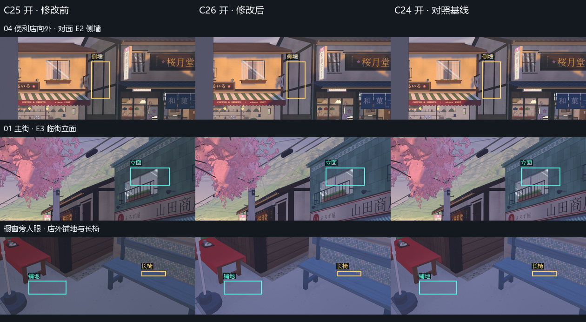
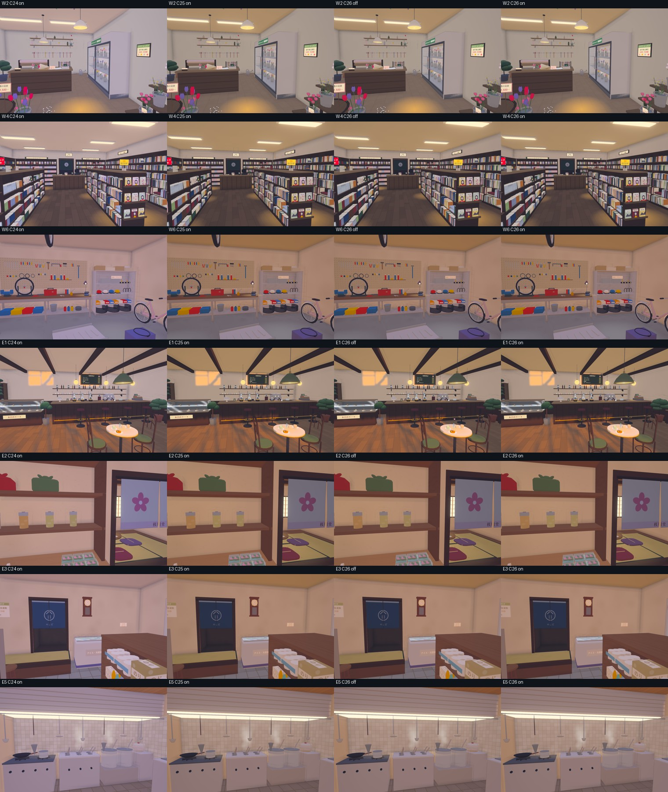

# 第 26 轮店内边界与地面帧时

C酱的 a281e7a 已在 RTX 3060 Laptop 上回验。第 25 轮误压暗的店外铺地、长椅和两处外墙都恢复到了第 24 轮的补光水平，四个固定测区与第 24 轮开启图的最大差均为 1。七家店内开、关、再开，均没有像素变化超过 7 个色阶。

## 店外铺地与外墙

傍晚，1440 × 900 原生 PNG。下表差值取 RGB 任一通道。橱窗外仍是同一站位，后处理权重从 0.01274 恢复到 1。04 从店里看门外时，门框最大差 1。街面 16,800 个像素中有 13,216 个随开关变化超过 8 级。

| 固定测区 | 像素数 | 第 25 轮开 → 第 26 轮开，差值 >8 | RGB 平均增量 | 与第 24 轮开启的最大差 |
|---|---:|---:|---|---:|
| 04 对街 E2 北侧外墙 | 7,200 | 6,027 | +12.6 / +12.8 / +20.9 | 1 |
| 01 的 E3 二楼正面 | 6,600 | 6,340 | +8.4 / +11.0 / +18.7 | 1 |
| 橱窗外铺地 | 12,025 | 12,025 | +13.7 / +13.8 / +26.4 | 1 |
| 橱窗外长椅 | 3,000 | 3,000 | +9.7 / +13.1 / +28.8 | 1 |

## 七家店内、04 与 20 后廊

七家两次开启的原图均逐像素相同。关闭对开启，W6 自行车店、E2 和菓子店、E3 杂货店、E5 拉面店整幅完全相同。W2 花店有 11 个像素变化，最大差 3。W4 书店有 235 个，最大差 3。E1 咖啡店有 152 个，最大差 7。04 朝内的傍晚图仅一个像素差 7，下午整幅相同。

同步固定站区与岛屿时钟后，E2 和 E3 的暖帘也逐像素一致。W4 的差异集中在书架横沿，抽查的着色面位于房间范围内，微差的具体成因尚未确定。[逐店原图、机位与差异明细](photos/README.md)

20 后廊的傍晚开启图与第 24、25 轮逐像素一致，开关平均亮度仍为后墙 43.25 → 51.69、门板 96.14 → 115.18。21 洗衣店前和 23 维修角与第 24 轮也逐像素一致，24 洗衣细节的最大差为 1。[傍晚九机位](photos/ground-evening.jpg) · [下午五机位](photos/ground-afternoon.jpg)

## RTX 3060 Laptop 帧时

1440 × 900、DPR 1、D3D11。开、关、再开各从新进程采样。主街、04 朝内和两段真实步行各约 3 秒，20、21、23、24、橱窗和店内朝门各约 10 秒。阈值为平均 ≥60 FPS 且 p95 ≤16.7 ms。

| 地面机位 | 开 FPS / p95 ms | 关 FPS / p95 ms | 再开 FPS / p95 ms |
|---|---:|---:|---:|
| 01 主街 | 65.00 / 15.5 | 65.00 / 15.5 | 65.00 / 15.5 |
| 04 便利店朝内 | 65.00 / 15.5 | 65.00 / 15.5 | 65.00 / 15.5 |
| 20 公寓后廊 | 65.00 / 15.5 | 65.00 / 15.5 | 64.80 / 15.5 |
| 21 洗衣店前 | 65.00 / 15.5 | 65.00 / 15.5 | 65.00 / 15.5 |
| 23 维修角 | 65.00 / 15.5 | 65.00 / 15.5 | 65.00 / 15.5 |
| 24 洗衣细节 | 65.00 / 15.5 | 65.00 / 15.5 | 65.00 / 15.5 |
| 沿街橱窗 | 64.90 / 15.5 | 65.00 / 15.5 | 65.00 / 15.5 |
| 04 店内看门口 | 65.00 / 15.5 | 65.00 / 15.5 | 65.00 / 15.5 |
| 第三人称步行 | 59.88 / 30.8 | 65.00 / 15.5 | 64.04 / 15.5 |
| 第一人称步行 | 65.00 / 15.5 | 65.00 / 15.5 | 65.00 / 15.5 |

三轮共 14,240 帧，各轮达标 9/10、10/10、10/10。超过 20 ms 的帧数依次为 17、0、5。唯一超限的是首次开启的第三人称步行，59.88 FPS、p95 30.8 ms，187 帧中有 16 帧超过 20 ms。关闭后为 65.00 FPS，再次开启为 64.04 FPS，后两轮 p95 均为 15.5 ms。 [逐帧记录](timing/frames.json.gz) · [分段结果](timing/frame-times.json) · [复算脚本](timing/verify.cjs)

## 本机加载与可复现性

保留八个店铺生成器在本地 vendored 源码中的房间登记。独立目录用固定归档执行 node scripts/prepare.cjs，退出 0，共核验 760 个上游原始文件。准备前后八份站区源码的 SHA-256 全部相同。七个正式拍摄进程各核对八份浏览器实际收到的脚本，56 次响应均匹配 Git 和工作树。[准备过程与布帘复核](source-check.md) · [源码 Windows CI](https://github.com/aa15119557034/agent-review-room/actions/runs/44249438637/job/134616218208)

七个正式拍摄进程退出码为 1、1、1、1、1、1、1，六个计时进程为 0、1、0、1、1、0。拍摄与计时分别记录 11、7 次加载请求取消。均完成渲染，JS 异常为零。[照片、哈希与请求记录](photos/measurements.json)

另一次室内表面定位复拍的四张 PNG 与正式开启图完全相同，八份脚本响应也匹配 Git。该进程记录 1 次加载请求取消，退出码 1。[14 个表面采样点](photos/interior-probes.json)
