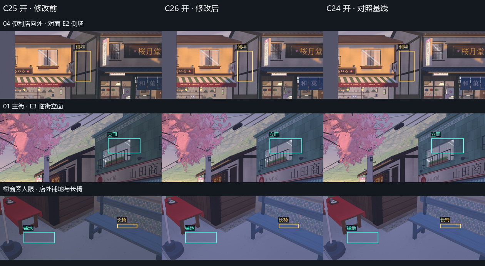

# C26 室内房壳与街侧同机位复拍

C25 中受室内保护影响的店外铺地、长椅和两处外墙，在 C26 傍晚复拍中恢复至 C24 开启态，四个固定采样区的最大 RGB 差均为 1。七个其他店内机位的后处理权重保持 0，04 便利店朝内亦为 0。

RTX 3060 Laptop，1440 × 900，DPR 1，AO 0.55，场景钟和站前钟均固定 14。比较 C26 `a281e7a8acb8557a6d8fe399a7c57eff195f5879`、C25 `a53236b3e4d5e3f0134f2fdd7629384171a64531`、C24 `4a8903840677d589f08e6a9934680b3b7b5f3d9c`。所有对照逐一核对位置、朝向、FOV、灯光、场景参数、时钟、AO 与显卡。每个机位采预热、正式一、正式二，数值取正式二的无损 PNG。照片以全分辨率 JPEG 发布。每个进程用 CDP 读取八个店铺生成器模块的实际 Script 响应体，SHA-256 与工作盘及 C26 Git 提交逐一相同。[相机、像素、材质盒和模块哈希](measurements.json)

## 店外补光与 04 便利店

矩形以左上为原点，右界和下界为开区间。表内数值为 RGB 最大通道差大于 8 的像素数 / 最大差。

| 时段与采样 | 原图矩形 | C26 关 → 开 | C25 开 → C26 开 | C24 开 → C26 开 |
|---|---|---:|---:|---:|
| 傍晚 04 门框 | [680, 150, 730, 600] | 0 / 1 | 0 / 1 | 0 / 1 |
| 傍晚 04 门外街面 | [840, 600, 1080, 670] | 13,216 / 30 | 0 / 1 | 0 / 1 |
| 傍晚 04 看 E2 侧墙 | [1020, 240, 1080, 360] | 6,027 / 27 | 6,027 / 27 | 0 / 1 |
| 傍晚 01 看 E3 立面 | [1220, 175, 1340, 230] | 6,450 / 45 | 6,340 / 42 | 0 / 1 |
| 傍晚 01 路面 | [715, 720, 990, 835] | 31,625 / 26 | 0 / 1 | 0 / 1 |
| 傍晚 橱窗铺地 | [410, 725, 595, 790] | 12,025 / 27 | 12,025 / 27 | 0 / 1 |
| 傍晚 橱窗长椅 | [965, 675, 1085, 700] | 3,000 / 39 | 3,000 / 39 | 0 / 1 |
| 午后 04 门框 | [680, 150, 730, 600] | 0 / 1 | 0 / 1 | 0 / 1 |
| 午后 04 门外街面 | [840, 600, 1080, 670] | 3,341 / 31 | 0 / 1 | 0 / 1 |
| 午后 04 看 E2 侧墙 | [1020, 240, 1080, 360] | 2,201 / 27 | 2,201 / 27 | 0 / 1 |
| 午后 01 看 E3 立面 | [1220, 175, 1340, 230] | 849 / 43 | 643 / 40 | 0 / 1 |
| 午后 01 路面 | [715, 720, 990, 835] | 31,494 / 27 | 0 / 1 | 0 / 1 |

橱窗机位的后处理权重 C24 / C25 / C26 依次为 1 / 0.01274074 / 1。04 朝门外的相机仍在店内，权重为 0。同一帧的门框最大差为 1，门外街面有补光。04 朝内傍晚全幅仅 (866, 423) 一个像素差 7，午后逐像素相同。主街、橱窗、04 朝门外仍包含受保护的店内或其他场景部分，各整幅图的跨版本差异见下表。

## 七家店内

三组分别启动开、关、再开，同一机位的两次开启态七张原始 PNG 均逐像素相同。[七店对照，左至右 C24 开、C25 开、C26 关、C26 开](seven-shops.jpg)

| 机位 | C26 关 → 开改变像素 / 最大差 | C26 开 → 再开改变像素 | 开启权重 C24 / C25 / C26 | 照片 |
|---|---:|---:|---|---|
| W2 花店 | 11 / 3 | 0 | 1 / 0 / 0 | [关](images/shops-W2-off.jpg) · [开](images/shops-W2-on.jpg) · [再开](images/shops-W2-on-repeat.jpg) · [C25](../../c25-interior-ground-3060-2026-11-18/photos/images/shops-W2-on.jpg) · [C24](../../c24-shadow-tint-ground-3060-2026-11-18/images/shops-W2-on.jpg) |
| W4 书店 | 235 / 3 | 0 | 1 / 0 / 0 | [关](images/shops-W4-off.jpg) · [开](images/shops-W4-on.jpg) · [再开](images/shops-W4-on-repeat.jpg) · [C25](../../c25-interior-ground-3060-2026-11-18/photos/images/shops-W4-on.jpg) · [C24](../../c24-shadow-tint-ground-3060-2026-11-18/images/shops-W4-on.jpg) |
| W6 自行车店 | 0 / 0 | 0 | 1 / 0 / 0 | [关](images/shops-W6-off.jpg) · [开](images/shops-W6-on.jpg) · [再开](images/shops-W6-on-repeat.jpg) · [C25](../../c25-interior-ground-3060-2026-11-18/photos/images/shops-W6-on.jpg) · [C24](../../c24-shadow-tint-ground-3060-2026-11-18/images/shops-W6-on.jpg) |
| E1 咖啡店 | 152 / 7 | 0 | 1 / 0 / 0 | [关](images/shops-E1-off.jpg) · [开](images/shops-E1-on.jpg) · [再开](images/shops-E1-on-repeat.jpg) · [C25](../../c25-interior-ground-3060-2026-11-18/photos/images/shops-E1-on.jpg) · [C24](../../c24-shadow-tint-ground-3060-2026-11-18/images/shops-E1-on.jpg) |
| E2 和菓子 | 0 / 0 | 0 | 1 / 0 / 0 | [关](images/shops-E2-off.jpg) · [开](images/shops-E2-on.jpg) · [再开](images/shops-E2-on-repeat.jpg) · [C25](../../c25-interior-ground-3060-2026-11-18/photos/images/shops-E2-on.jpg) · [C24](../../c24-shadow-tint-ground-3060-2026-11-18/images/shops-E2-on.jpg) |
| E3 杂货 | 0 / 0 | 0 | 1 / 0 / 0 | [关](images/shops-E3-off.jpg) · [开](images/shops-E3-on.jpg) · [再开](images/shops-E3-on-repeat.jpg) · [C25](../../c25-interior-ground-3060-2026-11-18/photos/images/shops-E3-on.jpg) · [C24](../../c24-shadow-tint-ground-3060-2026-11-18/images/shops-E3-on.jpg) |
| E5 拉面 | 0 / 0 | 0 | 1 / 0 / 0 | [关](images/shops-E5-off.jpg) · [开](images/shops-E5-on.jpg) · [再开](images/shops-E5-on-repeat.jpg) · [C25](../../c25-interior-ground-3060-2026-11-18/photos/images/shops-E5-on.jpg) · [C24](../../c24-shadow-tint-ground-3060-2026-11-18/images/shops-E5-on.jpg) |

W4 的后门帘由静态 S.card 生成。帘面内侧裁区 [525, 334, 621, 409) 的 7,200 个像素中，10 个只差 1。包含三段书架横沿的窄带 [0, 365, 720, 374) 有 176 个差异，最大 3。E2、E3 的开、关、再开三幅均相同。

另起一次同机位诊断，把 W2、W4、E1 与 04 朝内的 14 个像素中心投射回实际场景。14 条射线最近的可见不透明着色面均在本店房壳内，4 幅诊断 PNG 逐像素等于正式开启组。W2、W4、E1 有小幅、位置可重复的色差，采样点没有显示房壳漏掉最近可见面。其余渲染步骤对这些色差的具体贡献尚未拆分。[源射线、命中位置、材质与静态裁区](interior-probes.json)

## 地面机位

[傍晚九机位](ground-evening.jpg) · [午后五机位](ground-afternoon.jpg)。每排依次为 C24 开、C25 开、C26 关、C26 开。表中每幅图 1,296,000 像素。

| 时段与机位 | C26 关 → 开超过 8 / 最大差 | C25 开 → C26 开超过 8 / 最大差 | C24 开 → C26 开超过 8 / 最大差 | 开启权重 C24 / C25 / C26 | 照片 |
|---|---:|---:|---:|---|---|
| 傍晚 23 维修角 | 1,201,644 / 65 | 0 / 0 | 0 / 0 | 1 / 1 / 1 | [关](images/evening-service-corner-off.jpg) · [开](images/evening-service-corner-on.jpg) · [C25](../../c25-interior-ground-3060-2026-11-18/photos/images/evening-service-corner-on.jpg) · [C24](../../c24-shadow-tint-ground-3060-2026-11-18/images/evening-service-corner-on.jpg) |
| 傍晚 24 洗衣细节 | 953,099 / 61 | 0 / 0 | 0 / 1 | 1 / 1 / 1 | [关](images/evening-laundry-details-off.jpg) · [开](images/evening-laundry-details-on.jpg) · [C25](../../c25-interior-ground-3060-2026-11-18/photos/images/evening-laundry-details-on.jpg) · [C24](../../c24-shadow-tint-ground-3060-2026-11-18/images/evening-laundry-details-on.jpg) |
| 傍晚 04 朝内 | 0 / 7 | 0 / 7 | 0 / 7 | 0 / 0 / 0 | [关](images/evening-shop-interior-off.jpg) · [开](images/evening-shop-interior-on.jpg) · [C25](../../c25-interior-ground-3060-2026-11-18/photos/images/evening-shop-interior-on.jpg) · [C24](../../c24-shadow-tint-ground-3060-2026-11-18/images/evening-shop-interior-on.jpg) |
| 傍晚 20 后廊 | 521,682 / 64 | 0 / 0 | 0 / 0 | 1 / 1 / 1 | [关](images/evening-20-rear-eye-off.jpg) · [开](images/evening-20-rear-eye-on.jpg) · [C25](../../c25-interior-ground-3060-2026-11-18/photos/images/evening-20-rear-eye-on.jpg) · [C24](../../c24-shadow-tint-ground-3060-2026-11-18/images/evening-20-rear-eye-on.jpg) |
| 傍晚 21 正面 | 512,205 / 62 | 0 / 0 | 0 / 0 | 1 / 1 / 1 | [关](images/evening-21-front-eye-off.jpg) · [开](images/evening-21-front-eye-on.jpg) · [C25](../../c25-interior-ground-3060-2026-11-18/photos/images/evening-21-front-eye-on.jpg) · [C24](../../c24-shadow-tint-ground-3060-2026-11-18/images/evening-21-front-eye-on.jpg) |
| 傍晚 01 主街 | 1,065,451 / 59 | 213,891 / 53 | 32,065 / 53 | 1 / 1 / 1 | [关](images/evening-station-street-off.jpg) · [开](images/evening-station-street-on.jpg) · [C25](../../c25-interior-ground-3060-2026-11-18/photos/images/evening-station-street-on.jpg) · [C24](../../c24-shadow-tint-ground-3060-2026-11-18/images/evening-station-street-on.jpg) |
| 傍晚 沿街橱窗 | 867,805 / 54 | 835,277 / 54 | 198,762 / 41 | 1 / 0.012741 / 1 | [关](images/evening-street-detail-off.jpg) · [开](images/evening-street-detail-on.jpg) · [C25](../../c25-interior-ground-3060-2026-11-18/photos/images/evening-street-detail-on.jpg) · [C24](../../c24-shadow-tint-ground-3060-2026-11-18/images/evening-street-detail-on.jpg) |
| 傍晚 04 朝门外 | 722,873 / 51 | 399,698 / 51 | 317,205 / 51 | 0 / 0 / 0 | [关](images/evening-shop-door-eye-off.jpg) · [开](images/evening-shop-door-eye-on.jpg) · [C25](../../c25-interior-ground-3060-2026-11-18/photos/images/evening-shop-door-eye-on.jpg) · [C24](../../c24-shadow-tint-ground-3060-2026-11-18/images/evening-shop-door-eye-on.jpg) |
| 傍晚 白车侧面 | 962,651 / 63 | 0 / 1 | 0 / 1 | 1 / 1 / 1 | [关](images/evening-van-side-off.jpg) · [开](images/evening-van-side-on.jpg) · [C25](../../c25-interior-ground-3060-2026-11-18/photos/images/evening-van-side-on.jpg) · [C24](../../c24-shadow-tint-ground-3060-2026-11-18/images/evening-van-side-on.jpg) |
| 午后 01 主街 | 983,482 / 72 | 140,335 / 56 | 32,146 / 49 | 1 / 1 / 1 | [关](images/afternoon-station-street-off.jpg) · [开](images/afternoon-station-street-on.jpg) · [C25](../../c25-interior-ground-3060-2026-11-18/photos/images/afternoon-station-street-on.jpg) · [C24](../../c24-shadow-tint-ground-3060-2026-11-18/images/afternoon-station-street-on.jpg) |
| 午后 20 后廊 | 262,895 / 58 | 0 / 0 | 0 / 0 | 1 / 1 / 1 | [关](images/afternoon-20-rear-eye-off.jpg) · [开](images/afternoon-20-rear-eye-on.jpg) · [C25](../../c25-interior-ground-3060-2026-11-18/photos/images/afternoon-20-rear-eye-on.jpg) · [C24](../../c24-shadow-tint-ground-3060-2026-11-18/images/afternoon-20-rear-eye-on.jpg) |
| 午后 04 朝内 | 0 / 0 | 0 / 0 | 0 / 0 | 0 / 0 / 0 | [关](images/afternoon-shop-interior-off.jpg) · [开](images/afternoon-shop-interior-on.jpg) · [C25](../../c25-interior-ground-3060-2026-11-18/photos/images/afternoon-shop-interior-on.jpg) · [C24](../../c24-shadow-tint-ground-3060-2026-11-18/images/afternoon-shop-interior-on.jpg) |
| 午后 04 朝门外 | 502,574 / 47 | 340,503 / 47 | 292,971 / 47 | 0 / 0 / 0 | [关](images/afternoon-shop-door-eye-off.jpg) · [开](images/afternoon-shop-door-eye-on.jpg) · [C25](../../c25-interior-ground-3060-2026-11-18/photos/images/afternoon-shop-door-eye-on.jpg) · [C24](../../c24-shadow-tint-ground-3060-2026-11-18/images/afternoon-shop-door-eye-on.jpg) |
| 午后 白车侧面 | 863,245 / 56 | 0 / 1 | 0 / 1 | 1 / 1 / 1 | [关](images/afternoon-van-side-off.jpg) · [开](images/afternoon-van-side-on.jpg) · [C25](../../c25-interior-ground-3060-2026-11-18/photos/images/afternoon-van-side-on.jpg) · [C24](../../c24-shadow-tint-ground-3060-2026-11-18/images/afternoon-van-side-on.jpg) |

20 后廊傍晚与午后的 C26 开启态均逐像素等于 C25、C24 开启态。固定后墙 [970, 495, 1015, 540) 和门扇 [1048, 473, 1083, 520) 的平均亮度与 RGB 差见 measurements.json 中对应区域。

## 运行记录

七次正式拍摄与一次反投影诊断均完成渲染和现场还原，源文件、采集驱动和素材校验通过。每组均有加载阶段取消的请求，退出码均为 1。HTTP 错误、渲染异常均为零。

| 组 | 捕获张数 | 退出码 | 已取消的加载请求 |
|---|---:|---:|---|
| shops-on | 21 | 1 | menhir.glb |
| shops-off | 21 | 1 | menhir.glb, plastic_crate_02_1k.gltf |
| shops-on-repeat | 21 | 1 | plastic_crate_02.bin |
| evening-on | 27 | 1 | menhir.glb, boulders.glb, plastic_crate_02_1k.gltf, plastic_crate_02.bin |
| evening-off | 27 | 1 | menhir.glb |
| afternoon-on | 15 | 1 | plastic_crate_02_1k.gltf |
| afternoon-off | 15 | 1 | plastic_crate_02.bin |
| 反投影 | 12 | 1 | boulders.glb |
