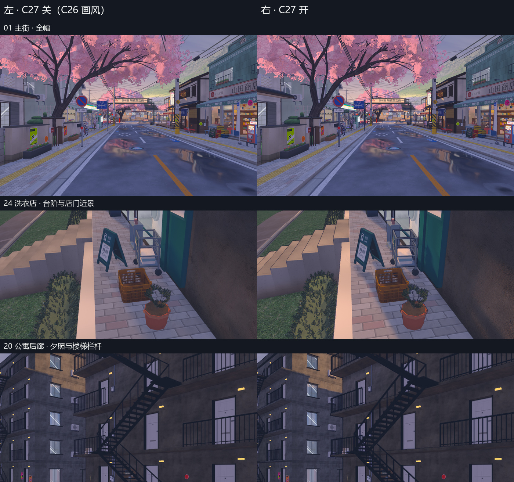

# 第 27 轮画风候选实机回验

候选 e00875b 已在 RTX 3060 Laptop 上复拍。细描边在近处台阶和栏杆上最清楚，三档明暗在阳光下的铺地可辨。#254 的共同默认版本为第 26 轮 cba1fca，候选单独保存在 codex/X-51-c27-toon-preview。

## 画面与关闭效果的对照

1440 × 900、DPR 1、D3D11、真实本机材质，站区和岛屿时钟固定。以 C26 默认原图对比候选的 ?toon=off，傍晚九个机位、下午五个机位中有 11 幅逐像素相同。其余三幅分别为傍晚 24 的 3 个像素、傍晚白车侧面的 5 个像素、下午白车侧面的 1 个像素，各只差 1 个色阶。原版本自身的重复捕获也出现过这些像素的相同波动。[14 组原图、重复捕获及像素坐标](photos/README.md)

将傍晚分档强度单独归零并保留暖轮廓光与描边后，24 的受照铺地有 11,008 / 11,009 个像素改变超过 8 个色阶，开启分档令平均亮度增加 17.03。该区单独开关新线逐像素一致。20 的楼梯与栏杆则相反，新线令 5,629 个像素改变超过 8，分档最大差仅 1。04 室内整幅对单独分档零差。当前强度足以看清室外受光面的分档，保留该强度作为候选基线。

在 20 的草片和花丛区域，单独切换新线分别有 463 和 180 个像素变化超过 8。白车挡风玻璃区域有 449 个，测区包含透过玻璃可见的轮廓。21 绿篱的描边最大差为 1。[分档与描边分开测试的同机位对照](photos/effect-isolation.jpg)

## 地面运动与控件

20 后廊地面机位水平摇动 0.9°，重放相同当前与前帧矩阵。关闭「运动模糊与光束」时，全屏合成前后的遮罩逐字节一致。开启后，340,954 / 1,296,000 个像素从禁止描边变为允许。草片区域 9,375 个像素中有 8,797 个跨过阈值。同一运动下仅关闭新线，这些像素里有 4,897 个显示差超过 8 个色阶，最大差 80。门灯区域有 118 个像素跨阈，但没有可见色差。地面专项渲染退出 0，重复图逐像素一致。 [地面运动复拍和取样记录](motion/README.md)

界面「统一色阶与描边」会关闭合成阶段的线，但已编译进受光材质的三档光照和暖轮廓光继续生效。?toon=off 从新页面启动时则跳过这两项。[渲染路径和控件核对](source-check.md)

## RTX 3060 Laptop 十段地面帧时

每轮独立启动。阴影补光、天气、水面与做旧保持开启。实测最终 WebGL 新线开关依次为 1、0、1。主街、便利店与两种步行每段约 3 秒，其余六段每段约 10 秒。阈值为平均 ≥60 FPS 且 p95 ≤16.7 ms。

| 机位 | 候选开 FPS / p95 ms | 候选关 FPS / p95 ms | 再开 FPS / p95 ms |
|---|---:|---:|---:|
| 01 主街 | 64.36 / 15.5 | 55.40 / 30.8 | 65.00 / 15.5 |
| 04 便利店朝内 | 63.71 / 15.5 | 65.00 / 15.5 | 65.00 / 15.5 |
| 20 公寓后廊 | 65.00 / 15.5 | 65.00 / 15.5 | 65.00 / 15.5 |
| 21 洗衣店前 | 65.00 / 15.5 | 65.00 / 15.5 | 65.00 / 15.5 |
| 23 维修角 | 64.70 / 15.5 | 65.00 / 15.5 | 65.00 / 15.5 |
| 24 洗衣细节 | 64.90 / 15.5 | 65.00 / 15.5 | 65.00 / 15.5 |
| 沿街橱窗 | 64.41 / 15.5 | 65.00 / 15.5 | 64.80 / 15.5 |
| 04 店内看门口 | 65.00 / 15.5 | 65.00 / 15.5 | 65.00 / 15.5 |
| 第三人称步行 | 51.62 / 30.8 | 59.24 / 30.8 | 61.81 / 30.7 |
| 第一人称步行 | 64.68 / 15.5 | 64.04 / 15.5 | 65.00 / 15.5 |

三轮 14,144 帧，共 26/30 段达标。20、21、23、24 的 12 次 p95 全部为 15.5 ms。第三人称三轮均有长帧，>20 ms 的帧数依次为 42/162、18/185、10/194。另有关闭时的 01 主街超限。开关两种状态都出现了长帧，尚未确认成因。[逐帧记录](timing/frames.json.gz) · [分段结果和真实着色状态](timing/frame-times.json) · [复算脚本](timing/verify.cjs)

## 运行记录

四个常规拍摄进程加一个分档诊断进程，退出码为 0、1、1、1、1。六个计时进程为 1、1、1、0、1、1。两组分别有 6、10 次加载请求取消，均完成渲染，JS 异常为零。[照片与进程记录](photos/measurements.json)

候选源码的 Windows CI 首次有一条 renderer 测试失败，world.test.ts:420 预期 24，得到 undefined。本轮没有改动该测试或相关的 renderer 与 schemas 源文件。同一提交、同一工作流第二次运行通过。[首次 Windows CI](https://github.com/aa15119557034/agent-review-room/actions/runs/44258142720/attempts/1) · [同一源码重跑](https://github.com/aa15119557034/agent-review-room/actions/runs/44258142720/attempts/2)
