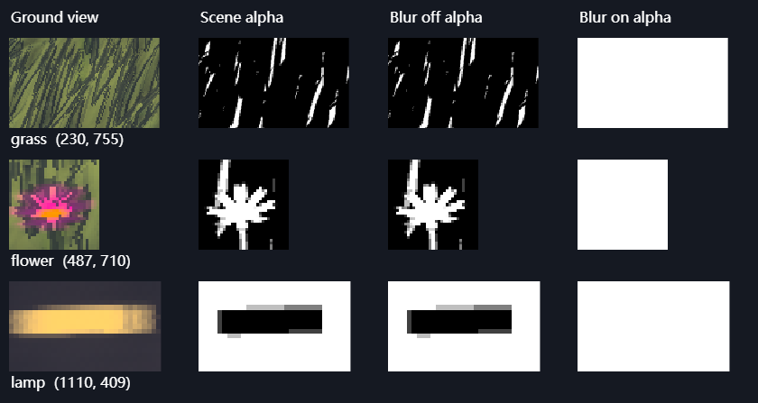

# 20 后廊地面摇镜：运动模糊与描边遮罩

C27 在地面勾选「运动模糊与光束」并转动视角后，前景草片的描边遮罩会丢失。傍晚 20 后廊的一处草片矩形中，8,797 个像素从禁止描边变成允许描边；保持同一次摇镜、只把新描边强度从 0.95 改为 0 后，其中 4,897 个像素的 RGB 最大通道差超过 8。门灯的遮罩也丢失，但本次该区域没有可测的新线颜色差。

| 固定像素矩形（左上原点，右下界不含） | 像素 | 从禁止到允许 | 其中新线造成 RGB 差 > 8 | 其中新线最大通道差 |
| --- | ---: | ---: | ---: | ---: |
| 草片 (230,755)–(355,830) | 9,375 | 8,797 | 4,897 | 80 |
| 品红花及周边草 (487,710)–(520,743) | 1,089 | 814 | 399 | 138 |
| 门灯及紧邻墙面 (1110,409)–(1142,428) | 608 | 118 | 0 | 0 |
| 全幅 | 1,296,000 | 340,954 | 194,922 | 138 |

**复现条件。** 提交 `e00875bd88109c6b3eb685bbb5aec8d01ef4bf5c`，RTX 3060 Laptop / ANGLE D3D11，1440 × 900。从 [C26 的相机记录](../../c26-room-shell-ground-3060-2026-11-18/photos/measurements.json) 取 `20-rear-eye` 当前相机。位置、俯仰和视场角沿用原镜头。上一帧在同一位置将当前方向绕世界 Y 轴偏转 +0.9°，当前帧回到原姿态，帧步长 1/60 秒。四组复放的前帧与当前帧各自矩阵完全相同，站区及岛屿均固定在 14 秒。

1. 在实际默认页面使用「运动模糊与光束」复选框，分别以关、开各复放一次。有效模糊强度分别为 0 和 0.62。每次完整渲染后从 `sceneRT.texture`、`compRT.texture` 按原坐标读取 alpha，用 `texelFetch` 写入无混合 RGBA8 后读回；表中按 0–255 字节的 128 阈值分类。
2. 开关两组未经模糊的 scene alpha 全图逐字节一致。关闭特效时，scene 与 comp 之间 0 个像素变动；开启后有 358,057 个 alpha 字节改变，其中 315,590 个从 0 变成 255。[场景 alpha](scene-mask.png) · [特效关时的合成 alpha](effects-off-mask.png) · [特效开时的合成 alpha](effects-on-mask.png)
3. 再保持特效开启，分别用新线强度 0 和原始强度 0.95 复放。两组场景和合成的 alpha 都与开启原始组完全相同，原始强度复拍的 RGB 全图逐字节相同。表中颜色差仅在已跨遮罩阈值、重复稳定的像素上计算。花的矩形包含花周围的草，数字描述该区域整体。该专项未测帧时。[最终地面画面](ground-jog.jpg)

采样后，取消界面的「统一色阶与描边」，实读 `uToon=0`、`uLnOn=1`。该页面已编译的受光片元源码包含强度 1.0 的分档、0.2 的暖轮廓光；此处记录控件与材质程序状态。原生进程退出 0，未见网络失败、HTTP 错误或 JS 异常，核对的五个源码/配置文件采样前后均与提交一致。[完整矩阵、指标、状态与文件哈希](result.json)
