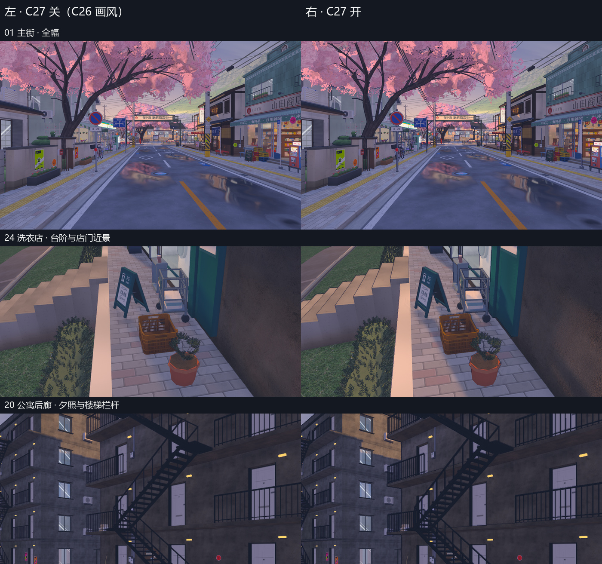
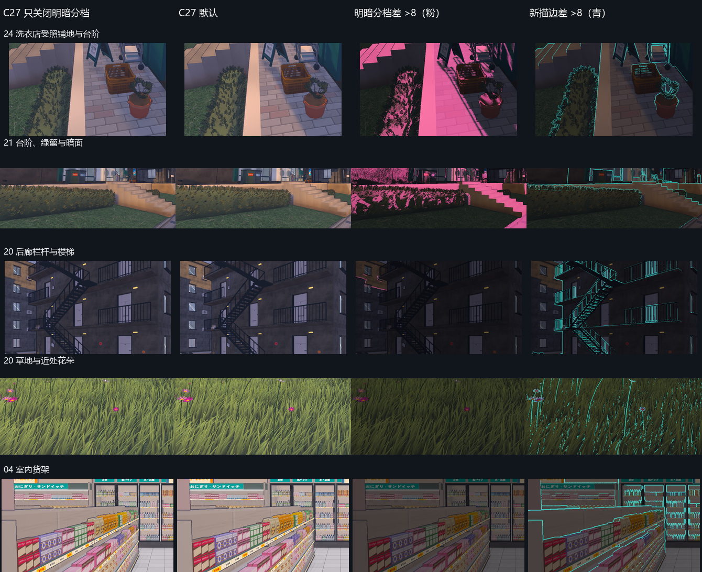

# C27 地面画风对照

左列为 C27 关闭新画风（C26 画风），右列为 C27 默认开启。傍晚 01 主街保留完整视野，24 洗衣店近景可看台阶、铺地和门前陈设，20 后廊近景可看夕照、楼梯与栏杆。

## 同机位与原生回退

RTX 3060 Laptop GPU，1440 × 900，DPR 1，AO 0.55。两套时段预设分别固定运行，岛与站前时钟均锁定 14。保持原生模型纹理、四套 1024² 公寓材质、阴影调色和做旧贴花。每个机位依次捕获预热、正式一和正式二，统计取正式二的无损 PNG。C27 为 `e00875bd88109c6b3eb685bbb5aec8d01ef4bf5c`，C26 为 `a281e7a8acb8557a6d8fe399a7c57eff195f5879`。逐机位核对相机位置、朝向、FOV、灯光、时钟及渲染参数。

14 个机位/时段组合中，C27 `?toon=off` 与 C26 默认有 11 张逐像素相同。傍晚 24 洗衣店的 3 像素和白车侧面的 5 像素各差 1 级，位置均与 C26 或 C27 关同进程重复采样中的差异重合。午后白车 (1040,386) 一个像素绿通道为 197，C26 预热也是 197，两张正式图均为 196。C24、C25 的预热和两张正式图在该点均为 197。

| 时段与机位 | C26 开 → C27 关改变像素 / 最大差 | C27 关 → 开超过 8 级像素 / 最大差 | 全分辨率对照 |
|---|---:|---:|---|
| 傍晚 23 维修角 | 0 / 0 | 91,308 / 130 | [关](images/evening-service-corner-off.jpg) · [开](images/evening-service-corner-on.jpg) · [C26](../../c26-room-shell-ground-3060-2026-11-18/photos/images/evening-service-corner-on.jpg) |
| 傍晚 24 洗衣店 | 3 / 1 | 316,558 / 108 | [关](images/evening-laundry-details-off.jpg) · [开](images/evening-laundry-details-on.jpg) · [C26](../../c26-room-shell-ground-3060-2026-11-18/photos/images/evening-laundry-details-on.jpg) |
| 傍晚 04 朝内 | 0 / 0 | 44,985 / 111 | [关](images/evening-shop-interior-off.jpg) · [开](images/evening-shop-interior-on.jpg) · [C26](../../c26-room-shell-ground-3060-2026-11-18/photos/images/evening-shop-interior-on.jpg) |
| 傍晚 20 后廊 | 0 / 0 | 177,569 / 139 | [关](images/evening-20-rear-eye-off.jpg) · [开](images/evening-20-rear-eye-on.jpg) · [C26](../../c26-room-shell-ground-3060-2026-11-18/photos/images/evening-20-rear-eye-on.jpg) |
| 傍晚 21 正面 | 0 / 0 | 302,994 / 129 | [关](images/evening-21-front-eye-off.jpg) · [开](images/evening-21-front-eye-on.jpg) · [C26](../../c26-room-shell-ground-3060-2026-11-18/photos/images/evening-21-front-eye-on.jpg) |
| 傍晚 01 主街 | 0 / 0 | 143,315 / 133 | [关](images/evening-station-street-off.jpg) · [开](images/evening-station-street-on.jpg) · [C26](../../c26-room-shell-ground-3060-2026-11-18/photos/images/evening-station-street-on.jpg) |
| 傍晚 沿街橱窗 | 0 / 0 | 57,991 / 126 | [关](images/evening-street-detail-off.jpg) · [开](images/evening-street-detail-on.jpg) · [C26](../../c26-room-shell-ground-3060-2026-11-18/photos/images/evening-street-detail-on.jpg) |
| 傍晚 04 朝门外 | 0 / 0 | 109,990 / 144 | [关](images/evening-shop-door-eye-off.jpg) · [开](images/evening-shop-door-eye-on.jpg) · [C26](../../c26-room-shell-ground-3060-2026-11-18/photos/images/evening-shop-door-eye-on.jpg) |
| 傍晚 白车侧面 | 5 / 1 | 79,615 / 134 | [关](images/evening-van-side-off.jpg) · [开](images/evening-van-side-on.jpg) · [C26](../../c26-room-shell-ground-3060-2026-11-18/photos/images/evening-van-side-on.jpg) |
| 午后 01 主街 | 0 / 0 | 155,358 / 126 | [关](images/afternoon-station-street-off.jpg) · [开](images/afternoon-station-street-on.jpg) · [C26](../../c26-room-shell-ground-3060-2026-11-18/photos/images/afternoon-station-street-on.jpg) |
| 午后 20 后廊 | 0 / 0 | 349,380 / 132 | [关](images/afternoon-20-rear-eye-off.jpg) · [开](images/afternoon-20-rear-eye-on.jpg) · [C26](../../c26-room-shell-ground-3060-2026-11-18/photos/images/afternoon-20-rear-eye-on.jpg) |
| 午后 04 朝内 | 0 / 0 | 44,291 / 103 | [关](images/afternoon-shop-interior-off.jpg) · [开](images/afternoon-shop-interior-on.jpg) · [C26](../../c26-room-shell-ground-3060-2026-11-18/photos/images/afternoon-shop-interior-on.jpg) |
| 午后 04 朝门外 | 0 / 0 | 145,781 / 128 | [关](images/afternoon-shop-door-eye-off.jpg) · [开](images/afternoon-shop-door-eye-on.jpg) · [C26](../../c26-room-shell-ground-3060-2026-11-18/photos/images/afternoon-shop-door-eye-on.jpg) |
| 午后 白车侧面 | 1 / 1 | 88,227 / 125 | [关](images/afternoon-van-side-off.jpg) · [开](images/afternoon-van-side-on.jpg) · [C26](../../c26-room-shell-ground-3060-2026-11-18/photos/images/afternoon-van-side-on.jpg) |

## 分档、暖边与描边

独立夕景诊断在初始化前读取原始 toon.json，仅将 evening.lit.strength 从 1 改为 0。保留原掩码、线宽 1.5、线强 0.95 与暖边强度 0.2。原生分档配置为 0 / 0.55 / 1，使用宽度 0.045 的平滑过渡。默认图与这组诊断图之差给出分档对最终像素的贡献。每个固定镜头另取一张保持分档关闭、只将新线强度 uLn.y 从 0.95 降为 0 的照片，保留 uLnOn=1 和暖边，随后还原。第二组差异给出该条件下的新描边贡献。未采暖边单独关闭的画面。

每格数值为 RGB 三通道最大绝对差超过 8 的像素数 / 最大差。较亮的 24 店门外铺地开启分档后平均亮度增加 17.03 级，20 后墙暗部同一操作的平均变化低于 0.01 级。在 20 栏杆、04 货架处，明显线条来自描边。

| 局部区域 | 原图矩形 [左,上,右,下) | 仅恢复分档 | 仅恢复新描边（分档关） |
|---|---|---:|---:|
| 24 受照铺地 | [576, 705, 685, 806] | 11,008 / 35 | 0 / 0 |
| 24 台阶 | [166, 351, 476, 525] | 20,461 / 14 | 2,097 / 87 |
| 24 周转筐网格 | [665, 537, 755, 579] | 370 / 37 | 68 / 26 |
| 20 后廊暗墙 | [970, 495, 1015, 540] | 0 / 1 | 0 / 0 |
| 20 楼梯栏杆 | [666, 192, 847, 454] | 0 / 1 | 5,629 / 115 |
| 20 前景草 | [230, 755, 355, 830] | 0 / 0 | 463 / 76 |
| 20 近处花朵 | [487, 710, 520, 743] | 0 / 0 | 180 / 138 |
| 20 灯体 | [1110, 409, 1142, 428] | 0 / 0 | 0 / 0 |
| 21 近景绿篱 | [160, 650, 330, 726] | 4,895 / 17 | 0 / 1 |
| 01 樱花树冠 | [390, 50, 650, 150] | 2,159 / 43 | 1,963 / 124 |
| 白车前窗区域 | [530, 245, 575, 358] | 29 / 10 | 449 / 105 |
| 04 货架 | [266, 454, 493, 575] | 0 / 0 | 1,021 / 104 |

04 朝内整幅对分档逐像素相同，恢复新线有 46,438 个像素差值超过 8。21 近景绿篱的新线最大变化为 1；20 前景草、花朵以及 01 树冠的局部图中都有新线差异。白车前窗裁区包括窗框和透过玻璃看见的结构，此取样不能将差异指定为玻璃材质自身。花草裁区同样覆盖重叠叶片与背景，未对每个像素读取材质 ID。

## 会话及原始证据

五次 Electron 运行均到达 complete，渲染、场景和驱动源文件、纹理资产、现场还原均通过，无 HTTP 错误和渲染异常。浏览器实际加载的八个店铺生成器 SHA-256 均与 Git 和工作盘相符。加载阶段取消的请求及退出码按组记录。

三处局部同时提供无损 PNG，可对同一矩形复算上述差值。

| 局部 | 默认 | 仅关分档 | 分档关且新线强度为零 |
|---|---|---|---|
| 24 受照铺地 | [PNG](samples/24-pavers-full.png) | [PNG](samples/24-pavers-no-bands.png) | [PNG](samples/24-pavers-no-bands-line-zero.png) |
| 20 楼梯栏杆 | [PNG](samples/20-rail-full.png) | [PNG](samples/20-rail-no-bands.png) | [PNG](samples/20-rail-no-bands-line-zero.png) |
| 04 货架 | [PNG](samples/04-shelf-full.png) | [PNG](samples/04-shelf-no-bands.png) | [PNG](samples/04-shelf-no-bands-line-zero.png) |

| 运行 | 捕获张数 | 退出码 | 已取消请求 |
|---|---:|---:|---|
| evening-on | 27 | 0 | 无 |
| evening-off | 27 | 1 | plastic_crate_02_1k.gltf／net::ERR_ABORTED, plastic_crate_02.bin／net::ERR_ABORTED |
| afternoon-on | 15 | 1 | plastic_crate_02_1k.gltf／net::ERR_ABORTED |
| afternoon-off | 15 | 1 | plastic_crate_02_1k.gltf／net::ERR_ABORTED |
| band-isolation | 27 + 9 张关闭新线强度诊断 | 1 | menhir.glb／net::ERR_ABORTED, boulders.glb／net::ERR_ABORTED |

[完整统计、相机、重复采样像素、模块与图像 SHA-256](measurements.json)
