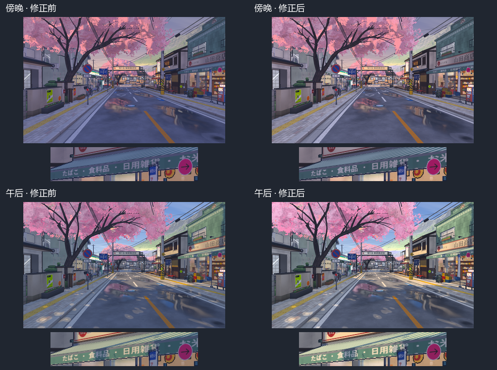

# 第 28 轮地面清晰度与实机回验

本次将选定的描边和三档明暗接入地面场景。傍晚保留暖灯和冷街面，以较中性的天光配合中间调，拉开店招浅字、檐面和铺地标线。固定相机和时钟，两个时段的正式截图都与选中的对照版本逐像素相同。源代码 `b4f1350397fc00b1ff7320f1844788dd1d16b86e`，[Windows 验证通过](https://github.com/aa15119557034/agent-review-room/actions/runs/44281515286)。

| 原生取样的亮度跨度 P90−P10 | 傍晚，调色前 → 后 | 午后，调色前 → 后 |
| --- | ---: | ---: |
| 01 店檐「食料品」 | 50.6 → 72.0 | 103.0 → 133.4 |
| 01 拱门文字 | 128.2 → 126.3 | 100.3 → 132.9 |
| 01 湿路与标线 | 18.9 → 23.0 | 20.8 → 27.6 |

调色前的基线是已修材质合批的 `ca10742c`。真实截图 1440 × 900、DPR 1、全分辨率 4× MSAA，曝光与 bloom 保持各时段原值。04 右侧顶灯 16,450 个像素，两个时段调色前后均无三通道同时 ≥250 的像素。旧傍晚倒影图的源峰 5.039 经烘焙压到线性值 2，最终傍晚 393,216 个像素逐个与原始浮点数据复算结果相同，12 张图的解码峰值在两个时段均为 2，12 个 Git blob 也与第 26 轮相同。[双时段原图、原生字区及灯芯](final-photos/README.md) · [十组光照对照](look-trials/README.md) · [倒影烘焙数据](../laundry-hedge-evening-reflections-2026-11-18/reports/bake-check.json)

## 24 洗衣店海报与材质合批

原始 C28 每次读取同一材质的编译回调都会创建新的函数，导致街区合批程序跳过普通材质。开启风格时，几何指纹随之变化，24 号机位改走现场规划，海报换到另一张、另一处。现已为每个材质保留稳定回调，兼容植物对原函数的裸调用。正式版开、关都读取同一烘焙清单，海报索引、图格、四角世界坐标、UV 和图集哈希一致。[海报原位对照](final-photos/native/24-poster-restoration.png) · [可复跑的材质合批检查](hook/README.md)

两次独立傍晚开启态实拍中，从页面开始加载到可以冻结机位，原候选为 250.8 秒，修复后为 46.4 秒。01 相同捕获的 renderer.info 最后一遍绘制调用由 2,603 恢复到 1,608，与关闭态相同。加载观察用于定位合批回归，实际帧时另列。[原始交件](photos/README.md) · [修复后截图与进程记录](final-photos/README.md)

用 `?toon=off` 重启后，14 张同机位图中有 12 张与 C26 逐像素相同。其余是傍晚便利店朝门外 1 像素、白车侧面 5 像素，单通道最大差均为 1/255。四次正式抓图都取得完整图片，三次记录到装饰模型请求取消，按严格传输检查退出 1。独立运动专项退出 0。

## 运动、控件与待精修处

20 后廊水平转镜 0.9°，动模前后 1,296,000 像素的描边遮罩均未跨过 0.95 阈值。01 原地专项的 70 个已查受光程序在界面开、关、再开时三档与暖边均同步切换；两轮计时进程另扫到 70 个已链接程序里有一个在关后保留旧值，其后是否实际绘制有待追踪。天光和最终合成的中间调门控均正确切换。具名店窗保持原生 HDR RGB，全部 11,165 个有玻璃着色贡献的测区像素都拒绝描边。原位重拍没有看到随机跳动。[地面摇镜、花、玻璃与实际着色程序](motion/README.md)

白车共用的无名透明材质仍漏过玻璃遮罩。车窗测区内有 8,540 个像素受该玻璃着色影响，其中 8,468 个仍具描边资格。这个数仅表示可被描边；是否出现暗线取决于该处的深度与轮廓。01 机位前方 35–150 米范围的小线条，在 ±0.09° 和 ±0.18° 转镜后可见一定的亚像素变化，回到原机位时差异为零。交 C酱按同轨迹与旧版比较，并局部修车窗。

## RTX 3060 Laptop 十段地面帧时

RTX 3060 Laptop、1440 × 900、DPR 1，依序原生开启、URL 关闭、再次开启。每段按平均 ≥60 FPS 且 p95 ≤16.7 ms 判定。共 14,116 帧，27/30 段达标。

| 地面机位 | 开 FPS / p95 ms | 关 | 再开 |
| --- | ---: | ---: | ---: |
| 01 主街 | **55.12 / 30.8** | 65.00 / 15.5 | 65.00 / 15.5 |
| 04 便利店朝内 | 65.00 / 15.5 | 65.00 / 15.5 | 65.00 / 15.5 |
| 20 后廊 | 65.00 / 15.5 | 65.00 / 15.5 | 64.80 / 15.5 |
| 21 正面 | 65.00 / 15.5 | 65.00 / 15.5 | 65.00 / 15.5 |
| 23 维修角 | 64.61 / 15.5 | 65.00 / 15.5 | 65.00 / 15.5 |
| 24 洗衣店 | 65.00 / 15.5 | 65.00 / 15.5 | 65.00 / 15.5 |
| 沿街橱窗 | 65.00 / 15.5 | 65.00 / 15.5 | 65.00 / 15.5 |
| 便利店朝门外 | 65.00 / 15.5 | 65.00 / 15.5 | 65.00 / 15.5 |
| 第三人称步行 | 65.00 / 15.5 | 64.68 / 15.5 | **50.34 / 30.8** |
| 第一人称步行 | 65.00 / 15.5 | 65.00 / 15.5 | **42.17 / 30.8** |

超出预算的实测段为 首轮开 01 主街 55.12 FPS / 30.8 ms、再开 第三人称步行 50.34 FPS / 30.8 ms、再开 第一人称步行 42.17 FPS / 30.8 ms。六个原生计时进程的退出码（每轮常规/细节）依次为 1/1、1/1、0/1。具体请求取消、渲染与源码检查分别保存在各轮记录。

[帧时与 GPU 回读](timing/frame-times.json) · [逐帧原始间隔](timing/frames.json.gz) · [复算脚本](timing/verify.cjs)
