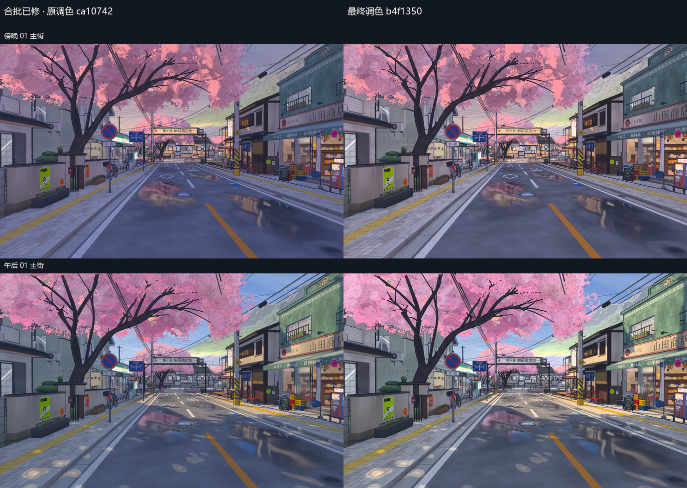

# C28 最终地面画面

最终版让店招较亮的笔画与偏暗的底色拉开了距离。傍晚右侧店檐「食料品」取样区的亮度 P10–P90 跨度从 50.6 增至 72.0，午后从 103.0 增至 133.4。窗格和路标保留硬边，湿路的倒影仍呈柔边。

| 01 主街 | 无损原生像素面板 | 默认 1440 × 900 原图 | 关闭新画风原图 |
|---|---|---|---|
| 傍晚 | [招牌、窗格、樱冠和湿路](native/evening-01-actual-pixels.png) | [开启 PNG](native/evening-01-on-full.png) | [关闭 PNG](native/evening-01-off-full.png) |
| 午后 | [招牌、窗格、樱冠和湿路](native/afternoon-01-actual-pixels.png) | [开启 PNG](native/afternoon-01-on-full.png) | [关闭 PNG](native/afternoon-01-off-full.png) |

原生面板将正式第二张 PNG 的矩形直接粘贴，保留每个源像素。傍晚左列为原始 C28 开启态 `880a02a`，该版本的材质回调破坏了合批。午后左列为 C27 开启态，原始 C28 午后开启组未留下照片。两张面板的中列均为修好回调及植物调用、仍用旧调色的 `ca10742`，右列均为最终生产源 `b4f1350`。[原始裁区与面板像素坐标](native/01-native-registration.json)

## 招牌与街面亮度

RTX 3060 Laptop、DPR 1。四次实拍中的 CSS 画布、canvas backing、实际 GL drawingBuffer 均为 1440 × 900。sceneRT 和 compRT 均为全分辨率、4× MSAA，浏览器默认 framebuffer 为 samples 0。曝光保持 1.02，AO 0.55，动态模糊、光束、色散与扭曲均为 0。晚间与午后 bloom 分别为 0.20 / 0.12。每个机位锁定岛和站前时钟 14、相机位置、朝向及 FOV。

| 时段与原图取样 | 回调修复后的 P10–P90 | 最终 P10–P90 |
|---|---:|---:|
| 傍晚 拱门字区 [678, 353, 808, 377] | 81.4–209.7 | 84.4–210.7 |
| 傍晚 店檐「食料品」 [1202, 366, 1252, 395] | 73.3–123.9 | 77.8–149.7 |
| 傍晚 湿路和标线 [706, 646, 978, 800] | 73.8–92.7 | 79.1–102.1 |
| 午后 拱门字区 [678, 353, 808, 377] | 65.6–165.9 | 66.1–199.0 |
| 午后 店檐「食料品」 [1202, 366, 1252, 395] | 78.5–181.5 | 82.3–215.6 |
| 午后 湿路和标线 [706, 646, 978, 800] | 74.7–95.5 | 78.7–106.2 |

数值为同一矩形内按 sRGB 码值加权的亮度分位数。拱门 lettering 实际加载的是 1024 × 128 画布，在 01 机位整个字牌投影约 183 × 23 屏幕像素，中央字区横跨约 130 像素。E3 店檐原画布为 1024 × 64，最终实拍射线命中已合批的 4096² 图集。较远的小字和斜视招牌仍受屏幕采样数限制。[拱门真实源贴图](native/arch-source-1024x128.png) · [店檐真实源贴图](native/awning-source-1024x64.png)

## 室内顶灯与 24 海报

04 右侧顶灯与灯座取原图 [1024, 155, 1353, 205)，共 16,450 像素。两时段的灯罩和灯座仍能分开，裁区在修回调版与最终版均为零个 RGB 三通道全白像素，也没有像素三个通道同时达到 250。

| 时段 | 亮端 P95，回调修复 → 最终 | 至少一通道达到 255，回调修复 → 最终 |
|---|---:|---:|
| 傍晚 | 246.32 → 246.32 | 4,059 → 4,059 |
| 午后 | 243.24 → 243.24 | 3,043 → 3,049 |

[顶灯 1:1 PNG 面板](native/04-lamps-actual-pixels.png)

24 洗衣店的最终开、关均使用烘焙清单，几何指纹恢复为 `1015:2741945:285456.7:910574.7`。紫红星形海报恢复到索引 15、图格 5、站前局部位置 [6.1352, 6.5412, -123.25]，第一个角投影为 (990.26, 160.56)。与原始 C28 关闭态逐项核对，最终开启、关闭两组的清单项、四个角、UV、1024² 图集 SHA-256 均相同。原始 C28 开启时的黄色海报来自重新规划。[海报在相同原图位置的三列对照](native/24-poster-restoration.png) · [清单、投影、UV 与图集哈希](native/24-poster-registration.json)

## 各机位

[20、21、23、24、04 地面全幅对照](ground-views.jpg)。表中“超过 8 / 最大差”以每像素 RGB 三通道最大绝对差统计，均使用无损原图。

| 时段与机位 | 回调已修 → 最终开，超过 8 / 最大差 | C27 默认 → 最终开，超过 8 / 最大差 | C26 默认 → 最终 URL 关，改变 / 最大差 | 最终全图 |
|---|---:|---:|---:|---|
| 傍晚 23 维修角 | 未拍该基线 | 937,819 / 168 | 0 / 0 | [关](images/evening-service-corner-off.jpg) · [开](images/evening-service-corner-on.jpg) |
| 傍晚 24 洗衣店 | 未拍该基线 | 537,644 / 172 | 0 / 0 | [关](images/evening-laundry-details-off.jpg) · [开](images/evening-laundry-details-on.jpg) |
| 傍晚 04 朝内 | 1,169,929 / 105 | 1,179,211 / 153 | 0 / 0 | [关](images/evening-shop-interior-off.jpg) · [开](images/evening-shop-interior-on.jpg) |
| 傍晚 20 后廊 | 360,677 / 47 | 423,278 / 198 | 0 / 0 | [关](images/evening-20-rear-eye-off.jpg) · [开](images/evening-20-rear-eye-on.jpg) |
| 傍晚 21 正面 | 未拍该基线 | 292,994 / 204 | 0 / 0 | [关](images/evening-21-front-eye-off.jpg) · [开](images/evening-21-front-eye-on.jpg) |
| 傍晚 01 主街 | 856,481 / 47 | 913,148 / 177 | 0 / 0 | [关](images/evening-station-street-off.jpg) · [开](images/evening-station-street-on.jpg) |
| 傍晚 沿街橱窗 | 未拍该基线 | 842,838 / 164 | 0 / 0 | [关](images/evening-street-detail-off.jpg) · [开](images/evening-street-detail-on.jpg) |
| 傍晚 04 朝门外 | 907,602 / 46 | 933,546 / 155 | 1 / 1 | [关](images/evening-shop-door-eye-off.jpg) · [开](images/evening-shop-door-eye-on.jpg) |
| 傍晚 白车侧面 | 845,392 / 48 | 875,471 / 165 | 5 / 1 | [关](images/evening-van-side-off.jpg) · [开](images/evening-van-side-on.jpg) |
| 午后 01 主街 | 853,853 / 46 | 893,345 / 162 | 0 / 0 | [关](images/afternoon-station-street-off.jpg) · [开](images/afternoon-station-street-on.jpg) |
| 午后 20 后廊 | 554,158 / 44 | 615,196 / 245 | 0 / 0 | [关](images/afternoon-20-rear-eye-off.jpg) · [开](images/afternoon-20-rear-eye-on.jpg) |
| 午后 04 朝内 | 1,176,210 / 133 | 1,184,676 / 144 | 0 / 0 | [关](images/afternoon-shop-interior-off.jpg) · [开](images/afternoon-shop-interior-on.jpg) |
| 午后 04 朝门外 | 901,236 / 46 | 935,613 / 154 | 0 / 0 | [关](images/afternoon-shop-door-eye-off.jpg) · [开](images/afternoon-shop-door-eye-on.jpg) |
| 午后 白车侧面 | 874,950 / 45 | 907,132 / 161 | 0 / 0 | [关](images/afternoon-van-side-off.jpg) · [开](images/afternoon-van-side-on.jpg) |

关闭新画风后，14 个时段/机位组合中有 12 幅逐像素等于 C26。傍晚白车有 5 像素各差 1，这些位置也在重复采样中出现。傍晚 04 朝门外 (846,613) 仅一个像素差 1；原始 C28 的关闭态相对 C26 在同一位置也有这一级差。此轮复拍覆盖静态地面机位，运动时的细线与遮罩由独立专项测试。

## 捕获与校验

四组均完成正式渲染及现场还原，源文件、驱动、模型与纹理资源校验通过，无 HTTP 错误或渲染异常。浏览器真正在每个进程加载的八家店铺生成器，其响应体 SHA-256 均与磁盘和最终 Git 提交相符。每个机位均拍预热、第一张、第二张，共 84 张。

| 组 | 张数 | 退出码 | 加载阶段已取消请求 |
|---|---:|---:|---|
| evening-on | 27 | 1 | menhir.glb／net::ERR_ABORTED, boulders.glb／net::ERR_ABORTED, plastic_crate_02_1k.gltf／net::ERR_ABORTED |
| afternoon-on | 15 | 0 | 无 |
| evening-off | 27 | 1 | menhir.glb／net::ERR_ABORTED, plastic_crate_02_1k.gltf／net::ERR_ABORTED |
| afternoon-off | 15 | 1 | menhir.glb／net::ERR_ABORTED, boulders.glb／net::ERR_ABORTED, plastic_crate_02_1k.gltf／net::ERR_ABORTED |

[完整数值、相机、渲染尺寸与模块哈希](measurements.json) · [原始 C28 取证](../photos/README.md)
