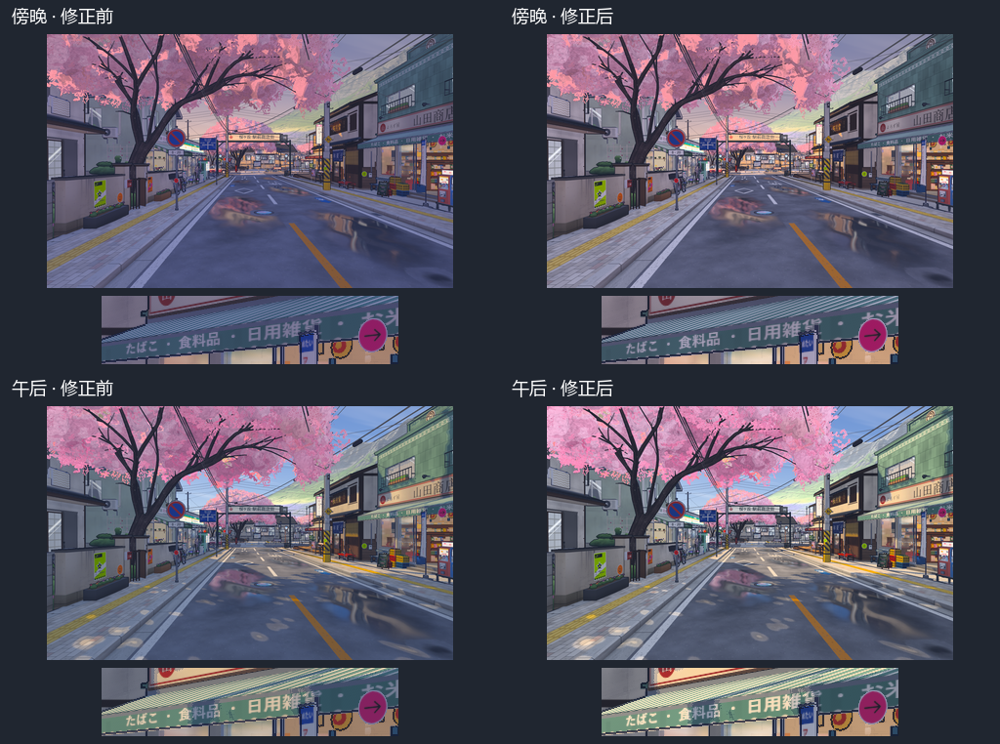

# 地面清晰度的同机位分项对照

在已恢复材质合批的 `ca10742c` 上，使用同一相机、同一场景时钟、同一 GPU 上的实际渲染做十组对照。两个时段各拍 5 个机位 × 10 组参数。最终源码 `b4f13503` 采用表中的「中间调＋天光」。两个时段的 01 正式实拍与选中组合均逐像素一致，1440 × 900。下图每格上方为全幅缩略图，下方店檐为 1:1 原图裁切。

正式版本的独立复拍见[同机位照片](../final-photos/README.md)。

| 时段 / 处理 | 拱门文字 | 「食料品」檐字 | 湿路与路标 | 全幅亮度 ≥248 |
| --- | ---: | ---: | ---: | ---: |
| 傍晚 · 合批恢复后的原色 | 128.24 | 50.57 | 18.90 | 0.00448% |
| 傍晚 · 只减远景雾 | 128.24 | 50.57 | 18.90 | 0.00448% |
| 傍晚 · 只减泛光 | 131.16 | 50.92 | 18.74 | 0.00432% |
| **傍晚 · 中间调＋天光** | **126.30** | **71.96** | **22.98** | **0.01296%** |
| 傍晚 · 较强提亮＋天光 | 119.02 | 74.38 | 29.13 | 0.02454% |
| 午后 · 合批恢复后的原色 | 100.35 | 103.01 | 20.80 | 0.00278% |
| **午后 · 中间调＋天光** | **132.92** | **133.36** | **27.57** | **0.01798%** |
| 午后 · 较强提亮＋天光 | 132.92 | 129.86 | 35.05 | 0.04823% |

前三列为固定原生像素框内的 P90−P10，0–255，按截图 RGB 码值用 0.2126、0.7152、0.0722 加权。数字描述框内亮度分布，字是否容易读还需要看[原生像素图](../final-photos/)。选中方案在傍晚保住了拱门笔画的明暗差，同时拉开了蓝底檐字和湿地标线。两时段 01 全幅三个通道都 ≥254 的像素均为 0。傍晚 04 全幅三个通道都 ≥254 的占比在调色前后均为 0.00023%。

[逐组数值、截图 SHA-256、取样坐标](measurements.json)。十组包含原色、单项减雾、单项减泛光、单项调中间调、单项天光、三个后期项合用，以及两档强度分别加天光、加全套。每次渲染后核对源码、资产和还原状态。两次探索会话均有本地装饰资产请求记为 `ERR_ABORTED`，渲染记录为每时段 50 张，无页面异常。正式地面照片与帧时另在独立进程复测。
