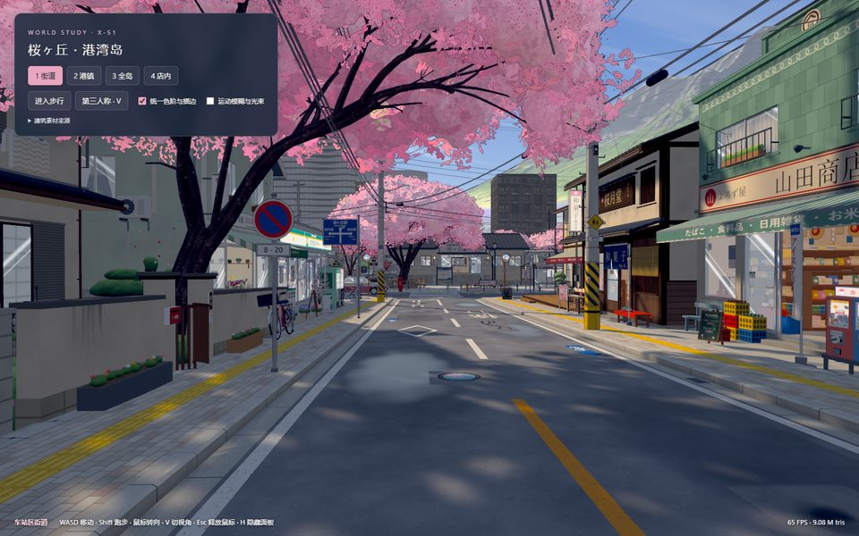
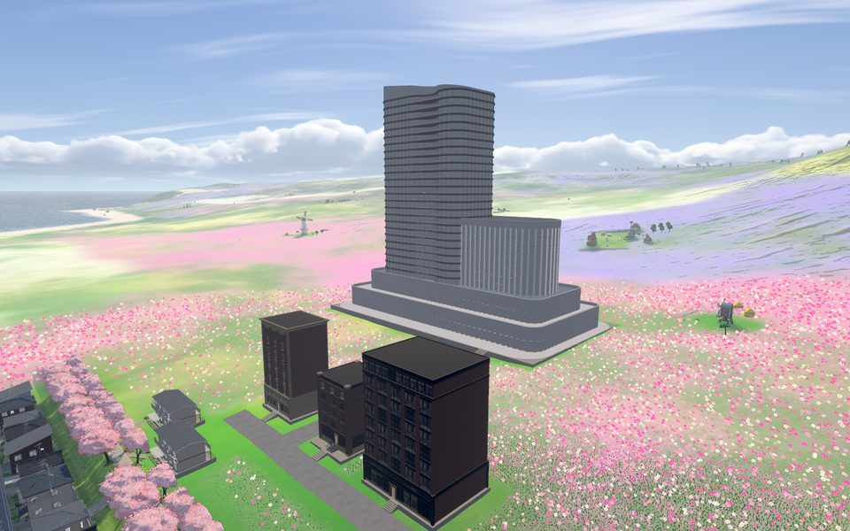
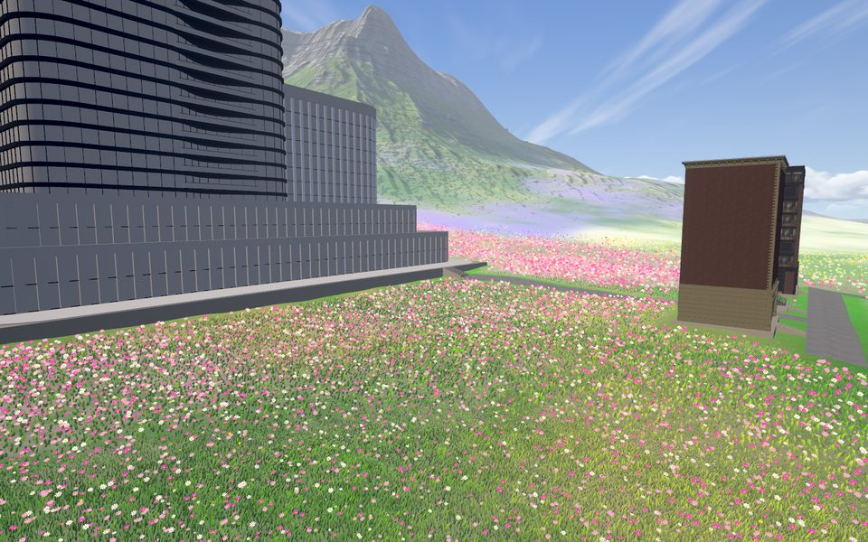

# 站后楼群试装与资源取消定位

本轮是候选实装，**尚未通过城市风格与步行性能验收**。四个固定机位约65 FPS；第一/第三人称步行约60 FPS，存在30.7ms长帧。资产字节复现与Chromium已知的终结状态缺陷吻合，但本机运行时尚未修复，仍保留失败结果。

场景源码：`76a000dbded2ed581f41eae5446b37137a1aafe4`。采集时工作区基于`7ef9545`有未提交修改，归档时已将受测的**198项场景/资产清单文件**逐一与该源码提交及本地字节比对，全部一致。当前测量为`gpu-city-v4`，完成于2026-11-17 01:04:59 UTC；[源码清单](./source-manifest.json)、[测量](./current-measurements.json)、[证据哈希清单](./provenance.json)。

## 画面与判断





其他机位：[港镇](./02-station-port.jpg)、[全岛](./03-island-aerial.jpg)、[店内](./04-shop-interior.jpg)、[第三人称行走](./walking-third.jpg)、[第一人称行走](./walking-first.jpg)。细节机位16、17的坐标在测量报告中。

街道后方现在有真实中高层体量，但高层外观仍偏灰、三栋中层偏暗；侧向镜头里的花海、基座和道路还没有形成可信的城市地块。它们是交给C酱判断和精修的候选，不代表已经达到江浩提供的绝区零参考，也不是P2完成。湿面仍是天空颜色近似，没有店铺倒影；井盖周围的矩形干区仍待修。

## 资产与适配

| 候选 | 固定版本实测成本 | 当前判断 |
|---|---|---|
| Quaternius Downtown City MegaKit 免费Standard三栋完整建筑 | 共89,078三角形；19张PNG；GPU纹理格式估算约313.3 MiB，未测实际VRAM | 门窗/底商结构可复用，需统一色阶、减少“贴进花田”的感觉；不能把免费版写成收费版315件/7栋 |
| mirzaev3d High-Rise Building #01 | 740,180三角形、36图元、4张512²纹理；原始尺寸约116.48×105.41×65.93 | 体量足够但几何较重，无LOD；玻璃/裙楼效果尚不合格，保留替换可能 |

来源、许可、原包/单文件SHA-256、官方获取入口均见[city-assets.json](../../city-assets.json)。前者CC0 1.0，后者CC BY 4.0；本轮没有购买资源。运行需要27项原始文件，二进制仅在`.local/city/`，不进Git。作者OBJ包只用于核对缺失材质，不是运行依赖。

高层官方GLB漏了三种材质参数，直接加载会出现黑塔。现依据作者原始MTL的Kd/Ks/Ns恢复Phong材质，并按sRGB转换颜色；作者源文件本身不透明，不虚构玻璃透射。原字节MTL及哈希已保留。Downtown的顶点颜色是作者控制信息，本场景不将它直接染到门面。

保留原模型比例；地基按实际双线性高度网格的极值计算，道路贴真实地表，堤顶连接按过渡三角面取样。五段台阶均满足级高≤0.18m、踏步≥0.25m、逐阶净空>0.005m，见[台阶CPU记录](./cpu/stairs-audit.json)。[当前四栋占地CPU复核](./cpu/current-placement-audit.json)使用已移动到[-16,-135]的Medium位置，未发现与Petal道具、河流和原公寓重叠；该检查不替代视觉接触检查。[早期选址记录](./cpu/placement-audit.json)包含弃用布局，单独保留。背景不可步行，没有扩展导航或碰撞区。

共享同URL且颜色空间/UV/采样语义一致的纹理，56个Texture减为23个，释放33份不再引用的CPU ImageBitmap。四个地基和连接道路/台阶从46个直接子网格合成2个，2828三角形不变，原建筑几何未合并或简化。总纹理RGBA8含mipmap估算318.67 MiB，**这是格式估算，不是测得显存占用**。

## 本机实测

RTX3060 Laptop、ANGLE D3D11、1440×900、pixelRatio=1；Electron44.9.0 / Chromium152.0.7977.167。受同步上限约65 FPS影响；没有证明新建筑零成本，也没有单独GPU阶段计时。

| 片段 | FPS | p95帧间隔 |
|---|---:|---:|
| 初始15.108s，982帧 | 65.000 | 15.5ms |
| 街道 | 65.002 | 15.5ms |
| 港镇 | 64.998 | 15.5ms |
| 全岛 | 64.678 | 15.5ms |
| 店内 | 65.000 | 15.5ms |
| 第三人称走9.562m | **60.517** | **30.7ms** |
| 第一人称走9.562m | **60.200** | **30.7ms** |

14/14行为检查、步行位移和视角切换、着色开关通过，JS异常0。`renderOk=true`只表示该脚本的渲染/行为判定通过，**不是画面美术和帧率达标**。5个同requestId资源取消全部在初始化阶段：menhir、高层GLB和三栋中层BIN；`transportClean=false / ok=false`，命令退出1。原始帧样本和同ID网络事件保留。

步行189/188帧分别有14/15帧约30.7ms，慢帧延续到片段末尾；多数慢帧的draw/triangle与前一帧相同。v1同路线约65 FPS，而v4两段平均draw数量与v1接近。当前只有RAF与绘制统计，没有CPU分段、GC或GPU耗时证据，不能归因于面数、碰撞或第三人称相机。固定镜头另有1.5秒预热，步行则切视角后立即采样，两者也不是严格对照。下一步应沿相同路线记录各update/render段和Performance trace，再在相同起点/采样规则下对比city可见与隐藏。

实际命令（fixture目录）：

```bat
node scripts\prepare-city.cjs
node scripts\baseline.cjs --scene=combined --stills --electron=D:\codex\2026-11-16\world-implementation\runtime-path-probe\electron.exe --output=artifacts/gpu-city-v4 --timeout-ms=240000
node scripts\diagnose-asset-transport.cjs --electron=D:\codex\2026-11-16\world-implementation\runtime-path-probe\electron.exe --output=artifacts/asset-transport-v2 --timeout-ms=60000
```

第一条27项verified、0 copied、退出0；后两条均退出1，原因分别见本节与下一节。准备脚本另实测27项首次复制，以及坏哈希在写入前拒绝、既有文件不变。26个JS/CJS逐一`node --check`通过，输出`{"syntaxChecks":26,"passed":true}`；`git diff --check`通过。没有录新视频。

## 资源取消：复现和上游依据

[独立复现完整报告](./transport/report.json)。不创建WebGL场景，原生fetch.arrayBuffer和原版Three FileLoader分别读取3种资产各3次，固定顺序，无重试。

- **18/18长度和SHA-256正确**，合计209,134,200字节，源文件未变。
- 原生路径9/9同ID正常finished；FileLoader路径8/9报`net::ERR_ABORTED`。
- 流式读取9次均正常EOF，无reader rejection，没有观察到AbortController或signal abort。
- 8次失败同ID均HTTP200；取消事件紧贴EOF，随后body fulfilled。跨时钟亚毫秒差不能作为严格因果顺序，也不能写成“fulfilled后才取消”。

官方Chromium提交[62473ad：修复已读完fetch body仍被报告取消](https://github.com/chromium/chromium/commit/62473ad0f747e245e514c93e741bb8e168a2a207)直接覆盖此条件：no-store响应、流式reader、EOF独立到达时，终结状态登记晚于客户端通知，正常关流被误记为取消；修复将状态登记提前，并带有CDP回归测试。[本机版本对应源码](https://raw.githubusercontent.com/chromium/chromium/152.0.7977.167/third_party/blink/renderer/platform/loader/fetch/response_body_loader.cc)尚缺此修复。

因此这次最小复现支持**引擎网络终结状态误报**，不是资产字节损坏；也不需要假设Three封装算法、GC或切镜头LOD有错。没有据此宣布所有历史取消均已查清，未在包含修复的运行时复验。本轮没有升级软件、改缓存头或屏蔽失败，`transportClean=false`保持原义。交给C酱独立核对。

## 失败历史与经验

- **v1**：初始约65 FPS，但高层黑、楼群散；画面拒收。保留[数据](./history/v1-measurements.json)、[原始楼群图](./history/v1-16-city-context.jpg)和8个修改文件快照。
- **v2**：Large入口台阶的踏步深度保护触发，初始化失败；旧驱动继续等到240秒超时。调整道路北缘0.5m后重做实际地形/台阶检查；驱动现在遇场景errors会立即失败。[失败数据](./history/v2-measurements.json)和9个修改文件快照保留。
- **v3**：材质和台阶修复后渲染通过，但街道52.318、全岛56.395 FPS。仅把46个连接网格合为2个后，v4固定机位恢复约65；步行仍约60，不能标作性能已全面恢复。[数据](./history/v3-measurements.json)、帧样本和9个修改文件快照保留。
- 资源诊断驱动**v1**没有完成引导，cases=0，180秒超时；加入正常的about:blank页面加载步骤后v2完成18次。这是驱动初始化问题，不能计作资产读取失败。[原始失败](./transport/driver-v1-timeout.json)及当时两项脚本快照保留；未修改的Three输入用provenance中的固定提交和哈希引用，避免重复提交整库。

本轮得到的可复用经验：模型下载成功不等于材质完整；原作者源包可以澄清转换遗漏和控制色语义。尺寸小的几何也可能制造多次绘制，原样保留失败数据后才能比较批处理前后。资源报错须用同requestId终结事件、实际EOF和字节哈希结合判断，单看URL ResourceTiming或页面能显示均不足以下结论。

下一轮由C酱判断楼群风格/布局是否值得保留，精修材质、地块过渡及井盖干区，给出步行开销建议；回交后由林离在同机复测。旧湿面严格对照、旧录像和失败历史继续保留，不被本轮覆盖。
