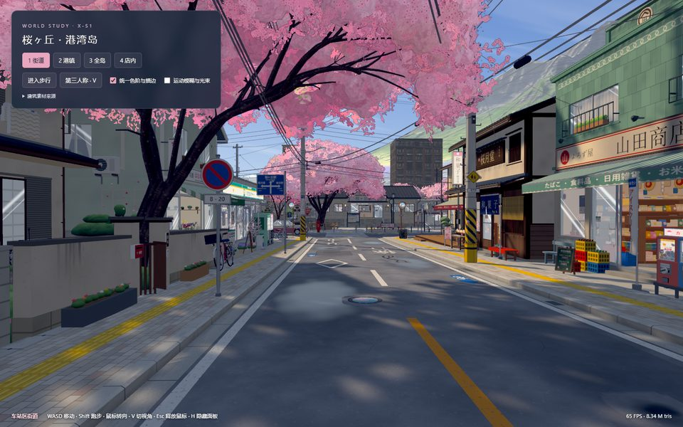
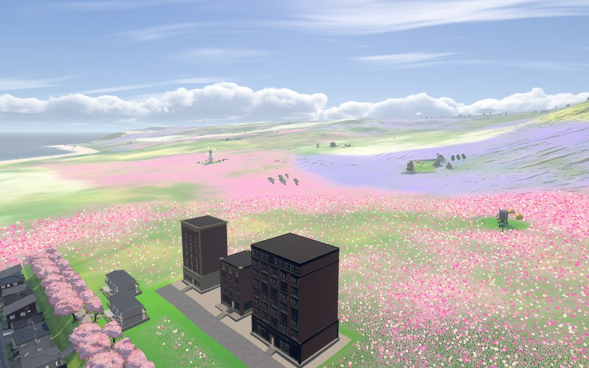
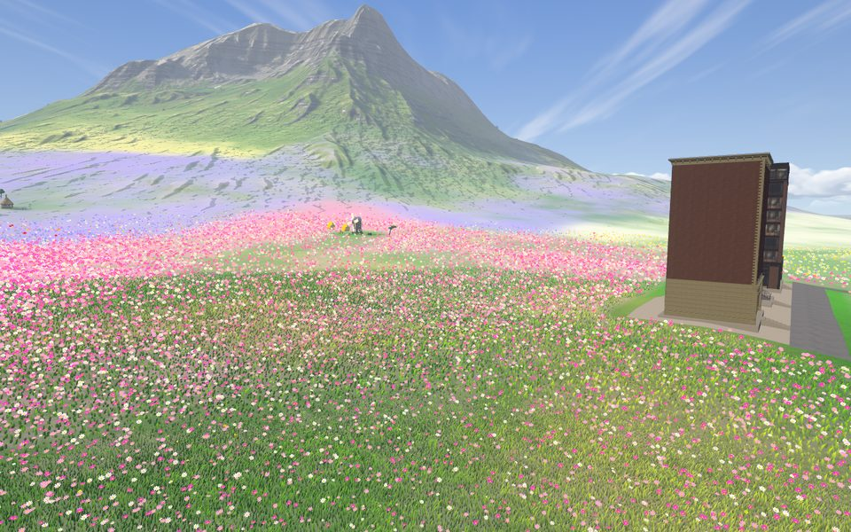
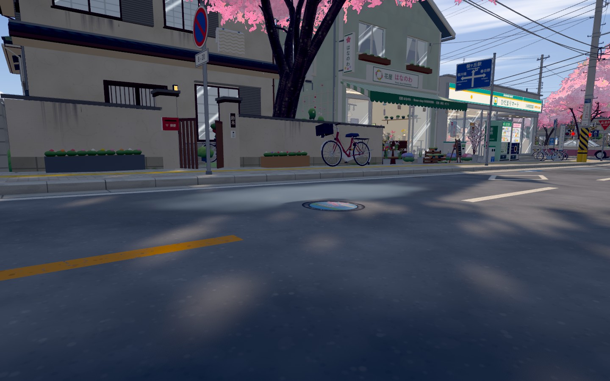

# 三栋中层精修回验与剩余问题

**井盖形状和资产依赖清理通过本轮核验；步行帧率仍有波动，三栋中层的材质风格仍待改善。** 不标P2完成，不把渲染脚本的`renderOk`当作美术或性能达标。

C酱精修提交：`cc079586460ee5f6e9d623e956a58a56906f4e1d`。林离后续清理/修正：`4f504b271eba8e20d67e6a6c07affbf3b36dcf51`。本目录同时保留两版实测；每轮捕获清单均与对应Git提交逐文件校验，正常基线/步行诊断各198项，湿面专用脚本范围各197项。见[provenance.json](./provenance.json)。原始大报告无损gzip归档并记录解压前后的哈希，未复制模型、运行时用户目录或缓存。

## 当前画面






[店内](./final/04-shop-interior.jpg)、[港镇](./final/02-station-port.jpg)、[全岛](./final/03-island-aerial.jpg)、[第一人称](./final/walking-first.jpg)、[第三人称](./final/walking-third.jpg)。

同机位的[原四栋试装](../city-background-2026-11-17/16-city-context.jpg)、[C酱三栋版本](./cc07958/16-city-context.jpg)和当前图用于看布局与材质；这些是正常动画采集，不能当作严格像素隔离对照。C酱先删除了不合适的弧形企业塔楼，三栋中层底色乘1.35并禁用其环境贴图强度，新增贴地铺装。背景占地和台阶检查未发现穿入，铺地清草有效；但中层仍暗、侧面大片无窗墙显眼，和花海的城市边界还不完整。这是候选场地，尚不是密集生活街区。

## 修改与依赖

- 高层退休：清除不可达的材质恢复函数，`projects`只保留Downtown三栋的26项原始依赖。原高层完整作者、许可、GLB/OBJ/MTL哈希及旧材质依据移入`retiredAssets.highrise`，原件和历史证据不删除。
- 当前准备仅需`node scripts/prepare-city.cjs --downtown=<Standard解包目录>`。原26项哈希未改，无参数验证26项，旧`--highrise`不再接受；不再要求下载已退出场景的模型。
- C酱将井盖干区从三角AABB改为alpha光栅化及12cm膨胀。林离发现实际`street-lines`为RepeatWrapping且UV超过1，后续改用Three `Texture.transformUv`处理矩阵、wrap和flipY；像素读取失败明确抛出含贴图上下文的异常，不静默退化。没有新增降质开关。
- 当前传输回归目标为menhir、Large BIN、Medium BIN，仍18次读取。它是当前依赖回归，不冒称重跑了原31.79MB高层输入；旧高层复现原样保留。

高层去掉740,180三角形和36图元，纹理格式估算仅约5.33 MiB；**不是318 MiB**。当前三栋合计89,078三角形、37图元，19份唯一纹理约313.33 MiB（RGBA8含mipmap估算，非实测VRAM）。适配层连接构件35网格合为3个，4988三角形；原建筑几何未减面。

材质只读审计未发现高层式的转换漏项：砖/线脚/混凝土/大理石的ORM蓝通道为0，不能解释成全墙金属；法线图与包内通用版本一致，不是Unreal法线；原砖底色较暗，玻璃也有明确的深色系数，FakeInterior没有自发光。后续提亮应标为局部风格/光照适配，不能说是在恢复尚未证实的作者参数。当前没有环境贴图，单独把`envMapIntensity`设0不能作为原先灰暗原因已证实的依据。

## 正常运行与固定帧

RTX3060 Laptop / ANGLE D3D11 / 1440×900 / pixelRatio1；Electron44.9.0、Chromium152.0.7977.167。正常基线受约65 FPS同步上限影响。

| 片段 | C酱cc07958 | 后续4f504b2 |
|---|---:|---:|
| 初始15秒样本 | 64.338 FPS，10帧>20ms | 64.802 FPS，3帧>20ms |
| 街道/港镇/全岛/店内 | 约65 FPS，p95 15.5ms | 约65 FPS，p95 15.5ms |
| 第三人称真实W步行 | 65.000，p95 15.5ms | **57.633，p95 30.8ms** |
| 第一人称真实W步行 | 64.032，p95 15.5ms | 65.000，p95 15.5ms |
| 渲染/行为 | 14/14、JS异常0 | 14/14、JS异常0 |
| 初始化资源取消 | 3次 | 2次 |

两版都`renderOk=true / transportClean=false / ok=false`，退出1。后一次第三人称下降不能被前一次较好结果覆盖，也不足以仅凭时间先后归因于mask修正或依赖清理。[C版数据](./cc07958/measurements.json)、[后续数据](./final/measurements.json)与所有帧样本均保留。

湿面专用验证固定全部RAF、时间和机位，每机位两次预热后开A1→关B→开A2；两版、两机位均`visualStrict=true`，全图RGB恢复差0，实际开关可见。后续版开/关全图最大通道差为细节78、街道64；两版对应A1 PNG字节也一致，因此本次采样语义修正没有改变这两个固定画面。**这是当前画面没有回归的证据，不是所有UV输入等价的证明。** 两版各4次资源取消，保留退出1。[C版固定帧](./wet-cc07958/diagnosis.json)、[后续固定帧](./wet-final/diagnosis.json)。

实际命令（fixture目录，旧版本在其对应源码上运行）：

```bat
node scripts/baseline.cjs --scene=combined --stills --electron=D:\codex\2026-11-16\world-implementation\runtime-path-probe\electron.exe --output=artifacts/gpu-city-cc07958 --timeout-ms=240000
node scripts/diagnose-wet-road.cjs --electron=D:\codex\2026-11-16\world-implementation\runtime-path-probe\electron.exe --output=artifacts/wet-road-cc07958
node scripts/baseline.cjs --scene=combined --stills --electron=D:\codex\2026-11-16\world-implementation\runtime-path-probe\electron.exe --output=artifacts/gpu-city-cleanup --timeout-ms=240000
node scripts/diagnose-wet-road.cjs --electron=D:\codex\2026-11-16\world-implementation\runtime-path-probe\electron.exe --output=artifacts/wet-road-city-cleanup
node scripts/diagnose-asset-transport.cjs --electron=D:\codex\2026-11-16\world-implementation\runtime-path-probe\electron.exe --output=artifacts/asset-transport-city-cleanup --timeout-ms=60000
```

以上均退出1，未消除transport判定；正常渲染与湿面严格判定分别保留。26项`node --check`及`git diff --check`通过。准备脚本26项验证通过，坏哈希在复制前拒绝；纹理UV/矩阵与像素读取异常传播做过CPU校验，最终画面另以本机GPU验证。没有录新视频或安装/升级软件。

## 五轮交替步行对照

按C酱建议，在cc07958源码上每种视角先真实W走完整个原3秒片段，单独保留这两个预热段，再各做5轮显示A/隐藏B。每段相同起点、朝向、1.5秒静止准备与真实W采样，记录CPU分段、逐帧renderer.info和独立全pass绘制计数，没有主动compile/initTexture，没有删除慢帧。

22段全部有效，4250帧保留；107个program、232个texture始终不变。唯一采样内geometry增长在third-A4，发生帧间隔15.4ms且该段没有慢帧；49个慢帧中，隐藏楼群的third-B3与显示楼群的first-A5各18个。[完整分析](./walking-cc07958/analysis.json)、[逐段数据](./walking-cc07958/measurements.json)、[实际驱动](./walking-cc07958/driver.cjs)。

| A−B的render中位数差 | 五个配对值（ms） | 配对差中位数 / IQR |
|---|---|---|
| third | +0.80、−0.75、−0.60、+2.50、+0.65 | +0.65 / 1.40ms |
| first | +1.10、−0.15、+1.60、−0.50、+5.00 | +1.10 / 1.75ms |

符号仍反转，不能直接记作稳定楼群成本。A会多提交约33–58次draw，但动画、LOD、缓存状态仍在变化，AB固定顺序也会混入时间影响。采样内没有观察到program/texture计数增长，不支持按这个证据直接加预热补丁；也不能反过来只凭计数不变归因于环境。CPU render耗时不是完成的GPU时间。

这轮`profileComplete=true / sourceUnchanged=true / transportClean=false / ok=false`，3次初始化取消；测量有wrapper/计数开销，不替代常规基线。此前含塔楼的两轮诊断和42.7MB trace的无损压缩副本见[walking-before](./walking-before/provenance.json)：前后A漂移与有/无trace两轮全部保留，未挑出最好的结果。

## 资源取消与下一步

[当前资产18次回归](./transport-current/report.json)仍是18/18长度和SHA-256正确，原生9/9正常结束、FileLoader8/9在EOF附近被报取消，未观察到主动abort。仍与[Chromium官方修复62473ad](https://github.com/chromium/chromium/commit/62473ad0f747e245e514c93e741bb8e168a2a207)描述匹配；没有在含补丁的运行时复验，没有改缓存头或忽略报错。旧高层案例和历史失败不被替代。

cc07958的[Windows CI](https://github.com/aa15119557034/agent-review-room/actions/runs/43996261162/job/133748952590)已通过，1575项测试、9项类型检查和2项构建成功；后续提交CI以PR Checks为准。

继续直接与C酱讨论三栋中层的风格与不稳定的步行成本；在得到可检验证据前，不做猜测性的碰撞/纹理降质补丁。井盖这一项通过，当前简化湿面仍无店铺倒影。港镇远处花海亮部、道路断头与全岛导航仍未处理。PR保持独立fixture和草稿，不合并。
