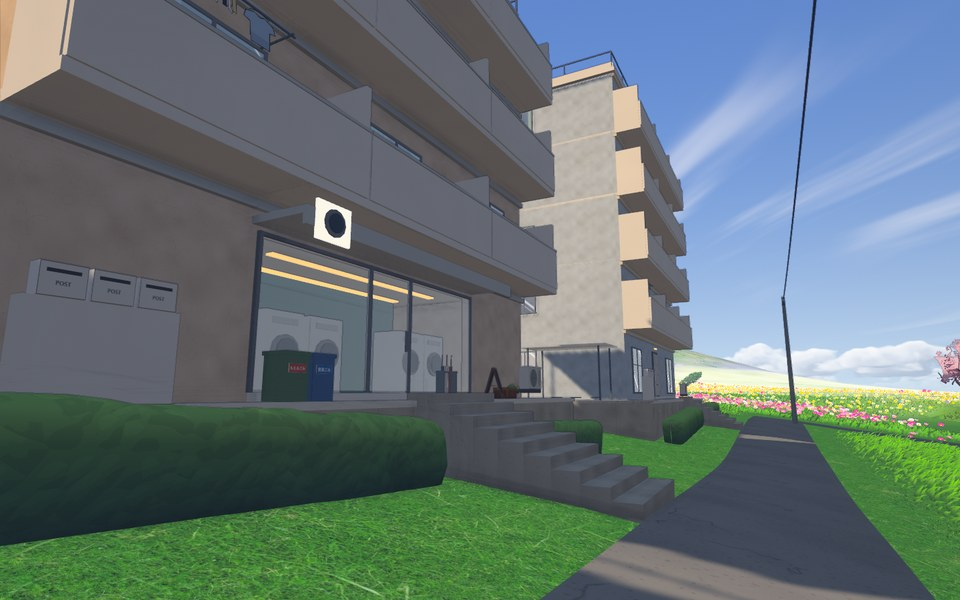
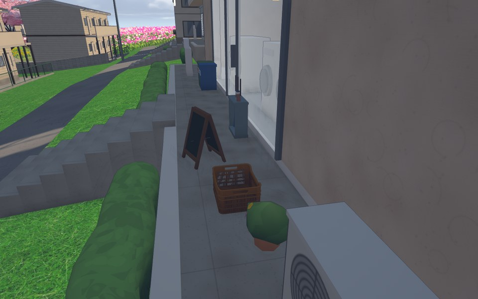
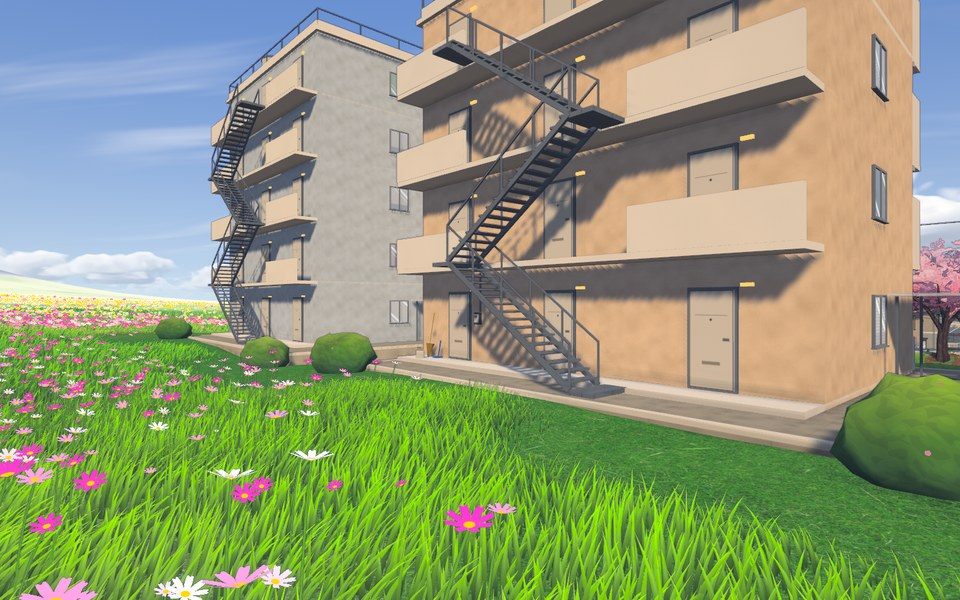
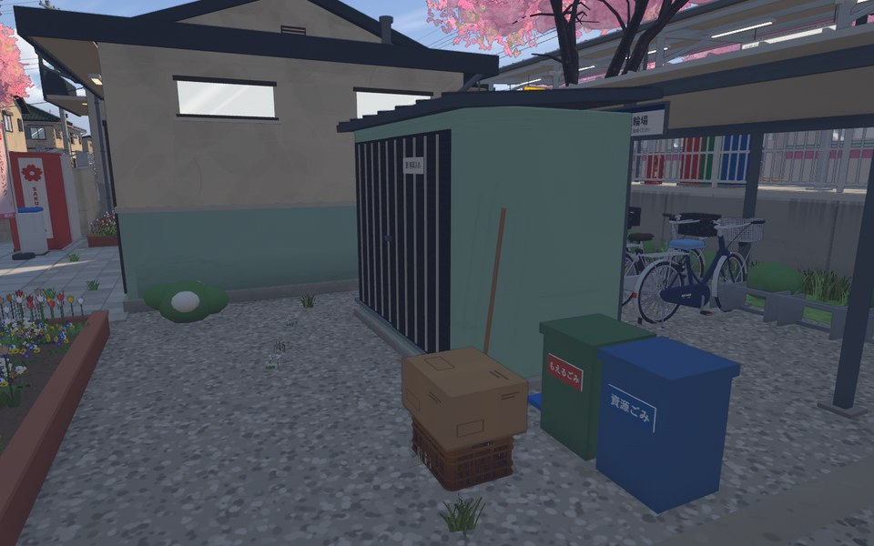
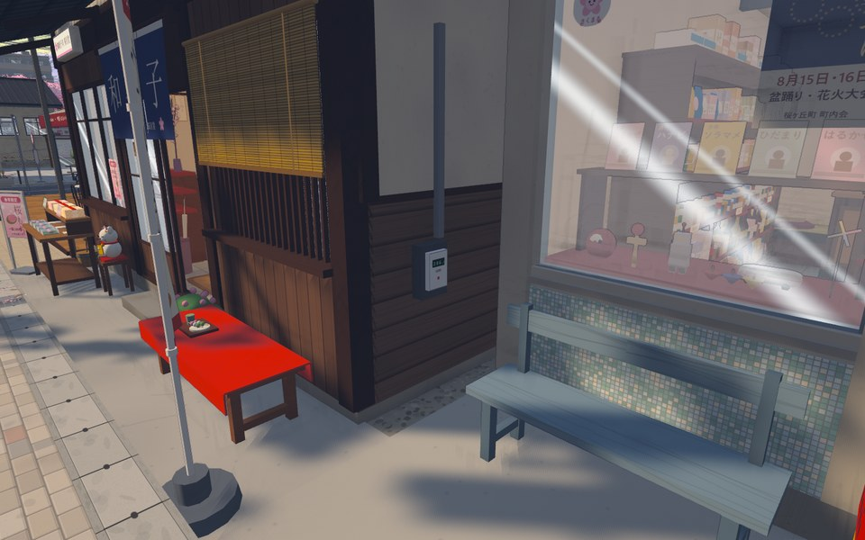

# 四处生活道具密度 · 实装与回验

本轮接[C酱第12轮之后的密度安排](https://github.com/aa15119557034/agent-review-room/pull/254#issuecomment-6946520197)。在洗衣店前、楼后走廊、服务角和街道补少量日常物件；**可交下一棒材质／构图精修，不代表已经达到参考图密度或P2整体验收。**

实装源码 `0d97731bd7cb4f4634f4c9fdc0e1033ae7585f2a`，快照契约修补源码 `6b0e9c4c7453bdd612e77c03cde9f81112ae9cc3`。原9份官方纹理道具继续使用；新增部分复用固定Sakuragaoka的MIT构件与原图集，非新CC0下载，没有新增纹理。来源及固定hash见[streetscape-assets.json](../../streetscape-assets.json)。

## 实拍与可见范围







- 洗衣店：一组伞架、两只带分类标签的桶，分列玻璃两侧，保留中央入口及原箱筐、矮牌、盆栽。这里仍是不可步行背景。
- 楼后：门侧扫帚、簸箕、水桶、电表，二层两只图集纸箱。清扫用品在20机位可见；纸箱中心射线先命中栏板，**不能说两箱在该机位清楚可见**。
- 服务角：保留原扫帚、箱筐和卷帘，新增两只分类桶与簸箕。桶在23机位明确可见；簸箕只露局部蓝边，中心被桶遮挡。原物和新物没有为了截图移动。
- 街道：原E1/W1已有伞架，未重复堆入口；在E2临街侧墙补原图集电表／上行管线。01中可见，另提供1.6m近景；这张新近景没有C12同机位前图，不冒称前后对照。

21张固定图对应7机位×warmup/capture1/capture2，time14、默认AO .55，无AO开关／HDR／逐tap或shadow ABA。7对重复图全图RGB差0；04对C12全图RGB差0。01主要差异位于新电表，差>1的范围x1124..1179、y415..533；不说整个场景不变。完整相机、实际投影和中心射线保留，处于视锥内不等于无遮挡。

## 预算、通路与资源

镇边由29,109增至**29,553三角**：GB新增252（两桶72、扫帚36、簸箕24、水桶60、电表36、纸箱24），伞架192，总增444。严格小于30,000门槛，仍留446三角可用余量。站区单独新增132（两桶72、簸箕24、电表36），不混进镇边数字；全streetscape为2,424三角。原5,840三角官方箱筐没有复制或降质替换。

CPU真实构造的两项检查均exit0：新增6个站区碰撞体与3,117原碰撞体无重叠，街道路段0.25m采样resolve保持；服务物支撑在原gravel顶。低簸箕盘面可跨步，其细把手单独按实际包围范围阻挡，没有用大盒封住通路。此采样不替代所有路径走测。

镇边的后廊包裹落在廊板上、上下箱贴合；最近后门边到纸箱约.405m，到电表约.215m，避开中央钢梯。扫帚沿用原builder，刷毛约埋入4.26mm，不是悬空。六组台阶和地形没有改变。两次dispose的根几何／材质只释放一次，借用纹理与站区原伞架几何／材质未被释放。

CPU使用图像像素placeholder，不作颜色／GPU性能证明。原报告在dirty状态采集，保留原标记；另有6个被记录源码文件与0d97731提交的逐字节绑定，不扩为所有传递依赖。后续6b0e9c4仅拆分分类桶的instances元数据，绘制、材质和碰撞创建调用未改；最终正常运行也实录29,553三角。这是源码范围说明，不把旧21图改写为新head采集。

## 首轮失败与修补

0d97731的正常基线 `gpu-town-density-v1`（session16446/PID38628）实际exit1，停在waiting-for-ready-frame，renderOk=false：新增两桶合为一条`instances`，只有复数`footprints`，旧快照要求每条`footprint`，`Object.entries(undefined)`抛错。没有性能帧、没有截图；另保留一次boulders加载取消。完整失败报告保留，不能写成仅运输失败。

修补6b0e9c4把两桶分别登记成各有单个footprint的实例；保留原共用绘制批次和碰撞体，未用默认空对象吞错。重新执行完整正常基线确认快照链路恢复。独立固定图驱动本来不调用该快照，它在0d97731上成功采集，不覆盖首轮基线失败结论。

## 最终正常运行

```bat
node scripts\baseline.cjs --scene=combined --electron=D:\codex\2026-11-16\world-implementation\runtime-path-probe\electron.exe --stills --output=artifacts/gpu-town-density-v2
```

6b0e9c4，RTX3060／1440×900，session93115/PID28616。

|采样|FPS|p95|>20ms帧|
|---|---:|---:|---:|
|街道|65.0016|15.5ms|0/203|
|港口|64.9998|15.5ms|0/202|
|鸟瞰|64.0389|15.5ms|3/200|
|店内|65.0016|15.5ms|0/203|
|第三人称，9.4197m|64.9974|15.5ms|0/203|
|第一人称，9.3716m|64.9998|15.5ms|0/202|

14/14行为、look、真实键盘walking通过。初始977帧仍有5个>20ms帧、最长30.9ms；鸟瞰最长30.8ms。不能称零开销或无掉帧。

最终基线实际exit1、renderOk=true、transportClean=false，仅crate.bin一次ERR_ABORTED，无JS异常。0d97731独立定向命令 `node D:\codex\2026-11-16\world-implementation\handoff\x51-density-diagnostic-gpu.cjs gpu-density-v1 0d97731bd7cb4f4634f4c9fdc0e1033ae7585f2a`，session55536/PID52044同样实际exit1，仅crate.bin取消，渲染成功；source／driver／9资产未变，恢复完成。三次运行分开保存，不覆盖失败或改写来源。

CI按提交分列保存在本目录ci，实际执行 `node scripts/verify.mjs`：

|源码|Windows实际job|实际日志结果|完成UTC|
|---|---|---|---|
|0d97731|[134013882257](https://github.com/aa15119557034/agent-review-room/actions/runs/44075949732/job/134013882257)|1615/1615、9类型、2构建、20code0|2026-11-17 11:43:46|
|6b0e9c4|[134016201992](https://github.com/aa15119557034/agent-review-room/actions/runs/44076623448/job/134016201992)|1615/1615、9类型、2构建、20code0|2026-11-17 11:49:44|

两者不能相互代替；0d的CI通过也不能掩盖实际基线快照失败。完整日志／报告无损gzip，原图不加工；provenance记录原字节。C12基线另见[第12轮回验](../look-c12-2026-11-17/README.md)。

## 可精修

请C酱据四区真图统一材质主次和构图，先看分类桶／伞架的色块、后廊清扫物的尺度及局部遮挡，再看与原街道是否协调。C12墙面圆纹和9cm共面侧面仍留作局部收边问题：静态未见闪花，不等于已消除风险。不要以测试或帧率代替美术验收；保持太阳／天空／烘焙方向和预算，镇边仍不扩步行。P2未完成，PR继续Draft、不合并。
