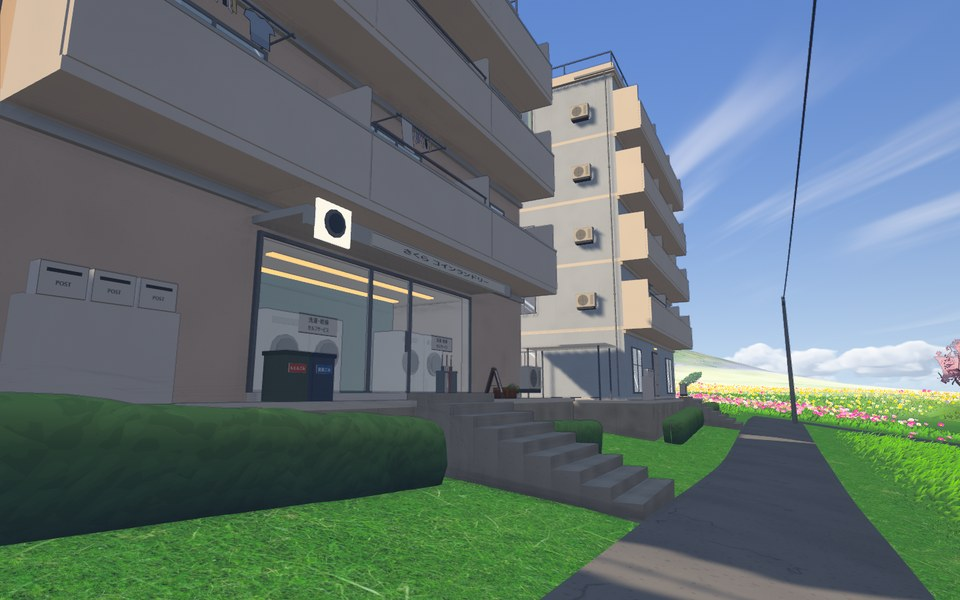
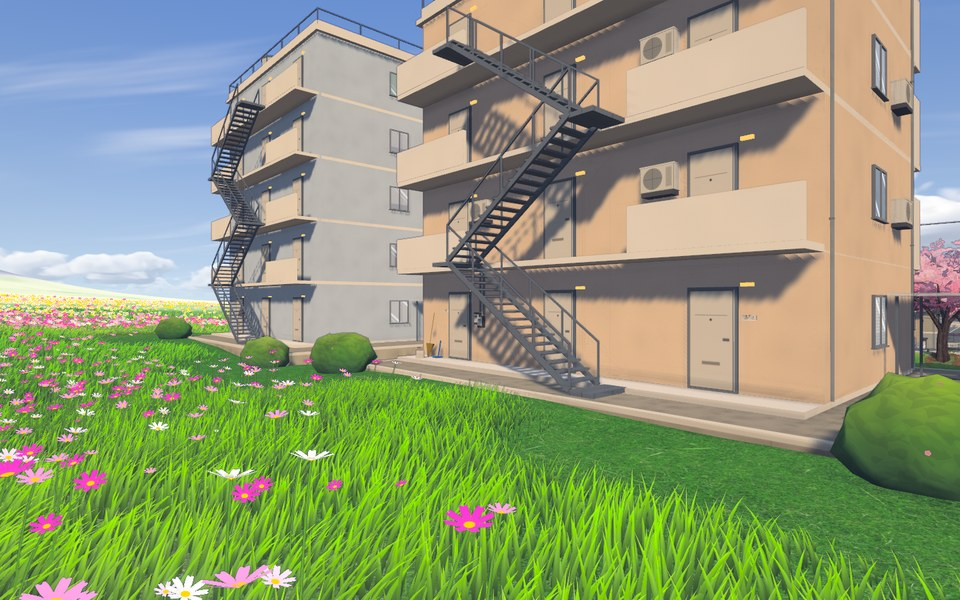
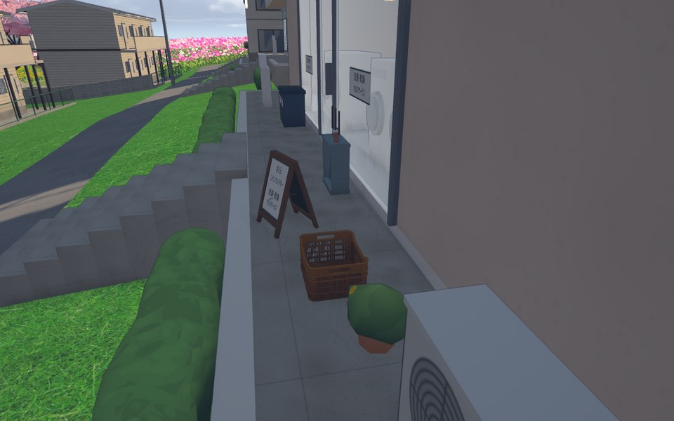
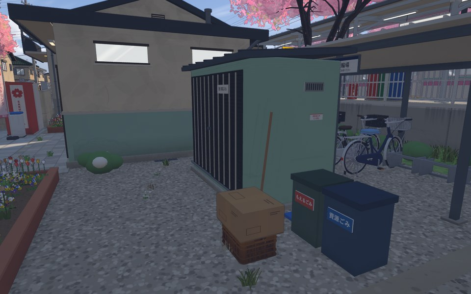

# C15 · 公寓生活物与洗衣店标识

源码 **`96ddf39ce4ca6448acf1a59dcc49dbf4ca4908ac`**，本机 RTX 3060、1440×900、真实9项带纹理道具。先接 C酱的[第15棒评审](https://github.com/aa15119557034/agent-review-room/pull/254#issuecomment-6948988639)，在不改变全局光照、AO和原通路的前提下补立面。固定图和正常走路采样已完成；可交 C酱继续收镇边草花／绿篱配色和服务角砾石尺度，**整体美术与P2仍未验收，Draft、不合并**。

## 改动和预算

| 项目 | 实际三角 |
|---|---:|
| C14 镇边 | 29,553 |
| 移除实体覆盖或地形下的隐藏面 | −516 |
| 稀疏立面道具与店招 | +896 |
| C15 镇边 | **29,933** |
| 服务角独立增量／街景合计 | +18／2,442 |

严格 `<30000` 尚余66。实例化不能免除实例的实际三角计数。只删除楼板覆盖的墙顶底、贴墙门背、被地形或相邻阶覆盖的台阶面及地基隐面，原周转箱、绿篱和钢梯外形保留；隐藏面证明只针对中间版CPU几何，不伪称独立验证了最终GPU全部CDLOD曲面。

新增9台外机、3根简化雨管与短檐沟、3组窄顶栏、2组4件晾衣、1电表、2姓氏牌。洗衣店新增横招、两张玻璃功能牌，并填入原A牌文字。复用固定MIT套件和既有图集；3个文字区落在原第5页商店图集空区，**有更新像素，0新增纹理对象／页／容量**。不编造店铺营业时间或价格。服务角补百叶、职员贴纸和两块短盖沟；原门把／门标签／路面格栅补丁不重复堆放。没有新增碰撞或可步行背景。

## 实图判断

林离实际查看C14/C15同机位20／21、C15固定23／24、正常18／23／24、三张图集字形及04／店前近景：外机和雨管打破了部分空白墙面，洗衣横招、玻璃功能牌和A牌文字实际可见；没有在这些视角看到新增漏面或漂浮。新增量仍是稀疏第一轮，不能称每户满配或所有物件全无遮挡。两个新增晾衣组重复同一小套花样，固定远近图没有成为显眼主问题，但仍保留这个限制。

服务角百叶、贴纸可见；墙脚短盖沟很小，不把其几何存在写成明显视觉提升。周转箱孔洞和旧门材质保持。画面下半部草花仍过艳，绿篱仍显厚重，下一棒由C酱按原分工处理；天空／烘焙／黄昏湿面及镇边可步行留后续。

完整像素图：[21](./diagnostic/21-front-eye-ao-on-capture-2.png)、[24](./diagnostic/laundry-details-ao-on-capture-2.png)。[实际横招图集](./diagnostic/laundry-atlas-name.png)、[功能字](./diagnostic/laundry-atlas-function.png)、[A牌](./diagnostic/laundry-atlas-aframe.png)均已查看，没有缺字方框；这些裁图不代替场景中的透视和可读性判断。

## 实际运行与保护对照

正常命令：`node scripts/baseline.cjs --scene=combined --electron=D:/codex/2026-11-16/world-implementation/runtime-path-probe/electron.exe --output=artifacts/gpu-town-c15 --stills`。session87880／PID59144／**actual exit1**，renderOk=true，14行为／look／walking通过，0JS异常；保留boulders和menhir两次ERR_ABORTED，transportClean=false，没有把渲染成功写成全成功。

| 段落 | FPS | p95 ms | >20ms帧／样本帧 |
|---|---:|---:|---:|
| 初始 | 64.338 | 15.5 | 10／972 |
| 01站前街 | 63.080 | 15.5 | 6／197 |
| 02站港 | 64.679 | 15.5 | 1／202 |
| 03鸟瞰 | 62.760 | 15.5 | 7／196 |
| 04店内 | 65.000 | 15.5 | 0／202 |
| 第三人称走路 | 65.002 | 15.5 | 0／203 |
| 第一人称走路 | 65.000 | 15.5 | 0／202 |

最长31ms；本轮没有追加性能复测，不声称无掉帧或已查明旧波动根因。正常基线包括实际计数开销，不能由一次波动直接归因于新立面。

定向命令：`node x51-c15-diagnostic-gpu.cjs gpu-look-c15-v1 96ddf39ce4ca6448acf1a59dcc49dbf4ca4908ac`。session54034／PID67136／**actual exit0**，7机位×warmup／capture1／capture2=21图，time14、默认AO.55；0网络／HTTP／JS错误，源码／driver／9资产／状态恢复核验通过。真实图集第5页texture/source/upload版本均4，实际city材质借用同一map；fillText观察器正常恢复。

同C14相机、时间和参数对照：04店内与店前近景最终RGB差0、PNG相同；01站街83像素差异且最大仅1色值。重复捕获6对PNG相同，01自身仍有62像素、最大1色值的微小差异；没有把7对写成全部一致，也没有将差异擅自归为动画。[逐图比较和原始帧汇总](./analysis/x51-c15-offline-analysis.json)保留全部数值。[定向完整报告](./diagnostic/look-report.json.gz)与[正常完整报告](./baseline/render-report.json.gz)是原字节无损gzip。

## CPU、来源与失败边界

[CPU来源映射](./source-map/cpu-states.json)区分C14旧版、删隐面dirty中间版、最终立面dirty版和服务角早期／最终版。只有与最终提交字节逐一相同的源才关联96ddf39；中间源未另存完整快照，保留当时报告、覆盖证明和哈希，不重写历史。CPU像素为占位，不用于实景验收。原外部driver缺ctx.onUpdate的首次失败stderr仍保留，修正后的driver不冒充失败时原字节。

CPU实际检查包括：516三角移除与1371个原box几何参数比对、逐面覆盖、实际29,933计数、图集装不下时不分配不绘制、同站重建复用、31材质／28几何各释放一次而共享资源不释放、服务角18三角与资源同一性和门路范围。出处与MIT许可见上层[街景清单](../../streetscape-assets.json)和[第三方说明](../../THIRD-PARTY.md)。

Windows CI属于此PR源head96ddf39所触发的合并验证：实际checkout合并引用`c0c1e493e84eced216706e060756d4e4df02116c`，将源head合入base`e8c37d659ae3e73934efb6e2a21fc822da9610e8`，不是直接检出源head。[实际job](https://github.com/aa15119557034/agent-review-room/actions/runs/44098778204/job/134092853043)日志为1615／1615测试、9类型检查、2构建，20项code0；完整元数据、原日志及解析器在ci目录。CI不代替GPU、性能或整体风格验收。

原运行退出码与service CPU退出观察保存在[事后执行记录](./analysis/x51-c15-execution-receipt.json)，明确是执行agent根据工具返回整理的记录，不伪装成当时自动生成的process receipt。资产本体、缓存、用户目录不随证据提交。
