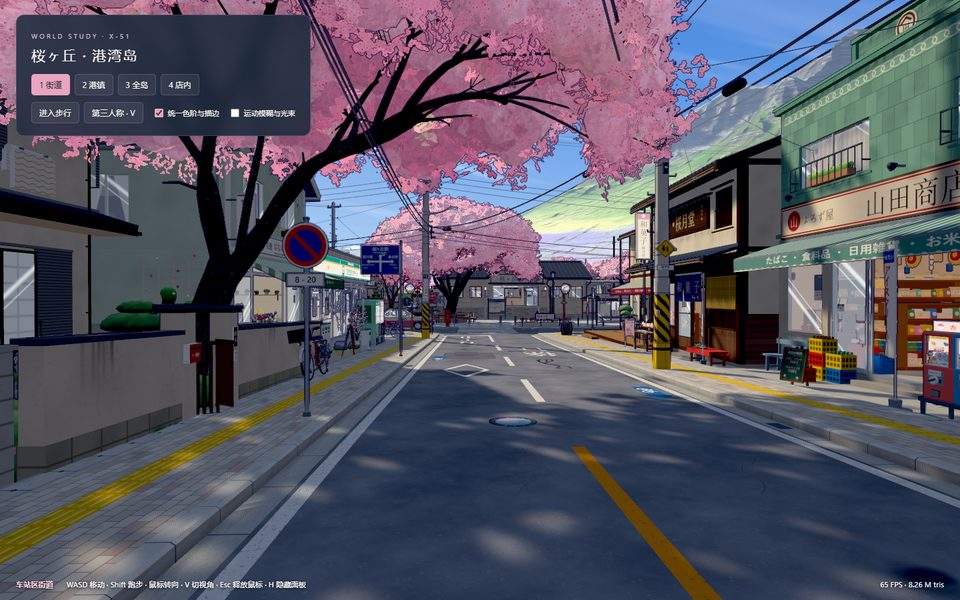
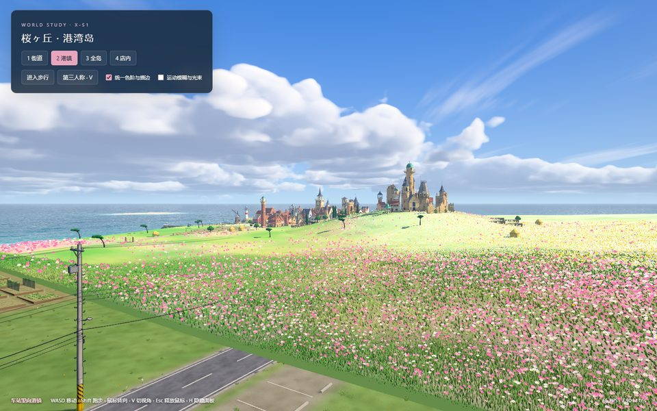
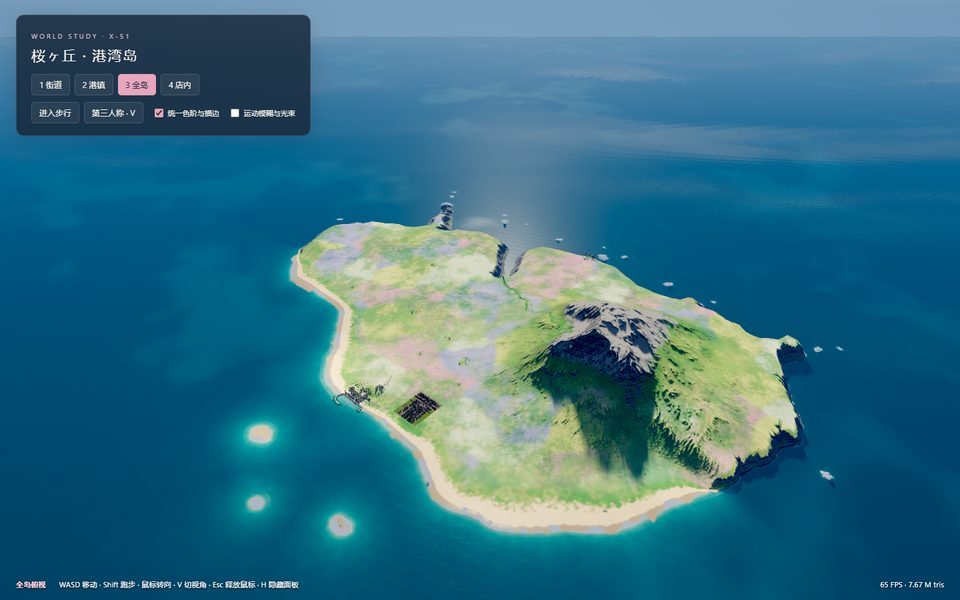
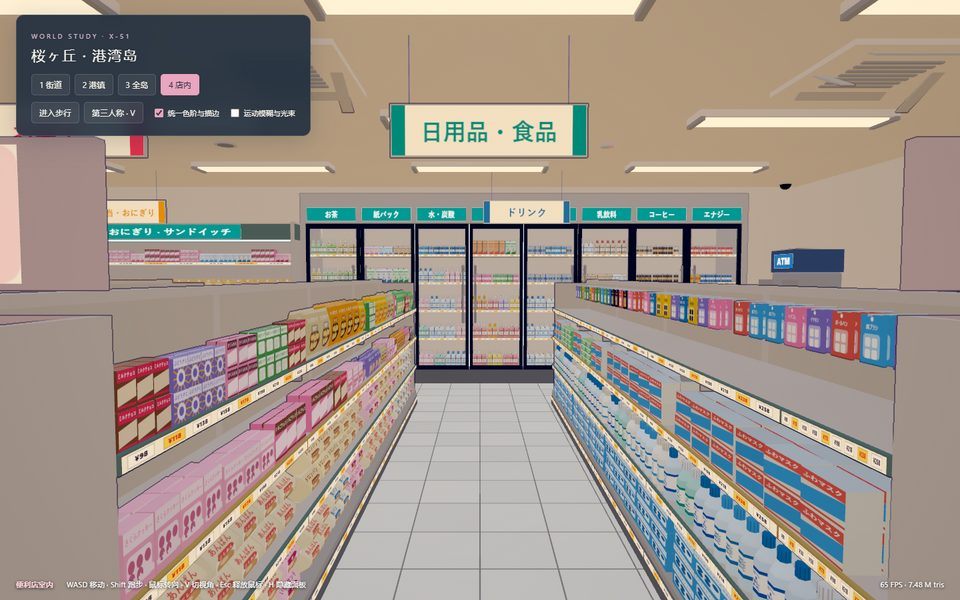

# C酱精修后的 RTX 3060 复测

2026-11-17（Asia/Shanghai），在源码 `294e85d70617e692c3b2845388b3a5f4a813f09c` 上采集。193 个场景文件与启动时的 [源码清单](./source-manifest.json) 一致；本轮未修改着色或地形代码，也未重录视频。原始数据见 [measurements.json](./measurements.json)。

结论：四机位、第一/第三人称实际步行仍约 65 FPS，11 项浏览器行为检查和着色开关检查通过，页面异常为 0。网络记录有两条 GLB 取消，保留 `ok=false / renderOk=true / transportClean=false`，不能称整轮全绿。

## 本机实测

RTX 3060 Laptop，1440×900、pixelRatio=1，Electron 44.9.0 / Chromium 152。首次可用帧 34.82s；街道主采样 15.11s、982 帧，约 65.00 FPS、p95 15.5ms。沿用全部 WebGL2 提交计数，包含阴影及后处理；接近 RAF 调度上限，只说明此次没有跌破该上限，不能证明精修没有 GPU 成本。

| 机位 | FPS | draw calls/帧 | 三角形/帧 |
|---|---:|---:|---:|
| 车站街道 | 65.00 | 1451.00 | 8.257 M |
| 站区望港镇 | 65.00 | 808.56 | 7.900 M |
| 全岛俯视 | 65.00 | 1686.00 | 7.669 M |
| 便利店室内 | 65.00 | 878.00 | 7.484 M |

第三人称实际 W 按键：65.00 FPS，3.12s 移动 9.42m；第一人称：65.00 FPS，3.11s 移动 9.37m；两段 p95 均为 15.5ms，切换视角的脚底位置差为 0。两段均记录到可信 KeyW 按下与抬起。

## 四机位截图






街道阴影和店内商品的可读性较上一轮改善；港镇花海与街道背后黄绿坡仍较亮，站区深绿直线边界仍明显。全岛小沙洲浅水亮圈仍可见，不据截图直接认定为 HDR 溢出。

另存 [统一着色开启](./05-street-toon-on.jpg) 与 [关闭](./06-street-toon-off.jpg)。关闭时恢复 ACES 及原岛明暗计算，但公共调色和半球光仍是精修后的值；它不是 `bd36ce0` 的严格控制组，仅还原饱和度/对比度也不足以成为旧提交原样对照。

## 网络记录与静态核对

- `menhir.glb` 和 `boulders.glb` 各出现一次 `net::ERR_ABORTED`。同轮 Resource Timing 分别记录 HTTP 200、620588 / 669820 字节，与本机文件大小一致；取消信号的底层原因仍未证实，不改写为成功。
- 着色替换点唯一，软曲线及高度混合未发现数值回归。没有新增 render pass 或几何；新增深度查询和指数运算仍有成本，不能因封顶 FPS 相同而说成本为零。
- 本轮实际执行 `node --check src/look.js`、`node --check src/main.js`，均退出 0；GPU 运行的 11 项行为检查及着色开关检查通过。没有重新执行未改动的相机物理单测。

## 留待结构修补的意见

- 深绿直线：`src/transition.js` 的 2m 矩形过渡网格采用纯色 Lambert 材质，矩形植被清除也强化了边界。保留负责填补高程裂口的网格，后续统一其地表着色及边缘植被密度；不靠删除网格或加植物墙掩盖问题。
- 黄绿山坡：现有地形的远景草色、HDR 日光和 toon 顶档共同抬亮。先做局部对照，再判断远景分档或草色调整，避免压暗整个店铺和街道。
- 小沙洲：已有浅水散射、焦散、岸浪泡沫与 bloom 均可能贡献亮圈，尚未分离各自比例。当前航拍相机海拔 2350m，`uHaze=0`，本轮新增的软曲线和深度雾不作用于这一机位。

以上三项本轮仅核查，未修改结构。

## 实际采集命令

```text
node scripts/baseline.cjs --scene=combined --stills --electron=D:\codex\2026-11-16\world-implementation\runtime-path-probe\electron.exe --output=artifacts/c-polish-294e85d-gpu --timeout-ms=240000
  Electron exited 1：renderOk=true，transportClean=false，页面异常0，GLB取消2
```
