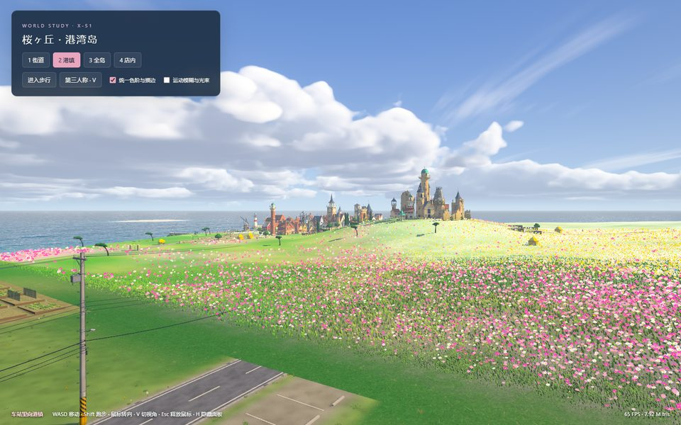
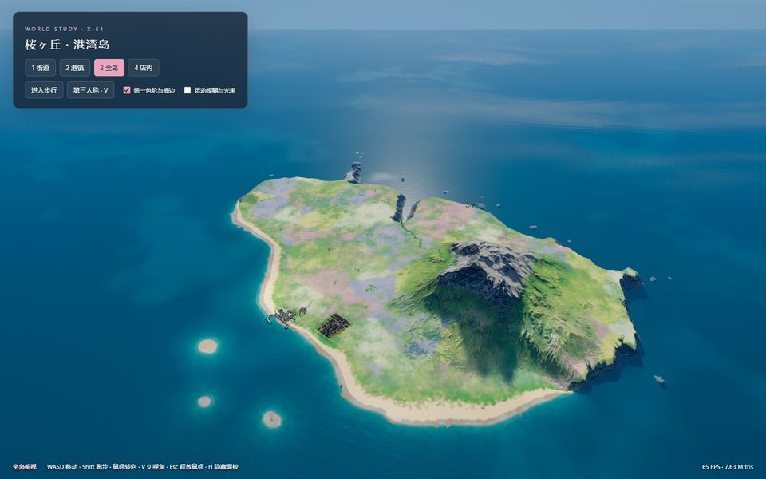
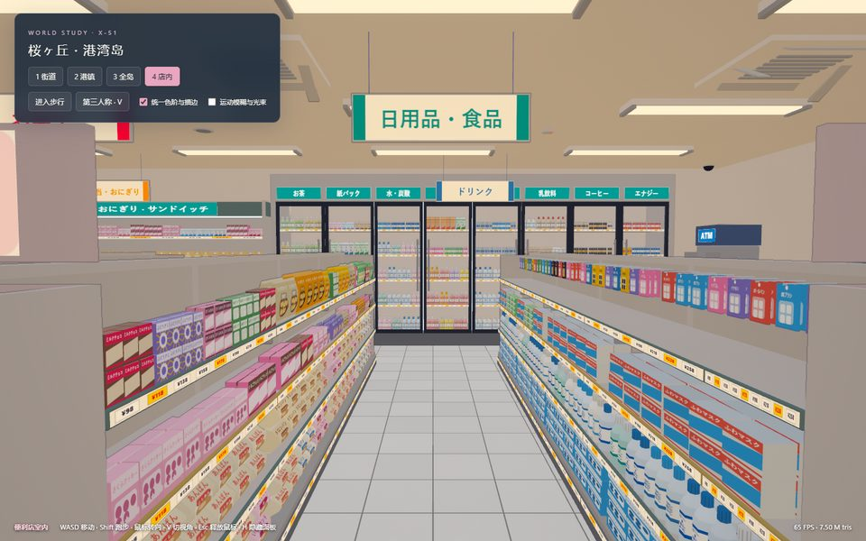
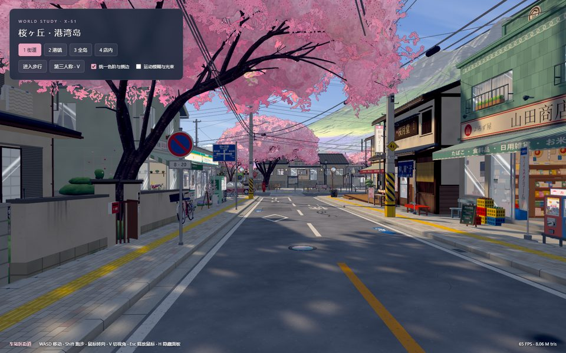
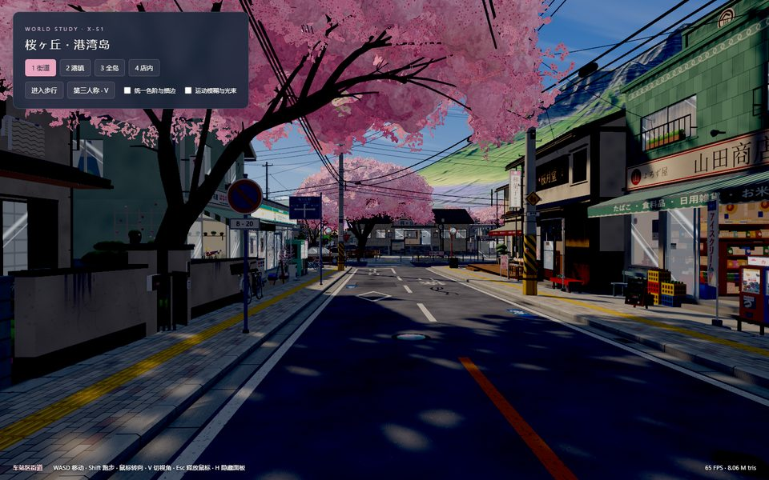

# C酱第二轮精修：RTX 3060 复测

2026-11-17（Asia/Shanghai），受测源码 `a7fe1e7625171a43425b4cae0812b8c58de8431c`。这是补充街景资产之前的独立运行；193 个场景文件哈希见 [source-manifest.json](./source-manifest.json)，原始帧间隔和截图校验见 [measurements.json](./measurements.json)。

运行命令：

```bat
node scripts\baseline.cjs --scene=combined --stills --electron=D:\codex\2026-11-16\world-implementation\runtime-path-probe\electron.exe --output=artifacts/gpu-polish-a7fe1e7 --timeout-ms=240000
```

退出 0。RTX 3060 Laptop / D3D11，Electron 44.9.0 / Chromium 152，1440×900、pixelRatio 1；浏览用 JPG 为 960px 宽，原 PNG 保留在本机 artifacts。

| 项目 | 实际结果 |
|---|---|
| 初始采样 | 967 帧 / 15.1231s，63.94 FPS，p95 15.5ms |
| 街道 | 65.00 FPS，约 1451 draw calls，8.218M 三角形 |
| 望港镇 | 65.00 FPS，约 811 draw calls，7.920M 三角形 |
| 全岛 | 64.68 FPS，约 1686 draw calls，7.662M 三角形 |
| 店内 | 65.00 FPS，约 880 draw calls，7.504M 三角形 |
| 第三人称真实 W 步行 | 64.68 FPS，位移 9.559m，采样 3.1231s |
| 第一人称真实 W 步行 | 65.00 FPS，位移 9.533m，采样 3.1231s |
| 行为与着色开关 | 11 项行为及开关检查通过，切视角脚点位移 0 |
| 运行与资源 | ok/renderOk/transportClean 均 true；异常 0、网络失败 0 |
| 首次 ready 帧 | 36.281s |

FPS 受约 65 的同步上限影响，不能证明 shader 成本没有增加，也不能把初始 63.94 FPS 写成全程不掉帧。全部视角和步行的 p95 为 15.5ms。测量包含采集器开销；交通、云和植被仍有动画。

目视：街道的阴影边缘与轮廓比前轮柔和，商品保持可读；港镇远处花海仍亮。此轮没有重新录视频，也没有重复严格固定帧 A/B/A。此前地表轮次的 strict=false 和录像资源取消记录仍保留在各自报告中，不能由本次通过覆盖。

toon-off 关闭统一着色，但保留公共 bloom、饱和度、暖太阳和线性过滤的站区色阶贴图，不是 `a30cca3` 的严格外观对照。

## 四机位








## 同次运行的着色开关




