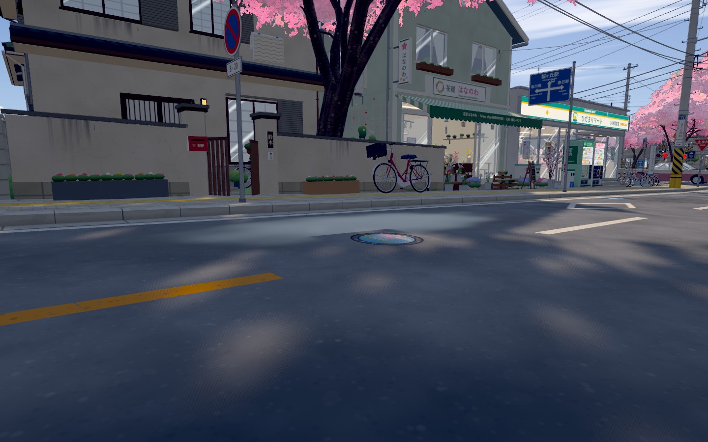
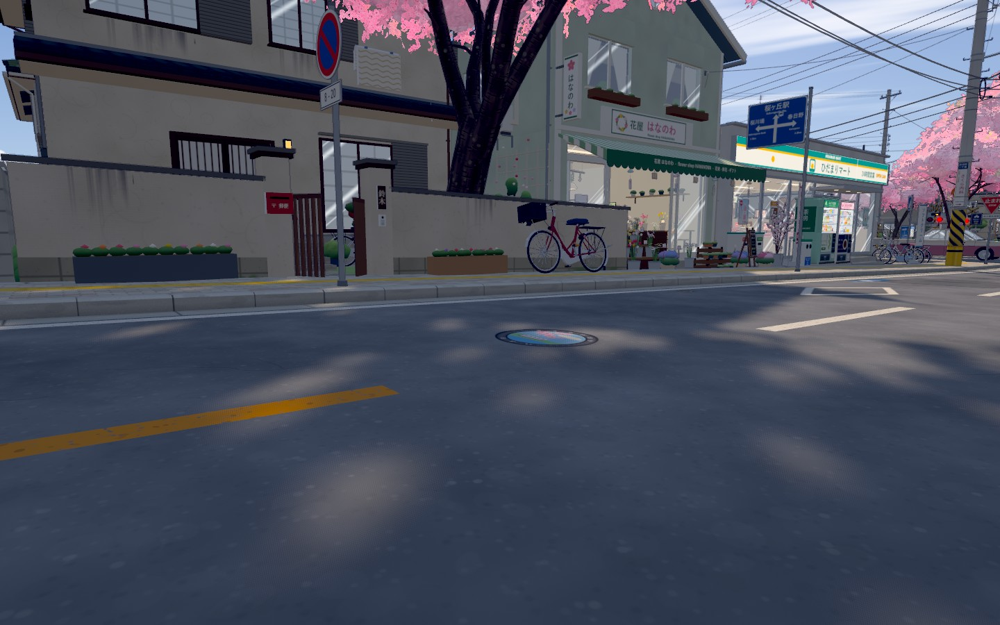
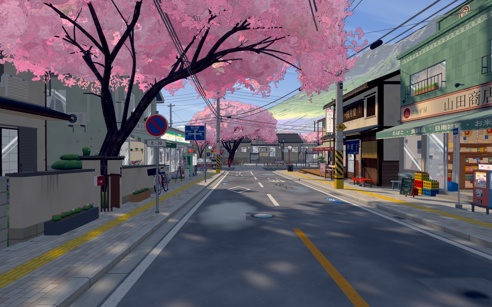
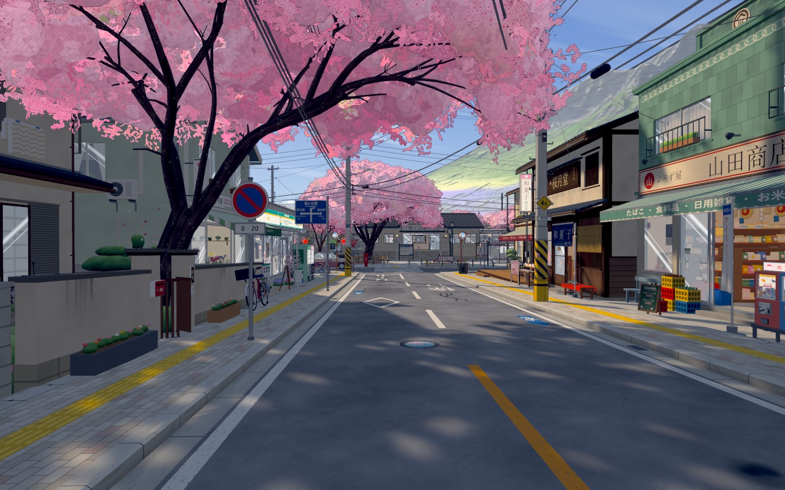
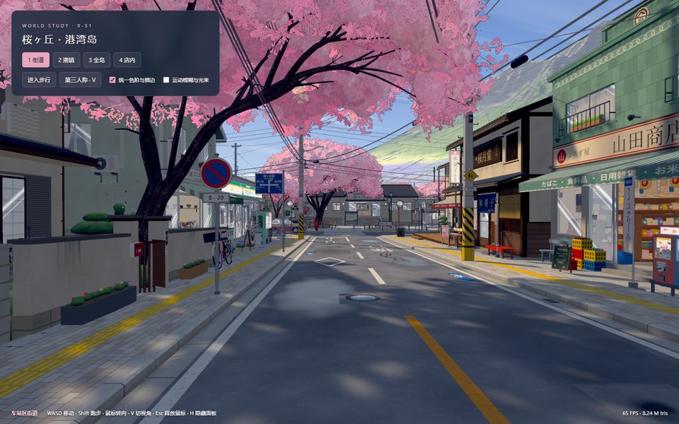
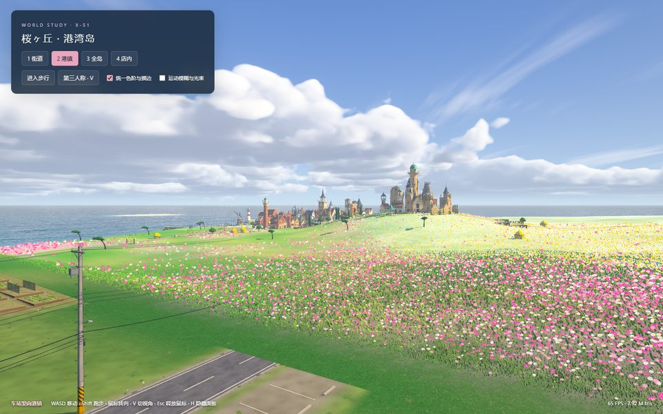
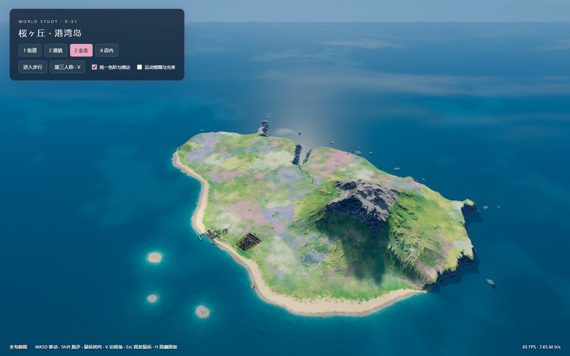
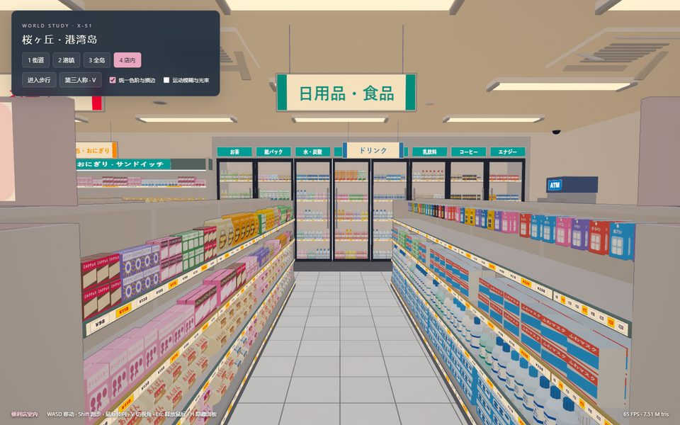

# C酱第三轮湿面修改：本机验收

2026-11-17（Asia/Shanghai），受测源码 **`9417b6e0e205a594b31332b1622a8e549bad2f76`**。196 个场景文件与该提交内容逐一核对；本轮只添加验证脚本、报告和截图，没有修改场景代码或继续调强度。

结论：**湿面可见效果已证实，两个机位的固定帧开→关→开严格恢复；3060 四机位/步行约65 FPS，14项行为通过。资源取消仍是独立未解决项。** 这不代表完整积水反射、材质质感或城市背景已达到参考图。

## 冻结状态的干湿对照

命令（退出0）：

```bat
node scripts/diagnose-wet-road.cjs --electron=D:\codex\2026-11-16\world-implementation\runtime-path-probe\electron.exe --output=artifacts/wet-road-9417b6e
```

1440×900、pixelRatio 1；提前拦截全部页面 RAF，固定 time=14，停步行，关闭时序 blur/rays、保留 bloom。每个机位只执行两次预热，再拍 on A1 / off B / on A2；不改 shader、不重载材质、不重试或挑帧。每张图在同一 JS task 内新渲染后立即读取 canvas PNG。

| 机位 | 开/关最大通道差 | 开/关平均通道差 | 变化像素 | 恢复后 A1/A2 |
|---|---:|---:|---:|---|
| 湿面细节 | 78/255 | 4.008/255 | 445804 / 1296000 | RGB差0、状态一致 |
| 原街道机位 | 64/255 | 0.792/255 | 107903 / 1296000 | RGB差0、状态一致 |

两组实际 GPU `uWetEnabled` 均为 **1→0→1**，同一程序，除开关外的记录状态一致；预热后同状态也无像素差。`visualStrict/renderOk/transportClean/ok=true`，场景/脚本哈希不变。原 PNG、脚本哈希、全图与旧 ROI 数据、实际请求时间线见 [frozen/diagnosis.json](./frozen/diagnosis.json)。范围包围框包括后处理传播，不能当作湿区分割 mask。

| 开 | 关 |
|---|---|
|  |  |
|  |  |

恢复帧原始 PNG：[细节 A2](./frozen/detail-on-A2.png)、[街道 A2](./frozen/station-street-on-A2.png)。本轮只验证当前修改的开关效果，没有重跑旧提交的固定帧对照；旧版 A/B/A 结论来自 [C酱的诊断与经验](https://github.com/aa15119557034/agent-review-room/pull/254#issuecomment-6927089983)。

## 正常运行性能与四机位

独立性能采集使用 RTX 3060 Laptop / ANGLE D3D11，1440×900、pixelRatio 1，Electron44.9.0 / Chromium152。主采样983帧/15.123s，65.0003 FPS、p95 15.5ms；首次 ready 帧36.473s。约65 FPS受同步上限限制，不能证明没有新增GPU成本。

| 机位/操作 | FPS | p95 |
|---|---:|---:|
| 街道 | 65.000 | 15.5ms |
| 港镇 | 65.002 | 15.5ms |
| 全岛 | 64.997 | 15.5ms |
| 店内 | 65.000 | 15.5ms |
| 第三人称真实 W 步行 | 64.998 | 15.5ms |
| 第一人称真实 W 步行 | 65.002 | 15.5ms |

14项行为、步行和着色开关通过，JS异常0，切视角脚点不漂移。第三/第一人称各移动约9.423m，用时3.108/3.123s。原始逐帧样本和完整数值见 [measurements.json](./measurements.json)。

实际命令：

```bat
node scripts/baseline.cjs --scene=combined --stills --electron=D:\codex\2026-11-16\world-implementation\runtime-path-probe\electron.exe --output=artifacts/gpu-wet-9417b6e --timeout-ms=240000
```

退出1：渲染通过，资源取消检查失败，见下节。另对全部src JS/scripts CJS和两处已修改上游JS执行 `node --check`，23项通过；`git diff --check`通过。场景提交9417b6e的 [Windows CI](https://github.com/aa15119557034/agent-review-room/actions/runs/43941609696/job/133560299400) 已通过。本轮未录新视频。

| 街道 | 港镇 |
|---|---|
|  |  |
| 全岛 | 店内 |
|  |  |

雾起点从110m改为60m、距离尺度700改为750，是独立的全局画面改动；正常运行截图用于检查整体可读性，不能把前后差异都归给湿面。街道、店内保持可读，港镇远处花海仍偏亮。

## 资源取消：保留未知，不改判定

正常运行基线 **`renderOk=true / transportClean=false / ok=false`**，`menhir.glb` 和 `boulders.glb` 各一次 `ERR_ABORTED`。其同 URL 的 ResourceTiming 显示HTTP200与620588/669820字节，但旧采集器未按失败 requestId 关联这些条目，因此不能用它证明失败请求已完整结束。

新固定帧脚本记录同一 requestId 的 request/response/finished/failed、阶段、单调时钟与主文档锚点。**这一次没有复现取消**：两个请求在 `loading-scene` 阶段正常结束，分别相对主文档请求约2349.8/2350.1ms；岛屿记录21个menhir、87组boulders。这不能抹去另一轮的失败记录。

静态调用链也不支持“采集切机位触发LOD取消”：`createIsland` 等待一次性 `loadProps`，`Props` 没有视角加载/取消，`setView` 不调用加载器abort。尚未取得失败请求的完整同ID事件链，暂不判断预期取消、传输故障或误报，也不屏蔽警报。下次失败可直接用已加的同ID链路继续排查。

## 经验与视觉边界

- 先做纯色 mask 定位、冻结状态全图A/B/A，再按响应位置选 ROI。上一轮三个ROI均从画面55%高度以下开始，漏掉主要窄带；局部均差不能代表整个材质路径。历史报告保留，诊断结论已纠正。
- 湿区变大后更容易读到，但当前只是固定两色天空的艺术近似，没有店铺/遮檐反射，也没有真实粗糙度变化；不能称为完整积水反射。
- 原路标/井盖排除逻辑未动，扩大湿区后，保守三角包围盒排除造成的矩形干区更显眼。后续应改善排除形状和边缘，不继续无依据加反光强度。
- 代码两端天空色字面值较旧版更亮；本轮可见性来自面积、底色暗化和混合权重的整体变化，不能简单归因于“天空色调深”。
- 两栋公寓依然只是近郊层次，大体量城市背景和商业街道具密度仍未完成。
