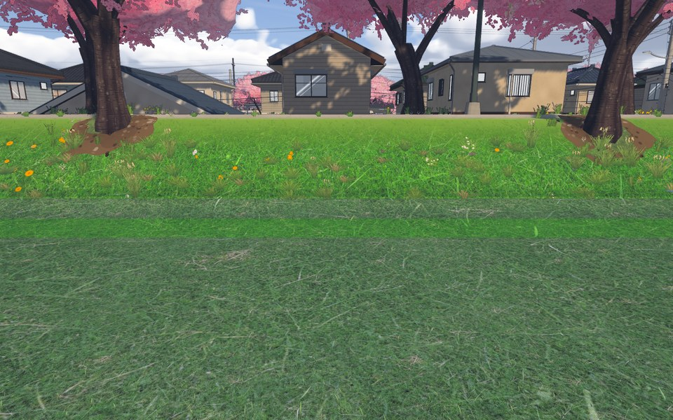
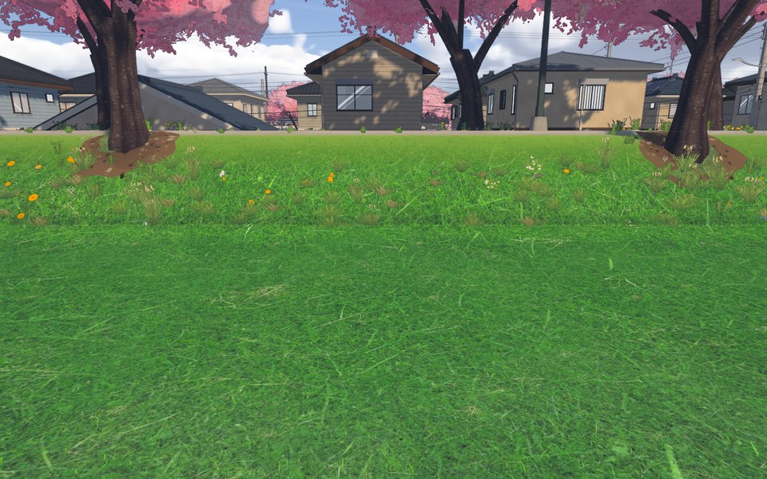
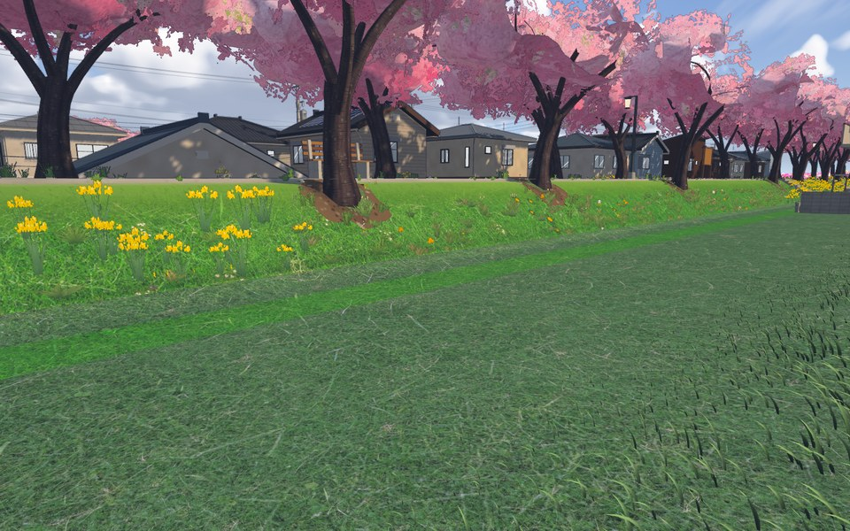
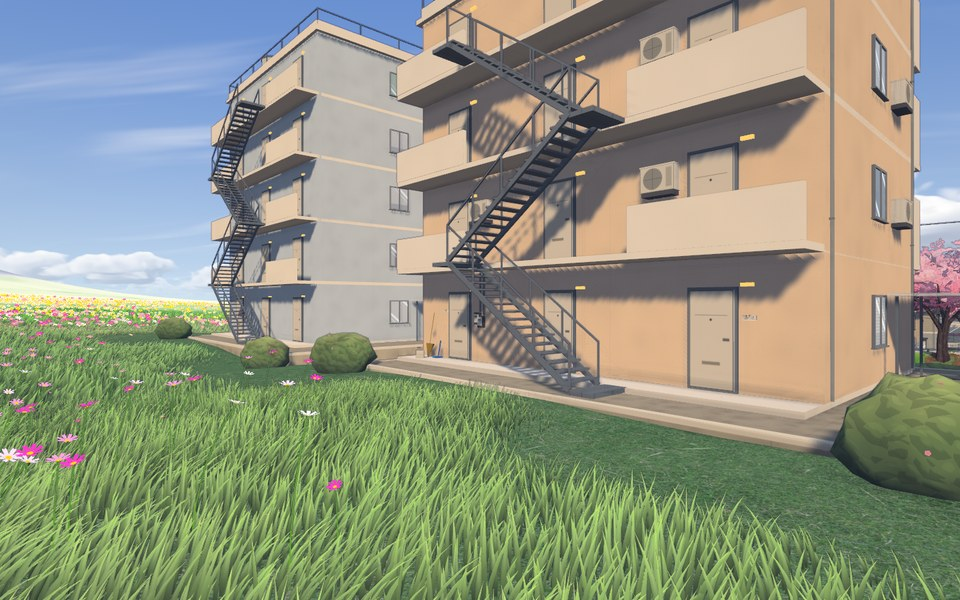
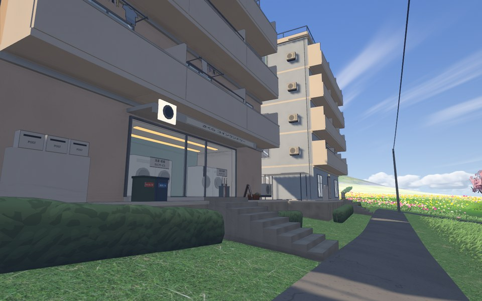

# C16 · 3060 回验与两项修补交接

源码 **`50e190b092fb2b30ab9ed19a28302d5638f947f4`**。本机 RTX3060 Laptop／1440×900／真实9项道具资产，接[C酱第16轮交接](https://github.com/aa15119557034/agent-review-room/pull/254#issuecomment-6951851191)。草花主次改善，但**北侧接缝出现亮绿色细带；另复现第二个look串用首个look的参数**。这轮不标作整体验收通过，交C酱修这两处；P2未完成、Draft、不合并。没有在本次回验中修改运行源码。

## 必须修：北侧接缝未继承镇边配色

`look.js`只给`island.terrain.material`注入TOWN，`island.js`先前已经复制它生成transition；`main.js`的站区edge blend又从transition复制。实际GL审计确认terrain有TOWN定义及uniform，而transition及两份edge blend均没有。北填缝带world z801..803、中段x221.6..317处于镇rect内部，mask=1；**这不是55米羽化的边界**。

两个专用人眼机位都看到亮绿细带。固定同相机／time14／AO.55，把town strength从1→0→1：关闭时细带与前景的色差显著消退，恢复后再现。central恢复整PNG相同；oblique恢复仅1像素最大1色值差，不能称四组全部字节相同。实际shader缺口、对象身份与开关因果共同支持配色不同步这一根因，不是只凭截图猜测。

建议在同一注入层给terrain与transition共享局部草皮／远花配色及uniform；随后创建的ground blend自然继承，避免再补第三套独立公式。保留原参数和几何，不用扩大羽化或加遮挡物掩盖接缝。完整GL shader正文保存在[town material audit](./diagnostic/town-material-audit.json.gz)，source与hash各用独立字段，未以哈希替换正文。

## 必须收口：第二个look的草花参数归属

`look.js:198–217`在共享Shell原型上安装一次闭包，永久引用第一个look的townUniforms。[CPU真实复现与范围](./cpu/x51-c16-meadow-review.md)使用实际Three、Pipeline、createLook、Meadow和Shell材质工厂：A设置一组rect；B设置另一组后，B terrain使用B参数，B grass仍使用A参数。B的strength0关不掉自己的草花，A的setter反而改变B；未注册的第三个Meadow也被全局包装影响。[原结果与源哈希](./cpu/x51-c16-meadow-lifecycle.json)保留失败值，脚本正常exit0表示复现脚本完成，不表示被测行为正确。

当前main仅一次init，首次pool为空、同look质量重建正确，因此**不是本次首次加载阻断，也未证明GPU材质泄漏**。最小修法是让包装按当前Meadow所有者取得uniform，未注册实例走原工厂；可用按Meadow归属的弱映射，避免闭包捕获第一个look。不要为此重写整套dispose或无条件恢复全局原型。CPU证据的最后一次捕获重跑、真实空stderr和范围在provenance中说明。

## 画面与保护区域

林离实际看了normal18／24、固定20／21、central开关图及oblique开启图。草从荧光绿收敛，花减少后建筑更突出，未见明显枯黄；20左远处与21右远处没有看到直尺般的55米硬边，但这不是完整环线覆盖证明。24近景绿篱斑块略强，作为后续审美建议，优先修上面两项，不重开全局着色。

镇边仍29,933三角。gravel repeat1.9影响东、西两处原站院，纹理周期约0.842m；没有新增纹理或像素。程序化花筛减在vertex shader中完成，不等于减少CPU提交的实例或三角数。

与C15实际相机／时间／参数一致的PNG对照：04和店前近景整PNG相同，01仅5像素最大2色值差；未把C酱云端随机差异代入本机。原7组重复有6对PNG相同，01自身62像素最大1色值差。全部17组重复另有20关闭态、oblique首次开启态各1像素最大1色值差。四组ABA中20／21／central恢复PNG相同，oblique差1像素；[完整离线数值](./analysis/x51-c16-offline-analysis.json)保留全部结果。

## 实际执行及性能限制

正常命令：`node scripts/baseline.cjs --scene=combined --electron=D:/codex/2026-11-16/world-implementation/runtime-path-probe/electron.exe --output=artifacts/gpu-town-c16 --stills`。session5028／PID63284／**actual exit1**，renderOk=true，14行为／look／walking通过；0JS异常，保留boulders一次ERR_ABORTED，transportClean=false。

| 段落 | FPS | p95 ms | >20ms帧／总帧 |
|---|---:|---:|---:|
| 初始 | 60.838 | 30.7 | 62／921 |
| 01站前街 | 64.039 | 15.5 | 3／200 |
| 02站港 | 65.000 | 15.5 | 0／202 |
| 03鸟瞰 | 64.681 | 15.5 | 1／202 |
| 04店内 | 65.000 | 15.5 | 0／203 |
| 第三人称走路 | 65.000 | 15.5 | 0／203 |
| 第一人称走路 | 65.000 | 15.5 | 0／202 |

初始最长46ms，明确保留，未自动重跑挑好结果。单轮计数无法证明这些长帧来自新shader编译或meadow包装，不能说已消除卡顿。

定向命令：`node x51-c16-diagnostic-gpu.cjs gpu-look-c16-v1 50e190b092fb2b30ab9ed19a28302d5638f947f4`。session67606／PID61484／**actual exit1**；原21图＋独立town30图，共51图完成，renderOk=true，0JS／HTTP异常；保留menhir与crate.bin两次ERR_ABORTED。源码／driver／9资产及包含townRect／strength的状态恢复均通过。5个实际GL program编译／链接通过，111个shell材质绑定了本次townUniform；这不证明跨look生命周期无泄漏。没有强制compile、重建scene或替换生产材质来取巧。

开关只影响岛屿草花和terrain，city foliage与gravel仍为C16；关闭态不是完整C15还原。专用机位先由实际height数据／平整函数／transition三角选择，再看真实图确认；CPU遮挡筛查本身不当作可见性证明。原报告：[normal](./baseline/render-report.json.gz)、[fixed](./diagnostic/look-report.json.gz)。均为原字节无损gzip，所有帧时、失败与51图索引保留。

Windows [实际job](https://github.com/aa15119557034/agent-review-room/actions/runs/44109955261/job/134132528102)日志为1615／1615测试、9类型、2构建，20code0。API关联source50e190b；实际checkout PR synthetic merge`45a651b64a491691408c85e9615df203ca45f65f`，base`e8c37d659ae3e73934efb6e2a21fc822da9610e8`。CI不覆盖本次视觉接缝和同realm第二look问题；C酱的Linux1507是另一次云端结果。

下一棒只修地形材质同步与参数归属，保留草花主次、店招、墙材质、周转箱及01／04／店前保护图。黄昏天空／烘焙／湿面、人物、生产集成与镇边可步行仍未做。
