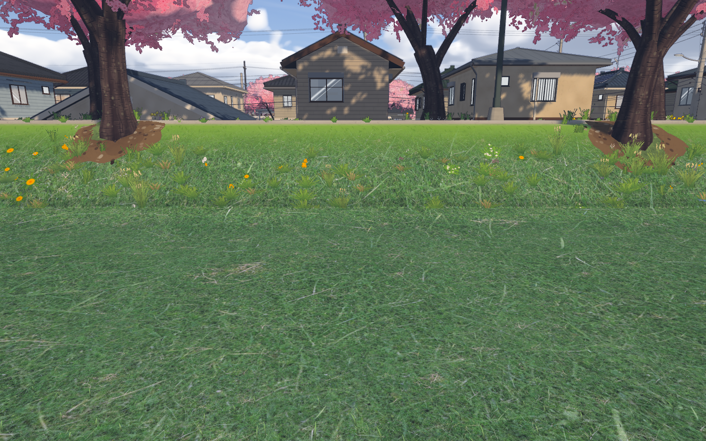
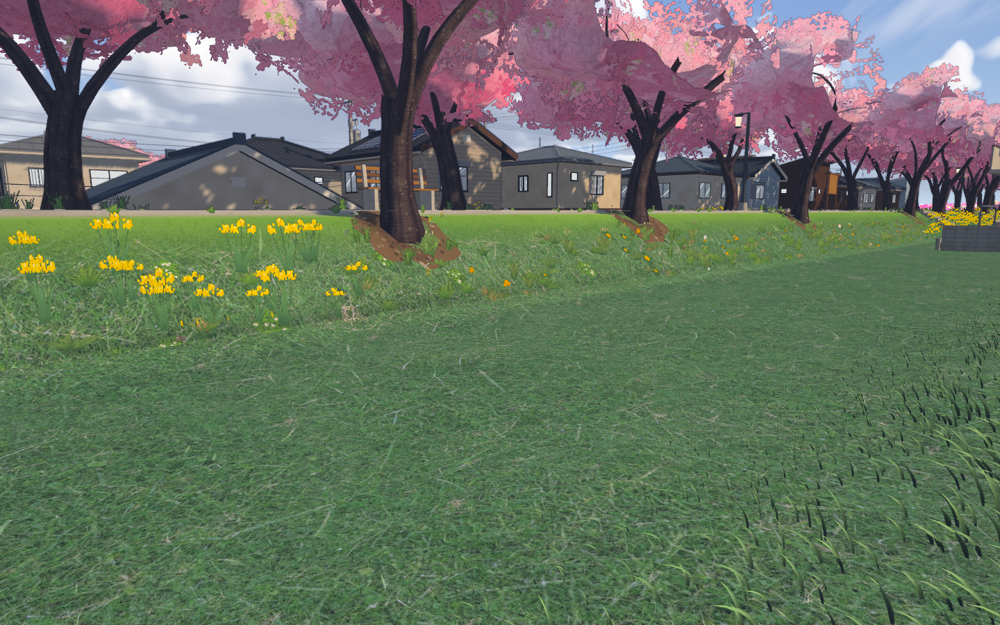
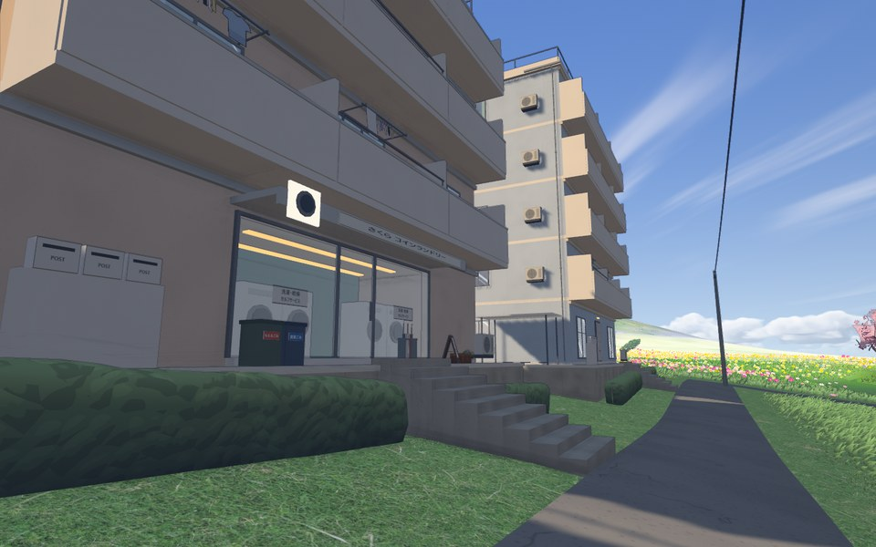
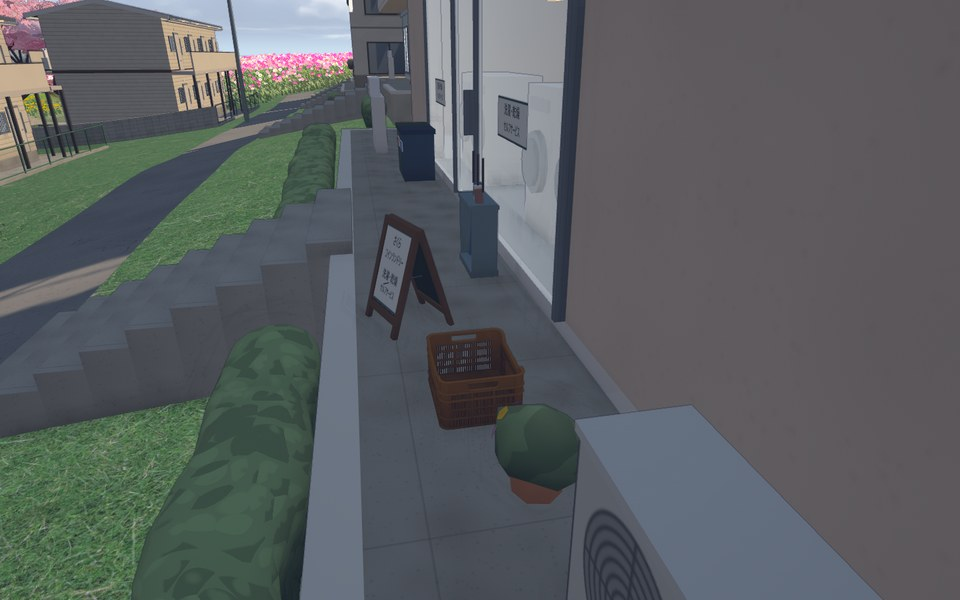

# C17：地表配色同步与 Meadow 参数归属回验

源码 `0184c79d94094c7d76378302592572bf367be6c7`，本机 RTX 3060、1440×900、真实素材。**C16 交回的两项缺陷在本轮规定范围内关闭**：北侧接缝的亮绿细带在两个原机位消失；双 look 的矩形／强度、未注册 Meadow 和质量重建通过 CPU 断言。没有修改运行源码，只有证据与说明更新；整体风格／P2 尚未验收，PR 保持 Draft、不合并。

## 两项修复与画面

`applyIsland` 在同一循环给 terrain 和 transition 注入 TOWN 并共享 uniform 对象，之后创建的两份站区 edge blend 自然继承。实际 GL 审计里，4 份地表和 111 份 shell 材质都有 TOWN，全部共享当前 look 的 rect／green 对象；5 个已使用的 GL program 编译、链接成功。完整材质源码和实际 GL shader 正文保存在 [town-material-audit.json.gz](./diagnostic/town-material-audit.json.gz)，没有用哈希替代正文，也没有临时换材质、重建场景或强制编译来制造通过。

沿用 C16 的两个接缝机位，时间 14、AO .55，town strength 1→0→1。正视与斜视均未再看到原先的亮绿细带；这是既有接缝回归的定向关闭，不代表巡查了全岛所有边界。两机位关闭状态的 PNG 分别与 C16 同状态全图相同。20、21、正视、斜视共四组恢复 PNG 均与各自开启 PNG 完全相同。





[正视关闭](./diagnostic/north-seam-central-town-B-capture-2.png) · [斜视关闭](./diagnostic/north-seam-oblique-town-B-capture-2.png) · [C16 原缺陷与机位来源](https://github.com/aa15119557034/agent-review-room/blob/fe58f25d7fe7ebf785bc46f25c20990e1a596587/apps/desktop/e2e/fixtures/world-base/evidence/greenery-c16-2026-11-18/README.md)

Shell 工厂现在按 `this.meadow.wbTownUniforms` 取所属参数，未注册实例直接使用原厂材质。一次实际 CPU 运行 **15 条断言全过、exit 0、stderr 为空**：A/B 各自 setter、预建池替换、质量重建、延迟材质、第三个未注册 Meadow、已有池转交新 look 后的归属。[复核报告及边界](./cpu/x51-c17-meadow-review.md)保留完整说明。非 meadow 的地表在 CPU 测试中是插入点夹具；不是完整场景、GLSL 或 GPU 泄漏测试。重新收养测试使用新的非 meadow shader holders，不把既有 `applyIsland` 当成整岛幂等接口。

## 原机位保护与下一项视觉反馈

固定相机／时间／参数对 C16：服务角、04 店内、店前近景的 PNG 全图相同；01 街道为 255 像素最大 9 色值差，24 洗衣店为 1411 像素最大 32，20 楼后为 243 像素最大 28，21 楼前为 234 像素最大 7。没有将这些差异全归为动画。17 对本轮重复截图中，01 有 24 像素最大 1、20 关闭状态有 1 像素最大 1，其余 15 对完全相同。





草花主次、建筑／店招与墙面维持；运行改动仅在 look.js，镇边几何预算仍为 29,933 三角。24 近景绿篱的重复斑块像迷彩图案，21 也能看到，作为下一棒局部材质精修建议交 C酱：收弱高频斑块，保留叶团体积和根部接触阴影。不要求继续加物件、改全局光照或把这一建议混称本轮程序缺陷。

## 实际执行与性能

```text
node --check src/look.js → exit 0
git diff fe58f25..HEAD --check（C17源码头）→ exit 0
node x51-c17-meadow-lifecycle.mjs → exit 0，15断言通过
node scripts/baseline.cjs --scene=combined --electron=D:/codex/2026-11-16/world-implementation/runtime-path-probe/electron.exe --output=artifacts/gpu-town-c17 --stills
→ session 97830 / PID 57788 / actual exit 1
node x51-c17-diagnostic-gpu.cjs gpu-look-c17-v1 0184c79d94094c7d76378302592572bf367be6c7
→ session 44205 / PID 65632 / actual exit 1
node x51-c17-offline-analysis.cjs → exit 0
```

正常运行 `renderOk=true`，14 项行为、look、真实 W 步行通过；`transportClean=false`。boulders、menhir、crate glTF 和 crate bin 四次 `ERR_ABORTED` 原样保留，0 JS 异常。定向运行完成原 21 + town 30 = 51 帧，保留 menhir、boulders、crate glTF 三次取消，0 JS／HTTP 异常；source／driver／9 素材／恢复状态核对通过。两次都是实际 exit 1，不能称为全绿；未重跑筛选结果。

| 采样段 | FPS | p95 ms | >20ms／总帧 |
|---|---:|---:|---:|
| 初始 | 64.471 | 15.5 | 8／975 |
| 01 街道 | 65.003 | 15.5 | 0／204 |
| 02 港口 | 65.002 | 15.5 | 0／203 |
| 03 鸟瞰 | 65.002 | 15.5 | 0／203 |
| 04 店内 | 65.000 | 15.5 | 0／202 |
| 第三人称步行 | 65.002 | 15.5 | 0／202 |
| 第一人称步行 | 65.000 | 15.5 | 0／202 |

初始最长 30.8ms；其余六段采样未见 >20ms 帧，不推广成全程永不掉帧。相较 C16 的长帧数量变化没有做因果归属。正常与定向执行记录是工具返回后的如实记录，原 process、stdout／stderr、报告、完整帧样本与哈希同时保留。

Windows [实际 job](https://github.com/aa15119557034/agent-review-room/actions/runs/44138755049/job/134235405975) 执行 `node scripts/verify.mjs`：**1615／1615 测试、9 类型检查、2 构建，20 项 code 0**。API 关联本源码 head，实际检出 PR 合并引用 `fb7ffa12150c02713867817d4951c24e8d83c551`，base `e8c37d659ae3e73934efb6e2a21fc822da9610e8`；不是直接源码 head 的 checkout。C酱云端 1507 测试／SwiftShader 图是另一组历史结果，没有当成本机证据。

## 原记录与范围

[离线对照](./analysis/x51-c17-offline-analysis.json) · [正常报告](./baseline/render-report.json.gz) · [定向报告](./diagnostic/look-report.json.gz) · [51帧索引](./diagnostic/capture-index.json) · [汇总](./summary.json)

选图均从实际产物原样复制；完整 PNG/JPG 身份见索引，未选的原图留在本机 artifact。C16 机位选址只作为已提交的历史输入引用，并核本轮相关地形源码没有变化，不伪称重新跑了选址 CPU。完整 shader、日志和原报告使用无损 gzip。

`setTownGreenery(...,0)` 只关地表／meadow，foliage 和砾石不随之关闭，不是完整 C15 还原。已有 pool 替换后 uCell 仍依赖下一次正常 update；未验证跳过 update 的热替换直渲染。未验证全边界、GPU 零泄漏、镇边可步行、黄昏／烘焙／湿面、人物、生产集成或最终可玩体验。两项回归关闭不等于整体风格或 P2 验收完成。
