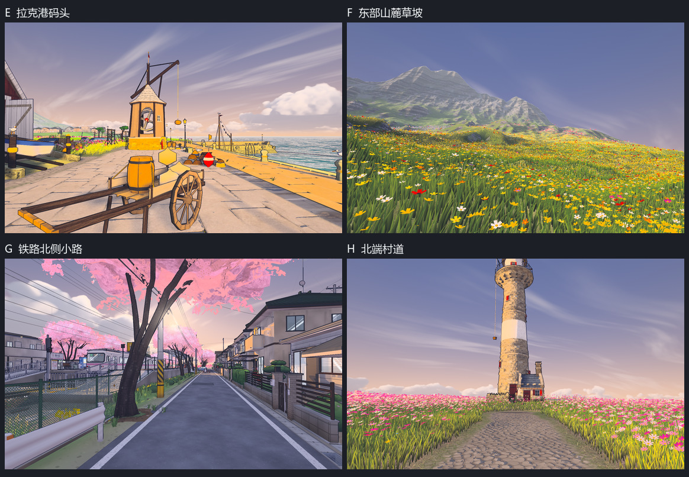

# 四个全岛地面抽样的傍晚基线

[按 #254 的全岛验收约定](https://github.com/aa15119557034/agent-review-room/pull/254#issuecomment-6979011939)，从原生港镇码头路、东部山麓草坡、车站铁路北侧小路和北端聚落 Cairnwick 的塔楼村道分别抽一点。以 252 为固定随机种子，地点在看成片前由道路弧长或草坡范围确定。四点以 57° 垂直视场、眼高 1.60 米收进场景的「全岛地面抽样」菜单。[抽样算法及可复算的范围](select.cjs)

| 点位 | 脚下地面高程（米） | 眼位世界坐标（米） | 画面中可复查的部分 |
| --- | ---: | --- | --- |
| [E 拉克港码头](sample-e-harbour.png) | 4.49691 | −49.3148, 6.0969, 1121.5 | 起重机、近处手推车与木桶、港口铺地和海面 |
| [F 东部山麓草坡](sample-f-hillside.png) | 59.90857 | 1040.6682, 61.5086, 591.5865 | 近景草花、中段裸岩和山脊轮廓 |
| [G 铁路北侧小路](sample-g-rail.png) | 8.00000 | 337.8563, 9.6, 844.5 | 沿路樱花、住宅、围栏、电线和列车 |
| [H 北端村道](sample-h-north.png) | 134.56234 | 181.0601, 136.1623, −1212.8685 | 石板小路、路边花草和石塔 |

场景源码为 `f608c8ae4e8edb5b4179b1579c13ea356e316f45`。原生 RTX 3060 Laptop，1440 × 900，像素比 1，傍晚，岛屿和站区时钟均为 14 秒。四个按钮逐个实际触发，面板隐藏，四个机位距实测地面均为 1.60 米，最大误差 0.05 毫米。H 切回 E 后帧内所有像素相同。进程退出 0，JS 和 GL 错误均为 0。宿主观测到 4 个本地资源请求被取消，完整事件保留在报告里。四图用于检验全岛规则的覆盖，A–D 和两种步行继续承担原约定的帧时验收。[相机、逐图校验和、资源事件与源码清单](report.json)

基线来自 #254 的地形。在独立的 #266 地形上，F 同一水平位置的地面比这里低约 13.78 米。两份地形对照会另记绝对眼位和落脚眼位，日后每个版本的复拍均可按数值还原。

核对已保存基线可运行 `node reproduce.cjs verify`。按项目说明准备原版素材后，`node select.cjs verify` 可从原道路和高程重算四个点。实机重拍可运行 `node reproduce.cjs <已有的Electron可执行文件> <新的绝对输出目录>`。
