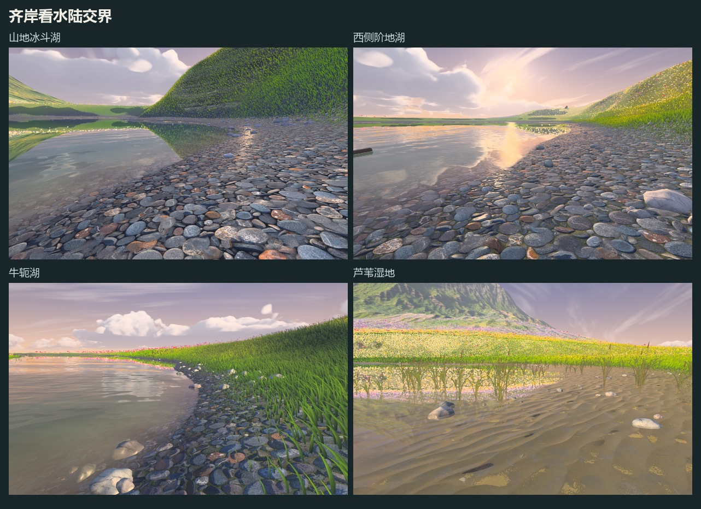
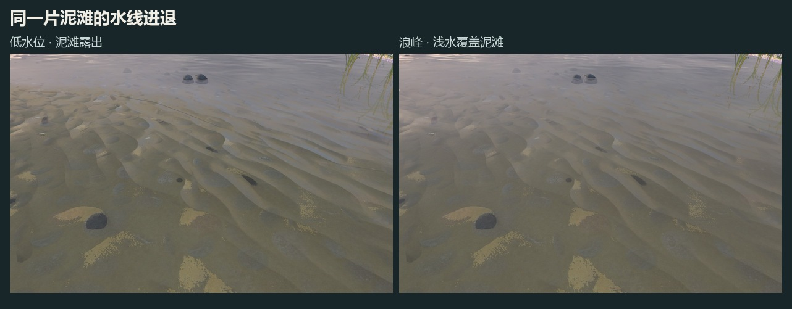

# 港湾岛的水岸、地形与天气

原图来自 Windows 上的 Electron，视口 1440 × 900，GPU 为 RTX 3060 Laptop。可在「内陆水域」选地点，点「进入步行」，按 W 走向水中。用「跳到天气阶段」可在同一机位观察晴天、阵雨和雾。[岛上水域分布图](./map.jpg)

## 岸带

四处湖盆刻入同一张 4096 × 4096 高程图。地表、湖岸线、岸石、植被与角色脚下使用同一份高度。按静水面以下的实际地形格点积分，四处新增水面合计 **15.89 公顷**。表中坡度是在图中所选的一条岸段上，沿岸线法向向陆侧走 1 米测得的高差，不代表全湖平均。

| 地点 | 水面面积 | 岸段坡度 | 岸边可见细节 |
| --- | ---: | ---: | --- |
| 山地冰斗湖 | 5.63 公顷 | 14.3% | 陡壁下的砾石架，岸石延续进清浅湖底 |
| 西侧阶地湖 | 5.86 公顷 | 7.9% | 宽缓的湖台、平砾滩和低角度日光倒影 |
| 东侧牛轭湖 | 2.35 公顷 | 23.9% | 弯月状旧河道，外弯陡岸与内弯浅滩 |
| 南侧浅滩湿地 | 2.05 公顷 | 2.4% | 泥滩、浅水洲、断续的芦苇带 |

山溪的碎砾随原河床转弯，海岸保留沙滩和浪涌。湖岸湿泥、浅水底和干地之间用坡度与距水线的距离混合材质，贴岸向下看能透过水看到石头。牛轭湖和泛滥平原湿地的地貌参照现实河流，岛上的组合与位置为手工设计。[溪滩与海岸实机图](./rivers.jpg) · [四处同机位改前／改后](./comparison.jpg) · [USGS 河道、牛轭湖与湿地](https://www.usgs.gov/geology-and-ecology-of-national-parks/geology-congaree-national-park)

## 水线、反射与交互

固定相机、天气和地形，只改变风浪相位。选定湿地泥滩处水面相对静水位位于 −4.42 至 +4.31 厘米。在同一块 400 × 250 像素的局部测试区域，直接读取水面着色器覆盖掩码，低水位覆盖 28,381 像素，高水位覆盖 100,000 像素。差值 71,619 是这块近岸区域新增的水面像素。[浪谷原图](./after/marsh-exposed.jpg) · [浪峰原图](./after/marsh-inundated.jpg) · [GPU 读回与岸坡剖面](./after/report.json)

- 浅水按深度透出底色，斜视时反射增强。近岸用 640 × 400 平面反射采样真实山体、岸石与植被，移动时最快每 0.14 秒刷新，静止时每 0.8 秒刷新。远处使用地形和天空近似。固定机位关闭岸上实景反射后，有 54,365 个像素达到画面差分阈值。[反射与点击的同机位对照](./water.jpg)
- 点击水面或涉水时，接触点附近 23.04 米见方的浅水网格传播涟漪，干岸阻断水面通量。固定光照、相位后单击一次，220 × 100 的水面窗口中有 14,733 个像素变化，网格响应已传播到距落点 0.84 米以外。独立测试中，波越过干岸屏障的幅度为 0。[点击前](./after/contact-before.jpg) · [点击后](./after/contact-after.jpg) · [数值检查](./checks.json)
- 浮木在 2.4 秒内的实测升沉幅度为 3.77 厘米，同时随波俯仰、侧倾。一次真实按键涉水行走了 16.16 米，触发 18 次扰动，最后脚底与河床高度差为 0。角色约在 0.82 米水深处停止继续涉入。水体采用局部浅水波模型，当前没有全岛流量或洪水演算。[涉水画面](./after/wading.jpg)

## 天气与运行

三个区域天气过程共 715 秒，分别模拟海洋冷锋、干燥高压脊、湿润强锋。气压、风、温度与露点差共同改变云量、能见度、降水、海况和路面湿度。弱风、高湿时出现贴地辐射雾。天气属于场景模拟，使用者可跳至一个阶段继续观察。[天气实机图](./weather.jpg) · [美国国家气象局对辐射雾的说明](https://www.weather.gov/safety/fog-radiation)

| 原生窗口实测，每段约 6 秒 | 平均 FPS | p95 帧时 |
| --- | ---: | ---: |
| 湿地晴天 | 63.7 | 15.5 ms |
| 山湖阵雨 | 65.0 | 15.5 ms |
| 车站晴天 | 64.5 | 15.5 ms |
| 车站阵雨 | 59.2 | 30.7 ms |
| 湿地涉水 | 56.8 | 30.8 ms |

本轮自然环境实机截图来自 `5164d6a`，原地形对照来自 `789cd2b`。相同的四组机位均核对位置、旋转、FOV 和分辨率。测试独占本轮渲染窗口，先拍摄原地形，再启动新版。新版完成 25 张取景，站区 14 项和沿岸 5 项行为通过，渲染端异常及失败请求均为 0。[新版原始数据](./after/report.json) · [旧版原始数据](./before/report.json)

| 实际执行 | 结果 |
| --- | --- |
| `node scripts/check-island-relief.cjs` | 遍历 16,777,216 点，保护区高度变动和原海岸跨零点均为 0，五个天气阶段、三个气压过程和涟漪断岸通过 |
| `node scripts/check-ground-transition.cjs` | 地表过渡、纹理采样和停车场边界检查通过 |
| `node scripts/check-camera-physics.cjs` | 8 项相机物理检查通过 |
| `node scripts/prepare-props.cjs`、`node scripts/prepare-apartments.cjs` | 9 个道具文件与 9 个公寓文件分别通过资产校验 |
| `node scripts/capture-inland.cjs <electron.exe> <输出目录>` | 本机独立分支实拍，退出 0 |
| `node scripts/capture-inland.cjs <electron.exe> <输出目录> <旧场景目录> <新版报告路径>` | 原图四个相同机位，退出 0 |

## 与站区材质一起运行

独立环境分支的入口整理为 `f4f10ca`。它和 #254 当时的 C22（`7a36abd`）自动生成合成树 `2ed8eace`。从这棵树导出运行源码并加载相同资产，25 张图、14 项站区行为、5 项沿岸行为全部跑通，渲染异常和失败请求均为 0。湿地水线变化仍为 71,619 像素。合成场景湿地涉水 49.2 FPS，p95 30.8 ms，山湖阵雨 65.0 FPS。以下两张图和报告直接来自合成场景。[站区雨景](./joint-street-rain.jpg) · [湿地岸边](./joint-marsh.jpg) · [合成场景原始记录及帧时](./joint-report.json)

## 原海岸与路线回归

实际执行 `node scripts/capture-environment.cjs <electron.exe> <输出目录> after`，完整重跑退出 0。32 秒步行沿南岸方向前进 93.80 米。第三／第一人称步行分别为 55.4／54.7 FPS，p95 均为 30.8 ms。阵雨期间的站街机位为 50.3 FPS。渲染异常、失败请求均为 0。[海岸与步行完整记录](./coast-regression.json)

首次检查干沙上的碎浪时，共用一个材质切换着色器的旧截图对照没有抓到未衰减的浪峰，正对照读数为 0。改用两份独立材质并等待实际渲染帧，同一相机、天气和浪峰相位下，未衰减波使 44,000 个目标像素均与干沙参考图不同，正常海岸耗散让这 44,000 个像素均与干沙一致。独立复测和最后一次完整运行得到相同结果。[首次记录](./coast-first.json) · [独立对照](./coast-probe.json)
