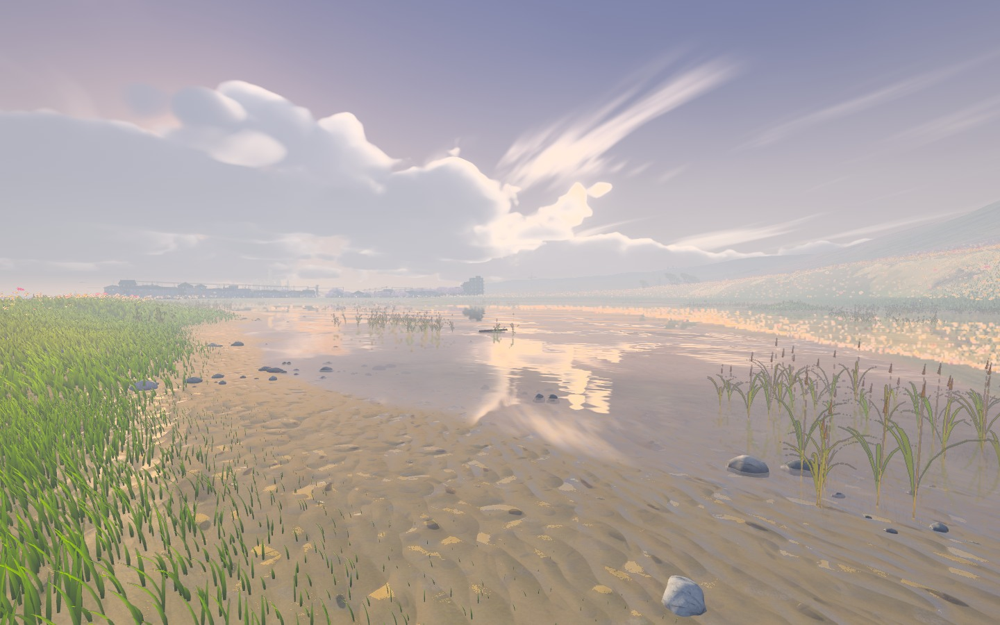
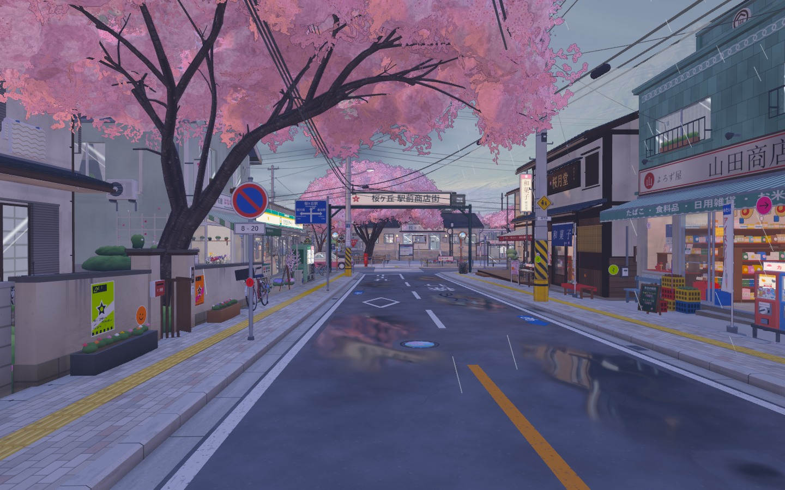

# 内陆水域与第 24 轮阴影调色联验

环境源码 `c129f8fba43a99470abc13f3a3cf179d4029da09` 与 #254 源码 `4a8903840677d589f08e6a9934680b3b7b5f3d9c` 已合到下游环境分支，集成提交 `e59c200379d5025ca9af4d8caa85f3d1118ccfb3`。两边同时改到了最终渲染通道。这里保留地面雾及其相机高度，也保留阴影补光和室内淡出。街景 PR 和环境 PR 仍分别审阅。

RTX 3060 Laptop、ANGLE D3D11、1440 × 900、DPR 1，运行正常场景入口。七种岛屿着色材质接入阴影补光，四种公寓材质绑定真实 1024² 贴图，26 张墙面贴花从预烘焙数据读取。湿地雾帧的画面已同时启用地面雾 0.880 和阴影调色 1。

| 同一批水域与天气 | 第 23 轮街景 FPS / p95 ms | 第 24 轮街景 FPS / p95 ms |
|---|---:|---:|
| 湿地晴天 | 64.33 / 15.5 | 64.33 / 15.5 |
| 山湖阵雨 | 65.00 / 15.5 | 65.00 / 15.5 |
| 车站主街晴天 | 52.83 / 30.8 | 65.00 / 15.5 |
| 车站主街阵雨 | 60.17 / 30.7 | 65.00 / 15.5 |
| 湿地涉水 | 54.17 / 30.8 | 64.83 / 15.5 |

两次独立前台启动，每个机位或涉水路线预热后连续采 6 秒。第 24 轮本次五段均达到平均 60 FPS、p95 16.7 ms 的目标。两次启动的原始记录保留了各帧间隔。

四处水域共 15.89 公顷。固定机位切换真实岸上反射改变 54,218 个像素，点击激起的水纹改变 14,358 个局部像素。湿地浪谷到浪峰，测区水面覆盖增加 71,619 像素。真实按键涉水 16.12 米，触发 19 次扰动，结束时脚底与河床高度差为 0。站区 14 项、沿岸 5 项检查均通过。两个 Electron 进程均退出 0，JS 与网络异常均为 0。

| 湿地低雾与真实岸景倒影 | 主街阵雨 |
|---|---|
|  |  |

[湿地涉水](wading.jpg) · [第 24 轮联合逐帧和物理记录](c24-report.json) · [第 23 轮联合逐帧和物理记录](c23-report.json) · [四处水域、岸线与取景入口](../README.md)
