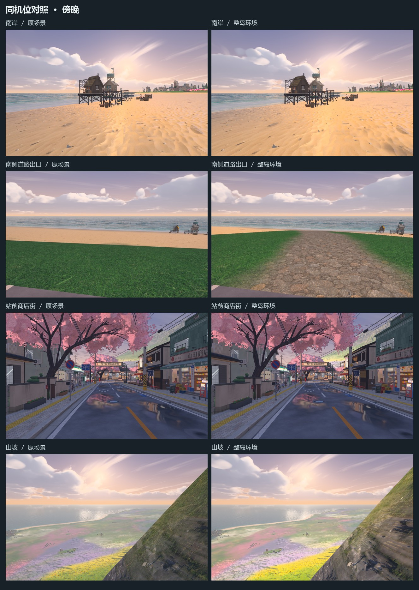
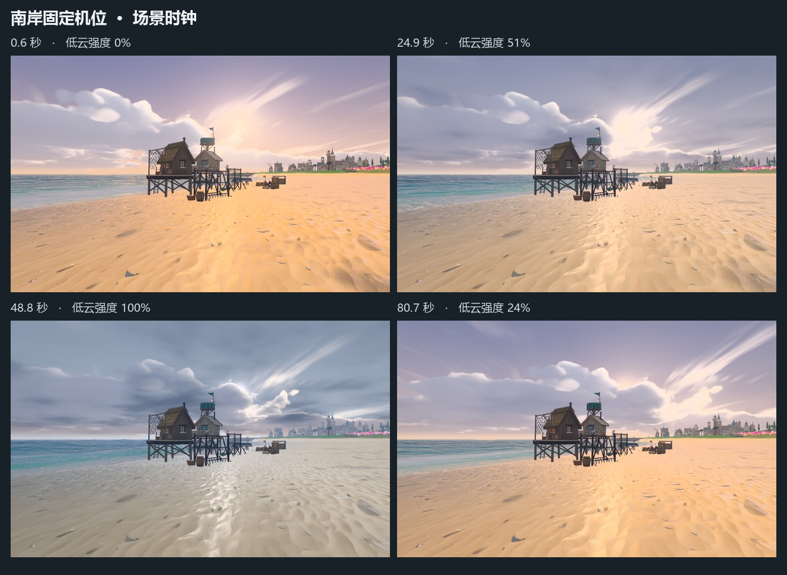
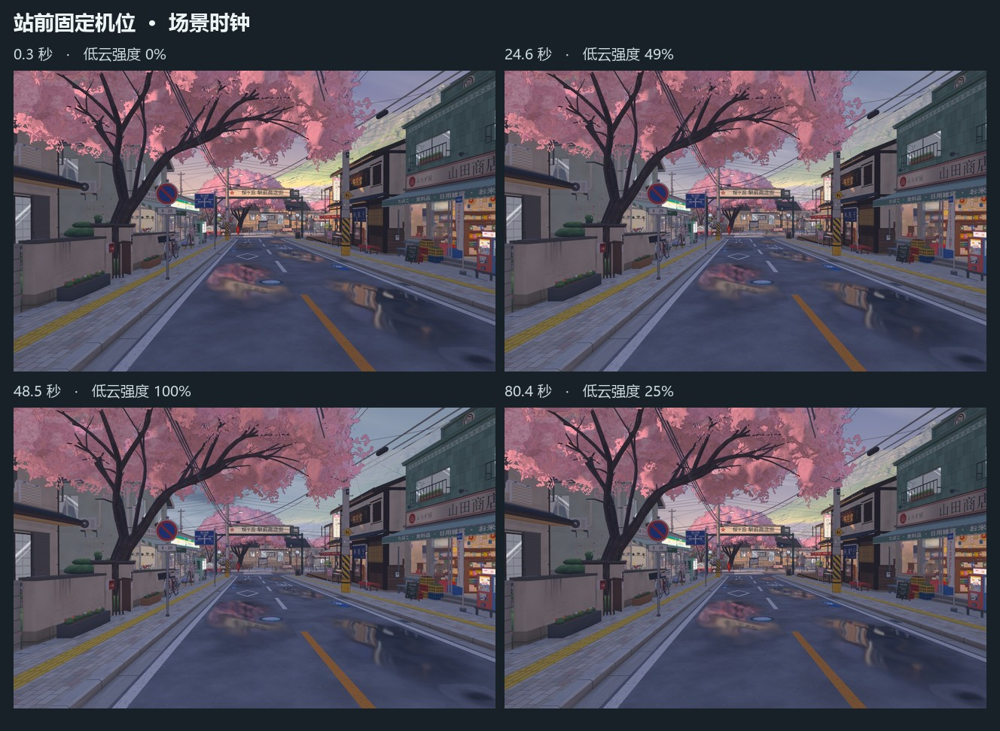
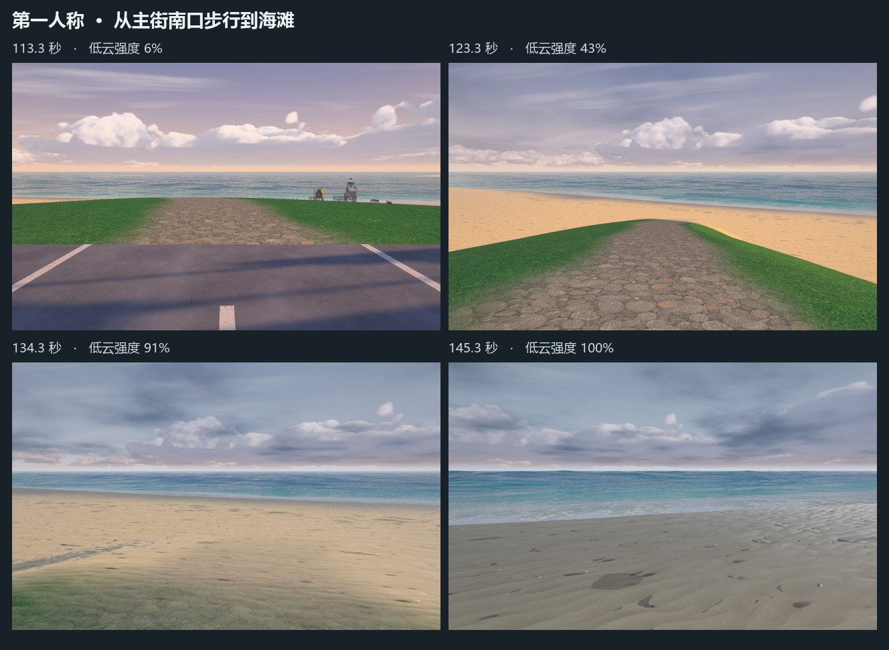

# X-51 · 整岛地形、南岸步道与海上天气

在场景里按 **7** 可直接看南岸，点击 **进入步行** 从沙滩起步。从站前商店街向南步行，路尽头会接到缓坡和潮间带。约 100 秒完成一次低云进场、风浪增强和放晴，时钟在首次场景绘制完成后开始。

## 实机画面

四个前后机位使用相同世界坐标、相机四元数、FOV 和 1440 × 900 分辨率。南岸、主街和步行三组时序，每组四帧，均来自正常推进的场景时钟。海浪、云影和车站的动画自然推进。对比用的基线是 `43a30f3`，最终场景实现是 `d0a3c54`，采集程序是 `7dc008d`，采样时工作树 HEAD 是 `f9a8d0b`。

| 同机位对照与主街天气 | 南岸天气与实际步行 |
| --- | --- |
| [](before-after.jpg) | [](coast-weather.jpg) |
| [](street-weather.jpg) | [](coastal-walk.jpg) |

每张原尺寸 JPG 在 [before](before) 和 [after](after)。南岸低云前，海面和沙地保留暖色。低云进场后，远港对比度降低，海面反射转冷，浪高与湿沙边缘同步变化。街面的太阳直射减弱，橱窗和积水继续使用 #254 的建筑倒影。第一人称步行的四帧取自同一次持续按 W 的 32 秒路线，脚底向南推进 **93.8 米**。

## 地形与落脚

整岛使用一张 4096²、间距 1.5 米的高程场。新地形先保护河床、灯塔、建成区和站区，再调整自然岸滩及内陆起伏。地表网格、植被、道具落点和海床使用同一数据。程序随后在南侧街道出口把局部过渡放宽到 78 米，并接入原车站碰撞与海滩地形碰撞。

全网格与原始资料核对共 **16,777,216** 格。海岸修改 335,766 格、内陆修改 1,904,496 格（绝对变化超过 1 毫米），最大升降约 4.3 米。在站区既有整平工序前，海陆符号改变 0 格，原车站与三个原生镇区包围盒内改变 0 格。经真实控制器从主街南口到浅水边再返回，1716 次落脚采样与接缝网格或最高细节地表三角面比较，最大垂直误差 **1.95 毫米**。车站原有 14 项及自然环境 5 项检查均通过。

## RTX 3060 Laptop 帧时

Windows、Electron、ANGLE D3D11，DPR 1。每段切换后预热 1.8 秒，再从前台窗口的 rAF 时间戳连续采满至少 6 秒。平均 FPS 为总帧数除以实际时长，p95 取排序后的最近秩。步行分别从站区正常出生点开始，两段连续按 W；截图放在采样窗外。这些数值包含应用与呈现的帧间隔。基线与成品按同一脚本分别启动。

| 机位 | 基线 FPS / p95 ms | 成品 FPS | 成品 p95 ms | 超过 20 ms / 总帧数 |
| --- | ---: | ---: | ---: | ---: |
| 海雾期间 · 南岸 | — | 65.00 | 15.5 | 0 / 391 |
| 海雾期间 · 主街 | — | 65.00 | 15.5 | 0 / 390 |
| 南岸 | 65.00 / 15.5 | 65.00 | 15.5 | 0 / 390 |
| 站前主街 | 64.83 / 15.5 | 63.50 | 15.5 | 9 / 381 |
| 第三人称步行 | 65.00 / 15.5 | 58.67 | 30.8 | 37 / 352 |
| 第一人称步行 | 65.00 / 15.5 | 63.50 | 15.5 | 9 / 381 |

[基线逐帧与姿态](before/report.json) · [成品逐帧、天气、姿态与检查](after/report.json) · [GPU 错峰回执](coordination.json) · [中间轮次与隐藏窗口失败](diagnosis/trials.json)。隐藏窗口测试被系统节流到约 1 FPS，未得到有效步行；正式采样用可见窗口。中间版本主街和步行曾出现 p95 30.8 ms；按不透明物体深度筛去遮挡的天空、海面，并使云影与低云共用采样后复测。

### 同一构建的第二轮采样

首轮第三人称步行平均 58.67 FPS，p95 为 30.8 毫秒。关闭场景后，用同一份代码重启 Electron，完整重复六组采样和海岸验证。复测第三人称步行为 57.00 FPS，p95 为 30.8 毫秒。第一人称步行复测为 39.07 FPS，p95 为 30.9 毫秒。两轮的步行帧时都有波动。 [复测逐帧数据](diagnosis/repeat-report.json)

| 机位 | 首轮 FPS / p95 ms | 复测 FPS / p95 ms | 复测超过 20 ms / 总帧数 |
| --- | ---: | ---: | ---: |
| 海雾期间 · 南岸 | 65.00 / 15.5 | 65.00 / 15.5 | 0 / 391 |
| 海雾期间 · 主街 | 65.00 / 15.5 | 65.00 / 15.5 | 0 / 391 |
| 南岸 | 65.00 / 15.5 | 65.00 / 15.5 | 0 / 390 |
| 主街 | 63.50 / 15.5 | 64.83 / 15.5 | 1 / 389 |
| 第三人称步行 | 58.67 / 30.8 | 57.00 / 30.8 | 48 / 342 |
| 第一人称步行 | 63.50 / 15.5 | 39.07 / 30.9 | 148 / 235 |

## 干沙亮斑复核

b2865b8 步行末帧曾出现与海面分离的浪峰。[原现场](diagnosis/b2865b8-dry-sand.jpg) · [当时相机、天气与性能](diagnosis/b2865b8.json)。在近岸实测点 (295,1121)，地面高 0.550 米，风致增水 0.19 米。旧波幅在 t = 121.55 秒时可达 0.938 米。修复将岸内波幅在离平均岸线约 5 米处收为零。

同一机位、时间和满强度天气下，把旧浪峰和修复后的浪峰分别与临时隐藏海面的干沙对照。测区为 (310, 693) 起的 400 × 110 像素，RGB 任一通道差超过 4 计为变化。旧波幅改变 **44000** 像素，修复后改变 **0** 像素。[旧波幅](diagnosis/swash-unbroken.jpg) · [修复后](diagnosis/swash-adapted.jpg) · [干沙对照](diagnosis/swash-dry.jpg)

## 实际命令

以下以场景目录为当前目录。基线和两轮成品 GPU 采样均退出 0，正式运行未记录 JS 或网络错误。基线场景目录由 Git 导出 `43a30f3` 的 index、src、upstream 和清单，并链接同一份本机素材。相机对照检查同时核对分辨率、位置、四元数和 FOV。

```bat
set ELECTRON_EXE=D:\codex\2026-11-16\world-implementation\runtime-path-probe\electron.exe
node scripts\capture-environment.cjs %ELECTRON_EXE% artifacts\environment\base-verified before artifacts\environment\base-source
node scripts\capture-environment.cjs %ELECTRON_EXE% artifacts\environment\7dc008d after
node scripts\capture-environment.cjs %ELECTRON_EXE% artifacts\environment\7dc008d-repeat after
node scripts\check-island-relief.cjs
node scripts\check-ground-transition.cjs
node scripts\check-camera-physics.cjs
node scripts\prepare-props.cjs
node scripts\prepare-apartments.cjs
```

地表衔接检查涵盖 1,636 个接缝三角面、停车场顶点、站区边缘草花密度。相机物理检查 8 项通过。两组资产分别核对 9 个原文件、3,579,256 字节及 4,932,249 字节。

## 范围与限制

步行覆盖站区、南侧步道和相连的海滩。远处农场、港镇及北侧公寓仍是背景。街景玻璃与路面积水保留傍晚烘焙的建筑轮廓，随天气调整反射色与亮度；海洋与河面实时采样云层。自然天气采用一个 100 秒晴阴往返周期。固定太阳角度和原地形烘焙阴影保留，山脊微调后局部烘焙阴影可能偏离。父分支第 22 轮墙面做旧已在 Git 合并树中检查可自动合并；这组画面采自独立环境分支。超大视角沿用后续阶段安排。
