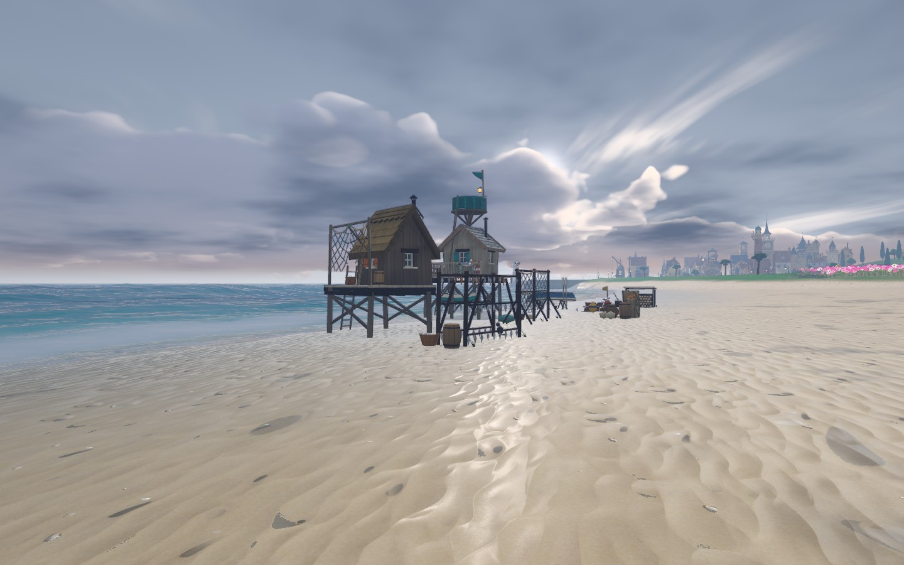

# 整岛自然环境与第 22 轮街景联验

将 #254 的 `23025dc41586fc8109625708d4361a945c31d029` 与 #266 的 `78c02831cc034d4080451930400c7bb6acf5ba9c` 放入独立临时工作树。Git 得到的内容树为 `1c725d4f857ebde7164392c614d3b8bb569d92bd`。两份改动在同一个本机场景中运行。

RTX 3060 Laptop、D3D11、1440 × 900、DPR 1。场景同时启用动态天气和第 22 轮墙面做旧，读到 144 个做旧材质、52 个贴花三角形和四种使用 1024 像素真实贴图的公寓材质。0 个 JS 错误、0 个网络错误，Electron 退出 0。

站区 14 项、自然环境 5 项检查通过。真实 W 键行走 32 秒，沿路线向南推进 93.89 米。往返 1,716 次落脚采样中，脚底与可见地面的最大偏差为 1.95 毫米。大风浪峰的 44,000 像素干沙测区与隐藏海面后逐像素相同。

| 场景 | 实测 FPS | p95 ms | 超过 20 ms / 总帧 |
|---|---:|---:|---:|
| 海雾 · 南岸 | 65.00 | 15.5 | 0 / 391 |
| 海雾 · 主街 | 47.50 | 30.8 | 105 / 285 |
| 南岸 | 65.00 | 15.5 | 0 / 390 |
| 主街 | 56.02 | 30.8 | 54 / 337 |
| 第三人称步行 | 50.54 | 30.8 | 87 / 304 |
| 第一人称步行 | 54.83 | 30.8 | 61 / 329 |

这次联验采了一轮。南岸在海雾和随后的常规机位都达到 65 FPS。主街和两段步行仍有长帧。

| 同一轮低云经过时的主街 | 南岸 |
|---|---|
|  |  |

[走过潮间带入口的实拍](trail-walk-32.jpg) · [原始逐帧、相机、脚底高度与湿沙对照](report.json) · [#254 墙面做旧的独立诊断](https://github.com/aa15119557034/agent-review-room/pull/254#issuecomment-6966358930)
