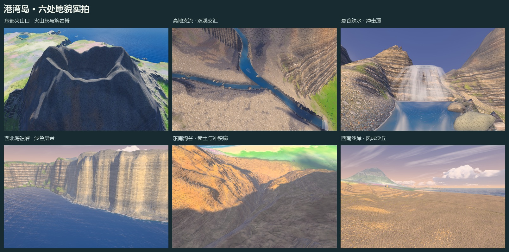
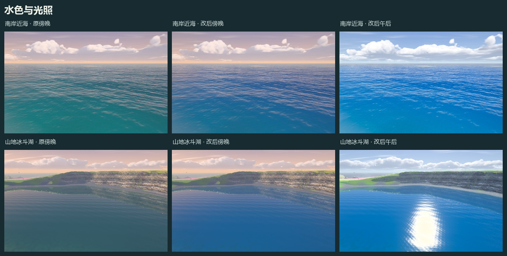

# 港湾岛地貌与水色

基线 `1c106b37` 已包含四处内陆湖盆、岸边物理与站区 C24 材质。本轮场景源码为 `dc129c04`。在场景的「水域与地貌」选择观景点，可从附近的落脚点进入步行。默认是傍晚，地址参数 `?time=afternoon` 可查看午后。[地貌与河网分布](./map.jpg)

| 地段 | 形态与材料过渡 |
| --- | --- |
| 东部火山口 | 在旧山体上塑造破口、凹陷火口、放射状岩脊。火口底的灰色细料沿内壁过渡到暗色火山岩和褐红色火山渣，山脚逐渐恢复草坡。 |
| 高地汇流峡谷 | 一条山溪和一条侧支在坡面汇合，沿悬谷下泄，再接入原有主河。较缓的河弯堆积浅色砾石，陡段露出湿岩，河床留有分散的大石。 |
| 悬谷瀑布 | 水越过岩槛，以重力轨迹落入下游冲击潭。落水处有局部白沫、扩散水纹和随风移动的薄雾。 |
| 西北海蚀岬 | 裸岩台地向海崖、潮湿崖脚和近海过渡。层理随岩床倾角起伏，竖向节理形成两处切口。 |
| 东南赭土沟谷 | 主沟与侧沟切入红褐色坡面，支脊露出层理，坡脚展开成较缓的冲积扇。 |
| 西南风成沙丘 | 沙脊沿风向弯曲，迎风面长、背风面短。风蚀洼地、浅色细砂和残留植被向原沙岸衔接。 |

以上六处均使用原生高程进行渲染和角色落脚。河流沿用 Jacob Miller 的 Petalwake 河带与抛体瀑布实现，在本地按新河床生成几何。岩石、碎砾和沙面复用项目已有纹理。[固定版本的开源代码](https://github.com/jjcm/petalwake/tree/25443cef0eba802052d9ef24c94ba3c4157b6f2e) · [许可与改动](../../THIRD-PARTY.md) · [改前／改后同机位图](./comparison.jpg)

## 水色与河网

按深度调整红、绿、蓝的吸收和散射。外海以深蓝为主，浅海透出蓝绿和海床，山湖偏冷蓝，牛轭湖与湿地保留较多悬沙底色。浅水透明、日光高光和掠射角反射仍随视角变化。在相同傍晚光照下，分别在海上和山湖中心垂直俯视，取画面中心 170 × 170 像素的 RGB 中位数，外海为 **27, 93, 109 → 21, 77, 136**，山湖为 **50, 90, 102 → 23, 96, 149**。这些读数是最终画面像素。[水色采样](./water-color.json)

新增三段连续水面中心线共 **501.5 米**。其中上游 224.7 米、跌水后的下游 111.8 米、侧支 165.0 米。实测 466 个中心线样点全部有水，水面沿流向下降，两个汇口的中心线水面等高。瀑布轨迹下落约 **22.0 米**。火口底约 371.6 米，围绕火口的固定环带高程为 438.4 至 513.2 米。河床和火山地貌是手工设计的稳定地形，流量与泥沙不随时间重塑河道。[逐段水位、瀑布和火口剖面数据](./evening/report.json)

## 运行与复核

原图来自 RTX 3060 Laptop 的 Electron 原生窗口，分辨率为 1440 × 900。在三个场景里分别固定晴天气象和风浪相位。改前与改后的 10 组傍晚机位逐项核对了位置、旋转、视角和分辨率。午后和傍晚都从六个新地点发送实际 W 键，傍晚各次水平位移为 2.17 至 2.22 米。

| 实机采样 | 午后平均 FPS / p95 帧时 | 傍晚平均 FPS / p95 帧时 |
| --- | --- | --- |
| 火山口 | 65.0 FPS / 15.5 ms | 65.0 FPS / 15.5 ms |
| 悬谷瀑布 | 65.0 FPS / 15.5 ms | 65.0 FPS / 15.5 ms |
| 风成沙丘 | 48.5 FPS / 30.9 ms | 49.5 FPS / 30.8 ms |

旧场景行为另作回归。站区 14 项、沿岸 5 项通过，湿地水线随波进退，固定区域的高水位新增 71,619 个受水覆盖像素。车站晴天 60.0 FPS / 30.8 ms，湿地实际涉水 49.7 FPS / 30.8 ms。这些是本机短时采样。[午后记录](./day/report.json) · [傍晚记录](./evening/report.json) · [基线记录](./before/report.json) · [原水体和站区回归](./inland-regression.json)

| 实际执行（在 world-base 下） | 结果 |
| --- | --- |
| `node scripts/check-island-relief.cjs` | 扫描 16,777,216 个高程点。原海岸跨零和城镇保护区变动均为 0。四类材质都有过渡区，相邻 3 米权重纹素最大变化分别为 21、23、18、31（满值 255）。三个河段中心线均连续有水。 |
| `node scripts/check-ground-transition.cjs`、`node scripts/check-camera-physics.cjs` | 地面接缝和停车区材质保持，8 项相机物理检查通过。 |
| `node scripts/prepare-props.cjs`、`node scripts/prepare-apartments.cjs` | 两组各 9 个已准备资产通过校验。 |
| `node scripts/capture-inland.cjs <electron.exe> <目录> . --landforms` | 傍晚实机退出 0。另加 `--afternoon` 的午后实机也退出 0。 |
| `node scripts/capture-inland.cjs <electron.exe> <目录> <旧场景> <新版报告> --landforms` | 旧代码、相同相机与照明，退出 0。 |
| `node scripts/capture-inland.cjs <electron.exe> <目录>` | 原站区与湖岸检查、点击、浮木、涉水及涨退水线实测均通过。 |

[本机检查的原始输出](./checks.json)
