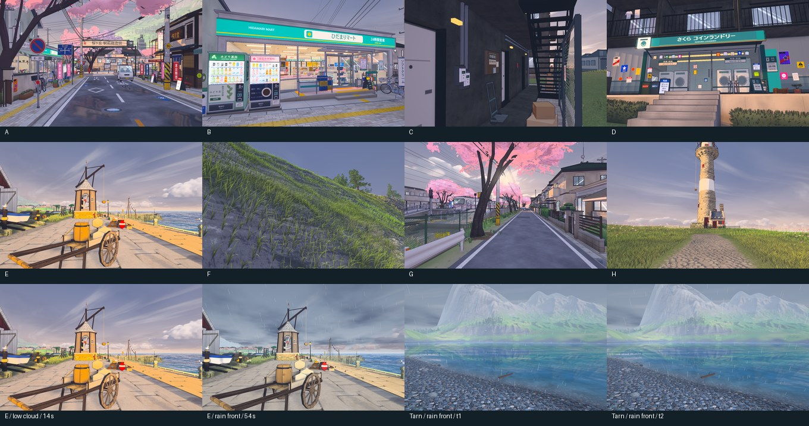

# 最终站区资产与岛屿地面环境联验

联合运行提交 `21154f79` 以 `6485bf56` 的地面、湖泊、云层和天气接入 `675f6602` 的最终广场樱花和三栋 Blender 建筑。八个固定地面机位实际进入，街面、后廊、洗衣店、铁路和湖岸均能正常渲染。F 山麓、H 北端村道与原地形交件的 PNG 逐字节相同，复拍返回 A 也与出发画面逐字节相同。

## 固定镜头与地面

八张正式图都由对应的页面按钮进入。分辨率为 1440 × 900，隐藏 HUD，傍晚天气时钟定在 14 秒。固定 F 仍取新地形高度，四个外景机位均为 57° 视角、高约 1.600 m。C 与 D 位于站区物理边界之外，向下实测分别命中后巷铺砖和洗衣店沥青，两处可见路面的眼高均为 1.600 m。A、B、G 相对站区可行走面的眼高分别为 1.620、1.600、1.600 m。在这些站区固定观景镜头按进入步行，游戏使用站区出生点。湖岸入口会把角色放到对应岸边。

A–D 的旧图来自最终模型验收，当时没有联合天气。这四张的像素差同时包含天气、光线和地表效果。E–H 与原地形、同一时间和机位进行比对。E、G 分别有 5,690 和 11,718 个像素发生变化，F、H 全部 1,296,000 个像素相同。[逐图对比](comparison.json) · [原生照片路径和哈希](report.json)

## 云、降雨、水体与倒影

E 的 14 秒照片为海上低云，降雨 0，54 秒为锋面阵雨，降雨 1。湿路和地面雾均与对应天气状态一致。两张保持同一相机、方向和 FOV。[低云](sample-e-harbour.png) · [阵雨](storm-e.png)

从页面下拉菜单进入冰斗湖岸，选取锋面阶段后恢复正常生产循环。固定相机高出岸边 2.15 m。在 48.0509 至 49.4356 秒之间，雨量从 0.9439 增至 0.9626，湖心水面从 137.9791 m 降至 137.9594 m，云层持续平移。湖水实际绑定 640 × 400 实时镜面目标，两次采样的倒影更新计数从 1 增至 2。[第一时刻](live-tarn-1.png) · [第二时刻](live-tarn-2.png)

站区玻璃使用最终模型交件内烘好的六面 256 × 256 傍晚反射贴图。本次核对了实际加载路径、尺寸和字节哈希。该静态来源与湖岸每次实时生成的岸景倒影分别记录。三个网格建筑及完整樱花 GLB 都进入实际加载，页面解码字节数对应已校验运行包。上游 760 个原件和 station-art 的 10 项文件已通过 prepare。设备原有的傍晚地面光照衍生贴图随采集保留。CDP 记录 3 次取消，保留在原生回执中，本轮没有独立逐请求正文审计。[来源和网络回执](report.json)

## 真实步行与帧时

同一台 RTX 3060 Laptop GPU，普通原生入口，窗口以 `showInactive` 显示，采样起止页面均无焦点。先以同一 A 机位自然播放 3.5 秒，再从站区出生点按住 W 约 3.1 秒，角色实际移动约 9.42 m。两段使用真实 RAF，第一段 228 帧、65.00 FPS / P95 15.5 ms，第二段 202 帧、65.00 FPS / P95 15.5 ms。这是单轮地面到达和步行抽测。固定天气后的截图用独立锁时步骤获取。[逐帧原始数据](arrival-frames.json.gz)

贴花使用当前联合真实指纹 `1061:2667664:298285.6:949273.1`，命中烘焙计划，重规划射线 0 条。独立无硬件加速装配校核了原 26 枚贴花、3,147 个站区碰撞体、W1 的全部 51,036 个货架接触点和四个湖泊的玩家落点。[几何回执](geometry/README.md)

## 复核

运行 `node verify.cjs` 核对图片、已交付 GLB、倒影、天气和两组帧时。几何回执内另有独立重复验算入口。使用已准备的同一源码树和 Electron，在此目录执行 `node tools/capture.cjs <Electron可执行文件> <全新绝对输出目录> on` 可重拍。使用 `python tools/compare.py <fixture/evidence> <重拍输出目录> <新对比目录>` 生成逐像素对照。两份父分支的既有证据由 Git 历史复用。
