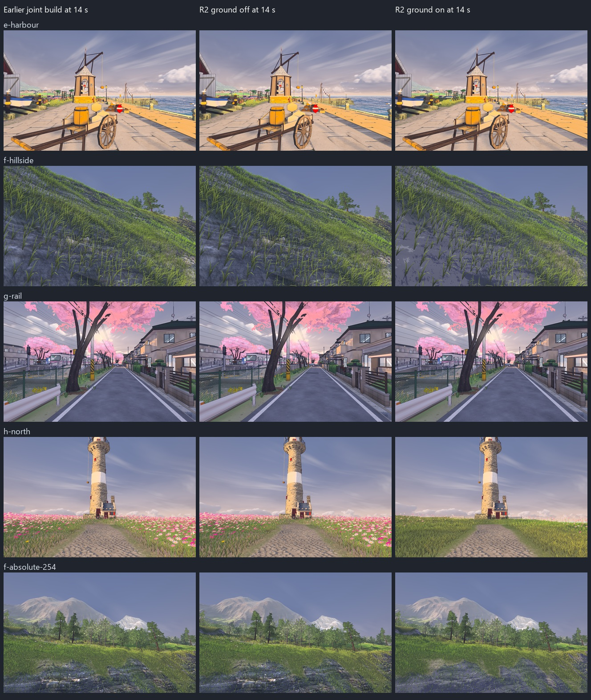
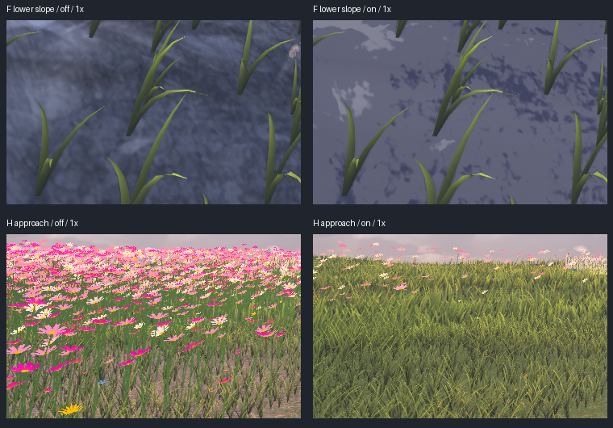
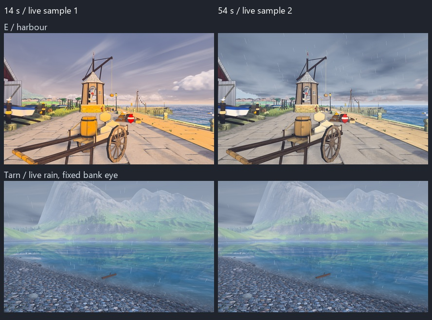

# #254 R2 与 #266 地面联验

联合源码 `b3e27d29b963ee02caa07c3057632e8f9c6a6461`，RTX 3060 Laptop / ANGLE D3D11，1440 × 900，无 HUD，傍晚。E、F、G、H 均从玩家地面抽样按钮进入。两次独立启动分别使用默认地表和 `?ground=off`；每次均按原联验方法用正常帧更新锁定在 14.000 s，看向同一位置后抓取三张。两进程均以 0 退出。另用实际天气阶段选择器在冰斗湖岸恢复正常帧循环，记录自然推进。



|机位|地面上眼高|开启/关闭地表的差异像素*|实拍所见|
|---|---:|---:|---|
|[E 拉克港码头](on/sample-e-harbour.png)|1.600 m|34,262|手推车、钟楼与海岸保持对位。|
|[F 山麓落脚点](on/sample-f-hillside.png)|1.600 m|598,535|近景岩面收成几块蓝灰色，块边明显，原有的岩石明暗纹理减少。|
|[G 铁路北侧](on/sample-g-rail.png)|1.600 m|787|道路、住宅和树冠基本一致，常规地表改动在此画面占比很小。|
|[H 北端村道](on/sample-h-north.png)|1.600 m|298,873|石板路与灯塔仍然对位，近路的亮粉花海变为大片黄绿草，花主要留在草带远处。|
|[F 保留 #254 原绝对眼点](on/sample-f-absolute-254.png)|15.379 m|306,986|山峰重新进入构图。新地表在此处低 13.779 m，此图只用于精确对位。|

\*任一 8 位显示 RGB 通道绝对差大于 8。对照总图第一列为[早先联合地形与旧地表](../joint-ground-samples-2026-11-18/README.md)，后两列为这次联合源码。F 正常眼点 Y=47.729416887，原绝对眼点 Y=61.5086，平面坐标 (1040.6682, 591.5865) 和朝向一致。关闭 R2 地表时，F 两种姿态、G、H 最终 PNG 与早先联合版本逐像素相同；E 仍有 4,012 个像素超过此阈值。在本构建的开/关对照中，E 的两个地表状态使用相同天气、相机和城镇源码。



## 海面、云和天气



|E 码头同机位|14 秒 · 海上低云|54 秒 · 锋面阵雨|
|---|---:|---:|
|云量 / 雨量 / 路面湿润|0.3244 / 0 / 0|1 / 1 / 1|
|风速|4.160 m/s|8.556 m/s|
|低云平流坐标|26.06, 35.42|196.50, 249.85|
|海浪材质强度 / 增水|0.8237 / 0.0616 m|1.1446 / 0.1900 m|
|世界 (0, 1320) 的 CPU 海面采样|0.4132 m|0.8220 m|

海面采样调用项目的 `waveHeight` 并采用开阔水面系数 1，该点海床高度为 −21.539 m。它是顶点波形的 CPU 对应值。E 的真实 PNG 中，选取的海面框 4,920 个像素中有 4,916 个变化超过 8，天空框 82,800 个像素中有 71,639 个超过 8。相机锁定时这两张实拍同时包含云、雨、照明和海面的变化。

**湖岸正常播放。** 在地表关闭的进程，从水域选择器进入冰斗湖岸，眼高 2.15 m。用真实天气下拉选择锋面阵雨后，恢复生产帧循环。两张原生 PNG 的眼位和朝向完全相同。天气从 48.1010 s 推进到 49.4856 s，水面材质时间从 50.7173 s 到 52.1019 s；两者都自然推进 1.3846 s。渲染器的低云坐标从 (161.85, 213.00) 移到 (169.78, 221.89)，雨量从 0.94457 增到 0.96330。固定湖心 (735, −824) 的 CPU 水面从 137.94880 升至 137.99191 m，变化 4.31 cm。原图湖面框 52,640 个像素中有 26,819 个变化超过 8，画面同时有斜落的雨线、反射与水波。[第一次](off/live-tarn-1.png) · [第二次](off/live-tarn-2.png)

两组均无场景异常与 WebGL 错误，E 首拍和返回 E 的三次帧哈希均对应相等。关闭地表的 G 第 2 帧哈希与第 1、第 3 帧不同；归档第 3 帧，与第 1 帧和旧联合 G 的整图哈希相同。中间帧只留哈希，无法定位差异像素。每个进程各出现一次浏览器取消 boulders.glb、menhir.glb 请求；复查同一资源服务器返回 200、669,820 / 620,588 字节，取消原因未归因。[资源复查](asset-http-check.json)

## 复算

```
node capture.cjs verify
python compare.py
node capture.cjs <已安装Electron路径> <新的绝对输出目录1> on
node capture.cjs <已安装Electron路径> <新的绝对输出目录2> off
python compare.py --on <输出目录1> --off <输出目录2> --out <新对照目录>
```

离线像素复算需要 Python、NumPy、Pillow；重新拍摄还使用本工作树已准备的本地素材。自然播放的采样间隔由实际帧调度决定。开/关组的报告含源文件哈希、姿态、天气、海面参数与各次原图哈希。[地表开启报告](on/report.json) · [地表关闭与湖岸播放报告](off/report.json) · [逐像素统计与取样框](comparison.json)
