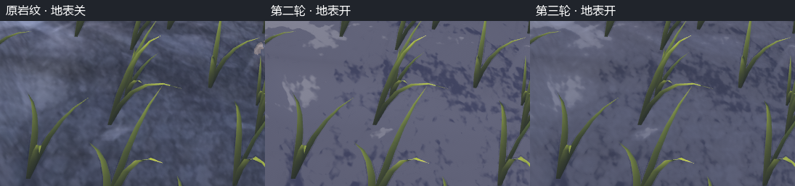

# 第三轮山麓岩纹与水云联验

联合源码 `8487a1c14f63b7f43316191327352c15dfd4967b` 含 #254 第三轮 `47a5c12` 与 #266。E–H 均沿用上一轮的玩家地面机位、朝向和傍晚时钟，在 RTX 3060 Laptop 上拍摄，原图为 1440 × 900。F 落脚点仍为 (1040.6682, 46.1294, 591.5865)，正常眼高 1.60 米。[正常 F 原图](sample-f-hillside.png)

C酱将岩色替换权重从 1.0 调至 0.55，法线压平权重从 0.8 调至 0.5。同一处岩面的大块蓝灰过渡中重新出现了局部明暗。上图原大框 (35,608)–(400,836)，三张均呈蓝灰色的 73,680 个像素中，最常见五种 RGB 的占比为 **2.98% → 36.78% → 10.28%**；不同 RGB 数分别为 3,584、1,139 和 1,778。数值只描述这个岩面裁框。

|联合机位|第二轮到第三轮任一通道差值 >8 的像素数|
|---|---:|
|E 码头，14 秒|17,047|
|F 山麓，地面以上 1.60 米|281,546|
|F 对齐 #254 历史绝对眼点，地面以上 15.379 米|115,113|
|G 铁路小路|0，整图一致|
|H 北村塔道|0，最大通道差为 2|
|E 码头，54 秒锋面阵雨|13,492|

各时点的天气、海面参数和相机姿态与第二轮相等。E 的 14 秒与 54 秒归档方便复看低云到阵雨的变化。[码头 14 秒](sample-e-harbour.png) · [码头 54 秒](storm-e.png) · [上一轮湖岸正常播放与两时点验证](../joint-r2-ground-3060-2026-11-18/README.md)

正常拍摄进程退出 0，无 JS 或 GL 错误。两条资源请求被浏览器取消；启动时另有一条 Chromium 磁盘缓存路径过长的诊断。对比使用成功保存的原生帧。[完整回执](report.json)

用装有 NumPy 和 Pillow 的 Python 运行 `python compare.py` 可复算原图哈希、同机位与各类像素计数。重拍复用上一轮的 `capture.cjs <Electron路径> <新输出目录绝对路径> on`。[复算结果](comparison.json)
