# 洗衣店连续绿篱与傍晚街景倒影

傍晚对照源码 `6e6d3eb` → `41c4fa8e5e84cc2a9e0087deb2097059a4aa95d2`。最终几何下重烘的六张 PNG 与运行时资产逐字节相同。[源码 Windows CI](https://github.com/aa15119557034/agent-review-room/actions/runs/44182317885/job/134389588171) 已通过。

## 同机位实拍

RTX 3060 Laptop / D3D11，1440×900，DPR 1。八组均为 C19 傍晚和本轮傍晚对照。位置、四元数、FOV、冻结时刻 14、AO 0.55、灯光、后期参数及 HUD 状态逐组相同。截图取每组三次中的最后一张。镇边四段让场景时钟正常运行，各约 10 秒，常规四机位和两段步行各约 3 秒。

| 机位 | C19 傍晚 | 本轮傍晚 |
|---|---|---|
| 01 站前主街 | 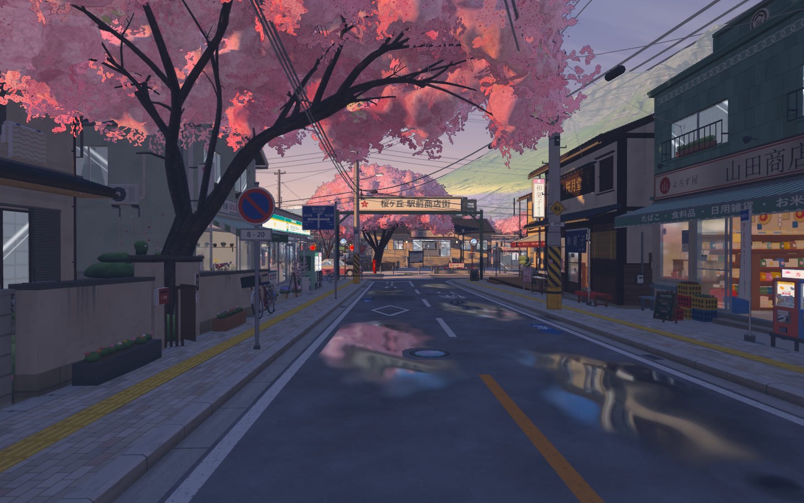 | 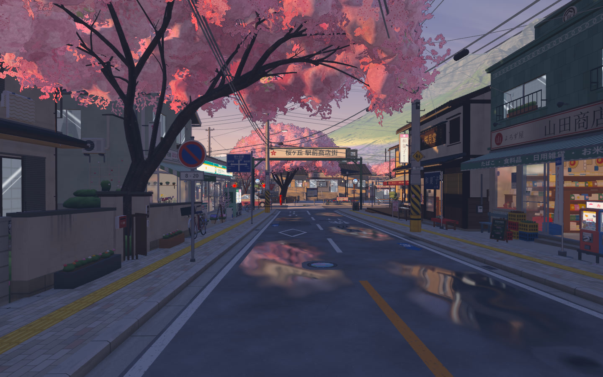 |
| 20 公寓后廊 | 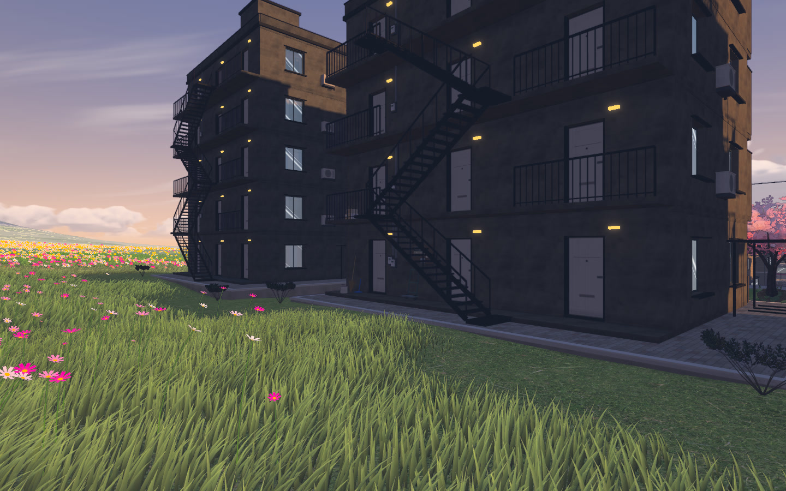 |  |
| 21 洗衣店前 | 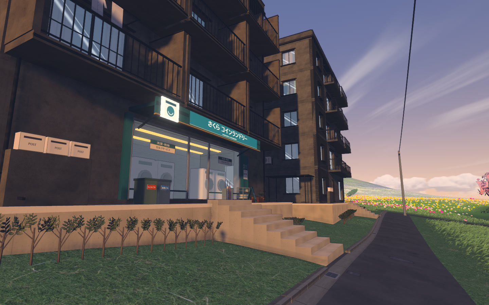 | 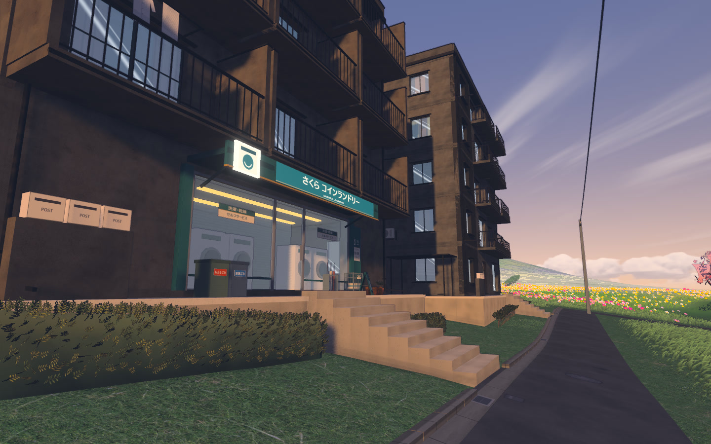 |
| 23 维修角 | 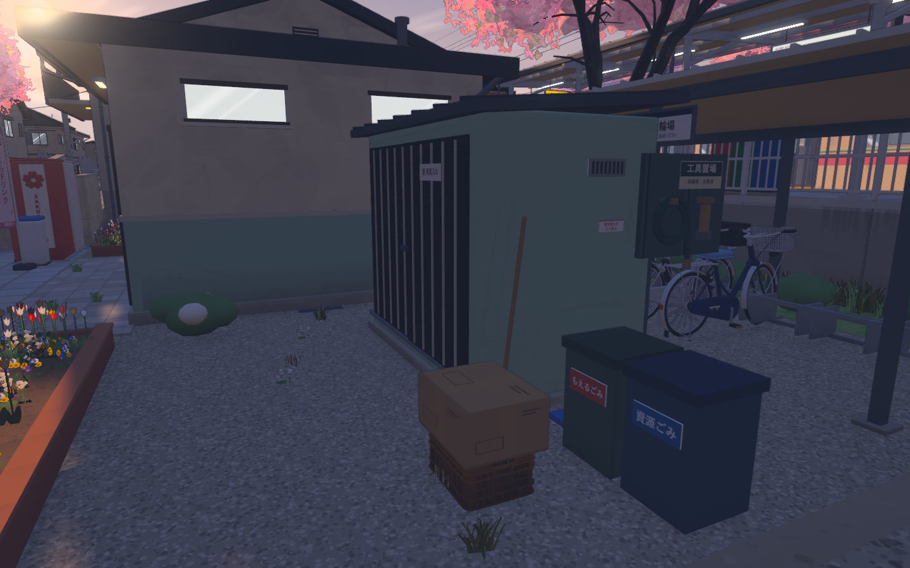 |  |
| 24 洗衣店细节 | 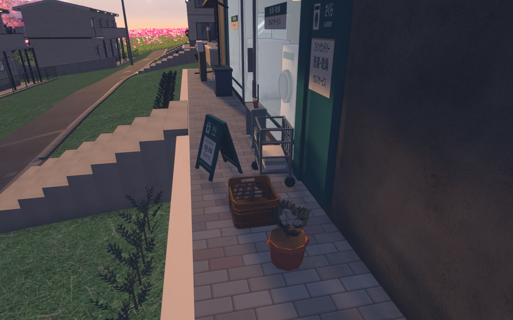 | 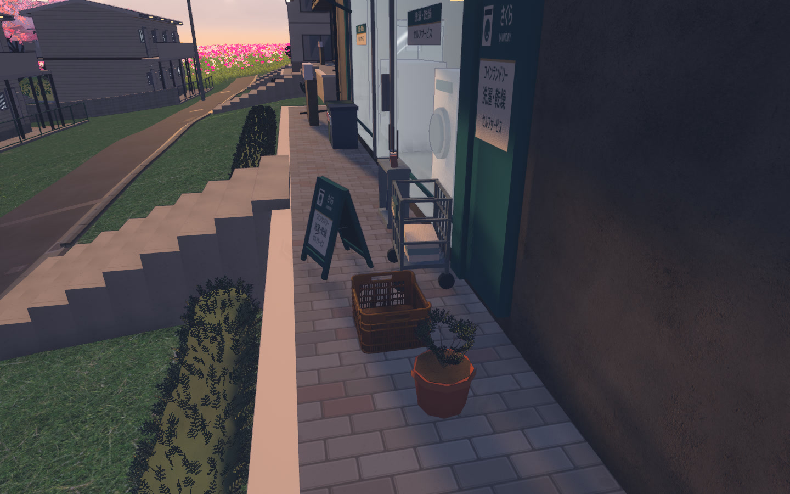 |
| 04 便利店内 | 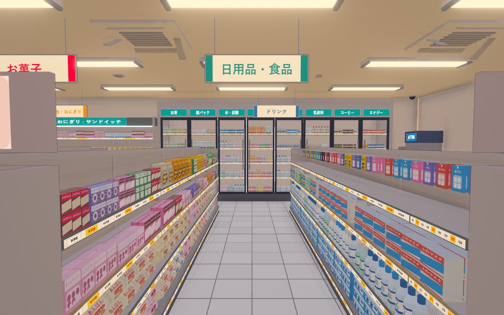 |  |
| 03 全岛鸟瞰 | 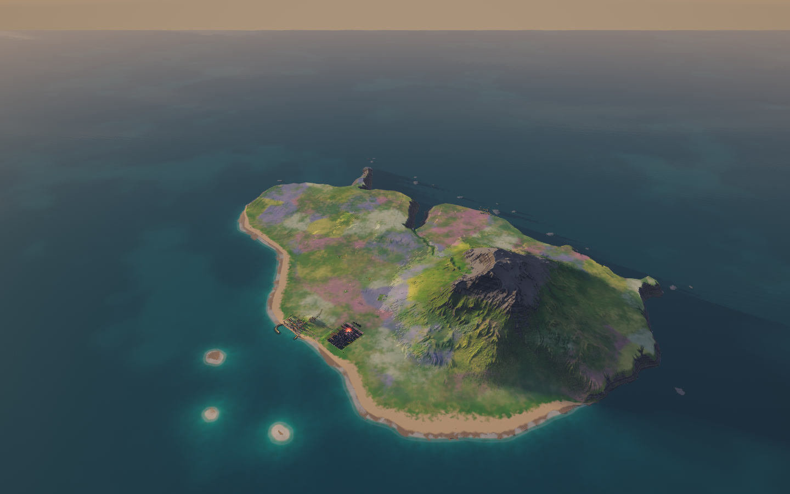 |  |
| detail 商店橱窗近景 | 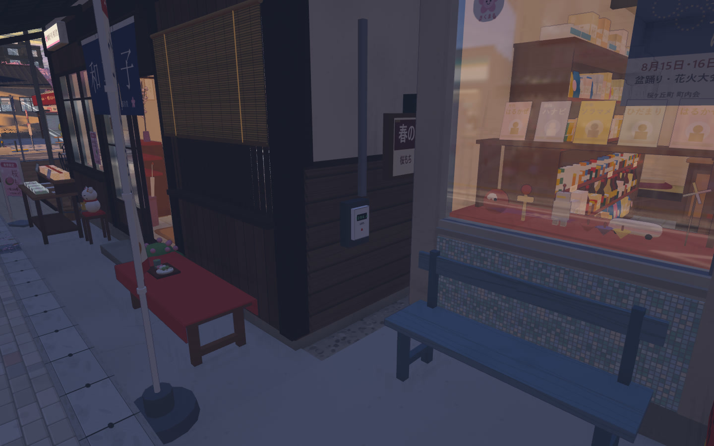 | 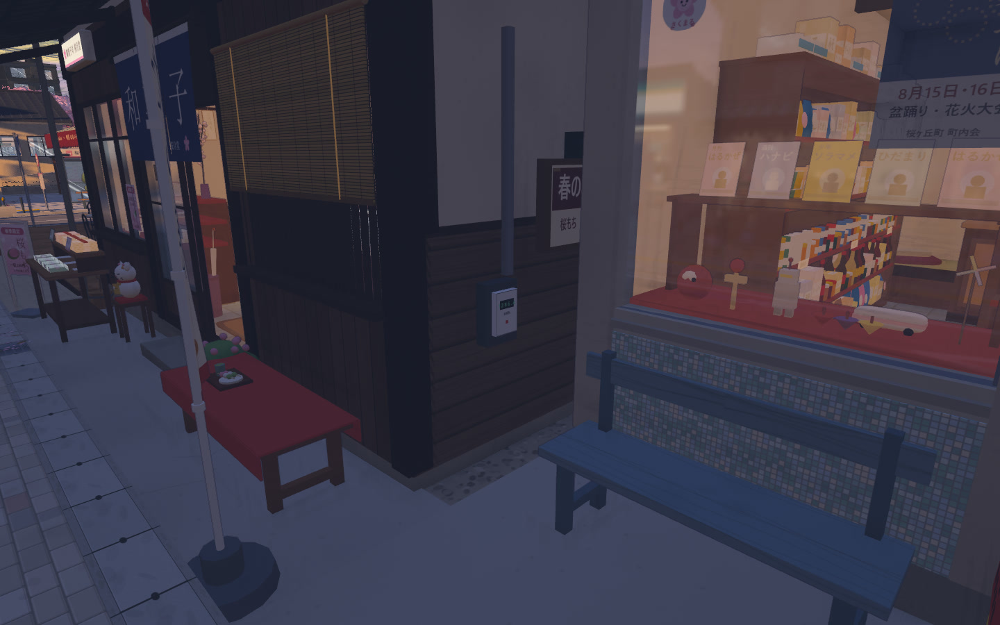 |

21 台阶两侧各有一段贴地绿墙。低处枝间能看到的挡墙已被冠层遮住，台阶开口保留。24 俯看能看到分散的叶梢。21 两段主体在离地 22、42 cm 两层每隔 5 cm 检测，共 422/422 次射线命中。镇边从 67,106 增至 80,758 个三角形，其中连续冠层 2,912 个，沿用原叶片图集。全镇 23 处植栽和六处楼梯的占地与净空检查通过。

01 近侧积水和商店橱窗已映出傍晚暖色。线性 RGB 逐像素按峰值同比例压到 2，六张 256² 图逐像素回算全部匹配。393,216 个像素中有 98 个超限，峰值从 5.03906 降到 2，其余 393,118 个在线性量化前保持原值。解码最大绝对误差 0.0076431。傍晚与下午两个实际入口分别加载各自的六面图，湿路和 27 扇橱窗共用当前时段的倒影，每帧额外捕获 0 次。

23 维修角和 04 店内的前后原始 PNG 解码像素完全相同。01 路面与橱窗近景的暖色变化可见。20 后廊的阴面以及 01 直射樱冠留给 C酱继续调光。

## 帧时

| 机位或路线 | C19 FPS | 本轮 FPS | C19 / 本轮 p95（ms） | 本轮最长（ms） | 本轮 >20 ms / 总帧 |
|---|---:|---:|---:|---:|---:|
| 20 公寓后廊 | 65.00 | 64.60 | 15.5 / 15.5 | 30.8 | 4 / 653 |
| 21 洗衣店前 | 65.00 | 65.00 | 15.5 / 15.5 | 15.6 | 0 / 657 |
| 23 维修角 | 65.00 | 64.60 | 15.5 / 15.5 | 30.8 | 4 / 653 |
| 24 洗衣店细节 | 65.00 | 65.00 | 15.5 / 15.5 | 15.6 | 0 / 657 |
| 01 站前主街 | 64.68 | 65.00 | 15.5 / 15.5 | 15.6 | 0 / 202 |
| 站区港口 | 65.00 | 65.00 | 15.5 / 15.5 | 15.6 | 0 / 203 |
| 03 全岛鸟瞰 | 63.72 | 62.77 | 15.5 / 15.5 | 30.9 | 7 / 197 |
| 04 便利店内 | 65.00 | 65.00 | 15.5 / 15.5 | 15.6 | 0 / 202 |
| 第三人称步行 | 64.68 | 64.68 | 15.5 / 15.5 | 30.8 | 1 / 203 |
| 第一人称步行 | 65.00 | 64.68 | 15.5 / 15.5 | 30.7 | 1 / 201 |

以下逐帧数据来自最终源码的第一次完整采样。此前在冠层颜色和叶片排列尚未定稿的 33b487f 上，鸟瞰曾测到 60.5 FPS、p95 30.7 ms。最终版鸟瞰有 7/197 帧超过 20 ms，最长 30.9 ms。

最终源码的截图、常规、镇边和下午入口四轮都完成渲染，均为 0 个 JS 异常。四轮因资源请求取消以 1 退出。截图为塑料筐 glTF 和 bin，常规和下午为筐的 bin，镇边还记录了 menhir 与 boulders。离线重烘实际退出 0，逐像素独立校验通过。常规行为 14/14、外观及两段步行检查通过。

## 复核数据

- [逐机位与原图散列](comparison.json) 记录世界相机和两版 JPG、PNG 的 SHA-256。
- [十段帧时](frame-times.json) 与 [压缩逐帧样本](frames/) 可复算平均 FPS、p95 和长帧。另存 [修整叶面前的诊断采样](reports/intermediate-frame-times.json)。
- [两时段实际载入的倒影、命令、行为与请求失败](runs.json)，以及 [原始 GPU 报告与源码清单](reports/)。
- [CPU 净空、冠层及资源释放记录](reports/hedge-geometry.json)。CPU 检查使用真实几何和地形，画布与图片解码由 GPU 实拍另外覆盖。
- [逐面编码核验](reports/bake-check.json) 和 [半浮点原始六面与独立校验器](hdr/)。将六个 .rgba16f.gz 与 reports/bake.json.gz 解压到临时目录，后者命名为 bake-report.json，再把 src/street-env-evening 的六张 PNG 复制进去。运行 `python verify-bake.py <临时目录> <fixture>/src/street-env`（NumPy、Pillow）。
